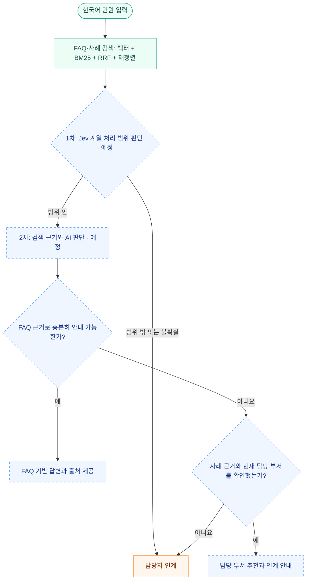

<div align="center">


# AI 민원 처리 시스템

**반복 문의에는 공식 근거를, 현장 조치에는 담당 부서 연결을.**

청주톡톡의 FAQ와 공개 민원 사례를 활용해 시민과 담당자 사이에 AI 완충지대를 만듭니다.


[빠른 시작](#빠른-시작) · [처리 흐름](#2-ai-완충지대의-처리-흐름) · [검색 구조](#3-두-rag의-역할과-검색-구현) · [개발 현황](#5-구현-현황과-mvp-순서) · [개발 하네스](docs/harness/README.md) · [상세 실행 문서](rag/README.md)

</div>

---

> [!NOTE]
> **현재 단계 · 2026-10-24 UTC**<br>
> **FAQ·사례 검색 기반 구축과 전체 데이터 적재를 완료했습니다.** 코드·DB 검증 13개와 API 검색 예제 10개가 통과했습니다. Jev 계열 처리 범위 판정과 자연어 응답, CLI 챗봇·웹 목업은 다음 단계입니다.

| 답변 근거 | 부서 추천 근거 | 현행 부서 디렉터리 | 검색 방식 |
| :---: | :---: | :---: | :---: |
| **FAQ 94건** | **공개 사례 5,015건** | **127개 부서** | **벡터 + BM25 + 재정렬** |

반복적인 절차·서류 문의는 공식 FAQ를 근거로 안내하고, 실제 조치가 필요한 민원은 공개 사례를 참고해 부서를 추천하는 것이 목표입니다. 근거가 부족하거나 판단이 불확실한 경우에는 담당자 검토 경로로 연결합니다.

## 빠른 시작

검색 서버가 실행 중이면 프로젝트 루트에서 바로 사용할 수 있습니다. 검색 CLI는 Python 표준 라이브러리로 API에 연결합니다.

```bash
# 적재 건수와 검색 서버 상태
python3 -m rag status

# 공식 FAQ에서 안내 근거 검색
python3 -m rag search '대형폐기물 배출 방법이 궁금합니다' --collection faq

# 유사 사례에서 부서 후보 검색
python3 -m rag search '711번 버스가 정류장에 서지 않고 지나갔습니다' --collection routing
```

<details>
<summary><strong>처음 설치하는 경우 — Docker Compose로 실행</strong></summary>

Docker와 Docker Compose가 필요합니다. 비공개 저장소 접근 권한이 있는 GitHub 계정으로 복제합니다.

```bash
git clone https://github.com/hy040504/ai-complaint-process.git
cd ai-complaint-process

# 파일 생성 후 POSTGRES_PASSWORD를 로컬 DB 비밀번호로 설정
test -f .env || cp .env.example .env

docker compose up -d postgres
docker compose build rag
docker compose run --rm rag ingest
docker compose up -d --wait rag
```

첫 적재는 모델 다운로드와 벡터 생성으로 시간이 걸립니다. 모델과 DB는 로컬에 저장하며 외부 유료 추론 API 키가 필요하지 않습니다. [상세 설치·갱신·검증 방법](rag/README.md)

</details>

<details>
<summary><strong>API로 연결하는 경우</strong></summary>

| 항목 | 서버 로컬 주소 |
| --- | --- |
| 검색 API | `http://127.0.0.1:8007/search` · POST |
| API 문서 | `http://127.0.0.1:8007/docs` |
| 상태 확인 | `http://127.0.0.1:8007/health` |
| 부서 조회 | `http://127.0.0.1:8007/departments` |

현재 API는 검색 근거와 출처, 부서 검증 상태를 반환합니다. 모든 검색 응답의 `decision`은 후속 판정을 요구하는 `requires_gate`입니다.

</details>

## 문서 안내

| 문서 | 확인할 내용 |
| --- | --- |
| [저장소 작업 지침](AGENTS.md) | 사람·AI 개발 도구가 유지할 경계, 작업 위치, 완료 조건 |
| [개발 하네스](docs/harness/README.md) | 시스템 구조·데이터 계약·판정 정책·평가·운영 절차 |
| [하네스 보완과 MVP 실행 계획](plan/harness-roadmap.md) | 다음 작업 순서, 완료 조건, 결정·미정 사항 |
| [RAG 실행 문서](rag/README.md) | 설치·적재·검색·모델·검증 결과 |
| [데이터 사전](db/README.md) | 원본 JSON 필드, 수집·정규화 기준 |
| [AI 민원 계획서 분석](plan/민원AI_계획서_상세분석.md) | 프로젝트 배경과 전체 서비스 구상 |
| [VoteLab 상세 기획안 분석](plan/VoteLab_AI민원_상세기획안_상세분석.md) | 역할·화면·TAXO·장기 구현 명세 |

---

## 1. 지금까지 결정한 방향

| 항목 | 결정 내용 |
| --- | --- |
| 목적 | 담당자가 직접 처리하던 반복 문의를 AI가 먼저 응대하고, 필요한 민원을 사람에게 연결 |
| 자주 묻는 민원 | **답변용 RAG**의 근거. FAQ 내용과 적용 조건으로 충분히 안내할 수 있는 문의에 응답 |
| 공개 민원 사례 | **부서 추천용 RAG**의 근거. 유사 민원의 내용과 처리 이력으로 담당 부서 후보 판단 |
| 처리 범위 밖 | 두 데이터로 뒷받침하기 어렵거나 확신이 부족하면 담당자에게 인계 |
| 1차 판단 | **Jev**로 데이터 범위에 해당하는지 판단하는 방식을 우선 실험 |
| 입력 언어 | **한국어 원문을 Jev에 직접 전달**. Papago 번역 경유 방식은 추후 비교 |
| 모델 비용 | 가능한 무료 모델을 우선 검토. 검색 모델은 로컬 공개 모델을 사용하고, Jev 계열 판별 모델은 미선정 |
| 검색 기술 | PostgreSQL + pgvector, 한국어 BM25, RRF, 재정렬 모델 |
| 부서 데이터 | 변경 전 표기와 현재 부서를 구분하고, 미확인 부서는 명시적으로 검토 대상 처리 |
| 시연 순서 | **1차 CLI 챗봇 → 2차 웹 목업** |

FAQ 안내로 해결할 수 있는 질문과 현장 조치·행정 판단이 필요한 민원을 구분합니다. FAQ가 검색되더라도 시민이 실제 단속·보수·처분 등을 요청한다면 안내만으로 처리 완료로 판단하지 않습니다.

## 2. AI 완충지대의 처리 흐름

아래는 구현할 업무 흐름입니다. 현재 구현한 검색으로 근거를 준비하고, 이후 처리 범위 판정과 답변·부서 추천을 연결합니다. 판정과 자연어 응답 단계는 아직 구현하지 않았습니다.



1차의 `True`는 **후속 검토가 가능하다**는 뜻이며, AI가 답변까지 완료할 수 있다는 뜻은 아닙니다. FAQ 근거가 충분한지와 부서 추천 근거가 충분한지는 따로 판단합니다. 범위 밖이라는 이유로 민원을 거절하는 대신 담당자 검토 경로로 연결합니다.

### Jev에 맡길 역할

Jev는 TypeSafe가 제공하는 구조화된 판단 모델입니다. 입력 상태와 질문을 받아 코드에서 사용할 판단값을 반환하므로, 이번 프로젝트에서는 처리 범위 판단에 사용할 예정입니다. 시민에게 보여 줄 자연어 답변은 별도의 응답 모델과 FAQ 근거로 구성합니다. [TypeSafe 공식 소개](https://docs.typesafe.ai/introduction)

Jev가 두 JSON의 내용을 미리 알고 있다고 가정하지 않습니다. 구현한 검색 API가 **FAQ·사례 후보, 원문, 출처, 부서 검증 상태**를 제공합니다. 이를 민원과 함께 판별 모델에 전달하는 연결을 진행할 예정입니다. 공식 Jev와 무료 공개 대체 모델 중 선택, 질문 구성, 출력과 서비스의 `True`/`False`를 연결하는 기준은 아직 확정하지 않았습니다.

한국어 입력의 판정 정확도와 응답 시간은 실제 민원 평가셋으로 확인합니다. Papago를 거친 영어 입력이 더 빠르거나 정확하다는 가정은 두지 않으며, 번역 비교는 한국어 기준 성능을 측정한 뒤 진행합니다.

## 3. 두 RAG의 역할과 검색 구현

한 PostgreSQL DB의 `complaint_rag` 스키마 안에 **답변용 `faq_knowledge`, 부서 추천용 `routing_cases`, 부서 확인용 `department_directory`**를 분리했습니다. FAQ와 사례는 각각 검색하고 순위를 계산합니다.

| 구분 | FAQ RAG | 공개 민원 사례 RAG |
| --- | --- | --- |
| 목표 | 적용 가능한 절차·서류·이용 방법 안내 | 민원 내용에 맞는 담당 부서 후보 추천 |
| 현재 자료 | FAQ 94건 | 공개 사례 5,015건 |
| 색인 단위 | FAQ 한 건 | 민원 사례 한 건 |
| 검색 텍스트 | 업무명·분류·상세 안내·대상·접수 조건·기간·주의사항 | `title` + `summary`. 요지가 없으면 제목 |
| 함께 확인할 정보 | 대상자·접수처·처리기간·주의사항·분류 | 과거 답변·현재 부서·관할·정규화 상태 |
| 결과 | 근거를 인용한 안내 | 부서 후보와 추천 근거 |
| 근거 부족 시 | 담당자 인계 | 담당자 인계 |

FAQ는 원문 한 건의 안내와 조건을 함께 임베딩하고, 결과에 전체 원문을 반환합니다. 재정렬 입력이 길면 겹치는 창으로 모든 내용을 평가합니다.

공개 사례의 `resolution`은 당시 처리 맥락을 이해하는 자료입니다. 과거 답변을 현재 시민에게 그대로 적용하거나, 이를 FAQ의 일반 안내 근거처럼 사용하지 않습니다. 부서 추천에는 `department_current`를 사용하고 관할 구청과 업무 조건을 함께 확인합니다.

| 구성 | 현재 구현 |
| --- | --- |
| 벡터 저장소 | PostgreSQL 17 + pgvector 0.8.1, cosine/HNSW |
| 데이터 분리 | FAQ·공개 사례·부서 디렉터리 별도 테이블 |
| 임베딩 모델 | 무료 공개 `BAAI/bge-m3`, 1024차원, 모델 리비전 고정 |
| 키워드 검색 | Kiwi 형태소 분석 + PostgreSQL에서 BM25 계산, 두 자료의 통계를 분리 |
| 결합 | 벡터 30건 + BM25 30건 → RRF(`k=60`) |
| 재정렬 | `BAAI/bge-reranker-v2-m3`, 상위 20건 평가 후 기본 5건 반환 |
| 판정 기준 | 미구현. 검색 점수를 자동 답변·이관 가능 확률로 취급하지 않음 |
| 응답 모델 | 미선정. 현재 결과는 원문 근거와 부서 후보이며 자연어 답변 생성은 다음 단계 |

색인 식별자는 데이터 종류와 `source_id`입니다. 사이트 표시 번호인 `id`는 고정 문서 키로 사용하지 않습니다. 검색 결과는 항상 `retrieval_only=true`, `decision="requires_gate"`를 반환합니다.

부서 디렉터리는 사례에서 현행 이름을 확인한 **127개 부서**를 담습니다. 내부 ID와 별칭을 부여하지만, 두 JSON에 없는 공식 업무분장은 `null`/`unverified`로 남깁니다. 구 정보도 이름에서 추출한 값이므로 실제 업무 관할 확인이 필요합니다. 27개 검토 대상 사례는 검색에는 남기되 부서 후보 확정 근거에서 제외합니다. [상세 구조와 실행](rag/README.md)

## 4. 현재 데이터와 정리 결과

데이터 수집·조직도 대조 기준일은 **2026-10-24 UTC**입니다. JSON 필드별 설명과 예시는 [db/README.md](db/README.md)에 있습니다.

| 자료 | 파일 | 규모 | 원문 |
| --- | --- | ---: | --- |
| 자주 묻는 민원 | [자주_묻는_민원.json](db/자주_묻는_민원.json) | 94건 / 14개 분야 키 | [청주톡톡 FAQ](https://toktalk.cheongju.go.kr/home/sub.do?menukey=7403) |
| 공개 민원 사례 | [공개_민원_사례.json](db/공개_민원_사례.json) | 5,015건 | [청주톡톡 공개 사례](https://toktalk.cheongju.go.kr/home/sub.do?menukey=7401) |

공개 사례의 신청일은 **2023-05-10~2026-10-22**, FAQ의 등록일은 **2023-03-30~2023-04-22**입니다. `source_url`로 원문을 추적하고 `retrieved_at`으로 상세 페이지 확인 시각을 기록합니다. **수집일은 원문 수정일이 아니며, 새로 수집했다고 안내 내용의 현행성이 보장되는 것은 아닙니다.**

### 부서 정규화

청주시 [공식 조직도](https://www.cheongju.go.kr/www/contents.do?key=7431)와 [조직개편 심의 기록](https://councilrec.cheongju.go.kr/minutes/svc/web/cms/mnts/SvcMntsViewer.php?schSn=3980)을 대조해 확인된 표기를 정리했습니다.

| 항목 | 반영 결과 |
| --- | --- |
| 대중교통과 | 앞서 공개 사례 359건을 `건설교통국 대중교통과`로 통일. 기존 자료와 합쳐 919건 |
| 공개 사례 추가 정리 | 부서 표기 505건 변경. 부서 표기 종류 145종 → 129종 |
| FAQ 접수처 | 앞서 대중교통과 2건 정리, 이후 기업지원과·균형건설과 등 13건 추가 정리 |
| 지역 구분 | 상당구·서원구·흥덕구·청원구의 같은 이름 과는 별도로 유지 |
| 현재 부서 확인 필요 | 미래산업과 계열 10건 + 과거 안전정책과 17건 = **27건** |

공개 사례에는 다음 필드를 저장합니다.

| 필드 | 사용할 의미 |
| --- | --- |
| `department` | 정규화한 표시 이름. 과거 부서도 포함 |
| `department_original` | 이번 정규화 직전 값. 이후 상세 재수집에서는 사이트 표기를 보존 |
| `department_current` | 확인된 현재 부서명. 확인이 필요한 항목은 `null` |
| `department_status` | `current` / `normalized` / `renamed` / `review_required` |
| `department_checked_on` | 정규화 기준 확인일. 현재 `2026-10-24` |

`department_current: null` 또는 `department_status: "review_required"`인 사례는 자동 이관 부서의 확정 근거로 사용하지 않습니다. `current`도 현재 조직도에서 부서를 식별했다는 뜻으로, 개별 민원의 현행 관할까지 확정했다는 뜻은 아닙니다.

FAQ는 변경 전 접수처를 `detail.received_by_original`에 보존하고, `detail.received_by`의 확인된 부서명만 정리했습니다. 층수·연면적 조건, 여러 접수기관, 온라인·방문·팩스 경로는 보존했습니다.

이전에 이미 통일한 대중교통과 표기는 당시 변경 전 원문을 복원한 값이 아닙니다. 이후 상세 재수집부터 사이트 표기를 기록합니다. 부서 규칙의 확인일은 수집기를 재실행해도 자동 갱신되지 않으므로 조직개편 시 별도로 검토해야 합니다.

### 자동 답변·이관 연결 전에 확인할 데이터

- 현재 부서 확인이 필요한 27건의 업무별 담당 부서를 대조합니다.
- 공개 사례의 `summary`가 빈 58건은 제목으로 검색하고, `resolution`이 빈 101건도 보존합니다. 두 건수는 서로 겹칠 수 있으며 검색 품질을 별도로 확인합니다.
- 부서 디렉터리에 공식 업무분장·관할 근거를 보완합니다. 현재 127개 부서 모두 업무분장 미검증 상태입니다.
- FAQ의 정책·접수팀·연락처·적용 조건을 검토합니다. 부서 표기 정리와 FAQ 답변 내용의 최신성 검증은 별도 작업입니다.
- FAQ 답변 가능, 부서 추천 가능, 범위 밖, 부서 불명확 사례를 포함한 한국어 평가셋을 준비합니다.

## 5. 구현 현황과 MVP 순서

| 단계 | 내용 | 상태 |
| --- | --- | --- |
| 자료 정리 | `/plan`에 계획서, `/db`에 데이터 배치 | 완료 |
| 데이터 수집 | 두 JSON 갱신, 원문 URL·고정 식별자·수집 시각 보강 | 완료 |
| 부서 정규화 | 원래 표기 보존, 현재 부서 구분, 수집기 공통 규칙 적용 | 완료 · 27건 검토 필요 |
| 검색 구성 | 두 목적의 벡터/BM25 검색, RRF, 재정렬, 부서 디렉터리, 검색 CLI/API | 구축·전체 적재·검색 예제 검증 완료 |
| 개발 하네스 문서 | 작업 규칙·구조·데이터 계약·판정 초안·평가·운영·실행 계획 | 기본 문서 구성 완료 · 판정 러너·CI는 미구현 |
| AI 판정·응답 | Jev 계열 한국어 판별, FAQ 근거 기반 자연어 답변 | 예정 |
| **1차 MVP** | **CLI 챗봇**에서 민원을 입력하고 답변·부서 추천·담당자 인계 결과 시연 | 예정 |
| **2차 MVP** | **청주톡톡과 비슷한 웹 목업**에서 같은 처리 흐름 시연 | 예정 |

1차 CLI에서는 민원 내용에 따라 **FAQ 답변 / 부서 추천 / 담당자 인계**를 구분하고, 답변이나 추천에 사용한 출처를 함께 보여 주는 것을 목표로 합니다. 웹 목업은 이 흐름을 화면으로 옮기는 단계입니다. 실제 행정 시스템 접수·이관 연계는 별도 개발 범위입니다.

현재 검색 CLI는 근거와 부서 후보를 JSON으로 출력합니다. 대화하며 최종 답변·인계를 결정하는 1차 MVP 챗봇과는 구현 범위를 구분합니다. 이후에는 검토 대상 데이터·한국어 평가셋 보완 → 판별·응답 모델 연결 → CLI 챗봇 평가 → 웹 목업 순으로 진행합니다. 목표 수치와 임계값은 아직 정하지 않았습니다.

## 6. 저장소 구조

```text
ai-complaint-process/
├── README.md                        # 프로젝트 목적·결정 사항·진행 상태
├── AGENTS.md                        # 저장소 작업 규칙·검증·완료 조건
├── compose.yaml                     # PostgreSQL/pgvector + 검색 API
├── docs/
│   ├── assets/                      # README 소개 배너
│   └── harness/                     # 구조·계약·판정 초안·평가·운영 문서
├── rag/                             # 적재·벡터/BM25·RRF·재정렬·CLI/API·검증
├── db/
│   ├── README.md                    # 데이터 스키마·정규화 규칙·갱신 방법
│   ├── 자주_묻는_민원.json            # 답변 근거 데이터
│   └── 공개_민원_사례.json            # 부서 추천 근거 데이터
├── plan/                            # 원본 계획서·분석·하네스/MVP 실행 계획
└── PACKET/
    ├── scrape_faq.py                # FAQ 수집
    ├── scrape_public_cases.py       # 공개 사례 수집
    ├── department_normalization.py  # 공통 부서 정규화 규칙
    ├── 자주 묻는 민원.saz             # HTTP 요청·응답 캡처
    └── 공개 민원 사례.saz             # HTTP 요청·응답 캡처
```

원본 패킷 캡처(`.saz`)에는 쿠키가 포함되어 로컬 참고 자료로 보관합니다. GitHub에는 수집 코드·정규화 규칙·두 JSON·계획서와 검색 구현을 업로드하며, `.env`·모델 캐시·실행 DB도 Git에서 제외합니다.

## 7. 현재 실행할 수 있는 작업

검색 서버의 최초 설치와 데이터 적재는 [검색 실행 문서](rag/README.md)를 따릅니다. 실행 중인 서버에는 다음과 같이 검색할 수 있습니다.

```bash
python3 -m rag status
python3 -m rag search '소파를 버리는 방법이 궁금합니다' --collection faq
python3 -m rag search '711번 버스가 정류장에 서지 않고 지나갔습니다' --collection routing
```

데이터 수집·정규화 도구는 Python 3 표준 라이브러리를 사용합니다. 아래 명령은 프로젝트 루트에서 실행합니다.

FAQ 전체를 다시 수집합니다.

```bash
python3 PACKET/scrape_faq.py
```

공개 사례는 전체 목록을 확인하고 새 게시물의 상세를 수집합니다. 목록에서 사라진 게시물은 결과에서 제외합니다.

```bash
python3 PACKET/scrape_public_cases.py
```

기존 공개 사례의 답변 수정까지 반영하려면 전체 상세 갱신을 실행합니다.

```bash
python3 PACKET/scrape_public_cases.py --refresh-all
```

사이트 재수집 없이 기존 JSON에 등록된 부서 규칙만 적용할 수도 있습니다.

```bash
python3 PACKET/department_normalization.py
```

수집기는 `source_id`로 게시물을 식별합니다. 공개 사례 수집 중에는 `.partial` 체크포인트를 저장하고, 완료된 결과로 원본을 교체합니다. 두 수집기 모두 공통 부서 규칙을 적용합니다. 상세 옵션은 각 명령의 `--help`로 확인할 수 있습니다.

최근 정규화에서는 **5,015건·94건의 본문과 출처 보존, 구청별 부서 구분, 재실행 결과 동일성, 수집 파서와 저장 함수 연결**을 검증했습니다. 검색 구현의 검증 명령과 결과는 [검색 문서](rag/README.md)에 정리합니다. Jev 계열의 한국어 판정 성능은 별도 평가가 필요합니다.

## 8. 원래 계획서와 현재 MVP의 관계

원래 계획서는 시민 상담·정식 접수·담당 부서 배정·처리 진행상황·담당자 화면·알림까지 연결하는 시스템을 다룹니다. 현재는 그 앞단인 **AI 1차 응대와 담당자 연결**을 먼저 시연합니다.

상세 기획안은 TAXO 분류 사전과 규칙에 따른 배정, 사람의 정식 답변 승인을 전제로 합니다. 현재 검토하는 Jev는 처리 범위 판단, 공개 사례 RAG는 부서 추천에 사용하는 방향입니다. 운영 단계에서 TAXO·현행 업무분장·사람 검토와 결합하는 방식은 추가 설계가 필요합니다.

| 문서 | 내용 |
| --- | --- |
| [AI 민원 프로세스 계획서 분석](plan/민원AI_계획서_상세분석.md) | 사업 배경, AI 완충지대, 전체 서비스 구상 |
| [VoteLab 상세 기획안 분석](plan/VoteLab_AI민원_상세기획안_상세분석.md) | 역할·화면·업무 상태·TAXO·API 등 장기 구현 명세 |
| [데이터 문서](db/README.md) | 현재 JSON 필드, 부서 정규화 결과, 수집·갱신 규칙 |

계획서의 기술 스택·일정·성능 목표는 원래 기획의 제안입니다. 이 README의 확정 사항, 검토안, 구현 현황을 구분해 현재 개발 범위를 파악합니다.
