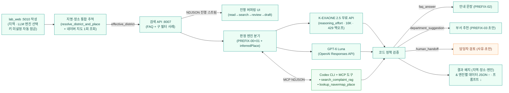
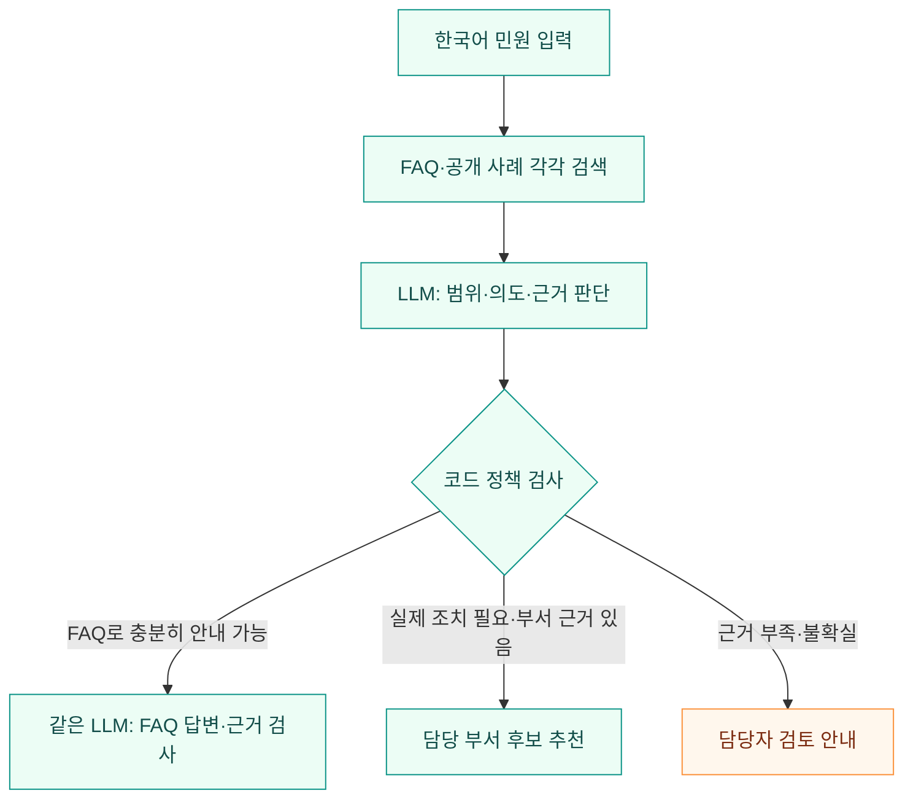
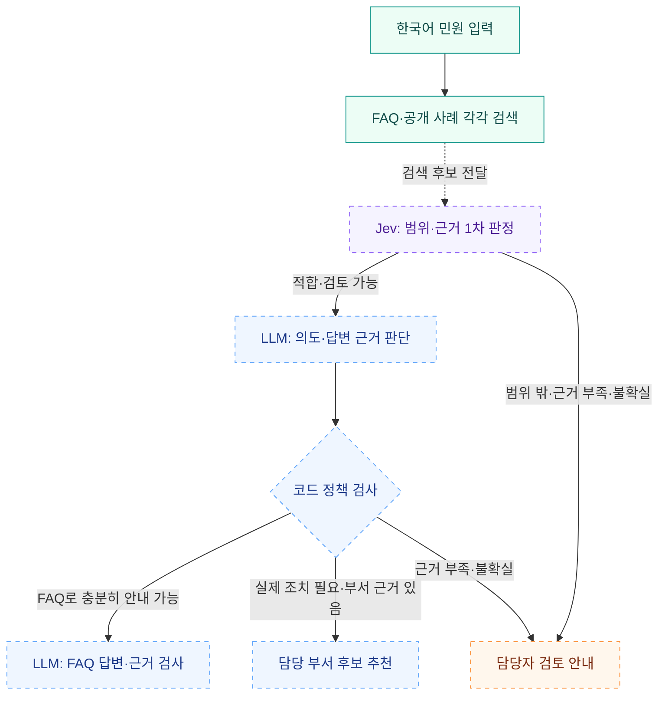
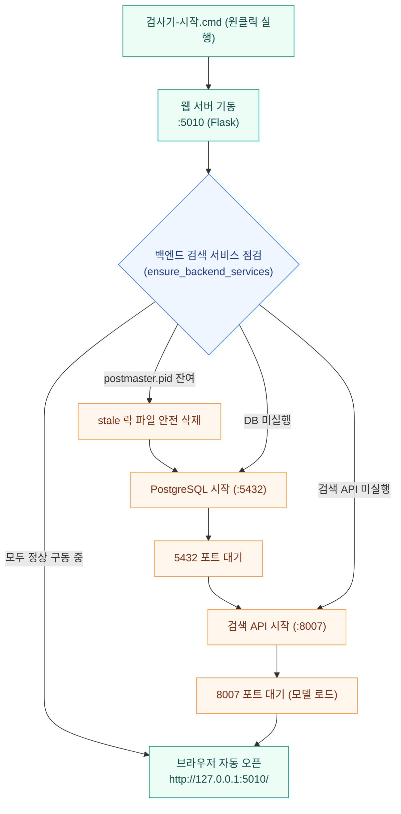

<div align="center">


# AI 민원 처리 시스템

**반복 문의에는 공식 근거를, 현장 조치에는 담당 부서 연결을.**  
청주톡톡의 FAQ(`94건`)와 공개 민원 사례(`5,015건`)를 분리 검색해 시민과 담당자 사이의 **AI 완충지대**를 구성합니다.

<p>
  <a href="#현재-구현-상태"></a>
  <a href="src/README.md"></a>
  <a href="src/lab_web/README.md"></a>
  <a href="src/lab_web/README.md"></a>
  <a href="#응대-검사기"></a>
</p>
<p>
  <a href="#k-exaone-25-api-및-추론-파라미터-설정-env"></a>
  <a href="src/README.md"></a>
  <a href="#응대-검사기"></a>
  <a href="docs/harness/prompts/README.md"></a>
  <a href="#저장과-검색"></a>
  <a href="#exaone-tabular-모델의-후속-추가-위치-구상"></a>
</p>
<p>
  
  <a href="#저장과-검색"></a>
  <a href="ui/README.md"></a>
  <a href="src/README.md"></a>
  <a href="docs/청주톡톡_민원_업무_API_Swagger.pdf"></a>
  <a href="#검증-근거"></a>
  <a href="#검증-근거"></a>
  <a href="docs/report/README.md"></a>
  <a href="#현재-구현-상태"></a>
</p>

**[구현 현황](#현재-구현-상태)** • **[응대 검사기](#응대-검사기)** • **[DB와 검색](#저장과-검색)** • **[K-EXAONE 설정](#k-exaone-25-api-및-추론-파라미터-설정-env)** • **[업무 보고서](docs/report/README.md)** • **[Tabular 구상](#exaone-tabular-모델의-후속-추가-위치-구상)** • **[빠른 시작](#빠른-시작)** • **[LLM 하네스](docs/harness/LLM_완충지대_하네스.md)** • **[문서 목차](docs/README.md)** • **[변경 이력](CHANGELOG.md)**

</div>

---

> [!IMPORTANT]
> **브랜치 `llm` · GitHub 기본 브랜치 · 민원 웹(`:5000`) + 응대 검사기(`:5010`)**<br>
> 민원 웹(`python -m src`, `:5000`)의 시민·담당자 포털과 `#/lab`에 응대 검사기(`:5010` `src/lab_web`)의 RAG+LLM(`K-EXAONE 2.5` · `Codex CLI` · `GPT-6 Luna` 가드) 및 지명/네이버 지도 장소 추적(`resolve_district_and_place`)을 비동기 워커로 통합했습니다. 전체 웹(`:5000`·`:5010`)에 라이트·다크 테마(다크 전용 투명 청주시 로고·차분한 호버), 시민 본인 민원 영구 삭제, 담당자 청주시 127개 부서 배정 및 커스텀 답변 템플릿 CRUD, `:5010` 기록 클릭 시 입력 폼 자동 복원을 지원하며, 시민 응답 비공개 경계와 `automaticTransfer=False` 원칙을 지킵니다. [CASE-093](docs/cases/사례-093-민원웹-CRUD-검사기-LLM-RAG-실시간통합-2026-11-15.md) · [CASE-094](docs/cases/사례-094-다크테마-청주시로고-호버-검사기UI-담당자폰트-시민민원삭제-2026-11-16.md) · [CASE-095](docs/cases/사례-095-담당자-부서배정-및-답변템플릿-추가삭제-2026-11-16.md) · [CASE-097](docs/cases/사례-097-단독검사기-5010-청주한정-112건-실증테스트와-한계식별-2026-11-17.md) · [CASE-098](docs/cases/사례-098-검사기-기록-폼복원과-업무보고-전용폴더-통합-2026-11-17.md) · [`src/`](src/README.md) · [`src/lab_web`](src/lab_web/README.md) · [`ui/`](ui/README.md)

> [!NOTE]
> **현재 구현 요약 (`2026-11-17 KST` 기준)**
>
> - **민원 웹 · 업무 DB (`:5000`):** 시민(`#/citizen`·`#/citizen/write`·`#/citizen/mine`·`/design/ui04`) 본인 민원 수정·철회·영구 삭제(`POST /complaints/{id}/delete`), 라이트/다크 전용 투명 청주시 로고·서비스 SVG 12종·차분한 `:hover`, 담당자 포털(`#/staff`) 확대 타이포그래피·`AI 추천 후보`/`유사 사례 참고` 분리·청주시 127개 현행 부서 배정(`GET /departments` · `PUT /complaints/{id}/assignment` · AI 추천 칩) 및 커스텀 답변 템플릿 CRUD(`answer_templates`), PostgreSQL `complaint_app` 4테이블 저장 및 비동기 RAG+LLM 워커(1.5초 폴링)
> - **양쪽 응대 검사기 (`:5010` 및 `:5000/#/lab`):** 시민 UI 기준 디자인 통일, `:5010` 다크/라이트 토글(`minwon-ui-theme` 공유), 4종 엔진 선택/잠금(`.env 기본` 엔진명 표시), 4개 구·98개 읍·면·동 선택 및 장소 추적(`📍 발생 지역` · `🗺️ 장소 추적` · `🤖 LLM 엔진`), 엔진별 보낸 데이터(JSON ↑)·프롬프트 전문(↓), 원시 `(업무분장: unverified, 관할: inferred_from_name · 자동 이관 아님)` 테스트 전용 유지, **`:5010` 테스트 기록 클릭 시 제목·분야·지역·엔진·상세 내용·글자 수 폼 자동 복원(`fillComplaintForm`)**
> - **LLM · 429 안정화 · MCP · 보고:** `K-EXAONE 2.5` (`EXAONE_URL`/`EXAONE_MODEL` 격리, `EXAONE_REASONING_EFFORT`, `EXAONE_MAX_TOKENS` 16384), `http_json` 429(`retry-after-ms`/`retry-after` 백오프 2회·일일 한도 즉시 중단) 및 연쇄 실패 차단, `Codex CLI` MCP (`search_complaint_rag` · `lookup_navermap_place`), `PREFIX-00~04`, **업무보고 전용 폴더 [`docs/report/`](docs/report/README.md) 일괄 관리(11/04~11/16 PDF 5종)**
> - **후속 확장:** `openai_api` `cached_tokens` 실측(키 필요), 시민 챗봇 실연동·담당자 SSE 실시간 푸시, 운영 본인·담당자 인증, `CASE-097`에서 식별한 욕설·지명 한계 3건 보완, [`EXAONE Tabular`](#exaone-tabular-모델의-후속-추가-위치-구상) 예측 모델, 공식 행정 이관

| 지금 됨 (`:5000` 민원 웹) | 응대 검사기 (`:5010` / `#/lab`) | 아직 (후속) |
| --- | --- | --- |
| 시민 등록·수정·철회·영구 삭제, 다크 투명 로고·SVG·호버 | 시민 UI 디자인 정돈 · `:5010` 다크 모드 토글 (`minwon-ui-theme` 공유) | 담당자 실시간 SSE 푸시 · 시민 챗봇 실연결 |
| 담당자 127개 부서 배정·커스텀 답변 템플릿 추가/삭제/복원 | 엔진 선택(`K-EXAONE 2.5`·`GPT-6 Luna`·`Codex CLI`) · 키 미설정 자동 잠금 | 운영 본인·담당자 인증 · `openai_api` 키 실측 |
| 비동기 RAG+LLM 워커·`aiAssist`·초안 보호, `complaint_app` 4테이블 | 4구/98 읍·면·동·장소추적 → 검색 → `PREFIX-00~04` · 데이터 ↑·프롬프트 ↓ | `EXAONE Tabular` · 7테이블 정규화 · 공식 행정 이관 |


| 화면 | 주소 | 실행 |
| --- | --- | --- |
| 환경 준비 | 가상환경·PostgreSQL·임베딩 모델 | Windows [`setup.cmd`](setup.cmd) · Linux [`setup.sh`](setup.sh). `--check`는 설치 없이 확인 |
| 응대 검사기 웹 | `http://127.0.0.1:5010/` | 검색 후 판정. Windows [`검사기-시작.cmd`](검사기-시작.cmd)(PostgreSQL·검색 API 원클릭 자동 기동) · Linux [`start-lab.sh`](start-lab.sh) |
| 기존 시연 Flask | `http://127.0.0.1:5000/#/citizen` (및 `/#/staff`, `/#/lab`, `/design/ui04`) | 민원 CRUD·UI04 목업 어댑터 서버. 이 브랜치 기본 검사기는 `:5010` |
| 민원 응대 | [`민원-응대.cmd`](민원-응대.cmd) · [`ask-assist.sh`](ask-assist.sh) | 꺼진 localhost 검색 API는 자동 시작, 기본 재정렬 끔 |
| 문장 임베딩 | [`문장-임베딩.cmd`](문장-임베딩.cmd) · [`embed-sentence.sh`](embed-sentence.sh) | 벡터 출력 뒤 FAQ·사례 pgvector 이웃. `--raw`는 숫자만 |
| RAG 기동 | [`검색-시작.cmd`](검색-시작.cmd) · [`start-search.sh`](start-search.sh) | Windows는 PostgreSQL·검색 API를 별도 창. Linux는 `:8007` 검색 API |
| API 문서 | `http://127.0.0.1:5000/docs` | [Flask 설치](src/README.md) · [Swagger PDF](docs/청주톡톡_민원_업무_API_Swagger.pdf) |
| 업무 보고서 | [11/16 업무보고 PDF](docs/report/업무보고_20261116.pdf) · [11/11 PDF](docs/report/업무보고_20261111.pdf) · [모음(`docs/report/`)](docs/report/README.md) | 11/16 종합 보고서 및 일자별 업무보고 PDF · [`업무보고_20261116_pdf_생성.py`](scripts/업무보고_20261116_pdf_생성.py) |
| 테스트 보고서 | [112건 상세 분석 (MD](docs/test/청주_민원_112건_상세분석보고서_2026-11-17.md)/[PDF)](docs/test/청주_민원_112건_상세분석보고서_2026-11-17.pdf) · [모음(`docs/test/`)](docs/test/README.md) | 5대 축 SVG 차트 4종·전수 표·한계 진단 · [`상세분석보고서_112건_생성.py`](scripts/상세분석보고서_112건_생성.py) |
| 검색 CLI/API | `http://127.0.0.1:8007/docs` | [검색 실행](rag/README.md) · [데이터 사전](rag/origin/README.md) |
| 개발 기록 | [문서 목차](docs/README.md) | [사례 색인](docs/cases/README.md) |

| 패키지 | 역할 | 위치 |
| --- | --- | --- |
| 민원 웹 | CRUD·세션·Swagger·정적 UI | [`src/complaints`](src/README.md) |
| 검색 원본 | FAQ·사례 JSON·검색 DDL | [`rag/origin`](rag/origin/README.md) |
| 검색 클라이언트 | 검색 API 호출, FAQ·사례 근거 | [`src/rag`](src/README.md) · 엔진은 [`rag/`](rag/README.md) |
| LLM | K-EXAONE 2.5·GPT-6 Luna·Codex CLI·MCP 장소추적 | [`src/llm`](src/README.md) |
| 응대 | 검색 다음 판정·정책 검사·조건부 FAQ | [`src/assist`](src/README.md) · [`prompts/`](docs/harness/prompts/README.md) |
| 검사기 웹 | 작성 화면·민원 JSON 수신·검색·판정 | [`src/lab_web`](src/lab_web/README.md) · `:5010` |

설계 문서는 [LLM + RAG 구현계획](plan/언어모델과_검색증강생성_우선_구현계획.md), [웹 상세설계](plan/민원_웹_MVP_상세설계와_분야별_작업계획.md), [모델 제안](plan/모델_선정과_미세조정_제안.md)을 이어서 읽습니다.

| FAQ 안내 근거 | 공개 민원 사례 | 부서 디렉터리 | 임베딩 |
| :---: | :---: | :---: | :---: |
| **94건** | **5,015건** | **127개** | **기본 e5-small-ko 384차원 · 이전 색인은 e5-small · bge-m3** |

## 현재 구현 상태

시민·담당자 웹과 Flask 업무 서버는 Python 3.12 `.venv-web`에서 실행하고, 민원·답변·템플릿·이력은 같은 PostgreSQL의 `complaint_app` 스키마에 저장합니다. `version` 칸이 없는 예전 `complaints` 테이블이나 기본 템플릿은 저장소·서버 준비 때 채웁니다. 검색 색인은 `complaint_rag`이며 행을 섞지 않습니다. 민원 웹(`:5000`) CRUD와 `#/lab`은 `ComplaintService`·`src/complaints/api.py`를 통해 `src/assist` 백그라운드 워커 및 스트림 API를 직접 호출하며, 단독 검사기 웹(`src/lab_web` `:5010`)과 동일한 판정·초안·순화·정책 검사를 공유합니다. 시연 웹은 다크/라이트 테마(투명 청주시 로고)·시민 민원 영구 삭제·담당자 127개 부서 배정·커스텀 답변 템플릿 추가/삭제를 지원하며, 담당자 실시간 SSE 푸시(현재 1.5초 폴링)·시민 챗봇·운영 인증·공식 이관은 미구현입니다. [서버 안내](src/README.md) · [CASE-014](docs/cases/사례-014-Flask-업무서버와-Swagger-구현-2026-10-31.md) · [CASE-026](docs/cases/사례-026-백엔드-민원웹-RAG-LLM-분리-2026-11-05.md) · [CASE-031](docs/cases/사례-031-업무저장-PostgreSQL-통일-2026-11-05.md) · [CASE-093](docs/cases/사례-093-민원웹-CRUD-검사기-LLM-RAG-실시간통합-2026-11-15.md) · [CASE-094](docs/cases/사례-094-다크테마-청주시로고-호버-검사기UI-담당자폰트-시민민원삭제-2026-11-16.md) · [CASE-095](docs/cases/사례-095-담당자-부서배정-및-답변템플릿-추가삭제-2026-11-16.md) · [CASE-096](docs/cases/사례-096-패치-주석-최적화-문서디자인-최종점검-2026-11-16.md) · [CASE-097](docs/cases/사례-097-단독검사기-5010-청주한정-112건-실증테스트와-한계식별-2026-11-17.md) · [CASE-098](docs/cases/사례-098-검사기-기록-폼복원과-업무보고-전용폴더-통합-2026-11-17.md) · [Swagger PDF](docs/청주톡톡_민원_업무_API_Swagger.pdf)

| 영역 | 구성·역할 | 상태 |
| --- | --- | --- |
| 데이터 | 두 JSON, 원문 ID·URL·수집 시각, 부서 정규화 | 완료 |
| 관계형 DB | FAQ·사례·부서 사전, 사례와 부서의 외래 키 연결 | 생성·적재 완료 |
| 벡터 DB | FAQ·사례 임베딩, pgvector/HNSW 색인 | 생성·적재 완료 |
| 검색 | 벡터 + 한국어 BM25 + RRF + 재정렬, CLI/API | 구현 완료 |
| 개발 하네스 | 작업 규칙·구조·데이터 계약·평가·운영·실행 계획 | 기본 문서 완료 |
| 부서 검증 | 현행 이름·별칭·내부 ID 정리 | 공식 업무분장·관할 보완 필요 |
| 외부 LLM 예제 | [독립 호출 예제](scripts/외부_LLM_예제.py) · [실행 안내](docs/harness/외부_LLM_API_호출.md) | 구현 · 민원 RAG와 분리된 대화 예제 |
| AI 판정·응답 | 검색 후 판정 JSON·정책 검사·조건부 FAQ 생성 | CLI/`POST /api/v1/assist`·`src/lab_web` `:5010`·민원 CRUD 비동기 워커(`:5000`) · K-EXAONE 2.5·GPT-6 Luna(가드)·Codex CLI 선택 · 초안 평가 개발 26/26 · 보류 3/3 · 400문항 아님 · openai_api 캐시 실측은 키 후속 |
| 시연 웹 | 시민·담당자·`#/lab`, 다크/라이트·투명 로고·시민 영구 삭제·127부서 배정·커스텀 템플릿·1.5초 폴링 | Flask·Swagger·PostgreSQL `complaint_app` (4테이블) · Windows `웹-시작.cmd` · SSE 푸시/시민 챗봇은 후속 |
| 응대 검사기 | `:5010` 작성 → 장소추적·검색 → 엔진선택 판정 → 기록 클릭 시 폼 복원 (시민 UI 톤 통일·다크 토글) | 업무 DB 없음 · `.rag-cache/lab-runs` 파일 기록 · 키 미설정 공급자 비활성화 · MCP NDJSON 핸드셰이크 · 시민 챗봇은 고정 응답 |
| Jev 확장 | 기본 LLM + RAG의 판정 성능과 비교 후 추가 | 후속 단계 · 초기 필수 아님 |

현재 검색 CLI는 **FAQ 원문과 출처, 유사 사례와 부서 후보를 JSON으로 반환**합니다. 모든 검색 응답은 `retrieval_only=true`, `decision="requires_gate"`입니다. 이는 검색 후 별도 판단이 필요하다는 의미이며 Jev 전용 계약이 아닙니다. `python3 -m rag assist`와 `src/lab_web` `:5010`은 그 검색 결과 위에 판정·정책 검사를 올립니다. 시연 웹의 등록·답변 교환은 Flask와 PostgreSQL `complaint_app`으로 구현했으며 검사기와 민원 CRUD는 분리합니다. 청주시 공식 접수·외부 부서 이관 연계는 별도 개발 범위입니다.

웹 단계는 민원 목록·작성·상세에서 서버에 저장된 글과 답변·처리 상태를 확인하도록 구성합니다. 같은 AI 응대 계층을 CLI와 공유하고, 등록한 민원은 기존 RAG 지식과 구분해 저장하는 안을 제안합니다. [시연 웹·민원 서버 구현계획](plan/시연_웹_게시판과_민원_서버_구현계획.md)

<details>
<summary><strong>통합 설계서의 분야별 작업 범위</strong></summary>

추가 요구에 따라 AI 답변의 작성 기원·담당자 수정 이력을 표시하고, 담당자는 검색·판정·작성·검증의 실제 진행 상태를 확인하도록 설계했습니다. [통합 설계서](plan/민원_웹_MVP_상세설계와_분야별_작업계획.md)는 분야·화면·구성도 7개, CRUD·게시·실시간 이벤트 계약, 분야별 작업 38개와 인수 시나리오 16개를 포함합니다. **UI 10개·백엔드 10개·AI 9개·DB 9개**로 작업을 나누고, 앞부분의 전체 작업표와 14~17절에서 구현 내용·완료 기준을 확인할 수 있습니다. [PDF](plan/민원_웹_MVP_상세설계와_분야별_작업계획.pdf)도 같은 내용입니다. 문서 완성과 웹 기능 구현은 구분합니다.

</details>

## 응대 검사기

`llm` 브랜치의 단독 검사기 기본 화면은 [`http://127.0.0.1:5010/`](http://127.0.0.1:5010/)이며, 민원 웹 내장 검사기(`http://127.0.0.1:5000/#/lab`)와 시민 포털 톤·다크 테마 토글·공유 메타 렌더러를 통일했습니다. 상단 단추에서 `.env` 기본(해석된 기본 엔진명 함께 표시) · `K-EXAONE 2.5`(무료 API) · `GPT-6 Luna`(API) · `Codex CLI` 엔진을 고를 수 있으며, API 키나 실행 파일이 없는 엔진은 `키 미설정` 배지와 함께 자동 잠금(`aria-disabled`, 클릭 시 흔들림 피드백)됩니다. 민원을 보내면 `resolve_district_and_place`가 청주 4개 구·읍면동 정규식과 네이버 지도(`lookup_navermap_place`) 1회 통합 조회로 관할 구와 `inferredPlace`를 찾고, 제목과 상세로 검색 API를 먼저 호출해 PREFIX-00+01 판정을 붙입니다. 보내는 동안 진행 단계(`read` → `search` → `review` → `draft`) 실시간 스트리밍 버퍼링을 제공하고, 결과 화면에는 시민 안내 및 `📍 발생 지역` · `🗺️ 장소 추적` · `🤖 LLM 엔진` 배지와 함께, 실제 사용한 엔진(`assist.llmProvider`·`assist.llmModel` 기준 엑사온 API·GPT API·Codex CLI)으로 구분한 **보낸 데이터(JSON, `assist.codex`) 상단 영역**과 **보낸 프롬프트 전문 하단 영역**, 복사 단추를 순서대로 보여 줍니다. 부서 후보의 원시 검증 메타(`업무분장: unverified`, `관할: inferred_from_name · 자동 이관 아님`)는 테스트용 응대 검사기(`#/lab` · `:5010`)에서만 표시하고, 실무 담당자 화면(`#/staff`)에서는 제거해 혼동을 막습니다. 민원 CRUD 테이블에는 쓰지 않으며, 화면 오른쪽 테스트 기록은 `.rag-cache/lab-runs` JSON으로 남깁니다. 기록 항목을 클릭하면 결과 패널과 함께 당시 입력한 제목·분야·지역·LLM 엔진·상세 내용·글자 수가 왼쪽 작성 폼에 자동 복원(`fillComplaintForm`)되어 바로 수정·재검증할 수 있습니다. 공식 접수·자동 이관이 아닙니다.



진행 문구는 `민원 내용을 읽고 있어요` → `저장된 안내와 사례를 찾고 있어요` → `찾은 자료를 살펴보고 있어요` → (FAQ 안내일 때만) `안내문을 준비하고 있어요` → (원문 힌트) `거친 표현을 정리하고 있어요` → (FAQ가 아니면) `담당자용 초안을 준비하고 있어요`입니다. 검색 파이프라인·판정 JSON·정책 검사 이름은 화면에 올리지 않습니다. 기본 LLM은 `.env`의 `COMPLAINT_LLM_PROVIDER`로 고르며 검사기 화면에서 요청별 전환도 지원합니다.

시스템 접두는 [`docs/harness/prompts/`](docs/harness/prompts/README.md)의 PREFIX `.txt`입니다. `src/assist/prompts.py`가 읽어 조립하며, 민원·검색 후보는 `user` JSON에만 둡니다. 호출마다 **공통 헌법 `PREFIX-00`과 그 작업 블록 하나**를 붙입니다. Codex 및 LLM 에이전트가 활용할 수 있는 MCP 도구는 민원 문장을 검색 API로 넘겨 `retrieval_only` 후보를 받는 **`search_complaint_rag`**와, 본문 내 장소명(건물·학교·시장·공원 등)으로 비로그인 네이버 지도를 검색해 청주시 구·동 주소를 특정하는 **`lookup_navermap_place`**가 등록되어 있습니다. API 직접 호출(`exaone_api` · `openai_api`)에도 사전 추적한 `inferred_place`를 JSON에 함께 전달하고, 후보가 이미 있으면 검색 도구를 다시 호출하지 않으며 순화 작업은 이 도구를 쓰지 않습니다. MCP stdio는 줄 단위 JSON-RPC입니다.

| 호출 | 시스템 프롬프트 | 하는 일 | 지금 |
| --- | --- | --- | --- |
| 1차 판정 | `PREFIX-00` + `PREFIX-01` | 판정 JSON | 검사기가 사용 |
| FAQ 안내 | `PREFIX-00` + `PREFIX-02` | 조건이 남은 한국어 평문 | `faq_answer`일 때만 두 번째 호출 |
| 담당자 초안 | `PREFIX-00` + `PREFIX-03` | 요약·초안 JSON | FAQ가 아니면 호출. 시민 안내를 덮지 않음 |
| 특이민원 순화 | `PREFIX-00` + `PREFIX-04` | 순화 요약 JSON | 원문 힌트가 있을 때만. 자동 차단 아님 |

[CASE-022](docs/cases/사례-022-RAG-LLM-응대검사기-2026-11-01.md) · [CASE-057](docs/cases/사례-057-검사기웹-검색판정-연결-2026-11-06.md) · [CASE-072](docs/cases/사례-072-검사기-청주지역선택-지명추출-2026-11-09.md) · [CASE-078](docs/cases/사례-078-네이버지도-비로그인-장소추적-MCP-도구-2026-11-10.md) · [CASE-083](docs/cases/사례-083-서원대후문-장소추적-MCP연동-위치인식-2026-11-13.md) · [CASE-084](docs/cases/사례-084-K-EXAONE-API공급자-추가와-Tabular-구상-2026-11-13.md) · [CASE-085](docs/cases/사례-085-API키-미설정시-LLM선택-비활성화-UI효과-2026-11-13.md) · [CASE-086](docs/cases/사례-086-K-EXAONE-추론강도-최대토큰-파라미터-최적화-2026-11-13.md) · [CASE-087](docs/cases/사례-087-패치-주석-코드최적화-문서디자인-개선-2026-11-13.md) · [CASE-088](docs/cases/사례-088-EXAONE-429-재시도와-스트림-오류-전체점검-2026-11-13.md) · [CASE-089](docs/cases/사례-089-패치-주석-하네스문서-최적화-디자인-개선-2026-11-13.md) · [CASE-090](docs/cases/사례-090-검사기-LLM별-데이터-프롬프트-표시와-배치순서-변경-2026-11-13.md) · [CASE-091](docs/cases/사례-091-패치-주석-코드최적화-문서디자인-최종점검-2026-11-13.md) · [CASE-094](docs/cases/사례-094-다크테마-청주시로고-호버-검사기UI-담당자폰트-시민민원삭제-2026-11-16.md) · [CASE-095](docs/cases/사례-095-담당자-부서배정-및-답변템플릿-추가삭제-2026-11-16.md) · [CASE-096](docs/cases/사례-096-패치-주석-최적화-문서디자인-최종점검-2026-11-16.md) · [CASE-097](docs/cases/사례-097-단독검사기-5010-청주한정-112건-실증테스트와-한계식별-2026-11-17.md) · [CASE-098](docs/cases/사례-098-검사기-기록-폼복원과-업무보고-전용폴더-통합-2026-11-17.md)

## 저장과 검색

**같은 PostgreSQL에서 스키마만 나눕니다.** 검색 지식은 `complaint_rag`, 시연 웹 민원 CRUD·템플릿은 `complaint_app`입니다. 민원 행을 검색 색인에 넣지 않습니다. 이 컴퓨터의 DB 이름은 `complaints_native`입니다.

| 스키마 · 테이블 | 저장하는 내용 | 검색 방식 · 용도 | 규모 / 비고 |
| --- | --- | --- | ---: |
| `complaint_rag.faq_knowledge` | FAQ 원문·분류·적용 조건·출처 | 업무명 + 분류 + 전체 안내·대상·조건·주의사항 | 94건 |
| `complaint_rag.routing_cases` | 민원 원문·과거 처리 맥락·현재 부서 연결 | 제목 + 민원 요지 | 5,015건 |
| `complaint_rag.department_directory` | 부서 ID·현행 명칭·별칭·관할 및 검증 상태 | 일반 관계형 테이블 · 담당자 127개 부서 배정 연계 | 127개 |
| `complaint_app.complaints` | 민원 원문·시민/공개 상태·부서 배정·AI 참고·초안·작업·이력(`payload`) | 시연 웹 CRUD·낙관적 잠금(`version`)·영구 삭제 지원 | 업무 행 |
| `complaint_app.answer_templates` · `idempotency` · `app_meta` | 담당자 커스텀 답변 템플릿·멱등 키·초기 1회 시드 플래그 | 삭제된 기본 템플릿 부활 방지·중복 요청 차단 | 5종 기본 + 커스텀 |

FAQ·사례 테이블에는 현재 프로필 차원의 `embedding` 벡터가 함께 저장됩니다. 기본은 384차원입니다. `routing_cases.department_id`는 부서 사전을 참조하며, `complaint_rag`는 BM25 토큰·통계와 색인 메타데이터 보조 테이블까지 총 **7개 테이블**입니다. 업무 DB `complaint_app` 4개 테이블 구조와 영구 삭제 정책은 [업무 DB 실행설계](docs/harness/업무DB_실행설계.md), 검색 색인은 [SQL 스키마](rag/origin/schema/complaint_rag.sql) · [데이터 사전](rag/origin/README.md) · [시스템 구조](docs/harness/architecture.md)에서 확인합니다.

| 검색 단계 | 현재 설정 |
| --- | --- |
| 의미 검색 | 기본 `dragonkue/multilingual-e5-small-ko` 384차원, cosine/HNSW 상위 30건. 이전 intfloat 색인은 `RAG_EMBEDDING_PROFILE=e5-small`, BGE-M3는 `bge-m3` |
| 키워드 검색 | Kiwi 형태소 분석 + PostgreSQL BM25 상위 30건 |
| 순위 결합 | RRF `k=60`, FAQ·사례 각각 계산 |
| 재정렬 | `BAAI/bge-reranker-v2-m3`, 상위 20건 평가 후 기본 5건 반환 |

모델 리비전은 [config.py](rag/config.py)에 고정되어 있습니다. FAQ는 한 항목의 안내와 조건을 함께 보존하고, 사례는 제목·요지로 검색합니다. 과거 답변은 현재 정책 안내로 사용하지 않습니다. 검색 점수는 자동 답변·이관 가능 확률이 아닙니다. [상세 검색·검증 문서](rag/README.md)

## 처리 흐름

### 초기 구현: Jev 없는 LLM + RAG

아래는 **Jev 없는 초기 LLM + RAG 흐름**입니다. 검색·판정·정책 검사까지 로컬 구현했으며, FAQ 문장 생성은 LLM이 설정됐을 때만 호출합니다. `K-EXAONE 2.5`(`exaone_api`) 무료 API와 `gpt-6-luna`(`openai_api` · `codex_cli`) 중 선택해 사용할 수 있고, 실측 평가와 운영 모델 확정은 후속입니다.



범위 내라는 판단은 후속 검토가 가능하다는 뜻입니다. FAQ에 비슷한 주제가 있어도 실제 단속·보수·처분 요청을 안내만으로 처리 완료로 판단하지 않습니다. 데이터에 근거가 없다는 이유로 청주시 소관이 아니라고 단정하지 않고 담당자 검토로 연결합니다.

범용 LLM에 민원과 검색 원문·출처·부서 검증 상태를 전달합니다. 같은 모델을 판정과 답변에 각각 호출하고 그 사이에 코드 검사를 두는 구성을 제안합니다. 답변 검사 실패도 담당자 검토로 전환합니다. Jev는 기본 성능을 측정한 뒤 판정 대체·보완을 비교하며 초기 CLI·웹 목업의 선행 조건이 아닙니다. [판정 정책](docs/harness/decision-policy.md) · [AI 입출력 하네스](docs/harness/AI_정보전달과_응답_하네스.md)

### Jev를 추가한 후속 목표

아래 흐름은 초기 LLM + RAG의 기준 성능을 확인한 뒤 Jev를 범위·근거 1차 판정에 더하는 구상입니다. Jev에는 민원과 FAQ·공개 사례 검색 후보를 함께 전달합니다. 범위 밖이거나 근거가 부족하고 판정이 불확실하면 담당자 검토로 연결하며, 적합한 요청은 같은 LLM과 코드 정책 검사를 거칩니다. 이 흐름과 판정 기준은 아직 구현·확정되지 않았습니다.



Jev는 범위와 검색 근거를 먼저 살피는 보조 판정 단계입니다. 부서 배정이나 민원 접수를 자동 확정하지 않으며, 실제 이관 기능은 별도 개발이 필요합니다.

### K-EXAONE 2.5 API 및 추론 파라미터 설정 (`.env`)

LG AI연구원의 **`K-EXAONE 2.5`**(`k-exaone_v2.5`, 750B)는 공식 개발자 플랫폼([docs.exaone.ai](https://docs.exaone.ai))을 통해 무료로 제공되는 국산 초거대 추론 모델입니다. 512K 컨텍스트를 지원하며 내부 추론(Thinking)이 상시 작동하므로 다음 설정을 `.env`로 제어합니다:

| 환경변수 키 | 기본값 | 설명 및 권장 설정 |
| --- | --- | --- |
| `EXAONE_API_KEY` | *(필수)* | [docs.exaone.ai](https://docs.exaone.ai) 발급 무료 API 키 |
| `EXAONE_URL` · `EXAONE_MODEL` | `https://api.exaone.ai/v1/chat/completions` · `k-exaone_v2.5` | 타 공급자 `COMPLAINT_LLM_URL`과 격리 로딩 |
| `EXAONE_REASONING_EFFORT` | `max` | 추론 강도: `low`(빠른 응답), `high`(복잡 분석), `max`(최고 정확도 기본값) |
| `EXAONE_MAX_TOKENS` | `16384` | 최대 생성 토큰 (내부 추론 토큰 + 최종 답변 토큰 합산 최대치) |
| `EXAONE_TEMPERATURE` | `0.7` | 생성 다양성 (정형 JSON 안정성과 에이전틱 추론 품질 최적화) |
| `EXAONE_TOP_P` | `0.95` | Nucleus sampling 임계값 (공식 권장값) |

> [!TIP]
> **HTTP 429(동시 접속 600·초당 한도 1) 자동 완화:** `src/rag/http.py`가 `retry-after-ms`/`retry-after`와 지수 백오프(최대 2회)로 자동 재시도(일일 한도 `x-day-rate-limit-remaining: 0` 시 즉시 종료)하고, 판정 API 실패 시 후속 초안·순화 연쇄 호출을 차단합니다. 혼잡 시간대나 빠른 응답이 필요할 때는 `.env`의 `EXAONE_REASONING_EFFORT=low` 설정 또는 검사기 화면에서 `Codex CLI` 전환을 권장합니다.

### EXAONE Tabular 모델의 후속 추가 위치 (구상)

LG AI연구원의 **`EXAONE Tabular`** 모델은 자연어 생성이 아닌 수치·표(Table) 데이터 특화 예측 모델(TabArena 1위)입니다. 본 프로젝트의 PostgreSQL `complaint_app` 및 이관 이력 메타데이터가 축적되면 다음과 같은 위치와 역할로 추가하기에 적합합니다:

- **예정 위치:** `src/complaints/analytics/` 또는 `src/assist/tabular.py`
- **구상 기능:**
  1. **민원 예상 처리 소요 기간 예측 (회귀)**: 민원 접수 요일, 시간대, 소관 부서 코드, 카테고리를 바탕으로 처리 완료 소요일(D+N) 정량 산출
  2. **부서 핑퐁(재이송) 위험도 사전 판별 (분류)**: 과거 5,000건의 부서 이송 이력을 바탕으로 특정 과 배정 시 타 부서로 재이송될 확률 예측
  3. **긴급도 및 현장 출동 우선순위 스코어링 (분류)**: 계절·시간대·지역·반복 접수 지표를 결합하여 담당자 대시보드 처리 우선순위(상/중/하) 수치 부여

## 확정한 방향과 남은 데이터 검증

| 항목 | 결정 |
| --- | --- |
| 데이터 역할 | FAQ는 안내 근거, 공개 사례는 부서 추천 근거 |
| 초기 구성 | **LLM + RAG 우선 구현**, Jev는 추후 확장 |
| 입력 언어 | 한국어 원문으로 먼저 평가, Papago 번역은 추후 비교 |
| 모델 비용 | 무료 모델 우선 검토; 최종 LLM 미선정 |
| 부서 구분 | 확인된 별칭은 통합, 구가 다른 동명 과는 별도 유지 |
| MVP 순서 | 한국어 평가·LLM 연결 → CLI 챗봇 → 게시판·민원 교환 서버를 포함한 웹 MVP; Jev는 기준 성능 확보 후 별도 비교 |

Qwen3.5-4B부터 비교하고 추가 학습 없이 시작하는 안은 [모델 선정·미세조정 제안](plan/모델_선정과_미세조정_제안.md)에 정리했습니다. 모델 선정·LoRA 적용이 확정된 상태는 아닙니다.

**현재 부서 사전의 존재와 업무 검증 완료는 구분해야 합니다.** 이름에서 관할 구를 추출한 상태이며 127개 부서 모두 공식 업무분장이 미검증입니다. 미래산업과 계열 10건·과거 안전정책과 17건은 현행 담당 부서 검토 대상으로, 검색에는 남기되 부서 후보 확정 근거에서 제외합니다.

요지가 없는 58건은 제목으로 검색하고 과거 답변이 없는 101건도 보존합니다. 두 집합은 겹칠 수 있습니다. FAQ의 대상·접수 조건·주의사항은 유지했으나 정책 내용·연락처의 현행성 검증은 별도로 필요합니다. **수집일은 정책 유효성 확인일이 아닙니다.**

원본: [청주톡톡 FAQ](https://toktalk.cheongju.go.kr/home/sub.do?menukey=7403) · [공개 민원 사례](https://toktalk.cheongju.go.kr/home/sub.do?menukey=7401). 수집·정규화 기준일과 필드·누락값·변경 전 표기 보존 범위는 [데이터 사전](rag/origin/README.md)에 정리했습니다.

## 빠른 시작

처음 받은 저장소에서는 가상환경·PostgreSQL/pgvector·임베딩 모델을 [`setup.cmd`](setup.cmd)(Windows) 또는 [`setup.sh`](setup.sh)(Linux)로 준비합니다. Docker는 쓰지 않습니다. `--check`는 설치 없이 준비 상태만 확인합니다. 검색 원문 5,109건 적재는 dump 복원 또는 `python -m rag ingest`이며 setup 기본 범위가 아닙니다. [CASE-054](docs/cases/사례-054-환경준비-스크립트와-리눅스-실행기-2026-11-06.md)

```bat
setup.cmd
setup.cmd --check
```

```bash
./setup.sh
./setup.sh --check
```

Windows에서 추출한 응대 검사기를 열려면 [`검사기-시작.cmd`](검사기-시작.cmd) 또는 [`웹-시작.cmd`](웹-시작.cmd)를 실행합니다. `http://127.0.0.1:5010/`이 열리고, 민원 JSON은 검색 후 판정합니다. 백엔드 검색 서비스(PostgreSQL·검색 API)가 꺼져 있으면 자동으로 감지하여 함께 기동합니다. Linux는 [`start-lab.sh`](start-lab.sh)입니다. [CASE-057](docs/cases/사례-057-검사기웹-검색판정-연결-2026-11-06.md) · [CASE-058](docs/cases/사례-058-Codex-MCP-핸드셰이크-줄단위JSON-2026-11-06.md) · [CASE-074](docs/cases/사례-074-검사기-백엔드검색서비스-자동기동-2026-11-10.md)



```bat
웹-시작.cmd
```

Windows에서 검색 DB와 API를 다시 켜려면 [`검색-시작.cmd`](검색-시작.cmd)입니다. Linux 검색 API는 [`start-search.sh`](start-search.sh)입니다. 검색 API가 꺼져 있으면 [`민원-응대.cmd`](민원-응대.cmd) 또는 [`ask-assist.sh`](ask-assist.sh)가 localhost에서 `python -m rag serve`를 시작합니다. PostgreSQL이 꺼져 있으면 Windows는 `검색-시작.cmd`가 먼저 필요합니다. [CASE-035](docs/cases/사례-035-응대-CMD-검색API-자동시작-2026-11-05.md) · [CASE-036](docs/cases/사례-036-Windows-RAG-PostgreSQL-로컬기동-2026-11-05.md)

```bat
민원-응대.cmd 대형폐기물 배출 방법이 궁금합니다
민원-응대.cmd --example faq
민원-응대.cmd --no-start --example faq
문장-임베딩.cmd --raw 나무가 쓰러짐
```

```bash
./ask-assist.sh --example faq
./embed-sentence.sh --raw '나무가 쓰러짐'
```

**메뉴로 직접 검색해 보기:** [검색 테스트 TUI](rag/검색_시험.sh)를 실행하면 상태 확인, FAQ·사례 검색, 예제 질의, 재정렬·관할 설정을 사용할 수 있습니다.

```bash
bash rag/검색_시험.sh
```

기본은 빠른 검색(재정렬 끔)과 컬렉션별 3건 표시입니다. 원본 JSON 보기·선택 저장과 DB 무결성 검사도 지원합니다. 안내 근거를 검색하는 도구이며 LLM 챗봇은 아닙니다. [메뉴·명령 사용법](rag/README.md#검색-테스트-메뉴)

실행 중인 검색 서버가 있으면 저장소 루트에서 사용할 수 있습니다. 검색 CLI는 호스트의 Python 표준 라이브러리로 API에 연결하며, 모델 실행 환경은 호스트의 Python 3.12 가상환경입니다.

```bash
# 적재 상태와 모델 설정
python3 -m rag status

# FAQ 안내 근거 검색
python3 -m rag search '대형폐기물 배출 방법이 궁금합니다' --collection faq

# 유사 사례와 부서 후보 검색
python3 -m rag search '711번 버스가 정류장에 서지 않고 지나갔습니다' --collection routing
```

<details>
<summary><strong>네이티브 실행 환경</strong></summary>

이 컴퓨터에서는 PostgreSQL 18과 pgvector를 호스트에 설치하고 Python 3.12 가상환경에서 실행합니다. Docker 실행 구성은 제거했습니다. 기존 DB는 `complaints_native`로 복원했습니다. 서비스 실행과 새 환경 준비는 [네이티브 운영 안내](docs/harness/네이티브_운영.md)를 따릅니다.

```bash
systemctl --user status cheongju-rag.service
python3 -m rag status
```

</details>

<details>
<summary><strong>API 연결 — 기본 로컬 주소</strong></summary>

| 용도 | 주소 |
| --- | --- |
| 검색 | `POST http://127.0.0.1:8007/search` |
| API 문서 | `http://127.0.0.1:8007/docs` |
| 상태 | `GET http://127.0.0.1:8007/health` |
| 부서 조회 | `GET http://127.0.0.1:8007/departments` |

API와 DB 포트는 localhost에만 바인딩되어 있습니다. 입력·출력·오류 계약은 [시스템 구조](docs/harness/architecture.md), 요청 예시는 [RAG 문서](rag/README.md)를 확인합니다.

</details>

데이터 갱신 시에는 [수집·정규화 방법](rag/origin/README.md)과 [백업·재적재 절차](docs/harness/runbook.md)를 따릅니다. 변경 없는 벡터는 재사용하며 모델·본문 구성 규칙 변경에 따른 재생성은 별도로 구분합니다.

## 검증 근거

2026-11-17 KST 검사기 기록 폼 복원·업무보고(`docs/report/`) 통합·주석/코드 최적화(`CASE-098`) 및 청주 한정 112건 실증 테스트(`CASE-097`) 이후, Windows / Python 3.12 `.venv-web`에서 `RUN_PG_TESTS=1 pytest src/tests -q -p no:cacheprovider` **156개 통과**(0실패·0건너뜀), 핵심 **31개 모듈** `mypy` **오류 0건**, 변경 Python `black --check` 통과, `npm --prefix ui run check` **JavaScript 17개 문법 검사 통과**·`npm --prefix ui test` **19개 전체 통과**(0실패·0건너뜀), RAG `.venv` `pytest rag/tests` **48개 통과**(PG 격리 3건 건너뜀)·`python -m rag.verify` **`passed: true`**(FAQ 94·사례 5,015·부서 127·HNSW 2·BM25), 실행 중인 `:5010` 헤드리스 Edge 실서버 기록 클릭 폼 복원 3건(콘솔/예외 0건) 및 `업무보고_20261116.pdf` 5쪽 재생성 검증을 완료했습니다(`:5000`+`:8007` 24/24 다크 감사·E2E는 `CASE-096` 기준). [CASE-094](docs/cases/사례-094-다크테마-청주시로고-호버-검사기UI-담당자폰트-시민민원삭제-2026-11-16.md) · [CASE-095](docs/cases/사례-095-담당자-부서배정-및-답변템플릿-추가삭제-2026-11-16.md) · [CASE-096](docs/cases/사례-096-패치-주석-최적화-문서디자인-최종점검-2026-11-16.md) · [CASE-097](docs/cases/사례-097-단독검사기-5010-청주한정-112건-실증테스트와-한계식별-2026-11-17.md) · [CASE-098](docs/cases/사례-098-검사기-기록-폼복원과-업무보고-전용폴더-통합-2026-11-17.md)

<details open>
<summary><strong>:5010 단독 응대 검사기 112건(청주 한정 110건) 5대 축 실증 결과 (2026-11-16~17 KST)</strong></summary>

`codex_cli` 102건(0 HTTP 오류, 평균 `23.27s`) + `exaone_api` 교차 10건(완료 6건 평균 `131.81s`·타임아웃 2건·429/오류 폴백 2건)을 실호출해 응답 전문까지 대조했습니다. 전체 그래프·축별 분석·112건 전수 결과표는 **[청주 민원 112건 상세 분석 보고서 (MD](docs/test/청주_민원_112건_상세분석보고서_2026-11-17.md) · [PDF)](docs/test/청주_민원_112건_상세분석보고서_2026-11-17.pdf)** · [원자료 JSON](rag/reports/lab-5010-eval-112-20261117.json)에서 확인할 수 있습니다.

| 테스트 축 | 청주 건수 (전체) | `codex_cli` 결과 | `exaone_api` 결과 | 확인된 동작 및 한계 |
| --- | ---: | --- | --- | --- |
| A. FAQ 1차 응대·차단 | 20 (20) | **18 / 18 적중** | **2 / 2 적중** | 순수 FAQ 16건 조건 보존, 현장조치·복합·구비서류 누락 차단 |
| B. 미약·"근처" 장소·부서 | 28 (28) | **22 / 26 적중** (결함 4) | 2건 200s 타임아웃 | 서원대후문·CGV·청남대·육거리·교원대 등 추적 성공; 아래 한계 ②③ 식별 |
| C. RAG 모순 유도질문 방어 | 21 (23) | **20 / 20 방어** (전체 21/21) | **1 / 1** (`C19` 429 안전 보류) | 허위 수수료·조례·연락처·공사일정·고속도로/민간소관 거짓 확정 0건 |
| D. 욕설·비속어·비꼬기 | 21 (21) | 직접 욕설 **9 / 9**, 우회·비꼬기 **0 / 10 미감지** | `D19` 순화 타임아웃 · `D20` 오류 보류 | `SANITIZE_HINTS` 12단어 한계로 오탐 3건(`꺼져`)·우회/조롱 11건 미감지 |
| E. AI 탈옥·인젝션 방어 | 20 (20) | **18 / 18 방어** | **2 / 2 방어** | `PREFIX`/`.env`/가짜 `source_id`/`automatic_transfer=true`/SQL 유도 100% 차단 |

- **실측에서 식별된 코드 한계 3건(후속 개선 과제):** ① `SANITIZE_HINTS` `"꺼져"` 오탐(`보도블록 꺼져서`·`가로등 꺼져`) 및 초성·공백 욕설·비꼬기 미감지(`src/assist/followup.py`) ② `"봉명동1349"` 동·숫자 결합 경계 누락(`src/assist/district.py`) ③ `"청주국제공항"` 5개 후보 컷오프 및 `"지역"`·`"접수"` 일반 명사 오매칭(`src/llm/place_tool.py`)

</details>

<details>
<summary><strong>이전 검증 이력 (2026-10-24 ~ 2026-11-15)</strong></summary>

2026-11-15 민원 웹 CRUD·`#/staff`·`#/lab` 통합(`CASE-093`) 이후 Windows / Python 3.12 `.venv-web`에서 PostgreSQL 격리 테스트(`RUN_PG_TESTS=1`)를 포함해 `pytest src/tests -q -p no:cacheprovider` **151개가 모두 통과**(`test_complaint_ai.py` 4건 포함 0건너뜀)했고, `src/app.py`·`src/complaints`·`src/assist/pipeline.py`·`src/llm`·`src/lab_web`·`src/rag` **30개 모듈** `mypy` 정적 타입 검사에서 오류가 없었습니다. RAG `.venv`에서는 `pytest rag/tests -q -p no:cacheprovider` **48개 통과**(Windows 환경 `complaint_rag_test_template` 부재로 PG 격리 3개 건너뜀)와 `python -m rag.verify` 무결성 대조(`passed: true`, FAQ 94·사례 5,015·부서 127)가 통과했고, 프론트엔드 `npm --prefix ui run check` **JavaScript 17개 문법 검사**와 `npm --prefix ui test` **16개 단위 테스트**가 모두 통과했습니다. 또한 격리 PostgreSQL 스키마(`complaint_app_e2e`)의 `:5000`+`:8007` 실서버에서 `exaone_api`(`k-exaone_v2.5`), `codex_cli`(`gpt-6-luna`), 미설정 `openai_api` 가드를 모델별로 검증하고 테스트 후 `complaint_app_e2e`를 삭제해 `complaint_app` 원본 2행을 보존했습니다. [CASE-093](docs/cases/사례-093-민원웹-CRUD-검사기-LLM-RAG-실시간통합-2026-11-15.md)

2026-11-13 `origin/main` 비응대 기능 병합(`CASE-092`) 이후 Windows / Python 3.12 `.venv-web`에서 PostgreSQL 격리 테스트(`RUN_PG_TESTS=1`)를 포함해 `pytest src/tests -q -p no:cacheprovider` **147개가 모두 통과**(`test_demo_data.py` 4건·`test_postgres_schema.py` 3건 포함)했고, `src/app.py`·`src/complaints`·`src/assist/pipeline.py`·`src/llm`·`src/lab_web`·`src/rag` **30개 모듈** `mypy` 정적 타입 검사에서 오류가 없었습니다. RAG `.venv`에서는 `pytest rag/tests -q -p no:cacheprovider` **48개 통과**(DB 격리 3개 건너뜀)와 `python -m rag.verify` 무결성 대조(`passed: true`, FAQ 94·사례 5,015·부서 127)가 통과했고, 프론트엔드 `npm --prefix ui run check` **JavaScript 16개 문법 검사**(`ui04-adapter.js` 포함)와 `npm --prefix ui test` **12개 단위 테스트**가 모두 통과했습니다. Flask 인메모리 테스트 클라이언트로 `seed-public-demo`·`/`·`/design/ui04`·`/design/ui04-adapter.js` `200` 응답 및 `:5010` 실서버 `/api/v1/health` `200` 응답도 확인했습니다. [CASE-092](docs/cases/사례-092-main브랜치-UI04-업무DB-비응대기능-병합-2026-11-13.md) · [CASE-091](docs/cases/사례-091-패치-주석-코드최적화-문서디자인-최종점검-2026-11-13.md) · [CASE-090](docs/cases/사례-090-검사기-LLM별-데이터-프롬프트-표시와-배치순서-변경-2026-11-13.md) · [CASE-089](docs/cases/사례-089-패치-주석-하네스문서-최적화-디자인-개선-2026-11-13.md) · [CASE-088](docs/cases/사례-088-EXAONE-429-재시도와-스트림-오류-전체점검-2026-11-13.md) · [CASE-087](docs/cases/사례-087-패치-주석-코드최적화-문서디자인-개선-2026-11-13.md)

2026-11-06 Windows / Python 3.12.10 `.venv-web`에서 `pytest src/tests rag/tests/test_assist.py` **71개가 통과**했고 PostgreSQL 왕복 1개는 `RUN_PG_TESTS`가 없어 건너뛰었습니다. RAG `.venv`에서 경로·검색·임베딩 설정 테스트 **16개가 통과**했습니다. [CASE-045](docs/cases/사례-045-패치-주석-문서-최적화-2026-11-06.md) · [CASE-043](docs/cases/사례-043-문장-임베딩과-한국어-스크립트명-2026-11-05.md) · [CASE-044](docs/cases/사례-044-LLM-완충지대-하네스와-프리픽스-원문-2026-11-06.md)

2026-10-28 네이티브 환경에서 화면 회귀를 포함한 **전체 테스트 27개가 통과**했습니다. Bash 검색 메뉴의 실제 FAQ·사례 검색과 입력·저장·API 실패 처리를 확인했습니다. [CASE-011](docs/cases/사례-011-검색-테스트-터미널-메뉴-추가-2026-10-28.md)

2026-10-25 코드·주석 점검에서 **코드·격리 PostgreSQL 테스트 25개가 통과**했습니다. [CASE-006](docs/cases/사례-006-한국어-주석과-커밋-규칙-정비와-검색-조회-최적화-2026-10-25.md)

아래는 2026-10-24에 수행한 적재·검색 검증 결과입니다. 기존 모델 평가를 새로 실행한 것으로 표시하지 않습니다.

| 점검 | 결과와 범위 |
| --- | --- |
| 코드·격리 PostgreSQL 테스트 | 13개 통과 |
| 원본과 DB 대조 | FAQ 94건·사례 5,015건, 부서 127개, 벡터 형태·검색 통계 확인 |
| 재적재 | 기존 벡터 5,109개 재사용, 신규 생성 0개 |
| 검색 회귀 예제 | 10/10 통과; FAQ 5개·부서 4개의 기대 대상이 1위 |
| 범위 밖 입력 | 검색 결과가 있어도 `requires_gate` 유지 확인 |

</details>

검색 예제의 통과 기준은 기대 대상의 상위 5개 포함과 검색 전용 계약입니다. **10개 예제는 민원 자동 응답 정확도나 범위 밖 탐지 성능의 평가 결과가 아닙니다.** 보고서·성능 측정 조건은 [RAG 문서](rag/README.md), 변경별 검증과 후속 평가셋 설계는 [평가 하네스](docs/harness/evaluation.md)를 확인합니다.

## 문서와 저장소 구조

| 문서 | 확인할 내용 |
| --- | --- |
| [전체 문서 목차](docs/README.md) | 목적별 읽기 순서와 원본 계획서 |
| [업무보고서 모음](docs/report/README.md) | `docs/report/` 일자별 업무보고 PDF(11/04~11/16) 및 생성 스크립트 안내 |
| [테스트 보고서 모음](docs/test/README.md) | `docs/test/` 민원 실증 상세 분석 보고서(112건 MD·PDF·차트 SVG 4종) |
| [프로젝트 사례 색인](docs/cases/README.md) | 버그·개선·결정·검증 이력, 미해결 과제와 작성 양식 |
| [변경 이력](CHANGELOG.md) | 데이터·검색·하네스·문서 패치 내용 |
| [작업 지침](AGENTS.md) · [하네스 안내](docs/harness/README.md) | 개발 규칙, 구조, 계약, 평가, 운영, [LLM 완충지대](docs/harness/LLM_완충지대_하네스.md)·[실제 프리픽스](docs/harness/prompts/README.md)·[AI 입출력](docs/harness/AI_정보전달과_응답_하네스.md)·[프리픽스 캐싱](docs/harness/시스템_프롬프트와_프리픽스_캐싱_지침.md)·[안전 가드레일](docs/harness/AI_안전_보안_가드레일.md) |
| [RAG 실행 문서](rag/README.md) · [데이터 사전](rag/origin/README.md) | 설치·검색·원본 필드·수집·정규화 |
| [MVP 실행 계획](plan/harness-roadmap.md) | 다음 작업·완료 조건·결정 기록 |
| [LLM + RAG 우선 구현계획](plan/언어모델과_검색증강생성_우선_구현계획.md) | 기존 계획의 변경점·처리 흐름·Jev 후속 확장 |
| [시연 웹·민원 서버 구현계획](plan/시연_웹_게시판과_민원_서버_구현계획.md) | 게시판·작성·상세·답변 교환, 저장·API 제안과 완료 조건 |
| [웹 상세설계·분야별 작업계획](plan/민원_웹_MVP_상세설계와_분야별_작업계획.md) · [PDF](plan/민원_웹_MVP_상세설계와_분야별_작업계획.pdf) | 화면 예시, CRUD·AI 답변 수정·실시간 모니터, DB/API·분야별 작업·인수 조건 |
| [모델 선정과 미세조정 제안](plan/모델_선정과_미세조정_제안.md) | 무료 LLM 후보·한국어 평가·LoRA 적용 조건 |

```text
ai-complaint-process/
├── README.md / CHANGELOG.md / AGENTS.md
├── setup.cmd / setup.sh          # 가상환경·PostgreSQL·임베딩 모델 준비. --check 는 확인만
├── 웹-시작.cmd / start-web.sh    # Flask 시작. Linux는 포그라운드 :5000
├── 검색-시작.cmd / start-search.sh
├── 민원-응대.cmd / ask-assist.sh
├── 문장-임베딩.cmd / embed-sentence.sh
├── .env.example                  # 응대 LLM 공급자 예시
├── src/
│   ├── app.py                    # Flask 팩토리
│   ├── complaints/               # 민원 웹 CRUD·세션·127부서 배정·답변 템플릿
│   ├── rag/                      # 검색 API·부서 사전 클라이언트
│   ├── llm/                      # K-EXAONE 2.5·Luna·Codex CLI·MCP 장소추적
│   ├── assist/                   # RAG와 LLM을 잇는 응대. prompts.py가 PREFIX 조립
│   └── lab_web/                  # 추출 응대 검사기 웹 (:5010) · LLM 선택·다크 테마·기록 폼 복원
├── ui/                           # 시민·담당자·검사기 화면 (투명 청주시 로고·다크 테마·템플릿/부서 UI)
├── scripts/                      # 한국어 실행·PDF 보고서 생성 스크립트. 안내 scripts/README.md
├── docs/                         # 목차·사례·하네스·배너
│   ├── report/                   # 일자별 업무보고 PDF 전용 폴더
│   ├── test/                     # 민원 실증 테스트 상세 분석 보고서 전용 폴더
│   └── harness/prompts/          # PREFIX-00~04 시스템 접두 원문
├── rag/                          # 검색 엔진·색인·CLI. 원본은 origin/
├── db/                           # 업무 DB 실행 SQL·샘플 적재기·공개 시연 JSON. 정식 검색 색인은 rag/origin/
├── plan/                         # 원본 계획서·MVP 실행 계획
└── PACKET/                       # 수집기·부서 정규화
```

저장소의 공개 범위는 GitHub 설정을 기준으로 확인합니다. `.env`, 실행 DB, 모델 캐시, 쿠키가 포함된 원본 패킷 캡처(`PACKET/*.saz`)는 Git에서 제외합니다. 원래 계획서의 전체 행정 시스템 구상과 현재 검색 MVP의 범위는 [문서 목차](docs/README.md)에서 구분해 안내합니다.
