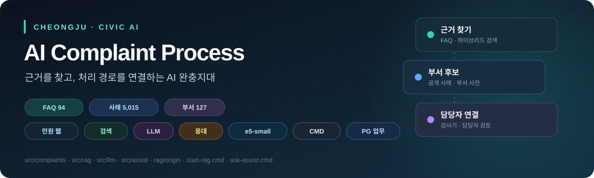
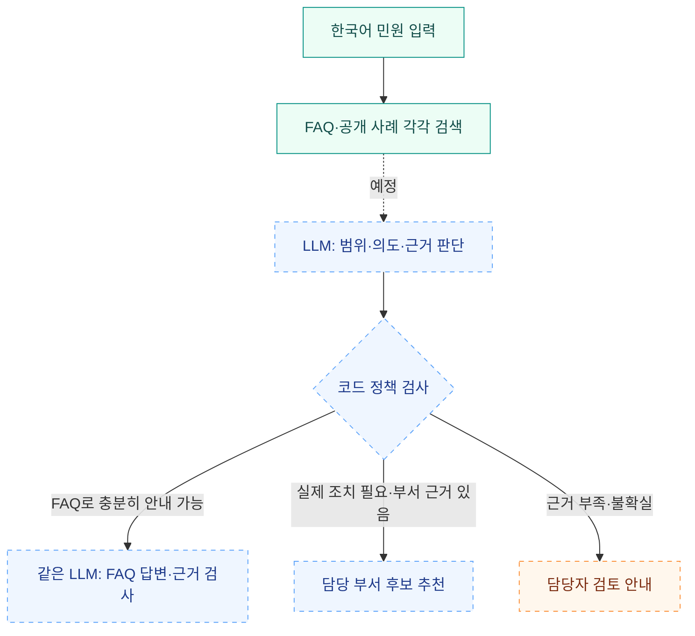
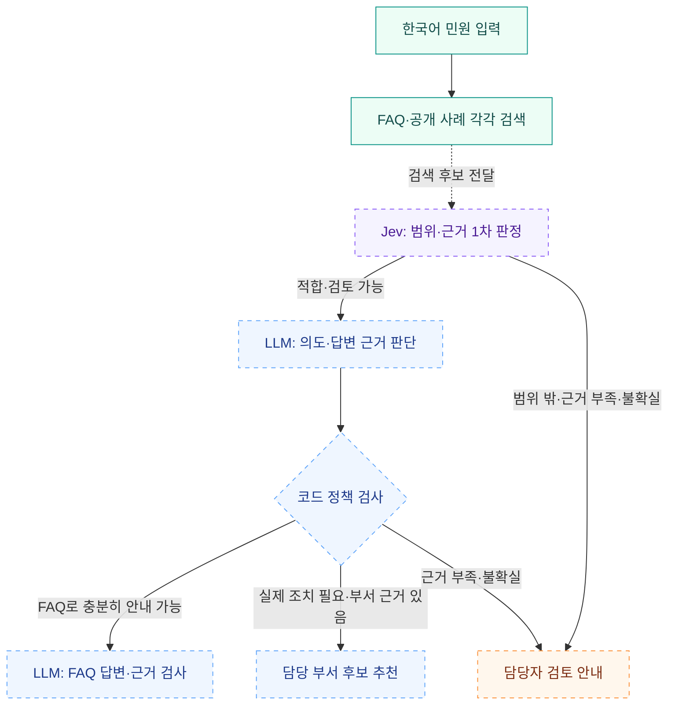

<div align="center">



# AI 민원 처리 시스템

**반복 문의에는 공식 근거를, 현장 조치에는 담당 부서 연결을.**

청주톡톡의 FAQ와 공개 민원 사례를 활용해 시민과 담당자 사이에 AI 완충지대를 만듭니다.

    

[구현 현황](#현재-구현-상태) · [DB와 검색](#저장과-검색) · [처리 흐름](#처리-흐름) · [빠른 시작](#빠른-시작) · [문서 목차](docs/README.md) · [변경 이력](CHANGELOG.md)

**[LLM + RAG 구현계획](plan/언어모델과_검색증강생성_우선_구현계획.md) · [모델 선정·미세조정 제안](plan/모델_선정과_미세조정_제안.md)**

**[웹 상세설계·분야별 작업계획](plan/민원_웹_MVP_상세설계와_분야별_작업계획.md) · [그림 포함 PDF](plan/민원_웹_MVP_상세설계와_분야별_작업계획.pdf)**

</div>

---

> [!NOTE]
> **현재 단계 · 2026-10-28 UTC · 네이티브 환경 전환**<br>
> **완료:** 데이터·관계형/벡터 DB·검색 CLI/API.<br>
> **다음:** Jev 없는 LLM + RAG 기반 CLI 챗봇 → 민원 게시판·작성·답변 서버를 갖춘 시연 웹.<br>
> **추후:** 기본 성능 평가 후 Jev 추가, 반복 오류에 따라 LoRA 검토. 최종 LLM은 미선정입니다.

| FAQ 안내 근거 | 공개 민원 사례 | 부서 디렉터리 | 적재된 임베딩 |
| :---: | :---: | :---: | :---: |
| **94건** | **5,015건** | **127개** | **5,109개 · 1024차원** |

## 현재 구현 상태

| 영역 | 구성·역할 | 상태 |
| --- | --- | --- |
| 데이터 | 두 JSON, 원문 ID·URL·수집 시각, 부서 정규화 | 완료 |
| 관계형 DB | FAQ·사례·부서 사전, 사례와 부서의 외래 키 연결 | 생성·적재 완료 |
| 벡터 DB | FAQ·사례 임베딩, pgvector/HNSW 색인 | 생성·적재 완료 |
| 검색 | 벡터 + 한국어 BM25 + RRF + 재정렬, CLI/API | 구현 완료 |
| 개발 하네스 | 작업 규칙·구조·데이터 계약·평가·운영·실행 계획 | 기본 문서 완료 |
| 부서 검증 | 현행 이름·별칭·내부 ID 정리 | 공식 업무분장·관할 보완 필요 |
| AI 판정·응답 | 범용 LLM의 의도·근거 판단, FAQ 기반 답변 | 미구현 · 모델 미선정 |
| 시연 | CLI 챗봇 → 청주톡톡과 비슷한 웹 MVP | 예정 |
| 시연 웹·업무 서버 | 실제 목록·CRUD, AI 답변 표시·담당자 수정, 실시간 작업 모니터 | 상세설계·분야별 작업 정리 · 미구현 |
| Jev 확장 | 기본 LLM + RAG의 판정 성능과 비교 후 추가 | 후속 단계 · 초기 필수 아님 |

현재 검색 CLI는 **FAQ 원문과 출처, 유사 사례와 부서 후보를 JSON으로 반환**합니다. 모든 검색 응답은 `retrieval_only=true`, `decision="requires_gate"`입니다. 이는 검색 후 별도 판단이 필요하다는 의미이며 Jev 전용 계약이 아닙니다. 시연 웹에서는 민원을 등록하고 답변을 주고받는 서버까지 구현할 계획입니다. 청주시 공식 접수·외부 부서 이관 연계는 별도 개발 범위입니다.

웹 단계는 민원 목록·작성·상세에서 서버에 저장된 글과 답변·처리 상태를 확인하도록 구성합니다. 같은 AI 응대 계층을 CLI와 공유하고, 등록한 민원은 기존 RAG 지식과 구분해 저장하는 안을 제안합니다. [시연 웹·민원 서버 구현계획](plan/시연_웹_게시판과_민원_서버_구현계획.md)

추가 요구에 따라 AI 답변의 작성 기원·담당자 수정 이력을 표시하고, 담당자는 검색·판정·작성·검증의 실제 진행 상태를 확인하도록 설계했습니다. [통합 설계서](plan/민원_웹_MVP_상세설계와_분야별_작업계획.md)는 분야·화면·구성도 7개, CRUD·게시·실시간 이벤트 계약, 분야별 작업 38개와 인수 시나리오 16개를 포함합니다. **UI 10개·백엔드 10개·AI 9개·DB 9개**로 작업을 나누고, 앞부분의 전체 작업표와 14~17절에서 구현 내용·완료 기준을 확인할 수 있습니다. [PDF](plan/민원_웹_MVP_상세설계와_분야별_작업계획.pdf)도 같은 내용입니다. 문서 완성과 웹 기능 구현은 구분합니다.

## 저장과 검색

**PostgreSQL 하나에서 관계형 데이터와 벡터 데이터를 함께 관리합니다.** 이 컴퓨터의 DB는 `complaints_native`, 스키마는 `complaint_rag`이며 목적에 따라 테이블과 검색 순위를 분리합니다.

| 테이블 | 관계형으로 저장하는 내용 | 벡터 검색 본문 | 규모 |
| --- | --- | --- | ---: |
| `faq_knowledge` | FAQ 원문·분류·적용 조건·출처 | 업무명 + 분류 + 전체 안내·대상·접수 조건·기간·주의사항 | 94건 |
| `routing_cases` | 민원 원문·과거 처리 맥락·현재 부서 연결 | 제목 + 민원 요지 | 5,015건 |
| `department_directory` | 부서 ID·현행 명칭·별칭·관할 및 검증 상태 | 일반 관계형 테이블로 관리 | 127개 |

FAQ·사례 테이블에는 `embedding vector(1024)`가 함께 저장됩니다. `routing_cases.department_id`는 부서 사전을 참조합니다. BM25 토큰·통계와 색인 메타데이터를 관리하는 보조 테이블까지 총 **7개 테이블**입니다. [SQL 스키마](rag/schema.sql) · [시스템 구조](docs/harness/architecture.md)

| 검색 단계 | 현재 설정 |
| --- | --- |
| 의미 검색 | `BAAI/bge-m3`, 정규화된 1024차원 벡터, cosine/HNSW 상위 30건 |
| 키워드 검색 | Kiwi 형태소 분석 + PostgreSQL BM25 상위 30건 |
| 순위 결합 | RRF `k=60`, FAQ·사례 각각 계산 |
| 재정렬 | `BAAI/bge-reranker-v2-m3`, 상위 20건 평가 후 기본 5건 반환 |

모델 리비전은 [config.py](rag/config.py)에 고정되어 있습니다. FAQ는 한 항목의 안내와 조건을 함께 보존하고, 사례는 제목·요지로 검색합니다. 과거 답변은 현재 정책 안내로 사용하지 않습니다. 검색 점수는 자동 답변·이관 가능 확률이 아닙니다. [상세 검색·검증 문서](rag/README.md)

## 처리 흐름

### 초기 구현: Jev 없는 LLM + RAG

아래는 **Jev 없는 초기 LLM + RAG의 목표 흐름**입니다. 실선의 검색까지 구현했으며, 점선 이후 판정·답변·검토 안내는 예정입니다.



범위 내라는 판단은 후속 검토가 가능하다는 뜻입니다. FAQ에 비슷한 주제가 있어도 실제 단속·보수·처분 요청을 안내만으로 처리 완료로 판단하지 않습니다. 데이터에 근거가 없다는 이유로 청주시 소관이 아니라고 단정하지 않고 담당자 검토로 연결합니다.

범용 LLM에 민원과 검색 원문·출처·부서 검증 상태를 전달합니다. 같은 모델을 판정과 답변에 각각 호출하고 그 사이에 코드 검사를 두는 구성을 제안합니다. 답변 검사 실패도 담당자 검토로 전환합니다. Jev는 기본 성능을 측정한 뒤 판정 대체·보완을 비교하며 초기 CLI·웹 목업의 선행 조건이 아닙니다. [판정 정책 초안](docs/harness/decision-policy.md)

### Jev를 추가한 후속 목표

아래 흐름은 초기 LLM + RAG의 기준 성능을 확인한 뒤 Jev를 범위·근거 1차 판정에 더하는 구상입니다. Jev에는 민원과 FAQ·공개 사례 검색 후보를 함께 전달합니다. 범위 밖이거나 근거가 부족하고 판정이 불확실하면 담당자 검토로 연결하며, 적합한 요청은 같은 LLM과 코드 정책 검사를 거칩니다. 이 흐름과 판정 기준은 아직 구현·확정되지 않았습니다.



Jev는 범위와 검색 근거를 먼저 살피는 보조 판정 단계입니다. 부서 배정이나 민원 접수를 자동 확정하지 않으며, 실제 이관 기능은 별도 개발이 필요합니다.

## 확정한 방향과 남은 데이터 검증

| 항목 | 결정 |
| --- | --- |
| 데이터 역할 | FAQ는 안내 근거, 공개 사례는 부서 추천 근거 |
| 초기 구성 | **LLM + RAG 우선 구현**, Jev는 추후 확장 |
| 입력 언어 | 한국어 원문으로 먼저 평가, Papago 번역은 추후 비교 |
| 모델 비용 | 무료 모델 우선 검토; 최종 LLM 미선정 |
| 부서 구분 | 확인된 별칭은 통합, 구가 다른 동명 과는 별도 유지 |
| MVP 순서 | 한국어 평가·LLM 연결 → CLI 챗봇 → 게시판·민원 교환 서버를 포함한 웹 MVP; Jev는 기준 성능 확보 후 별도 비교 |

Qwen3.5-4B부터 비교하고 추가 학습 없이 시작하는 안은 [모델 선정·미세조정 제안](plan/모델_선정과_미세조정_제안.md)에 정리했습니다. 모델 선정·LoRA 적용이 확정된 상태는 아닙니다.

**현재 부서 사전의 존재와 업무 검증 완료는 구분해야 합니다.** 이름에서 관할 구를 추출한 상태이며 127개 부서 모두 공식 업무분장이 미검증입니다. 미래산업과 계열 10건·과거 안전정책과 17건은 현행 담당 부서 검토 대상으로, 검색에는 남기되 부서 후보 확정 근거에서 제외합니다.

요지가 없는 58건은 제목으로 검색하고 과거 답변이 없는 101건도 보존합니다. 두 집합은 겹칠 수 있습니다. FAQ의 대상·접수 조건·주의사항은 유지했으나 정책 내용·연락처의 현행성 검증은 별도로 필요합니다. **수집일은 정책 유효성 확인일이 아닙니다.**

원본: [청주톡톡 FAQ](https://toktalk.cheongju.go.kr/home/sub.do?menukey=7403) · [공개 민원 사례](https://toktalk.cheongju.go.kr/home/sub.do?menukey=7401). 수집·정규화 기준일과 필드·누락값·변경 전 표기 보존 범위는 [데이터 사전](db/README.md)에 정리했습니다.

## 빠른 시작

**메뉴로 직접 검색해 보기:** [검색 테스트 TUI](rag/test_search.sh)를 실행하면 상태 확인, FAQ·사례 검색, 예제 질의, 재정렬·관할 설정을 사용할 수 있습니다.

```bash
bash rag/test_search.sh
```

기본은 빠른 검색(재정렬 끔)과 컬렉션별 3건 표시입니다. 원본 JSON 보기·선택 저장과 DB 무결성 검사도 지원합니다. 안내 근거를 검색하는 도구이며 LLM 챗봇은 아닙니다. [메뉴·명령 사용법](rag/README.md#검색-테스트-메뉴)

실행 중인 검색 서버가 있으면 저장소 루트에서 사용할 수 있습니다. 검색 CLI는 호스트의 Python 표준 라이브러리로 API에 연결하며, 모델 실행 환경은 호스트의 Python 3.12 가상환경입니다.

```bash
# 적재 상태와 모델 설정
python3 -m rag status

# FAQ 안내 근거 검색
python3 -m rag search '대형폐기물 배출 방법이 궁금합니다' --collection faq

# 유사 사례와 부서 후보 검색
python3 -m rag search '711번 버스가 정류장에 서지 않고 지나갔습니다' --collection routing
```

<details>
<summary><strong>네이티브 실행 환경</strong></summary>

이 컴퓨터에서는 PostgreSQL 18과 pgvector를 호스트에 설치하고 Python 3.12 가상환경에서 실행합니다. Docker 실행 구성은 제거했습니다. 기존 DB는 `complaints_native`로 복원했습니다. 서비스 실행과 새 환경 준비는 [네이티브 운영 안내](docs/harness/네이티브_운영.md)를 따릅니다.

```bash
systemctl --user status cheongju-rag.service
python3 -m rag status
```

</details>

<details>
<summary><strong>API 연결 — 기본 로컬 주소</strong></summary>

| 용도 | 주소 |
| --- | --- |
| 검색 | `POST http://127.0.0.1:8007/search` |
| API 문서 | `http://127.0.0.1:8007/docs` |
| 상태 | `GET http://127.0.0.1:8007/health` |
| 부서 조회 | `GET http://127.0.0.1:8007/departments` |

API와 DB 포트는 localhost에만 바인딩되어 있습니다. 입력·출력·오류 계약은 [시스템 구조](docs/harness/architecture.md), 요청 예시는 [RAG 문서](rag/README.md)를 확인합니다.

</details>

데이터 갱신 시에는 [수집·정규화 방법](db/README.md)과 [백업·재적재 절차](docs/harness/runbook.md)를 따릅니다. 변경 없는 벡터는 재사용하며 모델·본문 구성 규칙 변경에 따른 재생성은 별도로 구분합니다.

## 검증 근거

2026-10-28 네이티브 환경에서 화면 회귀를 포함한 **전체 테스트 27개가 통과**했습니다. Bash 검색 메뉴의 실제 FAQ·사례 검색과 입력·저장·API 실패 처리를 확인했습니다. [CASE-011](docs/cases/사례-011-검색-테스트-터미널-메뉴-추가-2026-10-28.md)

2026-10-25 코드·주석 점검에서 **코드·격리 PostgreSQL 테스트 25개가 통과**했습니다. [CASE-006](docs/cases/사례-006-한국어-주석과-커밋-규칙-정비와-검색-조회-최적화-2026-10-25.md)

아래는 2026-10-24에 수행한 적재·검색 검증 결과입니다. 기존 모델 평가를 새로 실행한 것으로 표시하지 않습니다.

| 점검 | 결과와 범위 |
| --- | --- |
| 코드·격리 PostgreSQL 테스트 | 13개 통과 |
| 원본과 DB 대조 | FAQ 94건·사례 5,015건, 부서 127개, 벡터 형태·검색 통계 확인 |
| 재적재 | 기존 벡터 5,109개 재사용, 신규 생성 0개 |
| 검색 회귀 예제 | 10/10 통과; FAQ 5개·부서 4개의 기대 대상이 1위 |
| 범위 밖 입력 | 검색 결과가 있어도 `requires_gate` 유지 확인 |

검색 예제의 통과 기준은 기대 대상의 상위 5개 포함과 검색 전용 계약입니다. **10개 예제는 민원 자동 응답 정확도나 범위 밖 탐지 성능의 평가 결과가 아닙니다.** 보고서·성능 측정 조건은 [RAG 문서](rag/README.md), 변경별 검증과 후속 평가셋 설계는 [평가 하네스](docs/harness/evaluation.md)를 확인합니다.

## 문서와 저장소 구조

| 문서 | 확인할 내용 |
| --- | --- |
| [전체 문서 목차](docs/README.md) | 목적별 읽기 순서와 원본 계획서 |
| [프로젝트 사례 색인](docs/cases/README.md) | 버그·개선·결정·검증 이력, 미해결 과제와 작성 양식 |
| [변경 이력](CHANGELOG.md) | 데이터·검색·하네스·문서 패치 내용 |
| [작업 지침](AGENTS.md) · [하네스 안내](docs/harness/README.md) | 개발 규칙, 구조, 계약, 평가, 운영 |
| [RAG 실행 문서](rag/README.md) · [데이터 사전](db/README.md) | 설치·검색·원본 필드·수집·정규화 |
| [MVP 실행 계획](plan/harness-roadmap.md) | 다음 작업·완료 조건·결정 기록 |
| [LLM + RAG 우선 구현계획](plan/언어모델과_검색증강생성_우선_구현계획.md) | 기존 계획의 변경점·처리 흐름·Jev 후속 확장 |
| [시연 웹·민원 서버 구현계획](plan/시연_웹_게시판과_민원_서버_구현계획.md) | 게시판·작성·상세·답변 교환, 저장·API 제안과 완료 조건 |
| [웹 상세설계·분야별 작업계획](plan/민원_웹_MVP_상세설계와_분야별_작업계획.md) · [PDF](plan/민원_웹_MVP_상세설계와_분야별_작업계획.pdf) | 화면 예시, CRUD·AI 답변 수정·실시간 모니터, DB/API·분야별 작업·인수 조건 |
| [모델 선정과 미세조정 제안](plan/모델_선정과_미세조정_제안.md) | 무료 LLM 후보·한국어 평가·LoRA 적용 조건 |

```text
ai-complaint-process/
├── README.md / CHANGELOG.md       # 소개·진행 상태 / 변경 이력
├── AGENTS.md                     # 저장소 작업 규칙
├── scripts/                      # 네이티브 검색 API 실행 환경
├── docs/
│   ├── README.md                 # 전체 문서 목차
│   ├── assets/                   # README 배너·설계 그림·인쇄 스타일
│   ├── cases/                    # 번호별 버그·개선·설계·검증 기록
│   ├── tools/                    # 통합 설계 PDF 생성 도구
│   └── harness/                  # 구조·계약·판정 초안·평가·운영
├── rag/                          # 검색 코드·테스트·검증 보고서
├── db/                           # 두 원본 JSON·데이터 사전
├── plan/                         # 원본 계획서·분석·MVP 실행 계획
└── PACKET/                       # 수집기·부서 정규화 코드
```

저장소는 **private**입니다. `.env`, 실행 DB, 모델 캐시, 쿠키가 포함된 원본 패킷 캡처(`PACKET/*.saz`)는 Git에서 제외합니다. 원래 계획서의 전체 행정 시스템 구상과 현재 검색 MVP의 범위는 [문서 목차](docs/README.md)에서 구분해 안내합니다.
