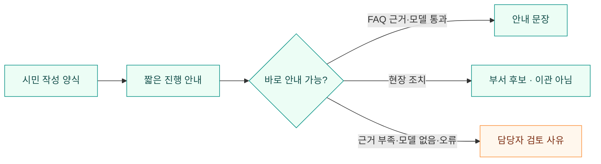
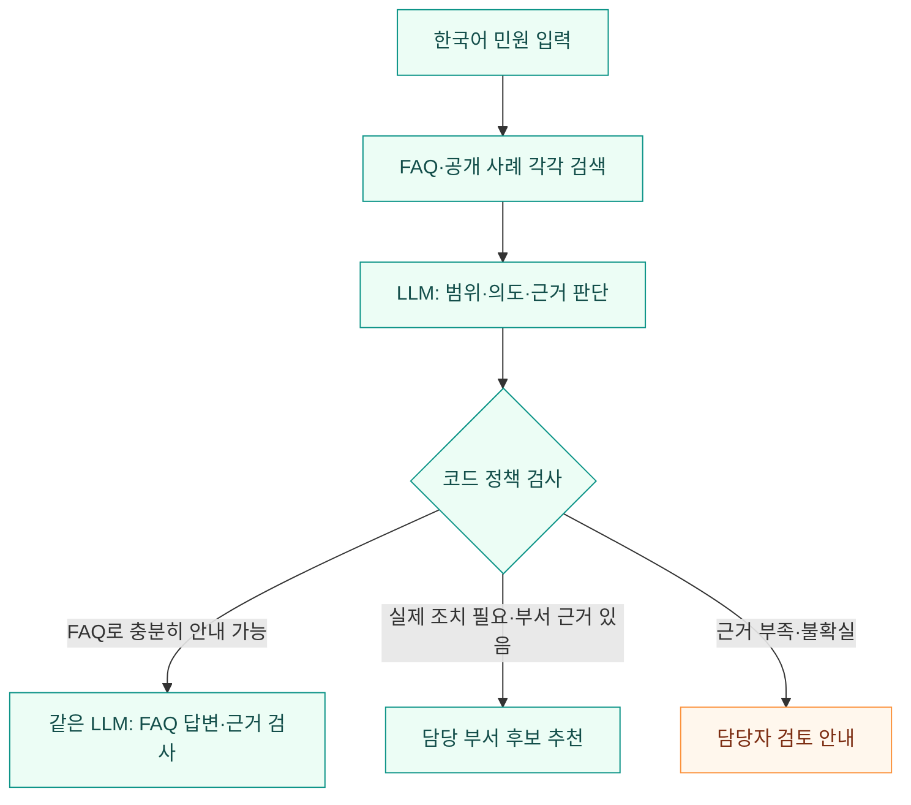
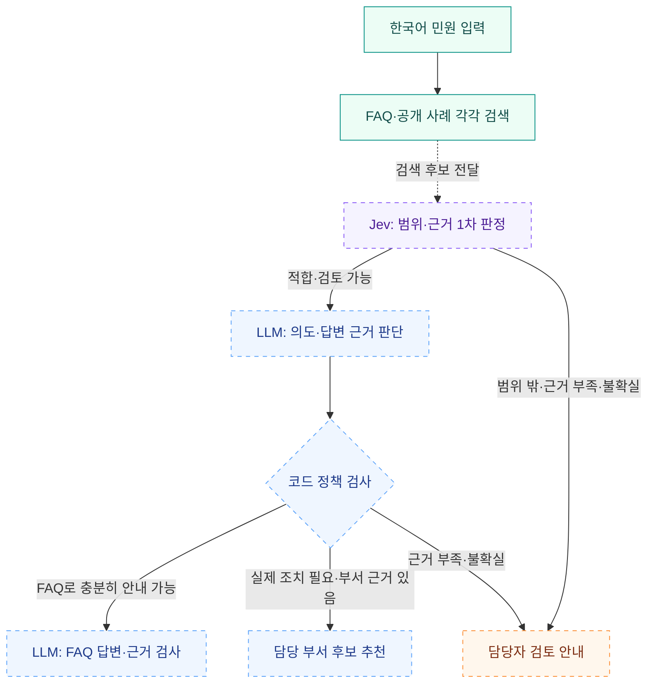

<div align="center">


# AI 민원 처리 시스템

            

**반복 문의에는 공식 근거를, 현장 조치에는 담당 부서 연결을.**

청주톡톡의 FAQ와 공개 민원 사례를 활용해 시민과 담당자 사이에 AI 완충지대를 만듭니다.

    

[구현 현황](#현재-구현-상태) · [응대 검사기](#응대-검사기) · [DB와 검색](#저장과-검색) · [처리 흐름](#처리-흐름) · [빠른 시작](#빠른-시작) · [LLM 하네스](docs/harness/LLM_완충지대_하네스.md) · [문서 목차](docs/README.md) · [변경 이력](CHANGELOG.md)

</div>

---

> [!NOTE]
> **현재 단계 · 2026-11-06 · 검색 + 웹 업무 시연 + 응대 검사기**<br>
> **구현:** 시민·담당자 화면, Flask API·Swagger, PostgreSQL `complaint_app` 업무 저장, 검색 원본 `rag/origin`, `/#/lab` 응대 검사기, `gpt-6-luna` API·Codex CLI 선택, Windows `웹-시작.cmd`·`검색-시작.cmd`·`민원-응대.cmd`·`문장-임베딩.cmd`. 판정·FAQ 안내는 [`docs/harness/prompts/`](docs/harness/prompts/README.md) PREFIX-00~02. Codex 도구는 `search_complaint_rag` 하나이며, 예전 업무 테이블의 `version`은 서버 시작 때 채웁니다. 기본 임베딩은 CPU용 `e5-small`(384차원).<br>
> **다음:** 운영 DB 5,109건 재임베딩과 검색 예제 재평가, PREFIX-03/04 연결, 공급자별 실측, 시민 챗봇 실연결, 담당자 SSE, 운영 인증·7테이블 정규화·공식 이관.

| 지금 됨 | 응대 검사기 | 아직 |
| --- | --- | --- |
| 시민·담당자 CRUD, Flask·Swagger, PostgreSQL `complaint_app` | `/#/lab` · `python -m rag assist` · `민원-응대.cmd` | 민원 CRUD의 LLM 연결 |
| FAQ 94 · 사례 5,015 · 부서 127, 원본 `rag/origin` | `src/assist`가 `src/rag`와 `src/llm`을 이음 | 시민 챗봇 실연결 · 담당자 SSE |
| Windows `웹-시작.cmd` · `검색-시작.cmd` · CPU용 e5-small · [Swagger PDF](docs/청주톡톡_민원_업무_API_Swagger.pdf) | `gpt-6-luna` API 또는 Codex CLI. 도구는 `search_complaint_rag`만 | 5,109건 재임베딩 · 실측 평가 · 공식 이관 |


| 화면 | 주소 | 실행 |
| --- | --- | --- |
| 시민 사이트 | `http://127.0.0.1:5000/#/citizen` | Windows: [`웹-시작.cmd`](웹-시작.cmd) |
| 담당자 사이트 | `http://127.0.0.1:5000/#/staff` | 같은 Flask 서버 |
| 응대 검사기 | `http://127.0.0.1:5000/#/lab` | 민원 CRUD와 분리, 저장 없음 |
| 민원 응대 CMD | [`민원-응대.cmd`](민원-응대.cmd) | 꺼진 localhost 검색 API는 자동 시작, 기본 재정렬 끔 |
| 문장 임베딩 CMD | [`문장-임베딩.cmd`](문장-임베딩.cmd) | 문장 없으면 입력 대기. 출력 후 키를 누를 때까지 창 유지 |
| RAG 기동 CMD | [`검색-시작.cmd`](검색-시작.cmd) | PostgreSQL·검색 API는 별도 창. 이미 켜져 있으면 상태만 보여주고 키 입력 후 닫힘 |
| API 문서 | `http://127.0.0.1:5000/docs` | [Flask 설치](src/README.md) · [Swagger PDF](docs/청주톡톡_민원_업무_API_Swagger.pdf) |
| 검색 CLI/API | `http://127.0.0.1:8007/docs` | [검색 실행](rag/README.md) · [데이터 사전](rag/origin/README.md) |
| 개발 기록 | [문서 목차](docs/README.md) | [사례 색인](docs/cases/README.md) |

| 패키지 | 역할 | 위치 |
| --- | --- | --- |
| 민원 웹 | CRUD·세션·Swagger·정적 UI | [`src/complaints`](src/README.md) |
| 검색 원본 | FAQ·사례 JSON·검색 DDL | [`rag/origin`](rag/origin/README.md) |
| 검색 클라이언트 | 검색 API 호출, FAQ·사례 근거 | [`src/rag`](src/README.md) · 엔진은 [`rag/`](rag/README.md) |
| LLM | Luna·Codex·legacy 공급자 | [`src/llm`](src/README.md) |
| 응대 | 검색 다음 판정·정책 검사·조건부 FAQ | [`src/assist`](src/README.md) · [`prompts/`](docs/harness/prompts/README.md) |

설계 문서는 [LLM + RAG 구현계획](plan/언어모델과_검색증강생성_우선_구현계획.md), [웹 상세설계](plan/민원_웹_MVP_상세설계와_분야별_작업계획.md), [모델 제안](plan/모델_선정과_미세조정_제안.md)을 이어서 읽습니다.

| FAQ 안내 근거 | 공개 민원 사례 | 부서 디렉터리 | 임베딩 |
| :---: | :---: | :---: | :---: |
| **94건** | **5,015건** | **127개** | **기본 e5-small 384차원 · 기존 dump는 bge-m3** |

## 현재 구현 상태

시민·담당자 웹과 Flask 업무 서버는 Python 3.12 `.venv-web`에서 실행하고, 민원·답변·이력은 같은 PostgreSQL의 `complaint_app` 스키마에 저장합니다. `version` 칸이 없는 예전 `complaints` 테이블은 저장소 준비 때 채웁니다. 검색 색인은 `complaint_rag`이며 행을 섞지 않습니다. 응대 검사기는 `src/assist`가 `src/rag`와 `src/llm`을 이어 그 검색 위에 판정만 올립니다. 실제 민원 CRUD의 LLM 연결·SSE·운영 인증·공식 이관은 미구현입니다. [서버 안내](src/README.md) · [CASE-014](docs/cases/사례-014-Flask-업무서버와-Swagger-구현-2026-10-31.md) · [CASE-026](docs/cases/사례-026-백엔드-민원웹-RAG-LLM-분리-2026-11-05.md) · [CASE-031](docs/cases/사례-031-업무저장-PostgreSQL-통일-2026-11-05.md) · [Swagger PDF](docs/청주톡톡_민원_업무_API_Swagger.pdf)

| 영역 | 구성·역할 | 상태 |
| --- | --- | --- |
| 데이터 | 두 JSON, 원문 ID·URL·수집 시각, 부서 정규화 | 완료 |
| 관계형 DB | FAQ·사례·부서 사전, 사례와 부서의 외래 키 연결 | 생성·적재 완료 |
| 벡터 DB | FAQ·사례 임베딩, pgvector/HNSW 색인 | 생성·적재 완료 |
| 검색 | 벡터 + 한국어 BM25 + RRF + 재정렬, CLI/API | 구현 완료 |
| 개발 하네스 | 작업 규칙·구조·데이터 계약·평가·운영·실행 계획 | 기본 문서 완료 |
| 부서 검증 | 현행 이름·별칭·내부 ID 정리 | 공식 업무분장·관할 보완 필요 |
| 외부 LLM 예제 | [독립 호출 예제](scripts/외부_LLM_예제.py) · [실행 안내](docs/harness/외부_LLM_API_호출.md) | 구현 · 민원 RAG와 분리된 대화 예제 |
| AI 판정·응답 | 검색 후 판정 JSON·정책 검사·조건부 FAQ 생성 | CLI/`POST /api/v1/assist`·`/#/lab` · `gpt-6-luna` API 또는 Codex CLI 선택 · 실측 평가 후속 |
| 시연 웹 | 시민·담당자 화면, 목록·CRUD·초안·게시·단계 시연 | Flask·Swagger·PostgreSQL `complaint_app` · Windows `웹-시작.cmd` |
| 응대 검사기 | `/#/lab` 시민 작성 양식·짧은 진행 안내 | 민원 저장 없음 · 시민 챗봇은 고정 응답 |
| Jev 확장 | 기본 LLM + RAG의 판정 성능과 비교 후 추가 | 후속 단계 · 초기 필수 아님 |

현재 검색 CLI는 **FAQ 원문과 출처, 유사 사례와 부서 후보를 JSON으로 반환**합니다. 모든 검색 응답은 `retrieval_only=true`, `decision="requires_gate"`입니다. 이는 검색 후 별도 판단이 필요하다는 의미이며 Jev 전용 계약이 아닙니다. `python3 -m rag assist`와 `/#/lab`는 그 검색 결과 위에 판정·정책 검사를 올립니다. 시연 웹의 등록·답변 교환은 Flask와 PostgreSQL `complaint_app`으로 구현했으며 검사기와 민원 CRUD는 분리합니다. 청주시 공식 접수·외부 부서 이관 연계는 별도 개발 범위입니다.

웹 단계는 민원 목록·작성·상세에서 서버에 저장된 글과 답변·처리 상태를 확인하도록 구성합니다. 같은 AI 응대 계층을 CLI와 공유하고, 등록한 민원은 기존 RAG 지식과 구분해 저장하는 안을 제안합니다. [시연 웹·민원 서버 구현계획](plan/시연_웹_게시판과_민원_서버_구현계획.md)

<details>
<summary><strong>통합 설계서의 분야별 작업 범위</strong></summary>

추가 요구에 따라 AI 답변의 작성 기원·담당자 수정 이력을 표시하고, 담당자는 검색·판정·작성·검증의 실제 진행 상태를 확인하도록 설계했습니다. [통합 설계서](plan/민원_웹_MVP_상세설계와_분야별_작업계획.md)는 분야·화면·구성도 7개, CRUD·게시·실시간 이벤트 계약, 분야별 작업 38개와 인수 시나리오 16개를 포함합니다. **UI 10개·백엔드 10개·AI 9개·DB 9개**로 작업을 나누고, 앞부분의 전체 작업표와 14~17절에서 구현 내용·완료 기준을 확인할 수 있습니다. [PDF](plan/민원_웹_MVP_상세설계와_분야별_작업계획.pdf)도 같은 내용입니다. 문서 완성과 웹 기능 구현은 구분합니다.

</details>

## 응대 검사기

`/#/lab`은 내부 기술 검토용입니다. 시민 직접 작성 양식으로 민원을 남기면 저장된 안내와 사례를 찾고, 지금 하는 일만 짧게 보여 준 뒤 안내 문장 또는 처리 사유를 표시합니다. 민원은 저장하지 않으며 공식 접수·자동 이관이 아닙니다.



진행 문구는 `민원 내용을 읽고 있어요` → `저장된 안내와 사례를 찾고 있어요` → `찾은 자료를 살펴보고 있어요` → (FAQ 안내일 때만) `안내문을 준비하고 있어요`입니다. 검색 파이프라인·판정 JSON·정책 검사 이름은 화면에 올리지 않습니다. LLM은 `.env`의 `COMPLAINT_LLM_PROVIDER`로 고릅니다.

시스템 접두는 [`docs/harness/prompts/`](docs/harness/prompts/README.md)의 PREFIX `.txt`입니다. `src/assist/prompts.py`가 읽어 조립하며, 민원·검색 후보는 `user` JSON에만 둡니다. 호출마다 **공통 헌법 `PREFIX-00`과 그 작업 블록 하나**를 붙입니다. Codex가 쓸 수 있는 도구는 `search_complaint_rag` 하나이며, 민원 문장을 검색 API로 넘겨 `retrieval_only` 후보를 받습니다. 후보가 이미 있으면 다시 호출하지 않고, 순화 작업은 이 도구를 쓰지 않습니다.

| 호출 | 시스템 프롬프트 | 하는 일 | 지금 |
| --- | --- | --- | --- |
| 1차 판정 | `PREFIX-00` + `PREFIX-01` | 판정 JSON | 검사기가 사용 |
| FAQ 안내 | `PREFIX-00` + `PREFIX-02` | 조건이 남은 한국어 평문 | `faq_answer`일 때만 두 번째 호출 |
| 담당자 초안 | `PREFIX-00` + `PREFIX-03` | 요약·초안 JSON | 파일만 · 미연결 |
| 특이민원 순화 | `PREFIX-00` + `PREFIX-04` | 순화 요약 JSON | 파일만 · 미연결 |

[CASE-022](docs/cases/사례-022-RAG-LLM-응대검사기-2026-11-01.md) · [CASE-023](docs/cases/사례-023-GPT-6-Luna-공급자-선택-2026-11-05.md) · [CASE-044](docs/cases/사례-044-LLM-완충지대-하네스와-프리픽스-원문-2026-11-06.md)

## 저장과 검색

**같은 PostgreSQL에서 스키마만 나눕니다.** 검색 지식은 `complaint_rag`, 시연 웹 민원 CRUD는 `complaint_app`입니다. 민원 행을 검색 색인에 넣지 않습니다. 이 컴퓨터의 DB 이름은 `complaints_native`입니다.

| 테이블 | 관계형으로 저장하는 내용 | 벡터 검색 본문 | 규모 |
| --- | --- | --- | ---: |
| `faq_knowledge` | FAQ 원문·분류·적용 조건·출처 | 업무명 + 분류 + 전체 안내·대상·접수 조건·기간·주의사항 | 94건 |
| `routing_cases` | 민원 원문·과거 처리 맥락·현재 부서 연결 | 제목 + 민원 요지 | 5,015건 |
| `department_directory` | 부서 ID·현행 명칭·별칭·관할 및 검증 상태 | 일반 관계형 테이블로 관리 | 127개 |

FAQ·사례 테이블에는 현재 프로필 차원의 `embedding` 벡터가 함께 저장됩니다. 기본은 384차원입니다. `routing_cases.department_id`는 부서 사전을 참조합니다. BM25 토큰·통계와 색인 메타데이터를 관리하는 보조 테이블까지 총 **7개 테이블**입니다. [SQL 스키마](rag/origin/schema/complaint_rag.sql) · [데이터 사전](rag/origin/README.md) · [시스템 구조](docs/harness/architecture.md)

| 검색 단계 | 현재 설정 |
| --- | --- |
| 의미 검색 | 기본 `intfloat/multilingual-e5-small` 384차원, cosine/HNSW 상위 30건. 기존 색인은 `RAG_EMBEDDING_PROFILE=bge-m3` |
| 키워드 검색 | Kiwi 형태소 분석 + PostgreSQL BM25 상위 30건 |
| 순위 결합 | RRF `k=60`, FAQ·사례 각각 계산 |
| 재정렬 | `BAAI/bge-reranker-v2-m3`, 상위 20건 평가 후 기본 5건 반환 |

모델 리비전은 [config.py](rag/config.py)에 고정되어 있습니다. FAQ는 한 항목의 안내와 조건을 함께 보존하고, 사례는 제목·요지로 검색합니다. 과거 답변은 현재 정책 안내로 사용하지 않습니다. 검색 점수는 자동 답변·이관 가능 확률이 아닙니다. [상세 검색·검증 문서](rag/README.md)

## 처리 흐름

### 초기 구현: Jev 없는 LLM + RAG

아래는 **Jev 없는 초기 LLM + RAG 흐름**입니다. 검색·판정·정책 검사까지 로컬 구현했으며, FAQ 문장 생성은 LLM이 설정됐을 때만 호출합니다. `gpt-6-luna`·`medium`은 OpenAI API 또는 Codex CLI 공급자로 선택할 수 있고, 실측 평가와 운영 모델 확정은 후속입니다.



범위 내라는 판단은 후속 검토가 가능하다는 뜻입니다. FAQ에 비슷한 주제가 있어도 실제 단속·보수·처분 요청을 안내만으로 처리 완료로 판단하지 않습니다. 데이터에 근거가 없다는 이유로 청주시 소관이 아니라고 단정하지 않고 담당자 검토로 연결합니다.

범용 LLM에 민원과 검색 원문·출처·부서 검증 상태를 전달합니다. 같은 모델을 판정과 답변에 각각 호출하고 그 사이에 코드 검사를 두는 구성을 제안합니다. 답변 검사 실패도 담당자 검토로 전환합니다. Jev는 기본 성능을 측정한 뒤 판정 대체·보완을 비교하며 초기 CLI·웹 목업의 선행 조건이 아닙니다. [판정 정책](docs/harness/decision-policy.md) · [AI 입출력 하네스](docs/harness/AI_정보전달과_응답_하네스.md)

### Jev를 추가한 후속 목표

아래 흐름은 초기 LLM + RAG의 기준 성능을 확인한 뒤 Jev를 범위·근거 1차 판정에 더하는 구상입니다. Jev에는 민원과 FAQ·공개 사례 검색 후보를 함께 전달합니다. 범위 밖이거나 근거가 부족하고 판정이 불확실하면 담당자 검토로 연결하며, 적합한 요청은 같은 LLM과 코드 정책 검사를 거칩니다. 이 흐름과 판정 기준은 아직 구현·확정되지 않았습니다.



Jev는 범위와 검색 근거를 먼저 살피는 보조 판정 단계입니다. 부서 배정이나 민원 접수를 자동 확정하지 않으며, 실제 이관 기능은 별도 개발이 필요합니다.

## 확정한 방향과 남은 데이터 검증

| 항목 | 결정 |
| --- | --- |
| 데이터 역할 | FAQ는 안내 근거, 공개 사례는 부서 추천 근거 |
| 초기 구성 | **LLM + RAG 우선 구현**, Jev는 추후 확장 |
| 입력 언어 | 한국어 원문으로 먼저 평가, Papago 번역은 추후 비교 |
| 모델 비용 | 무료 모델 우선 검토; 최종 LLM 미선정 |
| 부서 구분 | 확인된 별칭은 통합, 구가 다른 동명 과는 별도 유지 |
| MVP 순서 | 한국어 평가·LLM 연결 → CLI 챗봇 → 게시판·민원 교환 서버를 포함한 웹 MVP; Jev는 기준 성능 확보 후 별도 비교 |

Qwen3.5-4B부터 비교하고 추가 학습 없이 시작하는 안은 [모델 선정·미세조정 제안](plan/모델_선정과_미세조정_제안.md)에 정리했습니다. 모델 선정·LoRA 적용이 확정된 상태는 아닙니다.

**현재 부서 사전의 존재와 업무 검증 완료는 구분해야 합니다.** 이름에서 관할 구를 추출한 상태이며 127개 부서 모두 공식 업무분장이 미검증입니다. 미래산업과 계열 10건·과거 안전정책과 17건은 현행 담당 부서 검토 대상으로, 검색에는 남기되 부서 후보 확정 근거에서 제외합니다.

요지가 없는 58건은 제목으로 검색하고 과거 답변이 없는 101건도 보존합니다. 두 집합은 겹칠 수 있습니다. FAQ의 대상·접수 조건·주의사항은 유지했으나 정책 내용·연락처의 현행성 검증은 별도로 필요합니다. **수집일은 정책 유효성 확인일이 아닙니다.**

원본: [청주톡톡 FAQ](https://toktalk.cheongju.go.kr/home/sub.do?menukey=7403) · [공개 민원 사례](https://toktalk.cheongju.go.kr/home/sub.do?menukey=7401). 수집·정규화 기준일과 필드·누락값·변경 전 표기 보존 범위는 [데이터 사전](rag/origin/README.md)에 정리했습니다.

## 빠른 시작

Windows에서 시민 화면까지 한 번에 열려면 저장소 루트의 [`웹-시작.cmd`](웹-시작.cmd)를 실행합니다. `.venv-web`이 준비되어 있으면 Flask를 별도 창에서 시작하고, 이미 실행 중이면 그 주소를 엽니다. [CASE-024](docs/cases/사례-024-Windows-서버-시작-스크립트-2026-11-05.md)

```bat
웹-시작.cmd
```

Windows에서 검색 DB와 API를 다시 켜려면 [`검색-시작.cmd`](검색-시작.cmd)입니다. 검색 API가 꺼져 있으면 [`민원-응대.cmd`](민원-응대.cmd)가 localhost에서 `python -m rag serve`를 별도 창으로 시작합니다. PostgreSQL이 꺼져 있으면 `검색-시작.cmd`가 먼저 필요합니다. [CASE-035](docs/cases/사례-035-응대-CMD-검색API-자동시작-2026-11-05.md) · [CASE-036](docs/cases/사례-036-Windows-RAG-PostgreSQL-로컬기동-2026-11-05.md)

```bat
민원-응대.cmd 대형폐기물 배출 방법이 궁금합니다
민원-응대.cmd --example faq
민원-응대.cmd --no-start --example faq
문장-임베딩.cmd --raw 나무가 쓰러짐
```

**메뉴로 직접 검색해 보기:** [검색 테스트 TUI](rag/검색_시험.sh)를 실행하면 상태 확인, FAQ·사례 검색, 예제 질의, 재정렬·관할 설정을 사용할 수 있습니다.

```bash
bash rag/검색_시험.sh
```

기본은 빠른 검색(재정렬 끔)과 컬렉션별 3건 표시입니다. 원본 JSON 보기·선택 저장과 DB 무결성 검사도 지원합니다. 안내 근거를 검색하는 도구이며 LLM 챗봇은 아닙니다. [메뉴·명령 사용법](rag/README.md#검색-테스트-메뉴)

실행 중인 검색 서버가 있으면 저장소 루트에서 사용할 수 있습니다. 검색 CLI는 호스트의 Python 표준 라이브러리로 API에 연결하며, 모델 실행 환경은 호스트의 Python 3.12 가상환경입니다.

```bash
# 적재 상태와 모델 설정
python3 -m rag status

# FAQ 안내 근거 검색
python3 -m rag search '대형폐기물 배출 방법이 궁금합니다' --collection faq

# 유사 사례와 부서 후보 검색
python3 -m rag search '711번 버스가 정류장에 서지 않고 지나갔습니다' --collection routing
```

<details>
<summary><strong>네이티브 실행 환경</strong></summary>

이 컴퓨터에서는 PostgreSQL 18과 pgvector를 호스트에 설치하고 Python 3.12 가상환경에서 실행합니다. Docker 실행 구성은 제거했습니다. 기존 DB는 `complaints_native`로 복원했습니다. 서비스 실행과 새 환경 준비는 [네이티브 운영 안내](docs/harness/네이티브_운영.md)를 따릅니다.

```bash
systemctl --user status cheongju-rag.service
python3 -m rag status
```

</details>

<details>
<summary><strong>API 연결 — 기본 로컬 주소</strong></summary>

| 용도 | 주소 |
| --- | --- |
| 검색 | `POST http://127.0.0.1:8007/search` |
| API 문서 | `http://127.0.0.1:8007/docs` |
| 상태 | `GET http://127.0.0.1:8007/health` |
| 부서 조회 | `GET http://127.0.0.1:8007/departments` |

API와 DB 포트는 localhost에만 바인딩되어 있습니다. 입력·출력·오류 계약은 [시스템 구조](docs/harness/architecture.md), 요청 예시는 [RAG 문서](rag/README.md)를 확인합니다.

</details>

데이터 갱신 시에는 [수집·정규화 방법](rag/origin/README.md)과 [백업·재적재 절차](docs/harness/runbook.md)를 따릅니다. 변경 없는 벡터는 재사용하며 모델·본문 구성 규칙 변경에 따른 재생성은 별도로 구분합니다.

## 검증 근거

2026-11-06 Windows / Python 3.12.10 `.venv-web`에서 `pytest src/tests rag/tests/test_assist.py` **71개가 통과**했고 PostgreSQL 왕복 1개는 `RUN_PG_TESTS`가 없어 건너뛰었습니다. RAG `.venv`에서 경로·검색·임베딩 설정 테스트 **16개가 통과**했습니다. [CASE-045](docs/cases/사례-045-패치-주석-문서-최적화-2026-11-06.md) · [CASE-043](docs/cases/사례-043-문장-임베딩과-한국어-스크립트명-2026-11-05.md) · [CASE-044](docs/cases/사례-044-LLM-완충지대-하네스와-프리픽스-원문-2026-11-06.md)

2026-10-28 네이티브 환경에서 화면 회귀를 포함한 **전체 테스트 27개가 통과**했습니다. Bash 검색 메뉴의 실제 FAQ·사례 검색과 입력·저장·API 실패 처리를 확인했습니다. [CASE-011](docs/cases/사례-011-검색-테스트-터미널-메뉴-추가-2026-10-28.md)

2026-10-25 코드·주석 점검에서 **코드·격리 PostgreSQL 테스트 25개가 통과**했습니다. [CASE-006](docs/cases/사례-006-한국어-주석과-커밋-규칙-정비와-검색-조회-최적화-2026-10-25.md)

아래는 2026-10-24에 수행한 적재·검색 검증 결과입니다. 기존 모델 평가를 새로 실행한 것으로 표시하지 않습니다.

| 점검 | 결과와 범위 |
| --- | --- |
| 코드·격리 PostgreSQL 테스트 | 13개 통과 |
| 원본과 DB 대조 | FAQ 94건·사례 5,015건, 부서 127개, 벡터 형태·검색 통계 확인 |
| 재적재 | 기존 벡터 5,109개 재사용, 신규 생성 0개 |
| 검색 회귀 예제 | 10/10 통과; FAQ 5개·부서 4개의 기대 대상이 1위 |
| 범위 밖 입력 | 검색 결과가 있어도 `requires_gate` 유지 확인 |

검색 예제의 통과 기준은 기대 대상의 상위 5개 포함과 검색 전용 계약입니다. **10개 예제는 민원 자동 응답 정확도나 범위 밖 탐지 성능의 평가 결과가 아닙니다.** 보고서·성능 측정 조건은 [RAG 문서](rag/README.md), 변경별 검증과 후속 평가셋 설계는 [평가 하네스](docs/harness/evaluation.md)를 확인합니다.

## 문서와 저장소 구조

| 문서 | 확인할 내용 |
| --- | --- |
| [전체 문서 목차](docs/README.md) | 목적별 읽기 순서와 원본 계획서 |
| [프로젝트 사례 색인](docs/cases/README.md) | 버그·개선·결정·검증 이력, 미해결 과제와 작성 양식 |
| [변경 이력](CHANGELOG.md) | 데이터·검색·하네스·문서 패치 내용 |
| [작업 지침](AGENTS.md) · [하네스 안내](docs/harness/README.md) | 개발 규칙, 구조, 계약, 평가, 운영, [LLM 완충지대](docs/harness/LLM_완충지대_하네스.md)·[실제 프리픽스](docs/harness/prompts/README.md)·[AI 입출력](docs/harness/AI_정보전달과_응답_하네스.md)·[프리픽스 캐싱](docs/harness/시스템_프롬프트와_프리픽스_캐싱_지침.md)·[안전 가드레일](docs/harness/AI_안전_보안_가드레일.md) |
| [RAG 실행 문서](rag/README.md) · [데이터 사전](rag/origin/README.md) | 설치·검색·원본 필드·수집·정규화 |
| [MVP 실행 계획](plan/harness-roadmap.md) | 다음 작업·완료 조건·결정 기록 |
| [LLM + RAG 우선 구현계획](plan/언어모델과_검색증강생성_우선_구현계획.md) | 기존 계획의 변경점·처리 흐름·Jev 후속 확장 |
| [시연 웹·민원 서버 구현계획](plan/시연_웹_게시판과_민원_서버_구현계획.md) | 게시판·작성·상세·답변 교환, 저장·API 제안과 완료 조건 |
| [웹 상세설계·분야별 작업계획](plan/민원_웹_MVP_상세설계와_분야별_작업계획.md) · [PDF](plan/민원_웹_MVP_상세설계와_분야별_작업계획.pdf) | 화면 예시, CRUD·AI 답변 수정·실시간 모니터, DB/API·분야별 작업·인수 조건 |
| [모델 선정과 미세조정 제안](plan/모델_선정과_미세조정_제안.md) | 무료 LLM 후보·한국어 평가·LoRA 적용 조건 |

```text
ai-complaint-process/
├── README.md / CHANGELOG.md / AGENTS.md
├── 웹-시작.cmd                   # Windows Flask 시작·시민 화면
├── 검색-시작.cmd                 # Windows PostgreSQL·검색 API 시작
├── 민원-응대.cmd                 # Windows 민원 → RAG+LLM 응대. 꺼진 검색 API 자동 시작
├── 문장-임베딩.cmd               # 한 문장 벡터 숫자. DB·API 없음
├── .env.example                  # 응대 LLM 공급자 예시
├── src/
│   ├── app.py                    # Flask 팩토리
│   ├── complaints/               # 민원 웹 CRUD·세션·UI
│   ├── rag/                      # 검색 API 클라이언트
│   ├── llm/                      # Luna·Codex·legacy 공급자
│   └── assist/                   # RAG와 LLM을 잇는 응대. prompts.py가 PREFIX 조립
├── ui/                           # 시민·담당자·검사기 화면
├── scripts/                      # 한국어 파일명 실행 스크립트. 안내 scripts/README.md
├── docs/                         # 목차·사례·하네스·배너
│   └── harness/prompts/          # PREFIX-00~04 시스템 접두 원문
├── rag/                          # 검색 엔진·색인·CLI. 원본은 origin/
├── db/                           # 이전 경로 안내. 검색 원본은 rag/origin/
├── plan/                         # 원본 계획서·MVP 실행 계획
└── PACKET/                       # 수집기·부서 정규화
```

저장소의 공개 범위는 GitHub 설정을 기준으로 확인합니다. `.env`, 실행 DB, 모델 캐시, 쿠키가 포함된 원본 패킷 캡처(`PACKET/*.saz`)는 Git에서 제외합니다. 원래 계획서의 전체 행정 시스템 구상과 현재 검색 MVP의 범위는 [문서 목차](docs/README.md)에서 구분해 안내합니다.
