<div align="center">

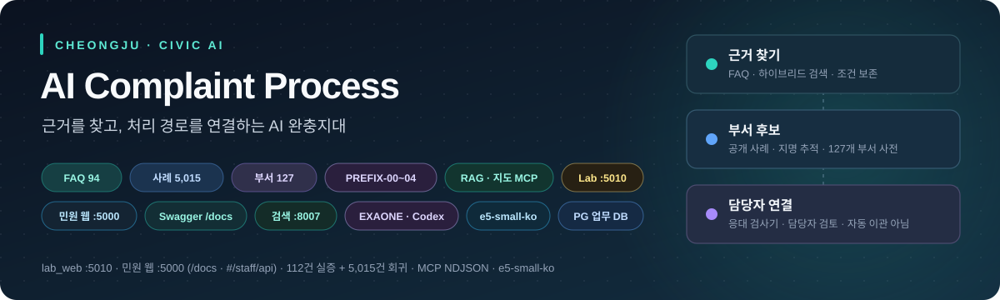

# 청주톡톡 AI 민원 도우미

**궁금한 건 바로 안내하고, 현장 조치가 필요한 민원은 알맞은 담당 부서로 이어 줍니다.**

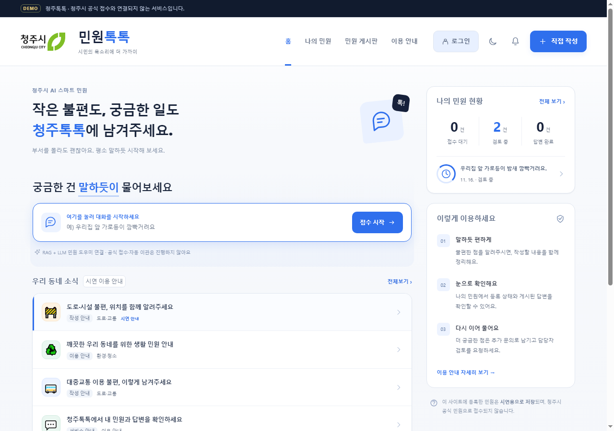
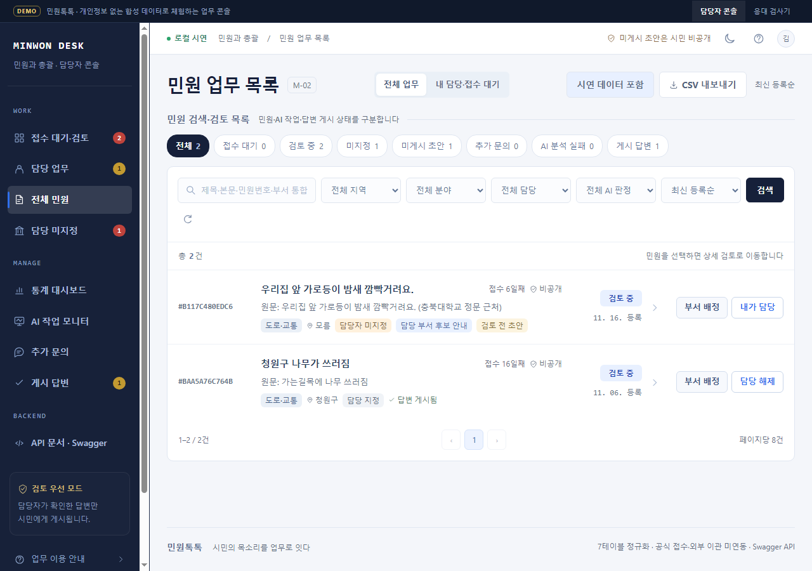

<sub>왼쪽은 시민 사이트, 오른쪽은 담당자 사이트입니다.</sub>

</div>

> [!TIP]
> **처음 쓰시나요?** 화면 그림으로 따라 하는 사용 가이드가 있습니다. 민원을 남기려는 분은 [민원인 이용 가이드](docs/guides/민원인_이용_가이드.md), 민원을 처리하는 분은 [담당자 이용 가이드](docs/guides/담당자_이용_가이드.md)를 읽어 주세요(인쇄용 PDF도 함께 있어요).

> [!NOTE]
> 이 프로젝트는 **시연용**입니다. 청주시 공식 민원 접수와 연결되어 있지 않고, 실제 부서로 민원을 자동으로 넘기지 않습니다.

---

## 어떤 서비스인가요?

시민이 불편한 점을 적으면 AI가 먼저 읽고 두 가지를 도와줍니다.

1. **자주 묻는 질문이면** 공식 안내 내용을 근거와 함께 알려 줍니다.
2. **현장 조치가 필요하면** 비슷한 과거 사례를 찾아 **담당 부서 후보**를 알려 주고, 담당자가 검토할 수 있게 정리합니다.

AI가 확신하지 못하면 억지로 답하지 않고 **담당자에게 넘깁니다.** 그리고 AI가 쓴 답변은 담당자가 확인해서 게시하기 전까지 **시민에게 보이지 않습니다.**

| 알고 있는 자료 | 규모 |
| --- | --- |
| 자주 묻는 질문(FAQ) | 94건 |
| 공개된 민원 사례 | 5,015건 |
| 청주시 부서 | 127개 |

---

## 누가 무엇을 할 수 있나요?

이용하는 사람은 **게스트 · 민원인 · 담당자**, 세 가지로 나뉩니다.

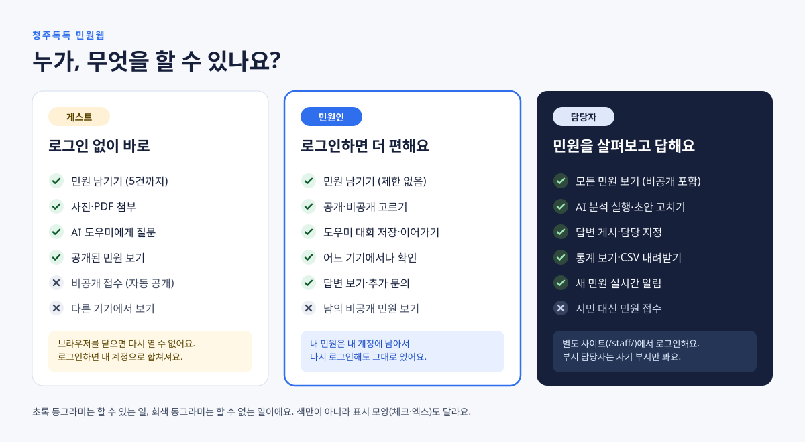

| 할 수 있는 일 | 게스트<br><sub>로그인 없이</sub> | 민원인<br><sub>로그인 후</sub> | 담당자<br><sub>담당자 사이트</sub> |
| --- | :---: | :---: | :---: |
| 홈·이용 안내 보기 | 가능 | 가능 | 가능 |
| AI 민원 도우미에게 묻기 | 가능 | 가능 | 불가 |
| 도우미 대화 저장하고 이어가기 | 불가 | 가능 | 불가 |
| 민원 접수하기 | 5건까지 | 제한 없음 | 불가 |
| 공개·비공개 고르기 | 공개로 고정 | 선택 가능 | 불가 |
| 공개된 민원 보기 | 가능 | 가능 | 가능 |
| 남의 비공개 민원 보기 | 불가 | 불가 | 가능 |
| 내 민원 고치기·지우기 | 이 브라우저에서만 | 가능 | 불가 |
| AI 분석 실행·초안 고치기 | 불가 | 불가 | 가능 |
| 답변 게시·담당 지정 | 불가 | 불가 | 가능 |
| 게시판에서 민원 내리기 | 불가 | 불가 | 가능 (사유 기록) |
| 통계 보기·CSV 내려받기 | 불가 | 불가 | 가능 |

**알아두면 좋은 점**

- **게스트로 낸 민원은 게시판에 공개됩니다.** 이름·연락처 같은 개인정보는 쓰지 마세요. 접수 뒤 수정으로 비공개로 바꿀 수는 없고, 문제가 있는 글은 담당자가 사유를 남기고 게시판에서 내릴 수 있습니다.
- 게스트는 **브라우저를 닫으면 내 민원을 다시 열 수 없습니다.** 로그인하면 그동안 낸 민원이 내 계정으로 합쳐집니다.
- 담당자 사이트는 시민 사이트와 **주소도 로그인도 따로**입니다. 담당자 아이디로 시민 사이트에 들어갈 수 없고, 그 반대도 마찬가지입니다.
- 담당 부서가 정해진 담당자는 자기 부서 민원만 보고, 총괄 담당자는 전체를 봅니다.

---

## 민원은 이렇게 흘러갑니다

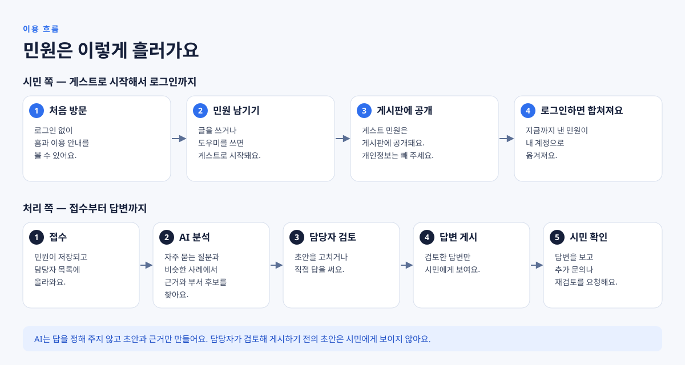

**그림에서 헷갈리기 쉬운 점**

- **장소를 먼저 확인합니다.** 주소가 청주 밖으로 확인되면 검색도 AI 분석도 하지 않고 곧바로 담당자 검토로 보냅니다.
- **판정 뒤에는 길이 둘로 나뉩니다.** 자주 묻는 질문으로 안내할 수 있으면 안내문을, 부서 연결이나 담당자 검토가 필요하면 담당자용 초안과 부서 후보를 만듭니다. 판정 결과는 코드가 한 번 더 확인합니다.
- **접수한 민원의 AI 결과는 모두 담당자 초안으로만 저장됩니다.** 담당자가 확인해 게시해야 시민에게 보입니다. 시민에게 바로 답이 나가는 곳은 **AI 챗봇의 자주 묻는 질문 안내**뿐입니다.

---

## 화면 둘러보기

| 시민 사이트 | |
| :---: | :---: |
| 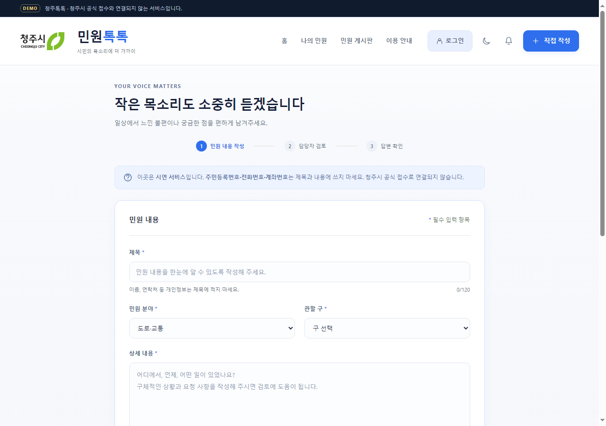<br>**민원 작성** — 제목·내용을 쓰고 사진을 붙여요 | 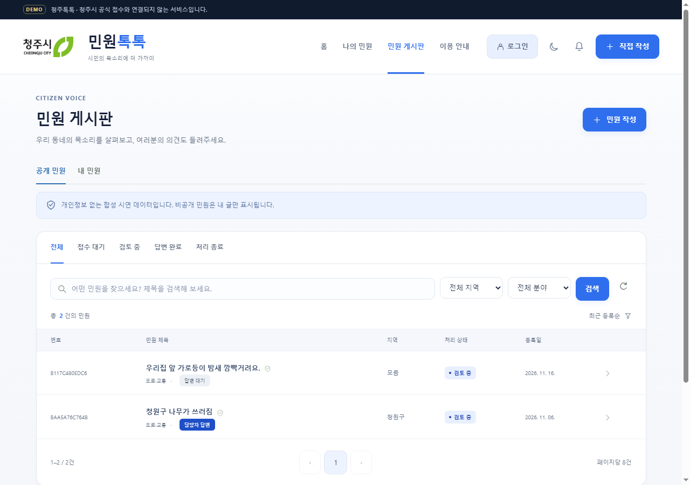<br>**민원 게시판** — 공개된 민원을 보고 검색해요 |

| 담당자 사이트 | |
| :---: | :---: |
| <br>**업무 목록** — 상태별로 모아 보고 담당을 정해요 | 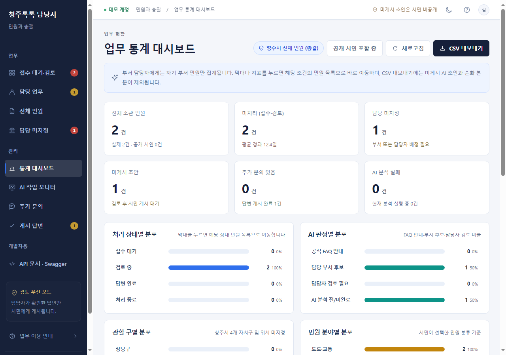<br>**통계 대시보드** — 처리 현황을 한눈에 봐요 |

| 어두운 화면과 휴대폰 | | |
| :---: | :---: | :---: |
| 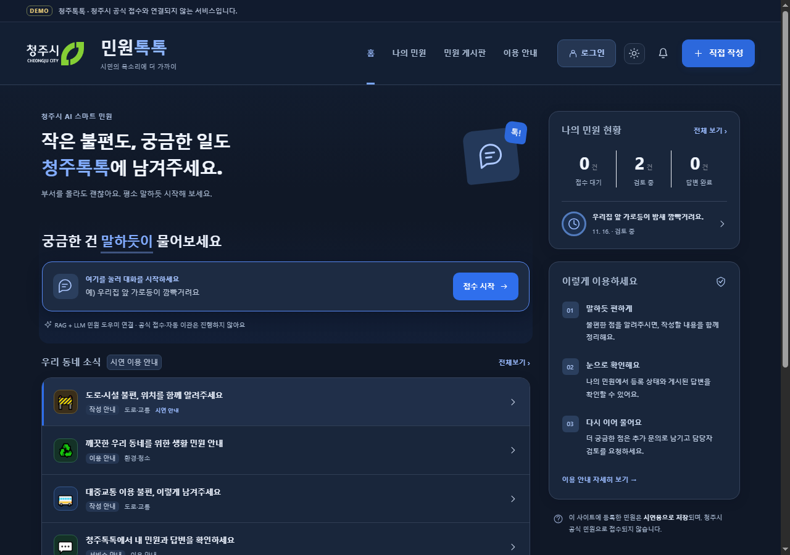<br>어두운 화면 | 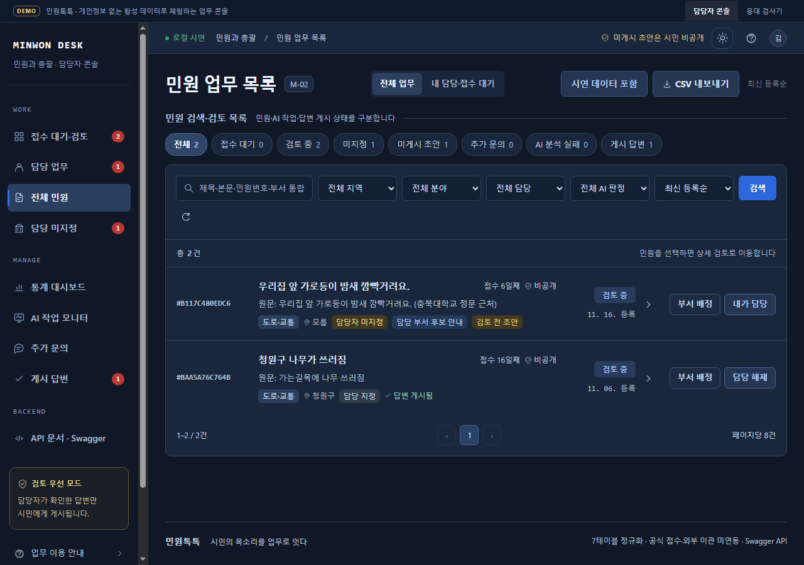<br>어두운 화면 | 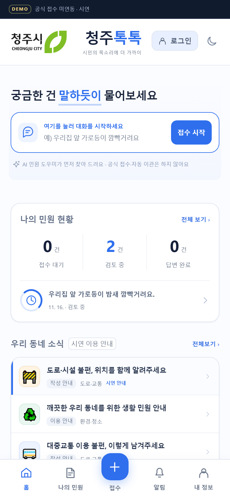<br>휴대폰 |

---

## 직접 실행해 보기

> 모든 명령은 저장소 폴더에서 실행합니다. Docker는 쓰지 않습니다.

**1. 처음 한 번, 환경 준비** (가상환경·데이터베이스·모델을 설치합니다)

```bat
setup.cmd          :: Windows
```
```bash
./setup.sh         # Linux
```

설치 없이 준비 상태만 보려면 뒤에 `--check`를 붙입니다.

**2. 실행하기**

| 무엇을 | 명령 | 열리는 주소 |
| --- | --- | --- |
| 민원 웹 (시민·담당자) | `python -m src` | 시민 `http://127.0.0.1:5000/` · 담당자 `http://127.0.0.1:5000/staff/` |
| 응대 검사기 (AI가 어떻게 판단하는지 확인) | Windows `bin/start-lab.cmd` · Linux `bin/start-lab.sh` | `http://127.0.0.1:5010/` |
| 검색만 따로 켜기 | Windows `bin/start-search.cmd` · Linux `bin/start-search.sh` | `http://127.0.0.1:8007/docs` |

로컬에서는 시연용 로그인이 기본으로 켜져 있어 계정 없이 두 사이트를 둘러볼 수 있습니다. 로그인 화면이 필요하면 담당자 계정은 아래 명령으로 만듭니다.

```bash
flask --app src:create_app create-staff --login-id staff_kim --name "김담당"
```

비밀번호는 명령줄이 아니라 실행 중 입력창(또는 환경변수)으로 받습니다. 자세한 내용은 [서버 안내](src/README.md)를 보세요.

**3. API 문서** — 민원 웹을 켠 뒤 `http://127.0.0.1:5000/docs`에서 한국어 Swagger 문서를 볼 수 있습니다. 인쇄본은 [Swagger PDF](docs/api/청주톡톡_민원_업무_API_Swagger.pdf)입니다.

---

## 인터넷에 공개한 모습

지금 이 민원 웹은 인터넷에 열려 있어서, 주소만 알면 누구나 시연 서비스를 써 볼 수 있습니다.

| 무엇 | 주소 |
| --- | --- |
| **시민 사이트** (민원을 남기는 곳) | https://cheongju.mib.dpdns.org/ |
| **담당자 사이트** (로그인이 필요해요) | https://cheongju.mib.dpdns.org/staff/ |
| **소스 코드** (GitHub) | https://github.com/hy040504/ai-complaint-process — 최신은 [`main` 브랜치](https://github.com/hy040504/ai-complaint-process/tree/main) |

> [!NOTE]
> 시연용 서버라서 예고 없이 멈추거나 데이터가 지워질 수 있습니다. 청주시 공식 접수가 아니니 개인정보는 쓰지 마세요.

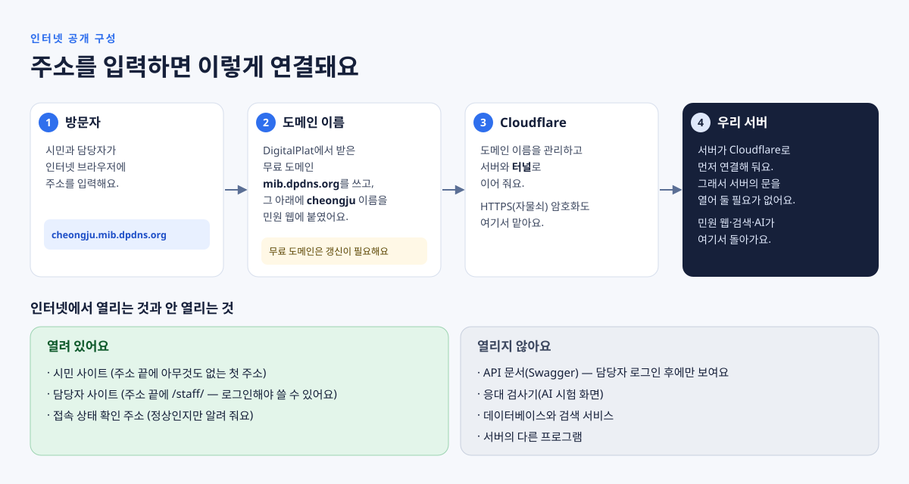

### 구성 요소를 쉬운 말로

| 이름 | 하는 일 | 어디서 받았나요 |
| --- | --- | --- |
| **도메인** `mib.dpdns.org` | 인터넷 주소의 "이름" 부분입니다. 그 아래에 `cheongju`라는 이름을 붙여 민원 웹 주소(`cheongju.mib.dpdns.org`)로 쓰고 있어요. | **DigitalPlat**에서 받은 무료 도메인 |
| **Cloudflare** | 도메인 이름을 관리하고, 방문자를 서버로 이어 주며, HTTPS(주소창의 자물쇠) 암호화를 맡습니다. | Cloudflare 무료 계정 |
| **터널** | 서버가 Cloudflare 쪽으로 **먼저 연결을 걸어 두는** 통로입니다. 덕분에 서버의 문(포트)을 인터넷에 열지 않아도 됩니다. | 서버에 설치한 프로그램 `cloudflared` |
| **우리 서버** | 민원 웹(시민·담당자 사이트), 검색, AI가 돌아가는 리눅스 컴퓨터입니다. 서버를 다시 켜도 모두 **자동으로 시작**돼요. | 따로 마련한 서버 |

### 왜 이렇게 했나요

- **무료**입니다. 도메인도, Cloudflare도, 터널도 비용이 들지 않아요.
- **주소가 바뀌지 않습니다.** 예전에 쓰던 임시 터널은 껐다 켤 때마다 주소가 새로 생겼지만, 지금 방식은 고정된 이름을 씁니다.
- **서버를 안전하게 둘 수 있습니다.** 서버가 밖으로 먼저 연결하는 방식이라 서버로 들어오는 문을 열 필요가 없어요.
- **HTTPS가 자동**으로 적용됩니다. 로그인할 때 아이디와 비밀번호가 암호화되어 오갑니다.

### 열리는 것과 지켜지는 것

- 인터넷에서는 **시민 사이트, 담당자 사이트, 접속 상태 확인 주소**만 열립니다. 담당자 사이트는 로그인을 해야 써요.
- **응대 검사기(AI 시험 화면)** 는 시민·담당자 사이트와 따로 `/lab/` 주소로만 들어갑니다. 어느 화면에도 연결 링크를 두지 않았고, **담당자로 로그인한 사람만** 쓸 수 있어요(로그인하지 않으면 담당자 로그인 화면으로 보냅니다). 한 계정이 10분에 20번까지 실행할 수 있고, 민원은 저장되지 않습니다.
- **API 문서(Swagger)** 는 담당자로 로그인한 뒤에만 볼 수 있어요(담당자 사이트의 "API" 메뉴).
- **디자인 시안, 데이터베이스, 검색 서비스**는 밖에서 열리지 않습니다.
- 터널을 움직이는 **열쇠(토큰)와 계정 비밀번호는 서버 안의 설정 파일에만** 있고 이 저장소(GitHub)에는 없습니다.

### 이 구성을 만든 순서

1. **DigitalPlat**에서 무료 도메인(`mib.dpdns.org`)을 받습니다.
2. **Cloudflare**에 그 도메인을 추가하고, DigitalPlat에서 이름 서버를 Cloudflare 것으로 바꿉니다.
3. Cloudflare에서 **터널**(이름 `cheongju-web`)을 만들고, `cheongju.mib.dpdns.org`를 서버의 민원 웹으로 연결합니다.
4. 서버에 터널 프로그램을 **서비스로 등록**해 늘 켜 둡니다.
5. 코드가 바뀌면 개발자가 [배포 스크립트](scripts/ops/deploy-remote.ps1)로 서버에 새 버전을 올립니다. (명령어와 순서는 [원격 서버 배포 안내](docs/harness/원격_서버_배포.md))

### 운영하면서 알아둘 것

- **도메인 갱신:** 무료 도메인은 기간이 지나면 갱신해야 할 수 있어요. DigitalPlat 계정에서 만료일을 가끔 확인하세요. 만료되면 주소가 열리지 않습니다.
- **접속이 안 될 때:** ① 브라우저에서 `…/api/v1/health` 주소가 "정상"으로 나오는지 보고 ② 안 나오면 서버의 서비스 4개(민원 웹·검색·검사기·터널)가 켜져 있는지 확인하세요. 터널만 꺼져도 주소가 열리지 않습니다.
- **같은 도메인의 다른 이름:** `mib.dpdns.org` 아래에는 다른 용도의 이름도 있을 수 있으니, 민원 웹은 `cheongju` 이름만 다루세요.
- **시연이 끝나면:** 시연용 계정을 끄고 필요하면 서버 설정을 정리해 주세요.

---

## 안전을 위해 지키는 약속

- **AI는 초안만 만듭니다.** 담당자가 확인해 게시한 답변만 시민에게 보입니다.
- **자동으로 다른 부서에 넘기지 않습니다.** 부서 이름은 후보로만 보여 줍니다.
- **과거 답변을 지금의 공식 안내로 쓰지 않습니다.** 공식 안내는 FAQ에서만, 과거 사례는 담당 부서 후보를 찾는 데만 씁니다.
- **근거가 부족하면 담당자에게 넘깁니다.** AI의 자신감 점수를 처리 근거로 삼지 않습니다.
- **사진은 위치 정보를 지웁니다.** 첨부한 사진의 EXIF(촬영 위치 등)는 저장 전에 자동으로 제거됩니다.
- **글 속의 지시는 따르지 않습니다.** 민원 내용에 "이렇게 행동해"라고 적혀 있어도 자료로만 취급합니다.

---

## 더 알아보기

| 궁금한 점 | 문서 |
| --- | --- |
| 민원 웹을 어떻게 쓰나요 (화면 그림 포함) | [민원인 이용 가이드](docs/guides/민원인_이용_가이드.md) · [담당자 이용 가이드](docs/guides/담당자_이용_가이드.md) |
| 구현한 기능과 수치, 검증 결과를 자세히 | [기술 개요](docs/기술_개요.md) (이전 README 전체) |
| 문서가 어디에 있는지 | [문서 목차](docs/README.md) |
| 서버와 API를 만지고 싶다 | [서버 안내](src/README.md) |
| 화면(UI) 구조와 디자인 | [화면 안내](ui/README.md) |
| 검색이 어떻게 동작하나 | [검색 안내](rag/README.md) · [데이터 사전](rag/origin/README.md) |
| AI의 판단 규칙과 프롬프트 | [완충지대 하네스](docs/harness/LLM_완충지대_하네스.md) · [프롬프트](docs/harness/prompts/README.md) |
| 지금 인터넷에 어떻게 공개했나(도메인·터널) | 이 README의 [인터넷에 공개한 모습](#인터넷에-공개한-모습) |
| 서버에 올리는 방법 | [원격 서버 배포](docs/harness/원격_서버_배포.md) |
| 어떤 문제를 겪고 어떻게 고쳤나 | [프로젝트 사례](docs/cases/README.md) · [변경 이력](CHANGELOG.md) |
| 앞으로의 계획 | [구현 계획](docs/plans/README.md) |

## 지금 상태와 한계

- **되는 것:** 시민·담당자 사이트, 게스트 접수, 로그인, 사진·PDF 첨부, AI 분석과 초안, 담당자 실시간 알림, 통계, 한국어 API 문서.
- **아직 안 되는 것:** 청주시 공식 접수 연결, 실제 부서로의 자동 이관, 외부 본인 인증(PASS 등), 여러 서버로 늘리기.
- **정해지지 않은 것:** 운영에 쓸 AI 모델, 합격 기준 점수. 지금은 `K-EXAONE`과 `GPT-6 Luna`(Codex)를 비교해 가며 쓰고 있습니다.
- **미확인:** 부서별 공식 업무 분장은 아직 검증되지 않아서, 부서 이름은 *후보*일 뿐 *확정*이 아닙니다.
