# 청주톡톡 민원 웹 — 담당자 이용 가이드

[가이드 목차](README.md) · [민원인 이용 가이드](민원인_이용_가이드.md)

시민이 남긴 민원을 **확인하고, 담당을 정하고, 답변을 써서 게시**하는 방법을 안내합니다. 컴퓨터를 많이 다뤄 보지 않으셔도 화면 그림의 **빨간 번호**를 따라 하시면 됩니다.

> [!IMPORTANT]
> 이 사이트는 **시연용**입니다. 청주시 공식 접수 시스템과 연결되어 있지 않고, 부서 배정도 이 화면 안에서의 표시일 뿐 **실제 부서로 전달되지 않습니다.**

---

## 업무 흐름 한눈에 보기

```text
시민이 민원 접수 → AI가 참고용 초안 준비(시민에겐 안 보임) → 담당자가 확인·담당 지정
       → 답변 쓰기(필요하면 AI 초안을 고침) → 미리보기 후 게시 → 시민이 답변 확인
```

**꼭 기억할 세 가지**

1. **AI는 도와주는 도구**입니다. AI가 만든 판정과 초안은 **참고용**이고, 최종 판단과 답변은 담당자가 합니다.
2. **게시하기 전의 글은 시민에게 보이지 않습니다.** 초안 저장과 게시는 다른 버튼이에요.
3. 과거 사례나 AI 초안을 **그대로 공식 안내로 쓰지 마세요.** 원문과 근거, 관할을 확인한 뒤에 게시합니다.

| 하고 싶은 일 | 읽을 곳 |
| --- | --- |
| 로그인하고 싶다 | [1. 로그인](#1-로그인) |
| 어디에 무엇이 있는지 알고 싶다 | [2. 첫 화면 보기](#2-첫-화면-보기) |
| 민원을 찾고 걸러 보고 싶다 | [3. 민원 찾기](#3-민원-찾기) |
| 민원 하나를 열어 확인하고 싶다 | [4. 민원 열어보기](#4-민원-열어보기) |
| 담당자나 부서를 정하고 싶다 | [5. 담당 지정과 부서 배정](#5-담당-지정과-부서-배정) |
| 답변을 쓰고 게시하고 싶다 | [6. 답변 쓰고 게시하기](#6-답변-쓰고-게시하기) |
| 게시한 답변을 거두고 싶다 | [6장 · 게시 답변 철회](#게시한-답변-거두기-게시-답변-철회) |
| 시민의 추가 문의를 확인하고 싶다 | [6장 · 추가 문의 확인하기](#추가-문의-확인하기) |
| AI를 다시 돌리거나 이력을 보고 싶다 | [7. AI 다시 돌리기와 이력](#7-ai-다시-돌리기와-이력) |
| AI 분석 진행 상황을 한눈에 보고 싶다 | [7장 · AI 작업 모니터](#ai-작업-모니터) |
| 게시판의 문제 글을 내리고 싶다 | [8. 게시판에서 글 내리기](#8-게시판에서-글-내리기) |
| 통계를 보거나 내려받고 싶다 | [9. 통계 보기](#9-통계-보기) |
| 용어가 어렵다 | [10. 용어 풀이](#10-용어-풀이) |

---

## 1. 로그인

담당자 사이트는 **시민 사이트와 주소도 로그인도 따로**입니다. 담당자 사이트 주소(끝에 `/staff/`)로 들어가면 아래 로그인 창이 나옵니다.

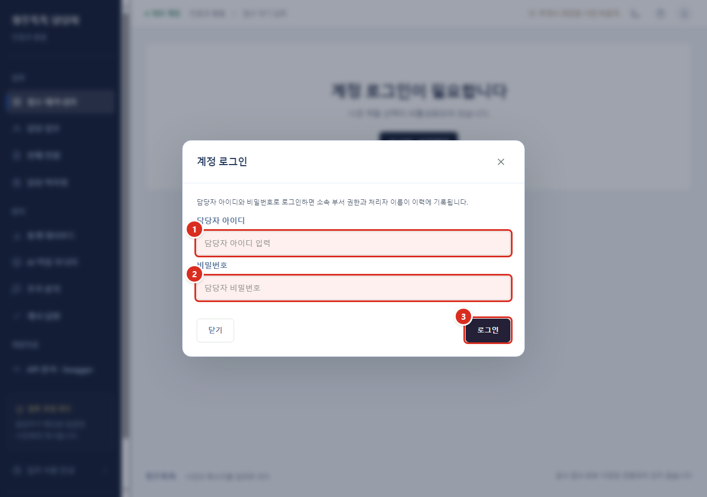

| 번호 | 이름 | 하는 일 |
| :---: | --- | --- |
| **1** | 담당자 아이디 | 관리자에게 받은 아이디를 입력합니다. |
| **2** | 담당자 비밀번호 | 비밀번호를 입력합니다. |
| **3** | 로그인 | 눌러서 들어갑니다. |

- 시민 계정으로는 담당자 사이트에 들어올 수 없고, 반대도 마찬가지입니다.
- 비밀번호를 여러 번 틀리면 잠시 로그인이 막힙니다.
- 아이디와 비밀번호는 **다른 사람에게 알려 주지 마세요.** 계정은 **시스템 관리자**가 만들어 주며, 이 화면에서 직접 만들 수는 없습니다.

**두 종류의 담당자**

| 종류 | 볼 수 있는 민원 | 할 수 있는 일 |
| --- | --- | --- |
| **총괄 담당자** | 모든 부서의 민원 | 다른 부서로 배정 포함 모든 업무 |
| **부서 담당자** | **자기 부서** 범위의 민원 | 자기 부서 안에서의 확인·답변. 다른 부서 배정은 **총괄만** 가능 |

---

## 2. 첫 화면 보기

로그인하면 **접수 대기·검토** 화면이 열립니다. 오늘 처리할 민원이 여기에 모입니다.

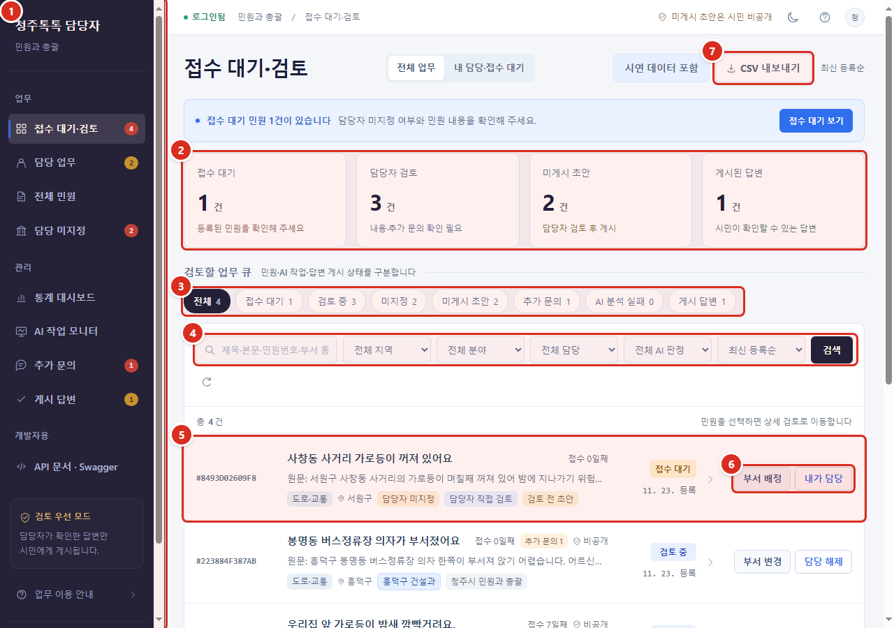

| 번호 | 이름 | 설명 |
| :---: | --- | --- |
| **1** | 왼쪽 메뉴 | 아래 표를 보세요. 빨간 숫자는 **처리가 필요한 건수**입니다. |
| **2** | 요약 카드 4개 | **접수 대기 / 담당자 검토 / 미게시 초안 / 게시된 답변**이 몇 건인지 보여 줍니다. 카드를 누르면 해당 민원 목록으로 갑니다. |
| **3** | 업무 큐 (탭) | 민원을 상태별로 걸러 봅니다. **전체 · 접수 대기 · 검토 중 · 미지정 · 미게시 초안 · 추가 문의 · AI 분석 실패 · 게시 답변** |
| **4** | 검색·필터 | 글자로 찾고 지역·분야·담당·AI 판정·정렬로 좁힙니다. [3장](#3-민원-찾기) 참고 |
| **5** | 민원 카드 | **누르면** 그 민원의 자세한 화면으로 갑니다. 카드 속 표시는 아래 표를 보세요. |
| **6** | 부서 배정 · 내가 담당 | 목록에서 바로 담당을 정합니다. [5장](#5-담당-지정과-부서-배정) 참고 |
| **7** | CSV 내보내기 | 목록을 엑셀에서 열 수 있는 파일로 내려받습니다. |

**왼쪽 메뉴 설명**

| 메뉴 | 무엇을 하나요 |
| --- | --- |
| 접수 대기·검토 | 오늘 확인할 새 민원 (첫 화면) |
| 담당 업무 | **내가 담당**으로 정한 민원 |
| 전체 민원 | 소관 민원 전체 |
| 담당 미지정 | 아직 담당자가 없는 민원 |
| 통계 대시보드 | 처리 현황을 숫자와 막대로 보기 |
| AI 작업 모니터 | AI 분석이 지금 어디까지 진행됐는지 실시간으로 보기 |
| 추가 문의 | 시민이 답변을 본 뒤 더 물어본 민원 |
| 게시 답변 | 이미 게시한 답변 모음 |
| API 문서 · Swagger | 시스템 개발자용입니다. 일반 업무에는 쓰지 않아요. |
| 업무 이용 안내 | 화면 안에서 바로 보는 짧은 도움말 |

**민원 카드 속 표시(태그)**

| 표시 | 뜻 |
| --- | --- |
| **담당자 미지정** | 아직 담당자가 정해지지 않았어요. |
| **검토 전 초안** | AI가 만든 초안이 있지만 **담당자가 아직 검토하지 않았어요.** |
| **접수 N일째** | 접수한 지 며칠이 지났는지 보여 줍니다. |
| **비공개** | 작성자가 비공개로 쓴 민원이에요. |

> [!NOTE]
> 화면 맨 위에 "**미게시 초안은 시민 비공개**"라고 항상 적혀 있습니다. 게시하기 전의 글은 시민에게 보이지 않아요.

---

## 3. 민원 찾기

**전체 민원** 메뉴로 가면 검색과 걸러 보기가 더 큰 화면으로 나옵니다.

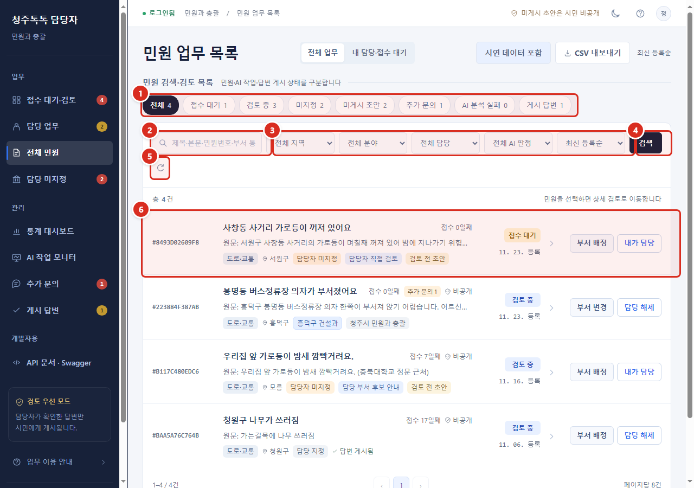

| 번호 | 이름 | 하는 일 |
| :---: | --- | --- |
| **1** | 상태 탭 | 숫자는 그 상태의 민원 수입니다. 누르면 해당 민원만 보입니다. |
| **2** | 검색 칸 | **제목 · 내용 · 민원번호 · 부서**에서 한 번에 찾습니다. |
| **3** | 걸러 보기 | 왼쪽부터 **지역 / 분야 / 담당 / AI 판정 / 정렬**입니다. 아래 표를 보세요. |
| **4** | 검색 | 조건을 고른 뒤 눌러야 적용됩니다. |
| **5** | 초기화 | 걸러 둔 조건을 모두 지웁니다. |
| **6** | 민원 한 줄 | 누르면 자세한 화면으로 갑니다. |

**걸러 보기에서 고를 수 있는 것**

| 칸 | 선택지 |
| --- | --- |
| 지역 | 상당구 · 서원구 · 흥덕구 · 청원구 · 모름 |
| 분야 | 도로·교통 · 환경·청소 · 공원·녹지 · 생활·복지 · 주택·건축 · 기타 |
| 담당 | 전체 담당 · **내 담당** · **미지정** |
| AI 판정 | 공식 FAQ 안내 · 담당 부서 후보 · 담당자 검토 · 분석 전 |
| 정렬 | 최신 등록순 · 오래된 미처리순 · 추가 문의 많은순 · 미게시 초안 우선 |

> [!TIP]
> **오래된 미처리순**으로 정렬하면 오래 기다린 민원부터 처리할 수 있어요.

**CSV 내보내기**: 지금 목록을 파일로 내려받습니다. 개인정보 보호를 위해 **게시하지 않은 AI 초안과 순화한 원문은 파일에 들어가지 않습니다.**

---

## 4. 민원 열어보기

목록에서 민원을 누르면 자세한 화면이 열립니다. 위쪽부터 차례로 읽으세요.

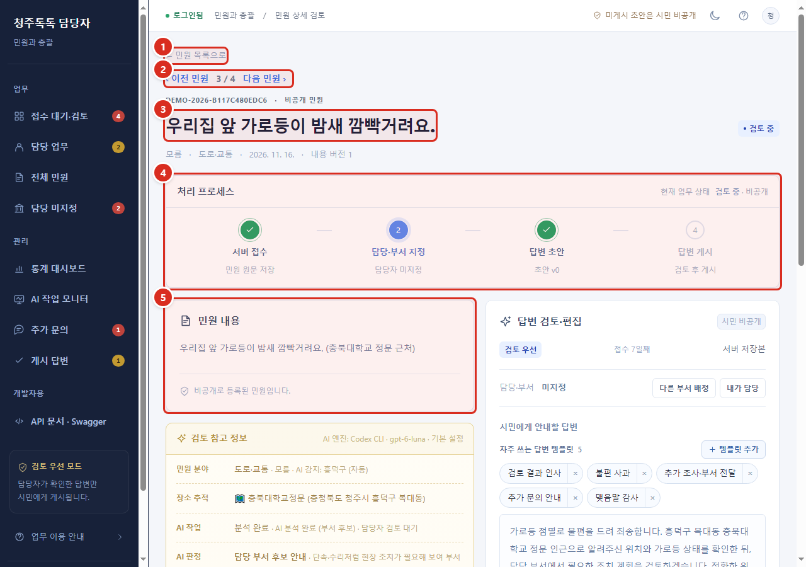

| 번호 | 이름 | 설명 |
| :---: | --- | --- |
| **1** | 민원 목록으로 | 목록으로 돌아갑니다. |
| **2** | 이전 · 다음 민원 | 목록 순서대로 앞뒤 민원으로 넘어갑니다. (**3 / 4**는 4건 중 3번째라는 뜻) |
| **3** | 제목과 상태 | 민원 제목과 지금 상태(**접수 대기 / 검토 중 / 답변 완료 / 처리 종료**)가 보입니다. 위의 작은 글씨에 민원 번호와 공개 여부가 있어요. |
| **4** | 처리 프로세스 | **서버 접수 → 담당·부서 지정 → 답변 초안 → 답변 게시** 중 어디까지 왔는지 보여 줍니다. 파란 동그라미가 지금 할 차례예요. |
| **5** | 민원 내용 | 시민이 쓴 **원문**입니다. 항상 이것을 먼저 읽으세요. |

### 검토 참고 정보 읽는 법

민원 내용 아래의 **노란 상자(검토 참고 정보)** 는 AI가 찾아 준 **참고 자료**입니다.

| 항목 | 뜻 |
| --- | --- |
| 민원 분야 | 시민이 고른 분야와 AI가 짐작한 지역(예: AI 감지: 흥덕구) |
| 장소 추적 | 글에서 찾아낸 장소 (예: 충북대학교 정문, 복대동) |
| AI 작업 | AI 분석이 끝났는지, 진행 중인지, 실패했는지 |
| **AI 판정** | **공식 FAQ 안내 / 담당 부서 후보 안내 / 담당자 검토 필요** 중 하나 |
| 부서 후보 | 비슷한 과거 사례에서 찾은 **담당 부서 후보**. **후보일 뿐 확정이 아닙니다.** |
| 참고 근거 | 안내에 쓴 자주 묻는 질문(FAQ) 등 근거 자료 |
| 민원 요약 | AI가 정리한 한 줄 요약과 **확인이 필요한 점** |

상자 맨 아래의 주의 문구를 꼭 읽어 주세요.

> **과거 사례나 AI 초안을 현행 정책으로 바로 게시·이관하지 않습니다. 원문과 근거·관할을 확인한 후 답변을 게시해 주세요.**

---

## 5. 담당 지정과 부서 배정

목록 카드와 상세 화면 어디서나 같은 버튼이 있습니다.

| 버튼 | 하는 일 |
| --- | --- |
| **내가 담당** | 이 민원을 내가 맡습니다. 다시 누르면(**담당 해제**) 맡은 것을 풀어요. |
| **부서 배정** / **다른 부서 배정** | 담당 부서를 정합니다. 아래 창이 열립니다. |

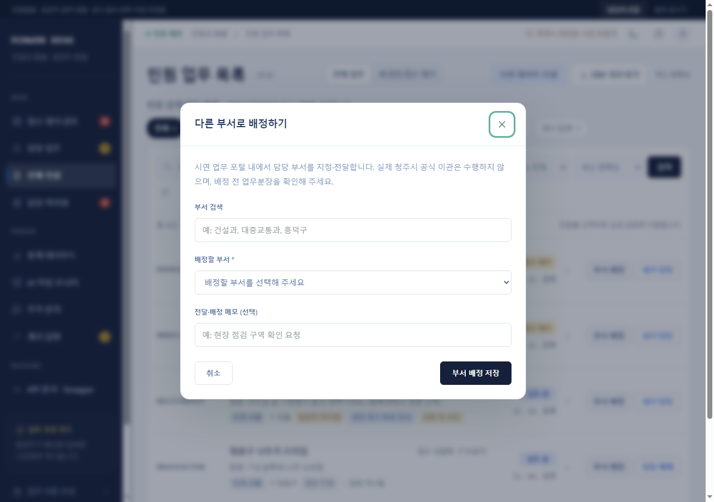

| 번호 | 이름 | 하는 일 |
| :---: | --- | --- |
| **1** | 부서 검색 | 부서 이름이나 구 이름 일부를 쓰면 목록이 줄어듭니다. 예: 건설과, 흥덕구 |
| **2** | 배정할 부서 | 목록에서 부서를 고릅니다. AI가 추천한 부서 후보가 있으면 버튼으로 먼저 보여 줍니다. |
| **3** | 전달·배정 메모 | 선택 사항입니다. 예: "현장 점검 구역 확인 요청" |
| **4** | 부서 배정 저장 | 눌러서 저장합니다. |
| **5** | 취소 | 저장하지 않고 닫습니다. |

> [!WARNING]
> 여기서 하는 배정은 **이 화면 안의 표시**입니다. 청주시의 공식 이관이 아니에요. 배정하기 전에 해당 부서의 **업무분장을 확인**하세요.

- **부서 담당자**는 자기 부서가 아닌 곳으로 배정할 수 없습니다. 그런 배정은 **총괄 담당자**가 합니다.
- 이미 배정한 부서를 풀려면 같은 창의 **배정 해제**를 누르세요.

---

## 6. 답변 쓰고 게시하기

상세 화면 **오른쪽의 "답변 검토·편집"** 에서 답변을 씁니다. 화면을 아래로 내려 보세요.

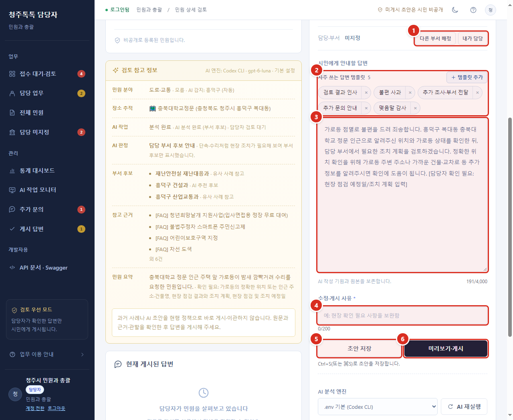

| 번호 | 이름 | 하는 일 |
| :---: | --- | --- |
| **1** | 부서·담당 버튼 | **다른 부서 배정**과 **내가 담당**이 여기에도 있어요. |
| **2** | 자주 쓰는 답변 템플릿 | 누르면 입력 칸에 문장이 들어갑니다. **+ 템플릿 추가**로 내 문장을 저장하고, 각 이름 오른쪽 **×** 로 지울 수 있어요. |
| **3** | 답변 입력 칸 | **시민에게 보낼 답변**을 씁니다. AI 초안이 미리 들어 있을 수 있어요. 읽어 보고 **고치세요.** (최대 4,000자) |
| **4** | 수정·게시 사유 | **꼭 써야 합니다.** 왜 고쳤는지, 어떤 근거로 게시하는지 짧게 남깁니다. (최대 200자) |
| **5** | 초안 저장 | **시민에게는 아직 보이지 않게** 쓰던 글을 저장합니다. `Ctrl + S`로도 저장돼요. |
| **6** | 미리보기·게시 | 시민 화면에 어떻게 보일지 먼저 확인하고 게시합니다. |

### 게시하는 순서

1. **3번**에 답변을 쓰거나 AI 초안을 고칩니다. 원문과 **참고 정보**를 보면서 사실과 다른 곳이 없는지 확인하세요.
2. **4번**에 사유를 씁니다. (빈칸이면 "이 입력란을 작성하세요"라고 알려 줘요.)
3. **6번 미리보기·게시**를 누릅니다.

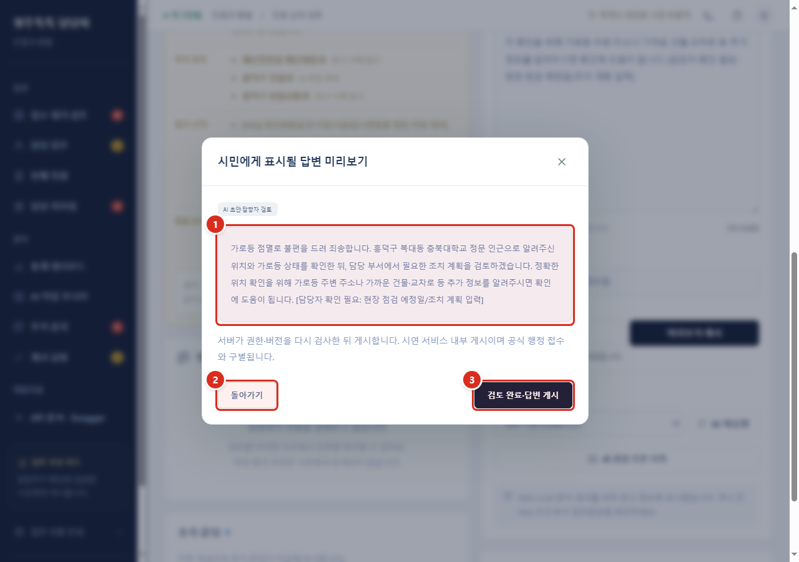

| 번호 | 이름 | 하는 일 |
| :---: | --- | --- |
| **1** | 미리보기 | **시민에게 이렇게 보입니다.** 위의 작은 표시(예: AI 초안·담당자 검토)도 함께 나가요. |
| **2** | 돌아가기 | 게시하지 않고 편집 화면으로 돌아갑니다. |
| **3** | 검토 완료·답변 게시 | **누르면 즉시 시민에게 공개됩니다.** 서버가 권한과 버전을 다시 검사한 뒤 게시합니다. |

> [!WARNING]
> **게시 버튼을 누르면 시민이 바로 볼 수 있습니다.** 누르기 전에 미리보기를 끝까지 읽으세요. 개인정보, 확정되지 않은 약속, 다른 부서의 일을 대신 약속하는 문장은 없는지 확인합니다.

- **게시한 뒤에는** 같은 화면의 **"현재 게시된 답변"** 칸에서 확인합니다. 문제가 있으면 **게시 답변 철회**(사유 필요)로 거둘 수 있어요.
- 시민이 **추가 문의**를 보내면 상태가 다시 **검토 중**으로 바뀌고 목록의 **추가 문의** 탭에 나타납니다.

### 게시한 답변 모아 보기

왼쪽 메뉴의 **게시 답변**을 누르면 이미 게시한 민원만 모아 볼 수 있습니다.

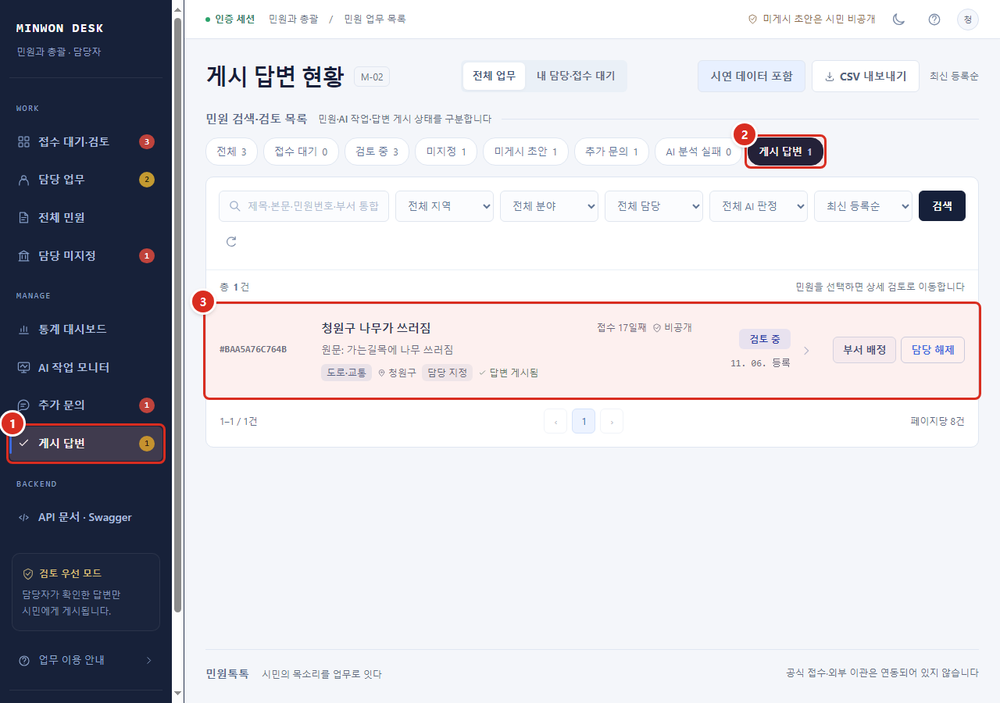

| 번호 | 이름 | 설명 |
| :---: | --- | --- |
| **1** | 게시 답변 메뉴 | 숫자는 게시한 민원 수입니다. |
| **2** | 게시 답변 탭 | 목록 위의 탭에서도 같은 목록을 고를 수 있어요. |
| **3** | 게시한 민원 | 카드 아래에 **답변 게시됨** 표시가 붙습니다. 누르면 상세 화면으로 갑니다. |

### 게시한 답변 거두기 (게시 답변 철회)

게시한 답변에 잘못된 내용이 있으면 상세 화면 오른쪽 아래의 **게시 답변 철회** 버튼을 누릅니다. 아래 창이 열려요.

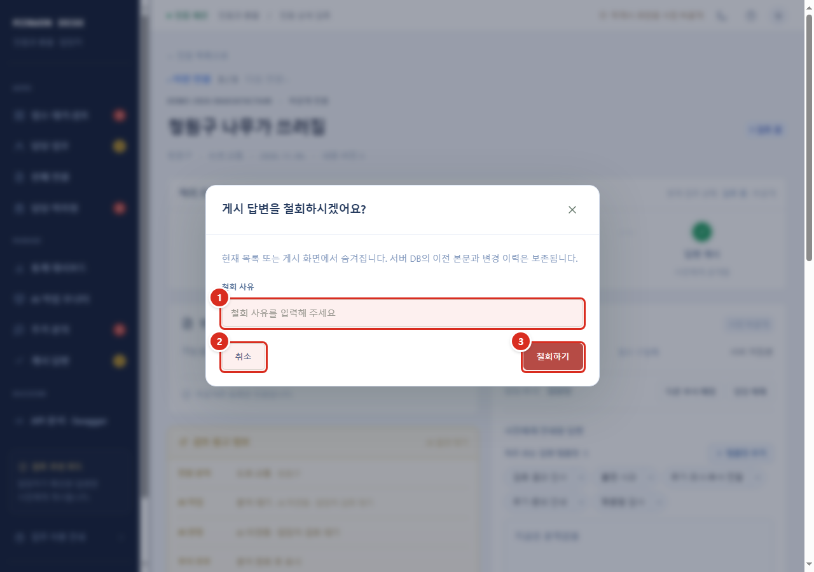

| 번호 | 이름 | 하는 일 |
| :---: | --- | --- |
| **1** | 철회 사유 | **꼭 써야 합니다.** 예: "부서 안내가 잘못되어 다시 확인 중입니다" |
| **2** | 취소 | 철회하지 않고 닫습니다. |
| **3** | 철회하기 | 답변을 내립니다. |

**철회하면 어떻게 되나요?**

- 시민 화면의 **답변 확인**에서 답변이 사라지고, 민원 상태가 **검토 중**으로 돌아갑니다.
- 내린 답변의 본문은 지워지지 않고 **이전 버전**으로 남습니다. 고쳐서 다시 게시하면 됩니다.

> [!WARNING]
> **철회 사유는 시민의 처리 이력에도 보입니다.** ("답변 철회: 사유" 형태) 시민이 읽어도 괜찮은 말로 쓰세요. ([8장](#8-게시판에서-글-내리기)의 "게시판에서 내리기" 사유는 시민에게 보이지 않는 것과 다릅니다.)

### 추가 문의 확인하기

답변을 본 시민이 더 물어보면 **추가 문의**로 들어옵니다.

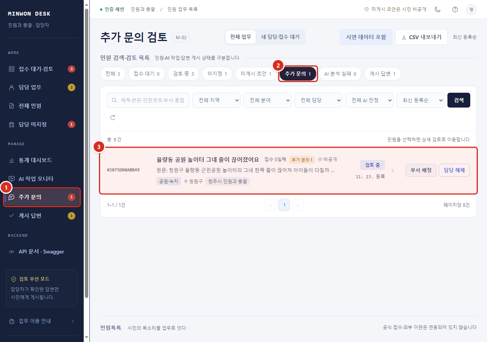

| 번호 | 이름 | 설명 |
| :---: | --- | --- |
| **1** | 추가 문의 메뉴 | 빨간 숫자는 추가 문의가 온 민원 수입니다. |
| **2** | 추가 문의 탭 | 목록 위의 탭에서도 같은 목록을 고를 수 있어요. |
| **3** | 추가 문의가 온 민원 | 제목 옆에 **추가 문의 N**(받은 문의 수)이 붙습니다. 누르면 상세 화면 왼쪽 아래 **추가 문의** 칸에서 내용을 읽을 수 있어요. 읽은 뒤 답변을 고쳐 다시 게시하세요. |

---

## 7. AI 다시 돌리기와 이력

상세 화면을 더 내리면 AI와 이력을 다루는 칸이 있습니다.

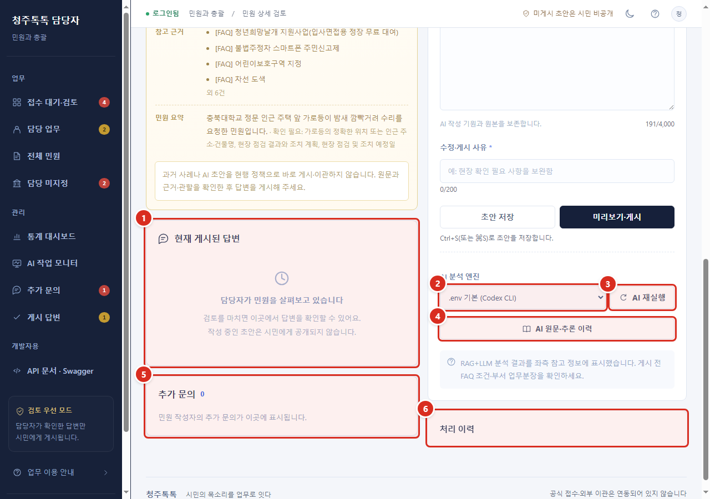

| 번호 | 이름 | 설명 |
| :---: | --- | --- |
| **1** | 현재 게시된 답변 | **시민에게 실제로 보이는 답변**입니다. 아직 게시 전이면 "담당자가 민원을 살펴보고 있습니다"가 보여요. |
| **2** | AI 분석 엔진 | AI를 다시 돌릴 때 쓸 엔진을 고릅니다. 평소에는 **기본값**을 쓰면 됩니다. |
| **3** | AI 재실행 | AI 분석을 처음부터 다시 합니다. 민원 내용이 바뀌었거나 분석이 실패했을 때 써요. |
| **4** | AI 원문·추론 이력 | AI가 처음 만든 글과 어떤 과정으로 판단했는지 기록을 봅니다. |
| **5** | 추가 문의 | 시민이 보낸 추가 문의가 여기에 쌓입니다. |
| **6** | 처리 이력 | 누가 언제 무엇을 했는지 모두 남습니다. (담당자 조정 기록은 시민에게 보이지 않아요.) |

### AI 작업 모니터

왼쪽 메뉴의 **AI 작업 모니터**에서 모든 민원의 AI 분석이 어디까지 진행됐는지 한 화면에 봅니다. 새로 고치지 않아도 **저절로 바뀝니다.**

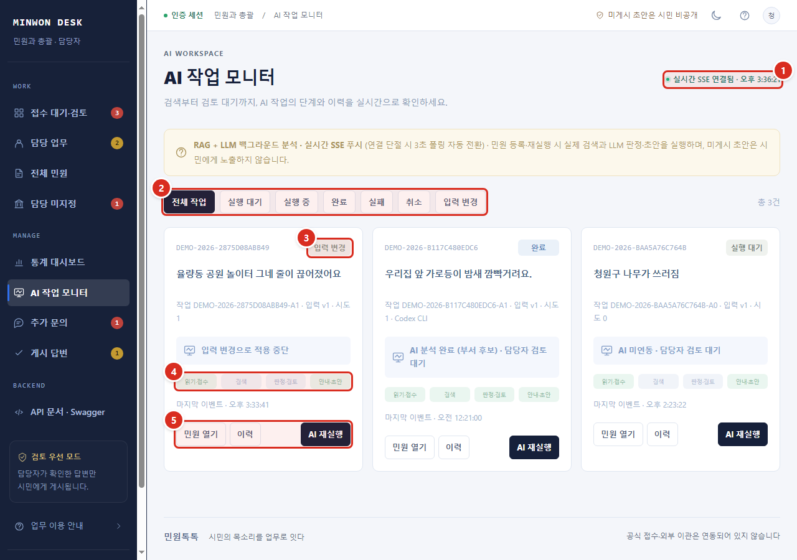

| 번호 | 이름 | 설명 |
| :---: | --- | --- |
| **1** | 실시간 연결 | 초록 점과 **실시간 SSE 연결됨**이면 화면이 자동으로 바뀝니다. 연결이 끊기면 몇 초마다 다시 확인해요. |
| **2** | 작업 상태 탭 | **실행 대기 · 실행 중 · 완료 · 실패 · 취소 · 입력 변경**으로 걸러 봅니다. |
| **3** | 작업 상태 | 이 민원의 AI 작업이 지금 어떤 상태인지 보여 줍니다. **입력 변경**은 분석 도중 민원 내용이 바뀌어 그 결과를 쓰지 않았다는 뜻이에요. |
| **4** | 진행 단계 | **읽기·접수 → 검색 → 판정·검토 → 안내·초안** 중 어디까지 왔는지 색으로 표시합니다. |
| **5** | 민원 열기 · 이력 · AI 재실행 | 상세 화면으로 가거나, 작업 기록을 보거나, AI 분석을 다시 돌립니다. **실패**나 **입력 변경**이면 **AI 재실행**을 누르세요. |

> [!NOTE]
> AI가 만든 초안은 **원본이 따로 보존**됩니다. 고쳐 쓰더라도 AI 원문과 비교할 수 있어요. 시민이 글을 고치면 이전 AI 결과는 **오래된 것**으로 처리되고 새로 분석합니다. **담당자가 이미 쓴 초안은 AI가 덮어쓰지 않습니다.**

---

## 8. 게시판에서 글 내리기

시민(특히 **로그인하지 않은 게스트**)이 쓴 글은 **민원 게시판에 공개**됩니다. 글에 **개인정보**가 있거나 **스팸·부적절한 내용**이면 담당자가 게시판에서 내릴 수 있어요.

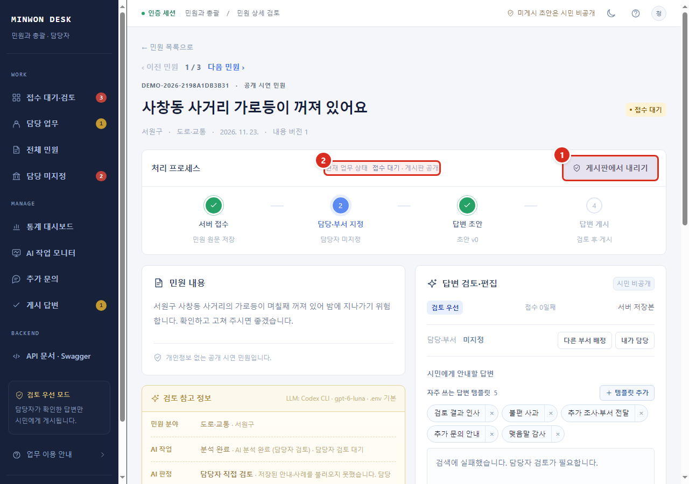

| 번호 | 이름 | 설명 |
| :---: | --- | --- |
| **1** | 게시판에서 내리기 | **공개 민원**에만 나타납니다. 누르면 아래 창이 열려요. |
| **2** | 현재 공개 상태 | **게시판 공개** 또는 **비공개**로 표시됩니다. |

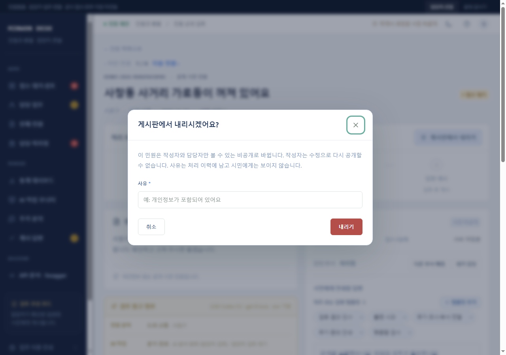

| 번호 | 이름 | 하는 일 |
| :---: | --- | --- |
| **1** | 사유 | **꼭 써야 합니다.** 예: "개인정보가 포함되어 있어요" (최대 200자) |
| **2** | 취소 | 내리지 않고 닫습니다. |
| **3** | 내리기 | 비공개로 바꿉니다. |

**내리면 어떻게 되나요?**

- 민원이 **비공개**가 되어 다른 시민에게는 보이지 않습니다. 작성자와 담당자는 계속 볼 수 있어요.
- 사유는 **처리 이력**에 남고 시민에게는 보이지 않습니다.
- 작성자는 **수정으로 다시 공개할 수 없습니다.** (게스트와 로그인한 시민 모두 마찬가지예요.)
- 내린 글은 같은 자리의 **게시판에 다시 공개** 버튼으로 되돌릴 수 있습니다. 사유가 필요해요.

**지켜야 할 규칙**

- 작성자가 **직접 비공개로 정한 민원**에는 이 버튼이 없습니다. 담당자도 공개로 바꿀 수 없어요. (시민의 사생활을 지키기 위해서입니다.)
- 담당자가 **내린 것만** 다시 공개할 수 있습니다.
- 내렸다는 것이 **작성자에게 알림으로 가지는 않습니다.** 필요하면 답변이나 안내로 따로 알려 주세요.

---

## 9. 통계 보기

왼쪽 메뉴의 **통계 대시보드**에서 처리 현황을 한눈에 봅니다.

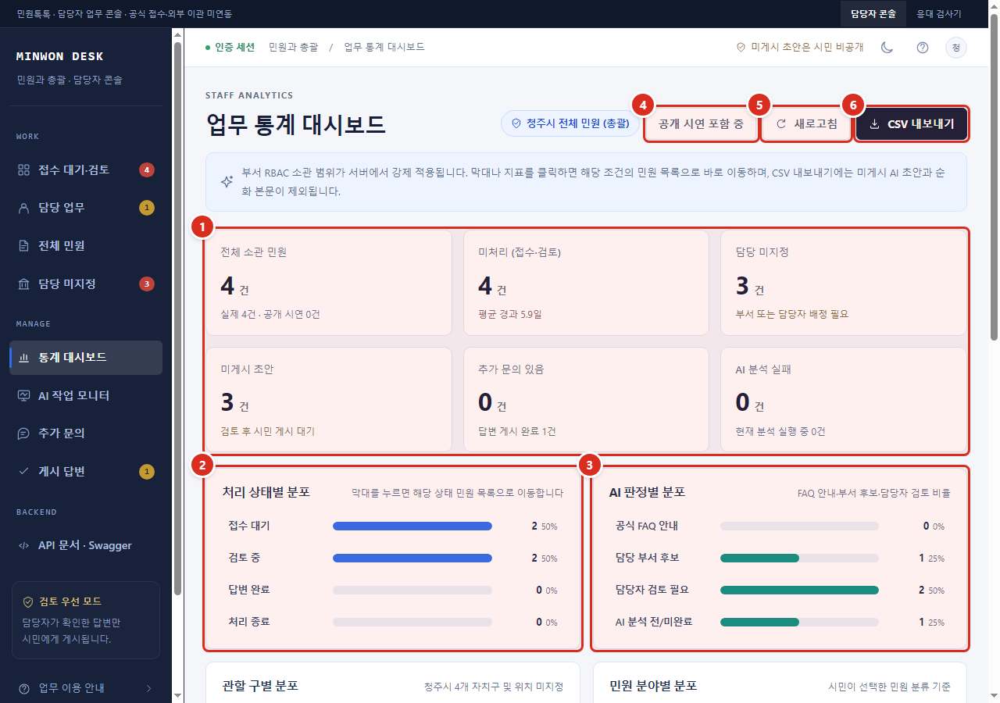

| 번호 | 이름 | 설명 |
| :---: | --- | --- |
| **1** | 요약 카드 6개 | **전체 소관 민원 · 미처리 · 담당 미지정 · 미게시 초안 · 추가 문의 · AI 분석 실패**의 건수입니다. 카드를 누르면 그 조건의 목록으로 갑니다. |
| **2** | 처리 상태별 분포 | 접수 대기·검토 중·답변 완료·처리 종료가 각각 몇 퍼센트인지 막대로 보여 줍니다. 막대를 누르면 해당 목록으로 가요. |
| **3** | AI 판정별 분포 | 공식 FAQ 안내·담당 부서 후보·담당자 검토 필요·분석 전/미완료의 비율입니다. |
| **4** | 공개 시연 포함 중 | 눌러서 **시연용 공개 데이터를 합칠지** 켜고 끕니다. 실제 민원만 보려면 꺼 두세요. |
| **5** | 새로고침 | 최신 숫자로 다시 불러옵니다. |
| **6** | CSV 내보내기 | 통계를 파일로 내려받습니다. (게시하지 않은 AI 초안과 순화 원문은 빠집니다.) |

화면을 아래로 내리면 **관할 구별 · 분야별 · 배정 부서별** 분포도 볼 수 있어요. 부서 담당자는 **자기 부서 범위**의 숫자만 보입니다.

---

## 10. 용어 풀이

| 용어 | 쉬운 설명 |
| --- | --- |
| **민원 번호** | 민원마다 붙는 고유 번호입니다. (예: `DEMO-2026-…`) 문의할 때 이 번호로 찾아요. |
| **AI 초안** | AI가 만들어 둔 **참고용 답변 글**입니다. 담당자가 고쳐서 써야 합니다. |
| **게시** | 답변을 **시민이 볼 수 있게 올리는 것**입니다. |
| **초안 저장** | 시민에게는 안 보이게 **쓰던 글을 보관**하는 것입니다. 게시와 달라요. |
| **미게시 초안** | 쓰기는 했지만 아직 **게시하지 않은 글**입니다. |
| **AI 판정** | AI가 이 민원을 **FAQ로 안내할 수 있는지, 부서 연결이 필요한지** 나눈 결과입니다. |
| **부서 후보** | 비슷한 과거 사례를 바탕으로 찾은 **담당 부서 추정**입니다. 확정이 아니에요. |
| **FAQ** | 청주시에서 **자주 묻는 질문**과 공식 답변입니다. |
| **순화 요약** | 거친 표현이 있는 민원을 담당자가 **부담 없이 읽을 수 있게 정리**한 글입니다. 원문은 따로 보존돼요. |
| **철회** | 시민이 민원을 거두거나, 담당자가 **게시한 답변을 거두는 것**입니다. 기록은 남아요. |
| **내리기** | 공개 민원을 **게시판에서 안 보이게(비공개)** 바꾸는 것입니다. |
| **총괄 / 부서 담당자** | 총괄은 모든 부서, 부서 담당자는 자기 부서 범위의 민원을 다룹니다. |
| **CSV** | 엑셀 같은 프로그램에서 열 수 있는 표 파일입니다. |

---

## 자주 겪는 일

**Q. AI 판정이 "담당자 검토"라고만 나와요.**
AI가 안내 근거를 충분히 찾지 못했다는 뜻입니다. 원문을 직접 읽고 답변을 쓰세요. 필요하면 **AI 재실행**을 해 볼 수 있어요.

**Q. AI 분석이 계속 "진행 중"이에요.**
**AI 작업 모니터**에서 진행 상황을 볼 수 있어요. 한참 걸리거나 실패했다면 상세 화면에서 **AI 재실행**을 눌러 보세요.

**Q. 게시 버튼을 눌렀는데 오류가 나요.**
**사유**를 비웠는지 확인하세요. 다른 담당자가 같은 민원을 먼저 고쳐 버전이 달라졌을 수도 있어요. 화면을 새로고침한 뒤 다시 시도하세요.

**Q. 다른 부서의 민원이 안 보여요.**
부서 담당자는 **자기 부서 범위**만 봅니다. 보여야 한다면 총괄 담당자에게 문의하세요.

**Q. 시민이 쓴 글을 직접 고칠 수 있나요?**
아니요. 시민의 원문은 담당자가 고치지 않습니다. 문제가 있으면 **답변**이나 **게시판에서 내리기**로 처리하세요.

---

[가이드 목차](README.md) · [민원인 이용 가이드](민원인_이용_가이드.md) · [프로젝트 소개](../../README.md)
