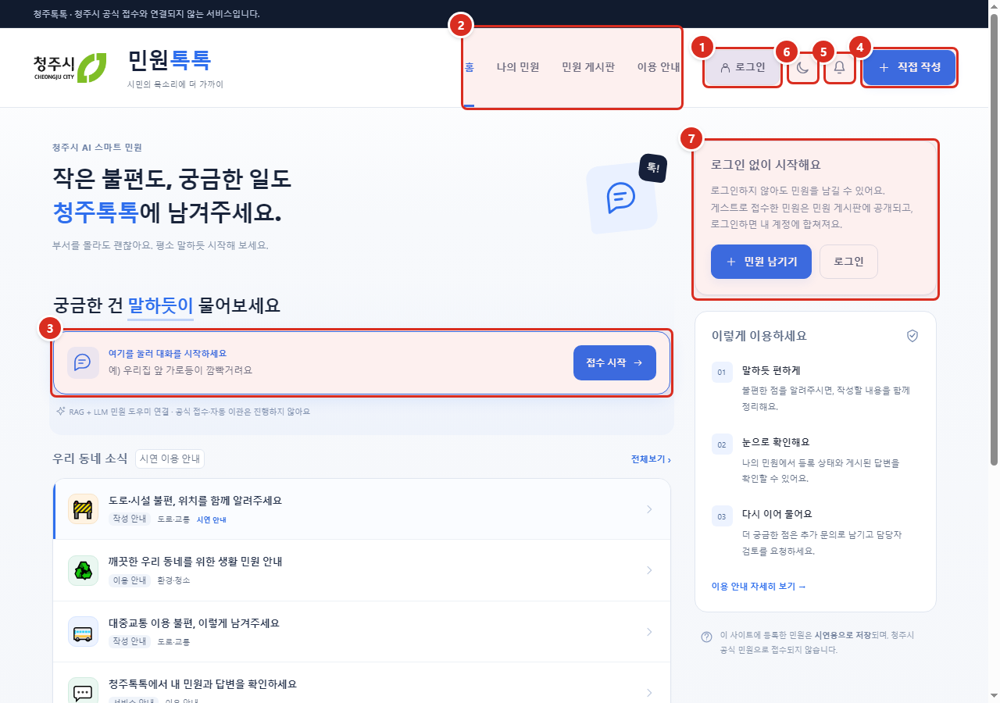
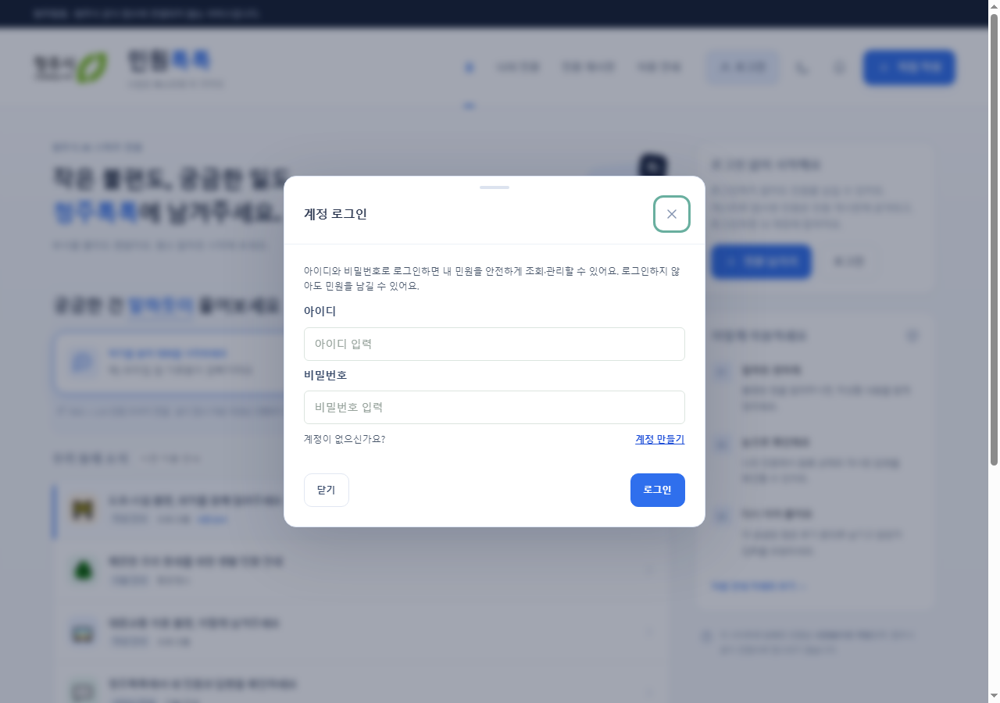
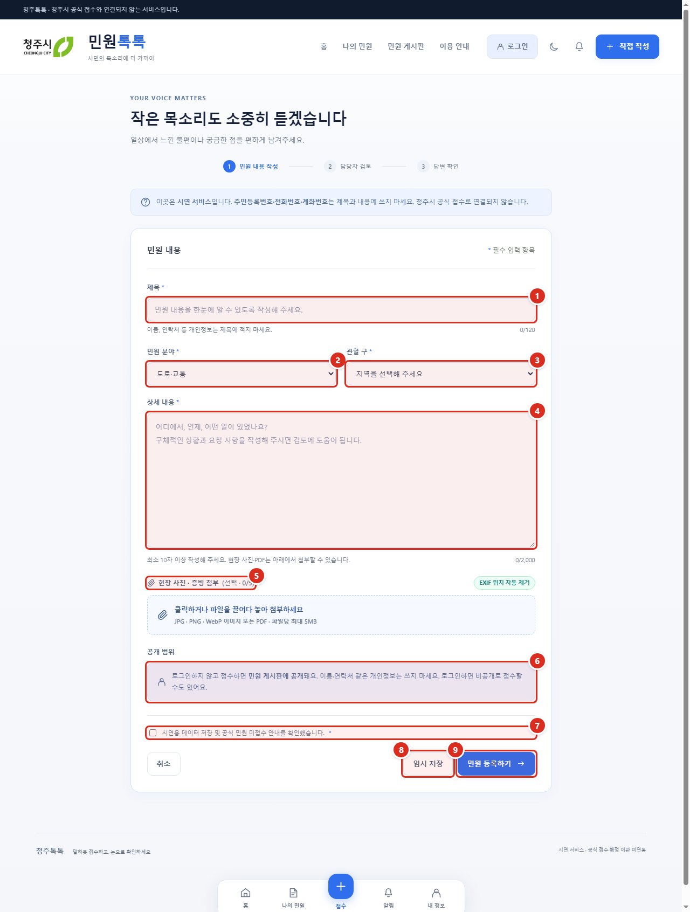
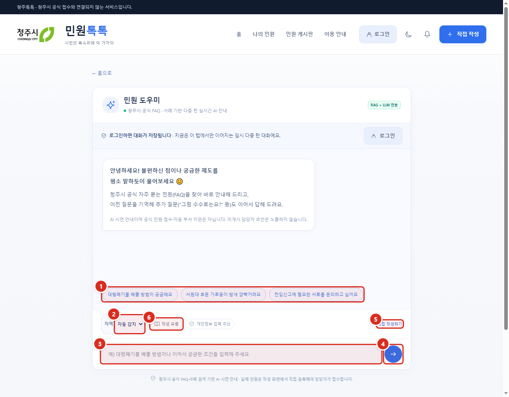
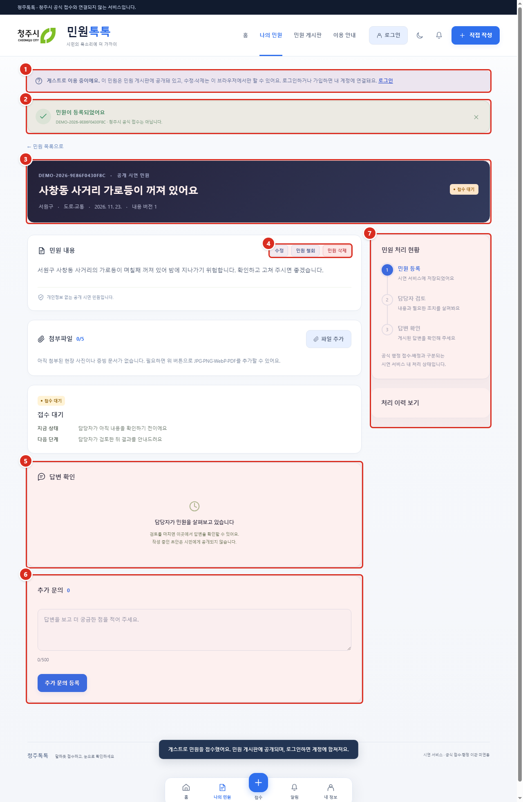
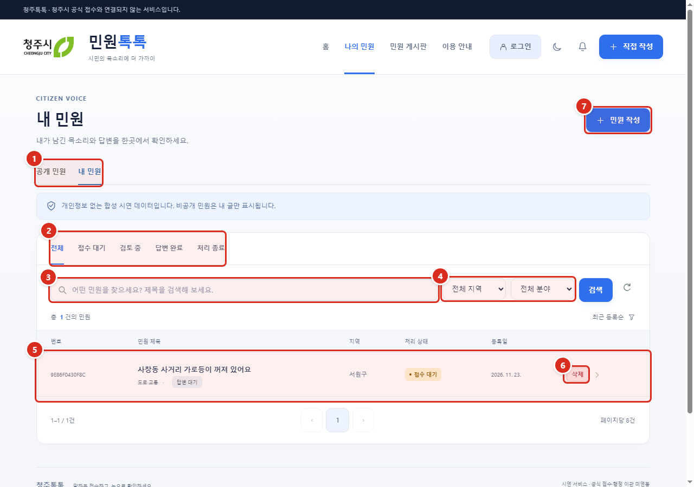
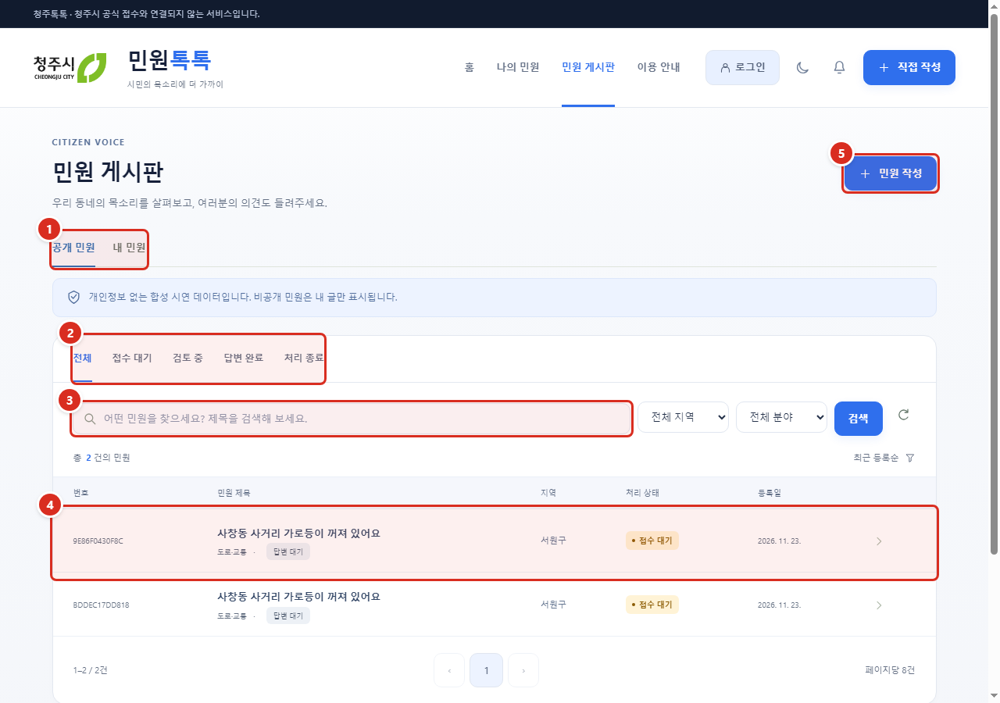
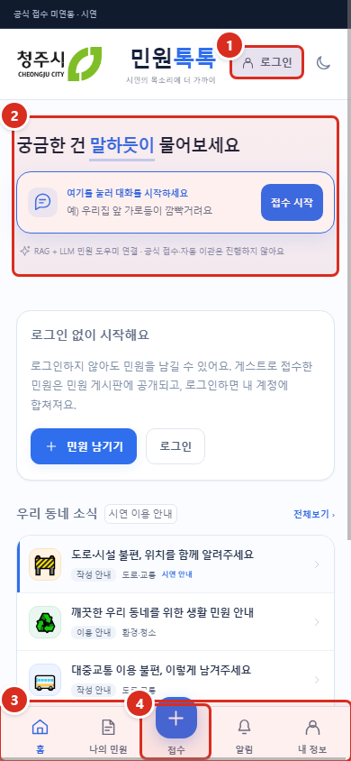

# 청주톡톡 민원 웹 — 민원인 이용 가이드

[가이드 목차](README.md) · [담당자 이용 가이드](담당자_이용_가이드.md)

불편한 일이나 궁금한 점을 **청주톡톡 민원 웹**에 남기고, 답을 확인하는 방법을 처음부터 차근차근 안내합니다. 컴퓨터나 인터넷을 잘 몰라도 그대로 따라 하실 수 있게 화면 그림에 **빨간 번호**를 붙여 설명했습니다.

> [!IMPORTANT]
> 이 서비스는 **시연용**입니다. 청주시 공식 민원 접수와 연결되어 있지 않고, 실제 부서로 민원이 자동 전달되지 않습니다. **주민등록번호·전화번호·계좌번호·이름** 같은 개인정보는 글에 쓰지 마세요.

---

## 이 가이드로 할 수 있는 일

| 하고 싶은 일 | 읽을 곳 |
| --- | --- |
| 처음 들어와서 화면이 어떻게 생겼는지 보고 싶다 | [1. 첫 화면 보기](#1-첫-화면-보기) |
| 로그인하거나 계정을 만들고 싶다 | [2. 로그인과 계정 만들기](#2-로그인과-계정-만들기) |
| 민원을 직접 쓰고 싶다 | [3. 민원 남기기](#3-민원-남기기) |
| 쓰기 전에 AI에게 먼저 물어보고 싶다 | [4. AI 민원 도우미에게 물어보기](#4-ai-민원-도우미에게-물어보기) |
| 접수한 뒤 무엇을 할 수 있는지 알고 싶다 | [5. 접수한 뒤 화면](#5-접수한-뒤-화면) |
| 내가 쓴 민원이나 다른 사람의 공개 민원을 보고 싶다 | [6. 내 민원과 민원 게시판](#6-내-민원과-민원-게시판) |
| 답변이 언제 오는지 알고 싶다 | [7. 처리 상태와 답변 확인](#7-처리-상태와-답변-확인) |
| 휴대폰으로 쓰고 싶다 | [8. 휴대폰에서 쓰기](#8-휴대폰에서-쓰기) |
| 궁금한 점이 있다 | [9. 자주 묻는 질문](#9-자주-묻는-질문) |

---

## 먼저 알아두세요: 로그인 없이도 되고, 로그인하면 더 편해요

| | 로그인 없이 (게스트) | 로그인하면 |
| --- | --- | --- |
| 민원 남기기 | **5건까지** | 제한 없음 |
| 공개 범위 | **게시판에 공개**로 고정 | **공개·비공개 중 선택** |
| 사진·PDF 첨부 | 가능 | 가능 |
| AI 민원 도우미 | 사용 가능 (대화는 저장되지 않음) | 대화가 **저장**되고 이어서 물을 수 있음 |
| 내가 쓴 민원 다시 보기 | **이 브라우저에서만** (창을 닫으면 다시 열 수 없어요) | 어느 기기에서든 **로그인하면 볼 수 있음** |

로그인 없이 쓴 민원도 나중에 로그인하거나 계정을 만들면 **내 계정으로 합쳐집니다.** (같은 브라우저에서 이어서 로그인해야 해요.)

---

## 1. 첫 화면 보기

주소창에 안내받은 주소를 입력하면 첫 화면이 열립니다.

| 번호 | 이름 | 하는 일 |
| :---: | --- | --- |
| **1** | 로그인 | 계정이 있으면 눌러서 로그인합니다. |
| **2** | 위쪽 메뉴 | **홈 · 나의 민원 · 민원 게시판 · 이용 안내**로 이동합니다. |
| **3** | 질문 창 | 눌러서 **AI 민원 도우미**와 이야기를 시작합니다. (**접수 시작** 버튼) |
| **4** | 직접 작성 | 바로 민원 쓰는 화면으로 갑니다. |
| **5** | 알림(종 모양) | 새로 올라온 답변을 모아 봅니다. (문자나 전화가 가는 것은 아니에요.) |
| **6** | 달 모양 버튼 | 화면을 **어두운 색**으로 바꿉니다. 눈이 편해집니다. 다시 누르면 원래대로 돌아옵니다. |
| **7** | 로그인 없이 시작해요 | 로그인하지 않고도 민원을 남길 수 있다는 안내입니다. |

맨 위의 검은 띠에는 "청주시 공식 접수와 연결되지 않는 서비스입니다"라고 적혀 있습니다. 시연 서비스라는 뜻이니 꼭 읽어 주세요.

---

## 2. 로그인과 계정 만들기

첫 화면 오른쪽 위의 **로그인(1번)** 을 누르면 아래 창이 나옵니다.

| 번호 | 이름 | 하는 일 |
| :---: | --- | --- |
| **1** | 아이디 | 가입할 때 정한 아이디를 입력합니다. |
| **2** | 비밀번호 | 비밀번호를 입력합니다. (입력하는 글자는 점으로 가려져요.) |
| **3** | 계정 만들기 | 계정이 없으면 눌러서 새로 만듭니다. |
| **4** | 로그인 | 입력을 마치고 누릅니다. |
| **5** | 닫기 | 로그인하지 않고 창을 닫습니다. |

**계정 만들 때 필요한 것**

- **이름**: 2~30자 (화면에 표시되는 이름이에요. 실명이 아니어도 됩니다.)
- **아이디**: 영문·숫자 3~32자 (`_` `.` `-` 사용 가능)
- **비밀번호**: 6자 이상

> [!TIP]
> 로그인을 여러 번 틀리면 잠시 로그인이 막힐 수 있어요. 잠시 뒤에 다시 해 보세요.

---

## 3. 민원 남기기

위쪽의 **직접 작성** 버튼(또는 휴대폰 아래쪽의 **+ 접수**)을 누르면 민원 쓰는 화면이 나옵니다. 위에서 아래로 차례로 채우면 됩니다.

| 번호 | 칸 이름 | 어떻게 쓰나요 |
| :---: | --- | --- |
| **1** | 제목 | 내용이 한눈에 보이게 짧게 씁니다. (최대 120자) 예: "사창동 사거리 가로등이 꺼져 있어요" |
| **2** | 민원 분야 | 가장 비슷한 것을 고릅니다. **도로·교통 / 환경·청소 / 공원·녹지 / 생활·복지 / 주택·건축 / 기타** |
| **3** | 관할 구 | **상당구 / 서원구 / 흥덕구 / 청원구** 중에서 고릅니다. 어디인지 모르면 **모름**을 고르세요. 글에 동네 이름이 있으면 시스템이 알아서 찾아 줍니다. |
| **4** | 상세 내용 | **10자 이상 2,000자까지** 씁니다. 아래 "잘 쓰는 방법"을 참고하세요. |
| **5** | 사진·PDF 첨부 | 현장 사진이나 증빙 서류를 붙입니다. (선택) |
| **6** | 공개 범위 | 게스트는 **게시판에 공개**로 정해져 있습니다. 로그인하면 **공개 / 비공개**를 고를 수 있어요. |
| **7** | 확인 체크 | "시연용이고 공식 접수가 아니다"는 안내를 읽었다는 표시입니다. **꼭 체크**해야 등록돼요. |
| **8** | 임시 저장 | 쓰던 내용을 이 창에 잠깐 보관합니다. 창을 닫으면 사라져요. |
| **9** | 민원 등록하기 | 다 쓴 뒤 눌러서 접수합니다. |

### 잘 쓰는 방법

답변이 빨리, 정확하게 오려면 **누가 읽어도 알 수 있게** 써 주세요.

| 꼭 들어가면 좋은 것 | 예시 |
| --- | --- |
| **어디서** | 사창동 사거리, 흥덕구 복대동 ○○아파트 앞 |
| **언제부터** | 일주일 전부터, 어제 저녁 8시쯤 |
| **무슨 일이** | 가로등이 꺼져 있어요, 나무가 쓰러졌어요 |
| **원하는 조치** | 수리해 주세요, 확인해 주세요 |

| 아쉬운 글 | 잘 쓴 글 |
| --- | --- |
| "가로등이 이상해요" | "서원구 사창동 사거리 가로등이 며칠째 꺼져 있어 밤에 지나가기 위험합니다. 확인하고 고쳐 주세요." |
| "빨리 해주세요!!" | "횡단보도 앞이라 어르신들이 위험해 보여요. 이번 주 안에 확인해 주시면 좋겠습니다." |

> [!WARNING]
> **글에 개인정보를 쓰지 마세요.** 이름, 전화번호, 주민등록번호, 계좌번호는 쓰지 않습니다. 게스트가 쓴 민원은 **게시판에 공개**되기 때문에 누구나 읽을 수 있어요.

### 사진·PDF 붙이기 (5번)

- **JPG, PNG, WebP 사진 또는 PDF**를 붙일 수 있습니다.
- 한 민원에 **최대 5개**, 파일 하나당 **5MB까지**입니다.
- 칸을 누르거나, 파일을 끌어다 놓으면 됩니다.
- 사진에 들어 있는 **촬영 위치 정보는 자동으로 지워집니다.** 집 위치가 새어 나갈 걱정은 하지 않으셔도 돼요.

### 등록하기

모두 채웠으면 **7번을 체크**하고 **9번 "민원 등록하기"** 를 누릅니다. 빠진 칸이 있으면 빨간 안내가 나오니 그 칸을 채운 뒤 다시 누르세요.

---

## 4. AI 민원 도우미에게 물어보기

"이런 일도 민원이 되나?", "서류가 뭐가 필요하지?"처럼 **먼저 물어보고 싶을 때** 쓰세요. 첫 화면의 **질문 창(3번)** 이나 위쪽 메뉴에서 열 수 있습니다.

| 번호 | 이름 | 하는 일 |
| :---: | --- | --- |
| **1** | 예시 질문 | 눌러 보면 질문이 자동으로 들어가 바로 답을 볼 수 있어요. |
| **2** | 지역 | 보통은 **자동 감지**로 두면 됩니다. 정확한 구를 알면 직접 고르세요. |
| **3** | 질문 입력 칸 | 궁금한 점을 평소 말하듯 씁니다. |
| **4** | 보내기(화살표) | 눌러서 질문을 보냅니다. |
| **5** | 직접 작성하기 | 도우미 대신 곧바로 민원을 쓰러 갑니다. |
| **6** | 작성 요령 | 민원을 잘 쓰는 방법을 보여 줍니다. |

**알아두세요**

- 도우미는 **청주시 공식 자주 묻는 질문(FAQ)** 을 찾아 알려 줍니다. 조건·기간이 있는 안내는 그대로 전해요.
- 도우미의 답은 **AI 안내**일 뿐, 공식 접수나 부서 전달이 아닙니다.
- 앞의 질문을 기억하니 "그럼 수수료는요?"처럼 **이어서 물어도** 됩니다.
- **로그인하지 않으면** 이 창에서만 이어지는 임시 대화예요. 닫으면 사라집니다. 로그인하면 대화가 **저장**됩니다.

---

## 5. 접수한 뒤 화면

민원을 등록하면 곧바로 아래 화면으로 넘어갑니다. 여기서 접수가 잘 되었는지, 앞으로 무엇을 할 수 있는지 볼 수 있어요.

| 번호 | 이름 | 설명 |
| :---: | --- | --- |
| **1** | 게스트 안내 | 로그인 없이 썼다면 보이는 안내입니다. **공개되어 있고, 이 브라우저에서만 고치고 지울 수 있다**는 뜻이에요. 로그인하면 내 계정에 연결됩니다. |
| **2** | 등록 확인 | "민원이 등록되었어요"와 함께 **민원 번호**가 나옵니다. 문의할 때 필요하니 적어 두세요. 오른쪽 **X**로 닫을 수 있어요. |
| **3** | 제목과 상태 | 민원 제목과 현재 상태(예: **접수 대기**)가 보입니다. |
| **4** | 수정 · 민원 철회 · 민원 삭제 | 아래 표를 보세요. |
| **5** | 답변 확인 | 담당자가 답변을 올리면 **여기에** 나타납니다. 올리기 전에는 "담당자가 민원을 살펴보고 있습니다"라고 보여요. |
| **6** | 추가 문의 | 답을 본 뒤 더 궁금한 점을 500자까지 적어 보낼 수 있어요. |
| **7** | 민원 처리 현황 | **민원 등록 → 담당자 검토 → 답변 확인** 중 어디까지 왔는지 보여 줍니다. |

### 수정 · 철회 · 삭제, 무엇이 다른가요?

| 버튼 | 언제 쓰나요 | 어떻게 되나요 |
| --- | --- | --- |
| **수정** | 오타나 빠진 내용을 고칠 때 | **답변이 올라오기 전까지** 고칠 수 있어요. 고치면 바뀐 글을 기준으로 처리 내용이 다시 준비됩니다. 답변이 올라온 뒤에는 **추가 문의**로 알려 주세요. |
| **민원 철회** | 더는 처리를 원하지 않을 때 | 목록과 게시 화면에서 **숨겨집니다.** 사유를 적어야 하며 기록은 남습니다. |
| **민원 삭제** | 내용을 완전히 지우고 싶을 때 | 서버에서 **완전히 삭제**되며 **되돌릴 수 없어요.** |

> [!NOTE]
> 게스트는 공개 범위를 **수정으로 바꿀 수 없습니다.** 공개된 글에 문제가 있어 담당자가 게시판에서 내린 경우에도 작성자는 다시 공개할 수 없어요.

---

## 6. 내 민원과 민원 게시판

위쪽 메뉴의 **나의 민원**과 **민원 게시판**에서 목록을 볼 수 있습니다. 둘은 같은 화면 모양이고, 위쪽의 **탭**으로 구분합니다.

### 내 민원

| 번호 | 이름 | 하는 일 |
| :---: | --- | --- |
| **1** | 탭 | **공개 민원**(모두의 글)과 **내 민원**(내가 쓴 글)을 바꿔 봅니다. |
| **2** | 상태 보기 | **전체 · 접수 대기 · 검토 중 · 답변 완료 · 처리 종료** 중 하나만 골라 봅니다. |
| **3** | 검색 | 제목에 들어 있는 낱말로 찾습니다. |
| **4** | 지역 · 분야 | 구와 분야로 좁혀 봅니다. 고른 뒤 **검색**을 누르세요. |
| **5** | 민원 한 줄 | **누르면** 그 민원의 자세한 화면으로 갑니다. |
| **6** | 삭제 | 내 민원을 곧바로 삭제합니다. (눌러도 한 번 더 물어봐요.) |
| **7** | 민원 작성 | 새 민원을 쓰러 갑니다. |

### 민원 게시판

| 번호 | 이름 | 하는 일 |
| :---: | --- | --- |
| **1** | 탭 | **공개 민원** 탭이 선택되어 있습니다. |
| **2** | 상태 보기 | 처리 상태별로 골라 봅니다. |
| **3** | 검색 | 다른 사람의 공개 민원을 제목으로 찾습니다. |
| **4** | 공개 민원 목록 | **누구나 볼 수 있게 공개된 민원**이 모여 있어요. |
| **5** | 민원 작성 | 새 민원을 쓰러 갑니다. |

게시판에는 **공개로 정한 민원**만 나옵니다. 로그인해서 **비공개**로 쓴 민원은 나와 담당자만 볼 수 있어요.

> [!NOTE]
> 아직 아무것도 쓰거나 물어보지 않은 **처음 방문** 상태에서는 "로그인하면 내 민원을 모아볼 수 있어요"라는 안내가 나옵니다. 민원을 쓰거나 도우미에게 물어본 뒤부터 목록을 볼 수 있어요.

---

## 7. 처리 상태와 답변 확인

민원은 아래 순서로 진행됩니다.

| 상태 | 뜻 | 내가 할 수 있는 일 |
| --- | --- | --- |
| **접수 대기** | 담당자가 아직 내용을 확인하기 전이에요. | 수정, 철회, 삭제 |
| **검토 중** | 담당자가 확인하고 있어요. 추가 문의가 있어도 이 상태가 됩니다. | 추가 문의, 철회 |
| **답변 완료** | 담당자가 답변을 올렸어요. **답변 확인**에서 읽을 수 있습니다. | 추가 문의, **담당자 재검토 요청** |
| **처리 종료** | 처리가 끝났어요. | 보기 (추가 문의는 못 해요) |
| **철회** | 내가 철회해서 목록에서 숨겨진 상태예요. | — |

**답변은 이렇게 올라옵니다**

1. AI가 먼저 민원을 읽고 **참고용 초안**을 만들어 둡니다. 이 초안은 **시민에게 보이지 않아요.**
2. **담당자가 읽고 고친 뒤 직접 게시**해야 비로소 내 화면의 **답변 확인**에 나타납니다.
3. 게시된 답변에는 "AI가 작성한 초안을 담당자가 검토한 답변입니다"라는 표시가 붙을 수 있어요.

답변이 마음에 들지 않거나 더 알고 싶으면 **추가 문의**를 보내거나 **담당자 재검토 요청** 버튼을 누르세요.

> [!TIP]
> 위쪽의 **종 모양(알림)** 에서 새로 올라온 답변을 모아 볼 수 있어요. 다만 문자나 전화로 알려 주지는 않으니, 가끔 들어와서 확인해 주세요.

---

## 8. 휴대폰에서 쓰기

휴대폰에서도 같은 주소로 들어가면 화면이 자동으로 작은 크기로 바뀝니다.

| 번호 | 이름 | 하는 일 |
| :---: | --- | --- |
| **1** | 로그인 | 위쪽 오른쪽에 있어요. |
| **2** | 질문 창 | 눌러서 AI 도우미와 이야기를 시작합니다. |
| **3** | 아래 메뉴 | **홈 · 나의 민원 · 접수 · 알림 · 내 정보**로 이동합니다. |
| **4** | 가운데 **+ 접수** | 민원 쓰는 화면으로 바로 갑니다. 엄지손가락으로 누르기 편해요. |

---

## 9. 자주 묻는 질문

**Q. 로그인하지 않고 쓴 민원을 나중에 다시 보고 싶어요.**
같은 브라우저(같은 컴퓨터·휴대폰)에서 다시 들어오면 보입니다. 다만 **브라우저를 모두 닫으면** 그 기록을 다시 열 수 없어요. 계속 확인하고 싶다면 민원을 쓴 뒤 **바로 로그인하거나 계정을 만드세요.** 그러면 내 계정으로 합쳐집니다.

**Q. 비공개로 쓰고 싶어요.**
**로그인**하면 공개·비공개를 고를 수 있어요. 로그인하지 않고 쓴 민원은 항상 공개입니다.

**Q. 이미 올린 공개 글을 내리고 싶어요.**
내가 쓴 글이라면 **민원 철회**(목록에서 숨김)나 **민원 삭제**(완전히 삭제)를 쓰세요. 다른 사람의 글에 개인정보가 있다면 담당자가 게시판에서 내릴 수 있습니다.

**Q. 사진이 올라가지 않아요.**
사진 형식(JPG·PNG·WebP)과 크기(파일당 5MB 이하)를 확인하고, 한 민원에 5개를 넘지 않았는지 보세요. 문서는 PDF만 가능해요.

**Q. 답변이 안 와요.**
담당자가 확인한 뒤에야 답변이 올라와요. 상태가 **접수 대기**나 **검토 중**이면 처리 중입니다. 급하면 **추가 문의**로 알려 주세요.

**Q. 이 서비스로 실제 청주시에 민원이 접수되나요?**
**아니요.** 시연 서비스라서 청주시 공식 접수나 다른 부서로의 자동 전달은 하지 않습니다. 실제 민원은 청주시 공식 창구를 이용해 주세요.

**Q. 글자가 너무 작아요.**
브라우저의 확대 기능(키보드 **Ctrl** 키를 누른 채 **+**)으로 키울 수 있어요. 눈이 불편하면 달 모양 버튼으로 어두운 화면을 써 보세요.

---

[가이드 목차](README.md) · [담당자 이용 가이드](담당자_이용_가이드.md) · [프로젝트 소개](../../README.md)
