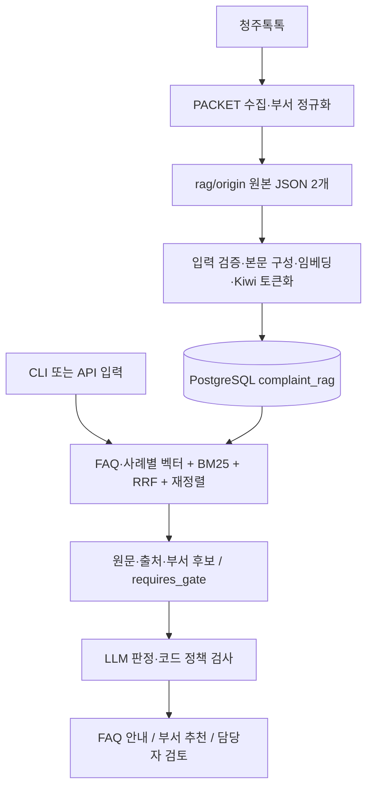

# 시스템 구조

2026-10-31 업무 서버 구현을 추가했다. 시민·담당자 `ui/`는 루트 `src/` Flask API를 호출하고, API의 Pydantic 모델 → 업무 서비스 → 저장소 `Protocol` → PostgreSQL `complaint_app`으로 처리한다. Swagger는 같은 모델에서 자동 생성하며 `/docs`에서 제공한다. 시민 응답에는 공개 DTO만 사용한다. 기존 검색 계층과 원본·색인은 분리하며 실제 AI·작업자·SSE는 후속이다. 현재 실행·타입·저장·오류 계약은 [서버 안내](../../src/README.md)를 따른다.

기준: 2026-11-06. 검색 계층과 로컬 응대 계층(`src/assist`, `src/lab_web` `:5010`)이 있다. LLM이 따를 완충지대 계약은 [LLM 완충지대 하네스](LLM_완충지대_하네스.md), 시스템 접두 원문은 [`prompts/`](prompts/README.md)다. 검색 API는 `retrieval_only` / `requires_gate`만 반환하고, 판정·정책 검사는 그 위에 둔다. `gpt-6-luna`는 OpenAI API 또는 Codex CLI로 선택할 수 있고, 실측 평가·FAQ 현행성 허용 목록은 미정이다. Jev는 기준 성능 확보 후 확장한다.

## 데이터와 실행 경로

이 서버의 PostgreSQL `complaints_native` DB, `complaint_rag` 스키마에서 관계형 데이터와 pgvector 벡터를 함께 관리한다. `faq_knowledge`와 `routing_cases`에는 원문·메타데이터와 현재 프로필 차원의 `embedding`이 저장되며 검색 순위는 각각 계산한다. 기본은 `dragonkue/multilingual-e5-small-ko` 384차원이다. `routing_cases.department_id`는 `department_directory.department_id`를 참조하는 외래 키다. 부서 디렉터리는 일반 관계형 테이블이며, BM25와 색인 메타데이터용 보조 테이블 4개까지 총 7개 테이블을 사용한다.

## 코드 탐색 지도

| 구성 | 책임 |
| --- | --- |
| [PACKET](../../PACKET/) | 원문 수집과 확인된 부서 별칭 정규화 |
| [data.py](../../rag/data.py) | 원본 검증, FAQ/사례 검색 본문, 내부 부서 ID 생성 |
| [config.py](../../rag/config.py) | 모델 리비전·차원·본문/토크나이저 버전·검색 설정 |
| [models.py](../../rag/models.py) | 프로필 임베딩(기본 e5-small-ko)과 긴 문서의 창 단위 재정렬 |
| [korean.py](../../rag/korean.py) | Kiwi 형태소와 BM25용 토큰 빈도 |
| [complaint_rag.sql](../../rag/origin/schema/complaint_rag.sql), [store.py](../../rag/store.py) | 테이블·색인·접속·색인 호환성 확인 |
| [ingest.py](../../rag/ingest.py) | 벡터 재사용·체크포인트·한 트랜잭션으로 데이터 반영 |
| [search.py](../../rag/search.py) | 두 검색기·RRF·재정렬·부서 후보 집계 |
| [api.py](../../rag/api.py), [__main__.py](../../rag/__main__.py) | HTTP API와 표준 라이브러리 CLI 클라이언트 |
| [assist.py](../../rag/assist.py) | CLI 호환 진입점. 구현은 `src/assist`·`src/llm`·`src/rag` |
| [src/complaints](../../src/README.md) | 민원 웹 CRUD·세션·정적 UI·Swagger |
| [src/rag](../../src/README.md) | 검색 API 클라이언트와 검색 전용 계약. `http_json` 전송과 `search_parts` 한 번 순회 |
| [src/llm](../../src/README.md) | Luna·Codex·기존 호환 LLM 공급자. JSON HTTP는 `src.rag.http`를 재사용 |
| [src/assist](../../src/README.md) | RAG와 LLM을 잇는 판정·정책 검사. 시스템 접두는 [`prompts/`](prompts/README.md) |
| [src/](../../src/README.md), [ui/](../../ui/README.md) | Flask 앱 팩토리·시민·담당자·검사기 화면 |
| [웹_시작.py](../../scripts/웹_시작.py) | Windows에서 Flask 시작과 시민 화면 열기 |
| [민원_응대.py](../../scripts/민원_응대.py) | Windows에서 민원 문장 → 검색 API + LLM 응대. 꺼진 localhost API는 `python -m rag serve` 자동 시작 |
| [문장_임베딩.py](../../scripts/문장_임베딩.py) | 한 문장 임베딩 뒤 FAQ·사례 pgvector 이웃. `--raw`는 숫자만 |
| [verify.py](../../rag/verify.py), [evaluate.py](../../rag/evaluate.py) | 실제 DB 대조와 API 검색 회귀 확인 |

## 적재 계약

1. 원본 형태·키·출처·부서 상태를 검사하고 검색 본문을 만든다.
2. 적재 잠금으로 동시 적재를 막고, 같은 모델 서명과 본문의 기존 벡터 또는 `complaint_rag.embedding_cache` 체크포인트를 재사용한다.
3. 새 임베딩과 토큰화를 마친 뒤 문서·부서·BM25 통계·색인 메타데이터를 한 트랜잭션으로 반영한다.
4. 새 원본에서 빠진 문서는 색인에서도 제외한다. 잘못된 일부 원본을 전체 원본처럼 적재하지 않도록 건수와 삭제 목록을 먼저 검토한다.

임베딩 서명은 모델·리비전·차원·최대 입력 길이·질문/문서 접두·정규화·본문 버전을 포함한다. 모델이나 본문 구성 규칙을 바꿀 때는 버전과 재적재를 함께 다룬다. 단순 원문 변경은 본문 해시로 감지한다. 재수집·DB 재적재·검증의 실제 절차는 [운영 문서](runbook.md)에 있다.

## 검색 계약

- 기본 임베딩은 `dragonkue/multilingual-e5-small-ko` 384차원이다. 이전 intfloat 색인은 `RAG_EMBEDDING_PROFILE=e5-small`, BGE-M3 색인은 `bge-m3`다.
- 기본 설정은 각 컬렉션에서 벡터 30건, BM25 30건, RRF `k=60`, 재정렬 최대 20건, 반환 5건이다.
- 재정렬을 끄면 RRF 상위 `limit`건의 원문만 조회한다. 재정렬을 켜면 기존 후보 범위인 `max(limit, rerank_k)`건을 확보한다.
- `both`도 두 컬렉션을 각각 처리한다. 두 컬렉션의 원시 점수를 합쳐 최종 의사결정을 하지 않는다.
- 요청에서 지정한 `district`만 사례 검색에 적용한다. 다른 구로 확인된 사례를 제외하되 본청·구 미확인 사례는 남긴다. FAQ에는 구 필터를 적용하지 않는다.
- 검색은 `REPEATABLE READ` 스냅샷을 읽는다. 결과에는 원본 `evidence`, 출처, 순위·점수와 부서 검증 상태가 들어간다.
- 부서 후보는 반환된 유효 사례를 묶어 가장 높은 사례 순위로 정렬한다. 사례 수 다수결이 아니며 전체 사례에 대한 분류 확률도 아니다.

## 외부 인터페이스

기본 호스트 주소는 `http://127.0.0.1:8007`이다. [실제 입력 모델](../../rag/api.py)과 실행 서버의 `/docs`가 필드 정의를 제공한다.

| 경로 | 요청·반환 |
| --- | --- |
| `GET /health` | 색인 호환성, 적재 건수, 모델 설정, 최근 적재 메타데이터 |
| `POST /search` | `query`, `collection=faq/routing/both`, `limit`, `district`, `rerank` → 검색 근거 |
| `GET /departments` | 선택적 `query`로 현행 명칭·별칭 조회 |

검색 응답의 컬렉션 키는 `results.faq_knowledge`, `results.routing_cases`다. 요청한 컬렉션만 포함하며 사례에는 `department_candidates`가 추가된다. 현재 응답은 항상 `retrieval_only=true`, `decision="requires_gate"`다. gate는 검색 후 판단 필요라는 뜻으로 Jev 전용 계약이 아니다. 후속 판정 결과는 별도 계약으로 구현한다.

| 상황 | 현재 처리 |
| --- | --- |
| 요청 필드 형식·범위 불일치 | FastAPI `422` |
| 공백 입력·검색할 형태소 없음·재정렬 질문 토큰 초과 | 검색 엔진 `ValueError` → `400` |
| 검색 중 DB·모델 등 예외 | `503` |
| API 시작 시 색인 없음·버전 불일치 | 시작 실패; API가 제공되지 않을 수 있음 |
| 범위 밖 민원 | 최근접 문서를 반환할 수 있음. 범위 판정은 `src/assist`가 검색 뒤에 수행한다 |

## LLM 응대 계층

검색 API·DB 구조는 유지하고 그 위에 `src/assist`가 `src/rag` 검색과 `src/llm` 판정을 연결한다. CLI `python -m rag assist`는 같은 함수의 호환 진입점이다. Flask `POST /api/v1/assist`·`/assist/stream`과 `src/lab_web` `:5010`도 이 계층을 쓴다. 응답의 `codex`는 모델에 넣은 사용자 JSON과 Codex stdin 전문이다.

1. FAQ·사례별 검색 결과를 받은 뒤 LLM이 의도·근거·처리 경로를 구조화해 제안한다. 공급자가 없으면 검색 근거만 남기고 담당자 검토로 연결한다.
2. 코드가 출처·부서 후보·필수 조건과 출력 계약을 검사한다. FAQ 현행성 허용 목록은 아직 없다.
3. FAQ 안내가 허용된 경우에만 같은 LLM을 다시 호출해 답변을 생성한다. 답변과 근거를 검사하고 실패하면 담당자 검토로 보낸다.
4. 부서 후보·담당자 검토 안내는 템플릿이다. 검사기는 파이프라인 전체가 아니라 짧은 진행 안내만 보여 준다.

`COMPLAINT_LLM_PROVIDER`로 `openai_api`(Responses API, `gpt-6-luna`·`medium`) 또는 `codex_cli`(읽기 전용 임시 작업공간)를 고른다. 기존 호환 토큰은 `legacy`다. 판정과 생성은 같은 모델 설정을 재사용하되 프롬프트·입출력·평가를 구분한다. 고정 시스템 지시와 가변 user JSON을 섞지 않는다. 계층형 `PREFIX-00`~`PREFIX-04` 적용과 프리픽스 캐시 실측은 후속이다. [AI 입출력 하네스](AI_정보전달과_응답_하네스.md) · [프리픽스 캐싱 지침](시스템_프롬프트와_프리픽스_캐싱_지침.md) · [안전 가드레일](AI_안전_보안_가드레일.md) · [CASE-022](../cases/사례-022-RAG-LLM-응대검사기-2026-11-01.md) · [CASE-023](../cases/사례-023-GPT-6-Luna-공급자-선택-2026-11-05.md) · [CASE-042](../cases/사례-042-AI-입출력-프리픽스-캐싱-하네스-2026-11-05.md)

LLM 호출은 검색 API 프로세스와 분리한다. Jev는 이후 판정 어댑터의 대체 또는 추가 검토 모듈로 비교하며 초기 실행 의존성에 넣지 않는다.

## 시연 웹·민원 업무 서버

사용자가 정한 웹 범위는 **민원 게시판·작성 페이지와 민원을 주고받는 서버**다. 2026-10-31 루트 `src/` Flask로 목록·상세·등록·답변·추가 문의·상태 저장을 로컬 구현했고, 2026-11-05 저장을 PostgreSQL `complaint_app`으로 옮겼다. Swagger는 `/docs`이며 인쇄본은 [Swagger PDF](../청주톡톡_민원_업무_API_Swagger.pdf)다. 검사기 응대는 민원 CRUD와 분리한다.

민원 서버는 입력·역할·조회 범위를 검사하고 민원·대화·상태를 저장한다. 기존 `/search`는 검색 근거 계약을 유지한다. 저장 성공과 AI 처리 성공을 구별하고, 검사기 실패는 등록된 글을 만들지 않는다.

기존 `complaint_rag`는 지식 검색용이며 새 게시글·답변은 `complaint_app`으로 구분한다. 시연 서버의 등록·검토 상태와 청주시 공식 접수·외부 부서 이관은 별개다. 화면·저장 구조·API는 [서버 안내](../../src/README.md)와 [시연 웹·민원 서버 계획](../../plan/시연_웹_게시판과_민원_서버_구현계획.md)을 따른다.

2026-10-27 [통합 상세설계](../../plan/민원_웹_MVP_상세설계와_분야별_작업계획.md)의 PostgreSQL 업무 스키마·별도 AI 작업자·SSE는 후속이다. 담당자 화면의 AI 작업 모니터는 서버 단계 시연이며 검사기 NDJSON 진행과 구별한다.

## 자원과 관측의 한계

네이티브 Python 3.12와 CPU용 Torch를 사용한다. API는 모델을 한 번 적재하고 검색 요청을 잠금으로 직렬 처리한다. 현재 개발 서버의 모델 스레드 설정은 12다. 요청 수가 늘면 대기 시간이 누적될 수 있다.

`elapsed_ms`는 검색 엔진 내부 시간이다. API 잠금 대기·네트워크 시간을 포함한 사용자 체감 지연과 구별한다. 현재 인증·요청 제한·판정 재시도·요청별 감사 기록은 구현되어 있지 않으며 API와 DB 포트는 localhost에만 바인딩되어 있다. 공개 서비스 전환은 별도 구현 범위다.
