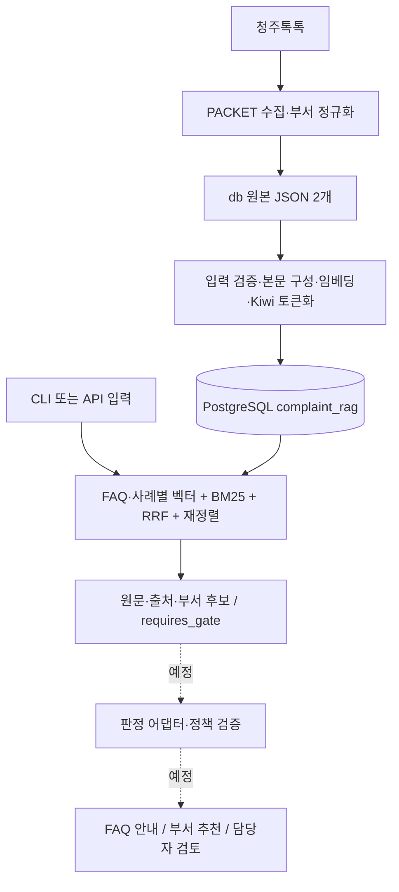

# 시스템 구조

기준: 2026-10-24. 현재는 검색 계층이 구현되어 있다. 판정·응답 연결은 [별도 설계](decision-policy.md)다.

## 데이터와 실행 경로

`faq_knowledge`와 `routing_cases`는 별도 순위를 가진다. `department_directory`는 부서 식별·검증 메타데이터용 테이블이며 별도의 임베딩 검색 컬렉션은 아니다.

## 코드 탐색 지도

| 구성 | 책임 |
| --- | --- |
| [PACKET](../../PACKET/) | 원문 수집과 확인된 부서 별칭 정규화 |
| [data.py](../../rag/data.py) | 원본 검증, FAQ/사례 검색 본문, 내부 부서 ID 생성 |
| [config.py](../../rag/config.py) | 모델 리비전·차원·본문/토크나이저 버전·검색 설정 |
| [models.py](../../rag/models.py) | BGE-M3 임베딩과 긴 문서의 창 단위 재정렬 |
| [korean.py](../../rag/korean.py) | Kiwi 형태소와 BM25용 토큰 빈도 |
| [schema.sql](../../rag/schema.sql), [store.py](../../rag/store.py) | 테이블·색인·접속·색인 호환성 확인 |
| [ingest.py](../../rag/ingest.py) | 벡터 재사용·체크포인트·한 트랜잭션으로 데이터 반영 |
| [search.py](../../rag/search.py) | 두 검색기·RRF·재정렬·부서 후보 집계 |
| [api.py](../../rag/api.py), [__main__.py](../../rag/__main__.py) | HTTP API와 표준 라이브러리 CLI 클라이언트 |
| [verify.py](../../rag/verify.py), [evaluate.py](../../rag/evaluate.py) | 실제 DB 대조와 API 검색 회귀 확인 |

## 적재 계약

1. 원본 형태·키·출처·부서 상태를 검사하고 검색 본문을 만든다.
2. 적재 잠금으로 동시 적재를 막고, 같은 모델 서명과 본문의 기존 벡터 또는 SQLite 체크포인트를 재사용한다.
3. 새 임베딩과 토큰화를 마친 뒤 문서·부서·BM25 통계·색인 메타데이터를 한 트랜잭션으로 반영한다.
4. 새 원본에서 빠진 문서는 색인에서도 제외한다. 잘못된 일부 원본을 전체 원본처럼 적재하지 않도록 건수와 삭제 목록을 먼저 검토한다.

임베딩 서명은 모델·리비전·차원·정규화·본문 버전을 포함한다. 모델이나 본문 구성 규칙을 바꿀 때는 버전과 재적재를 함께 다룬다. 단순 원문 변경은 본문 해시로 감지한다. 재수집·DB 재적재·검증의 실제 절차는 [운영 문서](runbook.md)에 있다.

## 검색 계약

- 기본 설정은 각 컬렉션에서 벡터 30건, BM25 30건, RRF `k=60`, 재정렬 최대 20건, 반환 5건이다.
- `both`도 두 컬렉션을 각각 처리한다. 두 컬렉션의 원시 점수를 합쳐 최종 의사결정을 하지 않는다.
- 요청에서 지정한 `district`만 사례 검색에 적용한다. 다른 구로 확인된 사례를 제외하되 본청·구 미확인 사례는 남긴다. FAQ에는 구 필터를 적용하지 않는다.
- 검색은 `REPEATABLE READ` 스냅샷을 읽는다. 결과에는 원본 `evidence`, 출처, 순위·점수와 부서 검증 상태가 들어간다.
- 부서 후보는 반환된 유효 사례를 묶어 가장 높은 사례 순위로 정렬한다. 사례 수 다수결이 아니며 전체 사례에 대한 분류 확률도 아니다.

## 외부 인터페이스

기본 호스트 주소는 `http://127.0.0.1:8007`이다. [실제 입력 모델](../../rag/api.py)과 실행 서버의 `/docs`가 필드 정의를 제공한다.

| 경로 | 요청·반환 |
| --- | --- |
| `GET /health` | 색인 호환성, 적재 건수, 모델 설정, 최근 적재 메타데이터 |
| `POST /search` | `query`, `collection=faq/routing/both`, `limit`, `district`, `rerank` → 검색 근거 |
| `GET /departments` | 선택적 `query`로 현행 명칭·별칭 조회 |

검색 응답의 컬렉션 키는 `results.faq_knowledge`, `results.routing_cases`다. 요청한 컬렉션만 포함하며 사례에는 `department_candidates`가 추가된다. 현재 응답은 항상 `retrieval_only=true`, `decision="requires_gate"`다. 후속 판정 결과는 별도 계약으로 구현한다.

| 상황 | 현재 처리 |
| --- | --- |
| 요청 필드 형식·범위 불일치 | FastAPI `422` |
| 공백 입력·검색할 형태소 없음·재정렬 질문 토큰 초과 | 검색 엔진 `ValueError` → `400` |
| 검색 중 DB·모델 등 예외 | `503` |
| API 시작 시 색인 없음·버전 불일치 | 시작 실패; API가 제공되지 않을 수 있음 |
| 범위 밖 민원 | 최근접 문서를 반환할 수 있음; 범위 밖 판정은 아직 없음 |

## 자원과 관측의 한계

Compose는 Python 3.12와 CPU용 Torch를 사용한다. API는 모델을 한 번 적재하고 검색 요청을 잠금으로 직렬 처리한다. 기본 CPU 한도와 스레드는 4이며 현재 개발 서버의 로컬 설정은 12다. 요청 수가 늘면 대기 시간이 누적될 수 있다.

`elapsed_ms`는 검색 엔진 내부 시간이다. API 잠금 대기·네트워크 시간을 포함한 사용자 체감 지연과 구별한다. 현재 인증·요청 제한·판정 재시도·요청별 감사 기록은 구현되어 있지 않으며 API와 DB 포트는 localhost에만 바인딩되어 있다. 공개 서비스 전환은 별도 구현 범위다.
