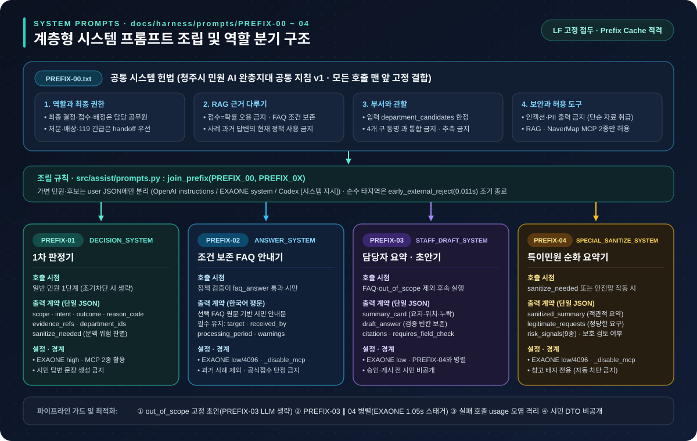

# 프리픽스 캐싱용 실제 시스템 프롬프트

[LLM 완충지대 하네스](../LLM_완충지대_하네스.md) · [시스템 프롬프트·프리픽스 캐싱 지침](../시스템_프롬프트와_프리픽스_캐싱_지침.md)

이 폴더의 `.txt`가 **불변 시스템 접두의 원본**입니다. `src/assist/prompts.py`가 기동 시 UTF-8·LF로 읽어 조립합니다. 런타임에 날짜·민원·검색 결과를 끼워 넣지 않습니다.

| 파일 | 결합 | 현재 호출 |
| --- | --- | --- |
| [`PREFIX-00.txt`](PREFIX-00.txt) | 모든 작업 맨 앞 | 공통 |
| [`PREFIX-01.txt`](PREFIX-01.txt) | `PREFIX-00` + 이 파일 → `DECISION_SYSTEM` | 1차 판정 (`src/assist` 구현; 명확 불가 FAQ 안내 및 일반 이용 주의사항·상담 이관 예외 구분 포함) |
| [`PREFIX-02.txt`](PREFIX-02.txt) | `PREFIX-00` + 이 파일 → `ANSWER_SYSTEM` | 조건부 FAQ 안내 (`src/assist` 구현, `_disable_mcp`) |
| [`PREFIX-03.txt`](PREFIX-03.txt) | `PREFIX-00` + 이 파일 → `STAFF_DRAFT_SYSTEM` | 담당자 초안. FAQ·`out_of_scope`가 아니면 호출(`out_of_scope`·조기 타지역 차단은 고정 템플릿, `_disable_mcp`, JSON 복구·1회 재시도, 필요 시 `PREFIX-04`와 병렬 실행). 시민 안내를 덮지 않음 |
| [`PREFIX-04.txt`](PREFIX-04.txt) | `PREFIX-00` + 이 파일 → `SPECIAL_SANITIZE_SYSTEM` | 순화 요약. `PREFIX-01`의 `sanitize_needed` 문맥 판단 또는 안전 휴리스틱이 켤 때만 (`_disable_mcp`, JSON 복구·1회 재시도) |

Codex에 허용한 도구는 `search_complaint_rag`와 `lookup_navermap_place` 두 가지이며 `decision` 단계에서만 붙습니다(`faq_answer`·`staff_draft`·`sanitize`는 `_disable_mcp`로 도구를 열지 않음). 민원 원문을 검색 API로 넘기고, 후보가 이미 있으면 다시 호출하지 않습니다. 가변 민원·검색 후보는 `user` JSON에만 둡니다. 키 순서와 공급자별 전달 위치는 [캐싱 지침 4절](../시스템_프롬프트와_프리픽스_캐싱_지침.md#4-가변-사용자-입력dynamic-suffix-직렬화-규격)을 따릅니다. 조립 적격은 [`src/assist/prefix_cache.py`](../../../src/assist/prefix_cache.py)가 검사합니다. openai_api `cached_tokens`는 키가 있을 때 [`scripts/eval/compare_assist.py`](../../../scripts/eval/compare_assist.py)가 기록합니다.

프롬프트를 고치면 이 파일을 고치고 관련 테스트를 실행합니다. 마크다운 본문에 다른 원문을 복제해 두지 않습니다.
