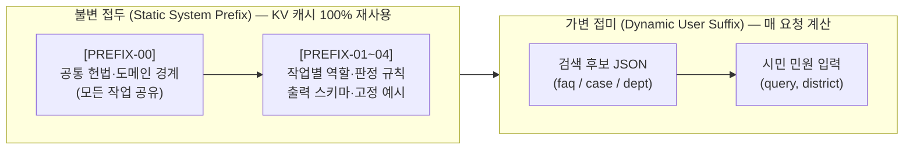

# 시스템 프롬프트와 프리픽스 캐싱 지침

[하네스 안내](README.md) · [AI 정보 전달과 응답 하네스](AI_정보전달과_응답_하네스.md) · [AI 안전·보안 가드레일](AI_안전_보안_가드레일.md) · [판정 정책](decision-policy.md)

**기준: 2026-11-06 UTC · 상태: 원문 파일 + 1·2차 호출 조립 구현.**
이 문서는 OpenAI Responses API(`gpt-6-luna`), Chat Completions, Codex CLI에서 **Prefix Caching**이 깨지지 않도록 불변 접두와 가변 접미를 나눈다. **실제 시스템 프롬프트 원문은 [`prompts/`](prompts/README.md)의 `.txt` 파일**이다. [`src/assist/prompts.py`](../../src/assist/prompts.py)가 기동 시 읽어 `DECISION_SYSTEM`·`ANSWER_SYSTEM`을 만든다.

> [!NOTE]
> **현재 코드:** `PREFIX-00`+`PREFIX-01`이 1차 판정, `PREFIX-00`+`PREFIX-02`가 FAQ 안내. `PREFIX-03`은 FAQ가 아닐 때 담당자 초안, `PREFIX-04`는 원문 힌트가 있을 때만 순화한다. 시민 갈래와 민원 CRUD는 바꾸지 않는다. 역할·RAG·서버 응답은 [LLM 완충지대 하네스](LLM_완충지대_하네스.md)를 본다.

---

## 1. 프리픽스 캐싱(Prefix Caching) 구조 설계

프리픽스 캐싱은 프롬프트의 **맨 앞부분(Prefix) 토큰 시퀀스가 이전 요청과 바이트·토큰 단위로 완전히 일치할 때** 이미 계산된 KV 캐시(Key-Value Cache)를 재사용하는 기술이다. 단 한 글자라도 앞부분에서 달라지면 그 지점 이후의 캐시가 모두 무효화(Cache Miss)된다.

따라서 모든 AI 호출은 다음과 같이 **불변 접두(Static Prefix)**와 **가변 접미(Dynamic Suffix)**를 엄격히 분리해 조립한다.



### 1.1 계층별 캐시 공유 전략

1. **1단계 캐시 공유 (`[PREFIX-00]` 공통 헌법):**
   - 이 프로젝트는 하나의 범용 LLM을 여러 작업(1차 판정, 2차 FAQ 답변 생성, 향후 담당자 초안·요약, 특이민원 순화)에 재사용한다([LLM + RAG 우선 구현계획](../../plan/언어모델과_검색증강생성_우선_구현계획.md)).
   - 모든 작업의 시스템 프롬프트가 **완전히 동일한 `[PREFIX-00] 공통 헌법 블록`**으로 시작하면, 서로 다른 종류의 작업(예: 1차 판정 직후 이어지는 2차 FAQ 생성) 사이에서도 최상위 프리픽스 블록의 KV 캐시를 공유할 수 있다.
2. **2단계 캐시 공유 (`[PREFIX-00] + [PREFIX-01~04]` 작업별 전체 시스템 프롬프트):**
   - 동일한 작업(예: 연속해서 들어오는 여러 시민의 1차 판정 요청)끼리는 `[PREFIX-00] + [PREFIX-01]` 전체가 100% 일치하므로 시스템 프롬프트 전 구간이 캐시에서 즉시 적중(Hit)된다.
3. **가변 영역 격리 (`user` 메시지 JSON):**
   - 매 요청마다 달라지는 검색 결과(`faq_candidates`, `case_candidates`, `department_candidates`)와 민원 원문(`query`, `district`)은 오직 `user` 역할 메시지(Responses API의 `input`)에만 배치한다.

---

## 2. 프리픽스 캐시 깨짐(Cache Busting) 방지 8대 규칙

시스템 프롬프트를 코드에 적을 때는 아래 8가지 규칙을 반드시 지킨다.

| 번호 | 규칙 | 잘못된 예시 (캐시 깨짐) | 올바른 예시 (캐시 유지) |
| --- | --- | --- | --- |
| **1** | **시스템 프롬프트 내 동적 변수 보간 금지** | `f"오늘 날짜는 {today}이며 관할 구는 {district}입니다..."`를 `system`에 넣음 | 날짜·관할 구·검색 건수 등 가변 값은 모두 `user` JSON 페이로드에 넣음 |
| **2** | **요청 ID·세션 토큰·타임스탬프 삽입 금지** | 프롬프트 첫 줄에 `[Request-ID: req-9812]`를 추가함 | 요청 추적 ID는 HTTP 헤더나 애플리케이션 로그에만 남기고 프롬프트 본문에서 제외 |
| **3** | **검색 후보를 시스템 프롬프트에 넣지 않음** | `system` 메시지 안에 검색된 FAQ 5건을 문자열로 붙여 넣음 | `system`은 규칙만 두고, 검색된 FAQ·사례 후보는 `user` 메시지의 JSON에 배치 |
| **4** | **줄바꿈·공백·유니코드 정규화 고정** | OS나 실행 경로에 따라 `\r\n`과 `\n`이 섞이거나 공백 개수가 흔들림 | 모듈 상수(`str`)에 LF(`\n`) 기준으로 정의하고 런타임 문자열 재조합을 피함 |
| **5** | **출력 스키마·열거값 순서 고정** | `set`이나 순서가 바뀌는 사전에서 열거값을 매번 `.join()`으로 생성 | `SCOPES`, `INTENTS`, `OUTCOMES`, `REASON_CODES`를 불변 튜플과 고정 문자열로 선언 |
| **6** | **Few-shot 예시는 고정 합성 예시만 사용** | 유사 예제(Dynamic Few-shot)를 매번 검색해 시스템 프롬프트에 끼워 넣음 | 프리픽스 끝에 넣는 예시는 개인정보 없는 고정 합성 예시 1~2개로 고정 |
| **7** | **단일 프롬프트 공급자(`codex_cli`)의 접두 순서 유지** | `[사용자 입력]`을 먼저 적고 `[시스템 지시]`를 뒤에 적음 | `[고정 실행 래퍼] → [시스템 지시(Prefix)] → [사용자 입력(Suffix)]` 순서를 엄수 (`complete_codex_cli` 현재 구조 유지) |
| **8** | **User JSON의 키 순서 결정론적 유지** | 동일 민원 재시도 시 JSON 키 순서가 바뀌어 하위 캐시까지 무효화됨 | `json.dumps(payload, ensure_ascii=False, indent=2)` 호출 시 고정된 키 삽입 순서(`query` → `district` → 후보군) 유지 |

> [!TIP]
> **최소 토큰 기준 참고:** OpenAI API 등 상용 프리픽스 캐싱은 보통 앞부분 **1,024토큰 이상**(이후 128토큰 단위)에서 자동 활성화되며, 로컬 vLLM/SGLang의 블록 캐싱은 블록 크기(예: 16~64토큰) 단위로 즉시 작동한다. 추후 상용 API의 1,024토큰 임계값을 넘겨야 할 때는 `[PREFIX-00]`과 작업별 프리픽스 뒤에 **고정 판정 기준표와 고정 합성 Few-shot 예시 블록**을 붙이면 불필요한 잡음 없이 캐시 적중 요건을 충족하고 한국어 지시 이행률도 함께 높일 수 있다.

---

## 3. 계층별 표준 시스템 프롬프트 원문

원문은 이 마크다운에 복제하지 않는다. 파일을 고치면 코드가 같은 문자열을 쓴다.

| 접두 | 파일 | 조립 | 상태 |
| --- | --- | --- | --- |
| PREFIX-00 | [`prompts/PREFIX-00.txt`](prompts/PREFIX-00.txt) | 모든 작업 맨 앞 | 구현 |
| PREFIX-01 | [`prompts/PREFIX-01.txt`](prompts/PREFIX-01.txt) | `DECISION_SYSTEM` | 구현 |
| PREFIX-02 | [`prompts/PREFIX-02.txt`](prompts/PREFIX-02.txt) | `ANSWER_SYSTEM` | 구현 |
| PREFIX-03 | [`prompts/PREFIX-03.txt`](prompts/PREFIX-03.txt) | `STAFF_DRAFT_SYSTEM` | FAQ가 아니면 호출. 미게시 |
| PREFIX-04 | [`prompts/PREFIX-04.txt`](prompts/PREFIX-04.txt) | `SPECIAL_SANITIZE_SYSTEM` | 원문 힌트가 있을 때만 |

`DECISION_SYSTEM`은 PREFIX-00과 PREFIX-01을 빈 줄로 이어 붙인 값이다. 민원·검색 후보는 `user` JSON에만 둔다.

### 3.1 `[PREFIX-00]` 공통 헌법

모든 작업 시스템 지시의 맨 앞. 역할, RAG 컬렉션 분리, 부서 관할, 환각 금지, 인젝션 방어. 전문은 [`PREFIX-00.txt`](prompts/PREFIX-00.txt).

### 3.2 `[PREFIX-01]` 1차 판정기

JSON만 반환. [`src/assist/policy.py`](../../src/assist/policy.py) 검증과 같은 필드. 전문은 [`PREFIX-01.txt`](prompts/PREFIX-01.txt).

### 3.3 `[PREFIX-02]` FAQ 시민 안내

`faq_answer`가 코드 검사를 통과한 뒤에만 호출. 평문. 전문은 [`PREFIX-02.txt`](prompts/PREFIX-02.txt).

### 3.4 `[PREFIX-03]` 담당자 초안

담당자 요약·초안 JSON. 검사기·CLI에만 싣고 시민 안내를 덮지 않는다. 웹 CRUD LLM은 미연결. 전문은 [`PREFIX-03.txt`](prompts/PREFIX-03.txt).

### 3.5 `[PREFIX-04]` 특이민원 순화

순화 요약과 정당한 요구 분리. 자동 차단 금지. `search_complaint_rag`를 부르지 않는다. 전문은 [`PREFIX-04.txt`](prompts/PREFIX-04.txt).

## 4. 가변 사용자 입력(Dynamic Suffix) 직렬화 규격

시스템 프롬프트(Static Prefix) 뒤에 전달되는 `user` 메시지는 항상 **결정론적 키 순서**를 가진 JSON 문자열로 직렬화한다.

### 4.1 1차 판정 호출의 `user` 메시지 (`src/assist/policy.py` `decision_prompt`)

```json
{
  "query": "우리집 앞 가로등이 밤새 깜빡거려 수리를 요청합니다.",
  "district": "흥덕구",
  "faq_candidates": [
    {
      "corpus": "faq",
      "source_id": "...",
      "title": "...",
      "source_url": "...",
      "detail": {
        "target": "...",
        "processing_period": "...",
        "received_by": "...",
        "main_content": "...",
        "warnings": "..."
      }
    }
  ],
  "case_candidates": [
    {
      "corpus": "routing",
      "source_id": "...",
      "title": "...",
      "source_url": "...",
      "summary": "...",
      "routing_eligible": true,
      "department_status": "resolved",
      "department_id": "...",
      "department_name": "...",
      "duty_status": "unverified"
    }
  ],
  "department_candidates": [
    {
      "department_id": "...",
      "canonical_name": "...",
      "district": "흥덕구",
      "duty_status": "unverified",
      "jurisdiction_status": "district_extracted_from_name",
      "supporting_case_ids": ["..."]
    }
  ]
}
```

### 4.2 2차 FAQ 답변 생성 호출의 `user` 메시지 (`src/assist/pipeline.py`)

```json
{
  "query": "대형폐기물 배출 방법을 알고 싶어요.",
  "faq": [
    {
      "corpus": "faq",
      "source_id": "...",
      "title": "...",
      "source_url": "...",
      "detail": {
        "target": "...",
        "processing_period": "...",
        "received_by": "...",
        "main_content": "...",
        "warnings": "..."
      }
    }
  ]
}
```

### 4.3 공급자별 프리픽스 전달 방식 (`src/llm/complete.py`)

| 공급자 (`COMPLAINT_LLM_PROVIDER`) | 고정 프리픽스 전달 위치 | 가변 입력 전달 위치 | 프리픽스 캐싱 적용 시 확인 사항 |
| --- | --- | --- | --- |
| `openai_api`<br>(Responses API, `gpt-6-luna`) | 요청 JSON의 `"instructions": system` | 요청 JSON의 `"input": user` | `instructions` 문자열을 상수로 유지하고 `model`·`reasoning.effort`를 고정하면 서버 측 자동 프리픽스 캐싱 작동 |
| `legacy` / 로컬 sLLM<br>(OpenAI Chat 호환, vLLM 등) | `messages[0]`: `{"role": "system", "content": system}` | `messages[1]`: `{"role": "user", "content": user}` | vLLM 실행 시 `--enable-prefix-caching` 활성화. `messages[0]` 본문이 동일하면 블록 캐시 즉시 재사용 |
| `codex_cli`<br>(읽기 전용 임시 작업공간) | 표준 입력(`stdin`)의 `[고정 실행 지시] + [시스템 지시]\n{system}` | 표준 입력(`stdin`)의 `[사용자 입력]\n{user}` | 항상 고정된 래퍼 문구와 `[시스템 지시]`가 먼저 오도록 순서 유지 ([CASE-038](../cases/사례-038-Windows-Codex-명령줄-길이-2026-11-05.md)) |
