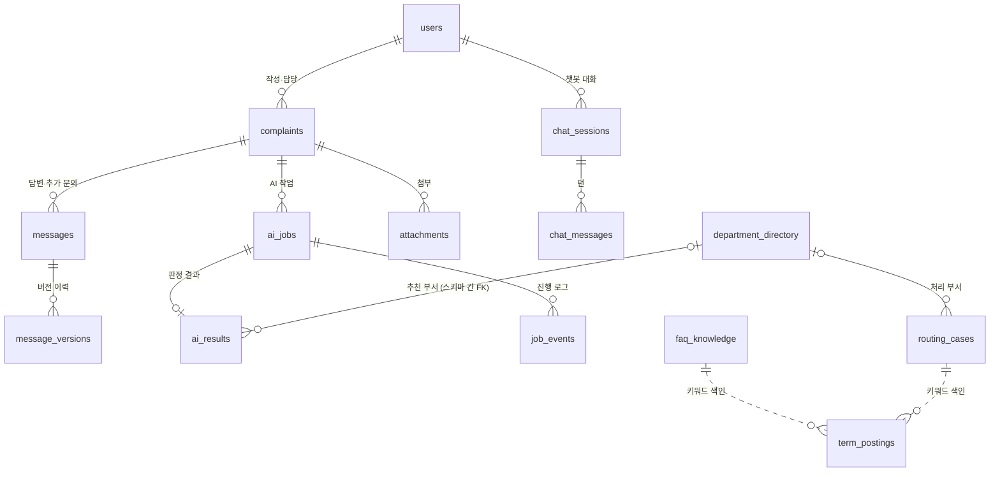
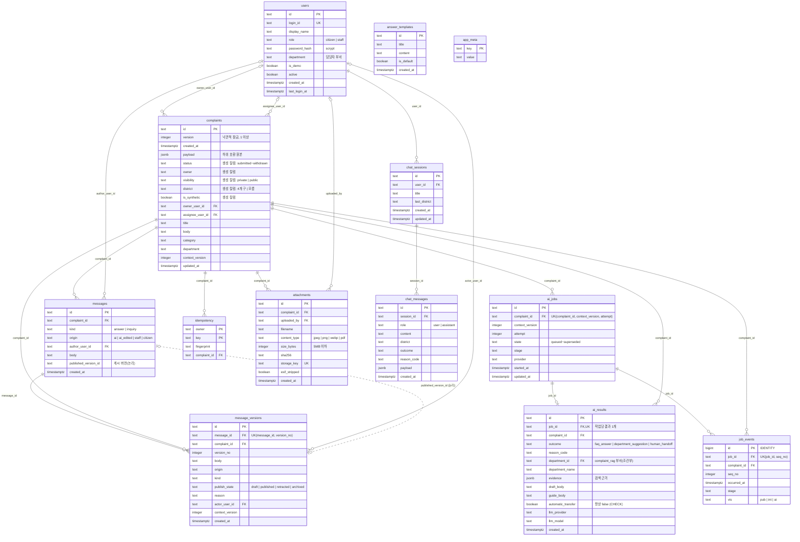
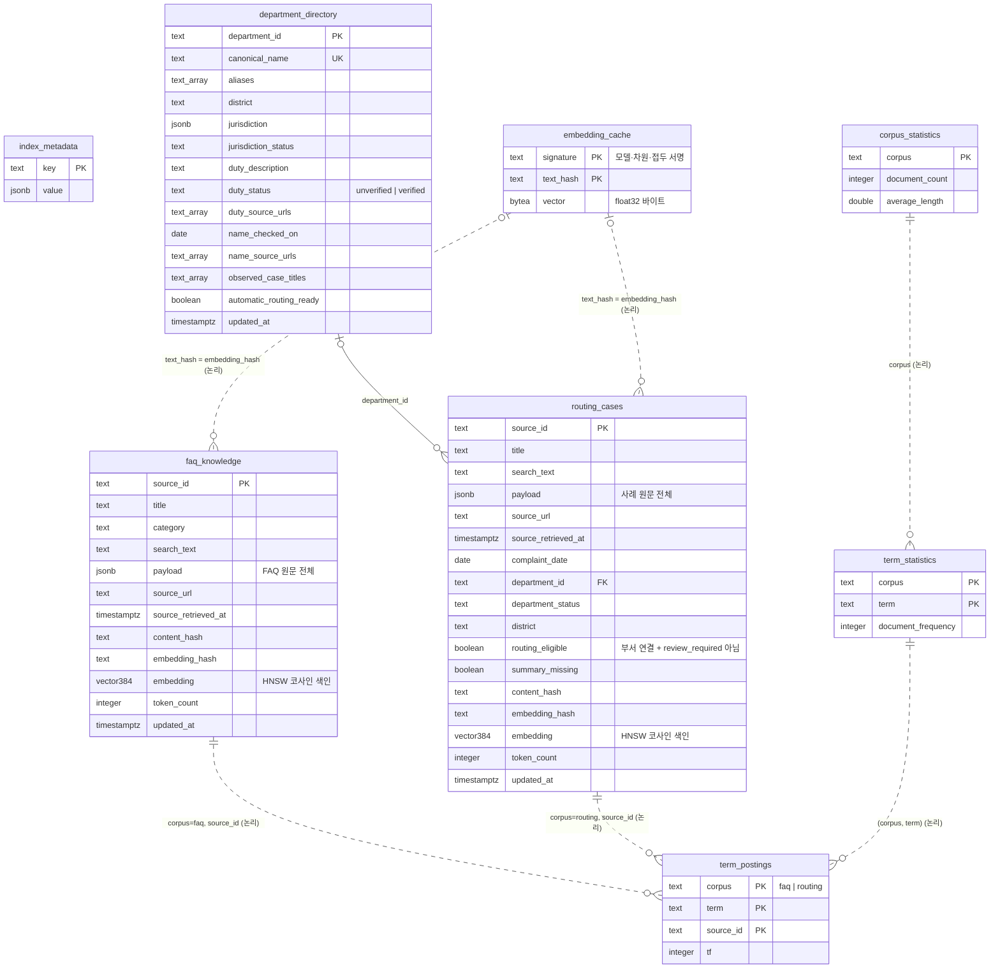

# 데이터베이스 ER 다이어그램

[계획·설계 문서](README.md) · [데이터 계약](../harness/data-contracts.md) · [업무 DB 실행 설계](../harness/업무DB_실행설계.md) · [시스템 구조](../harness/architecture.md) · [PDF 버전](데이터베이스_ER다이어그램.pdf)

이 문서는 프로젝트의 PostgreSQL 데이터베이스 구조를 ER 다이어그램으로 정리합니다. 기준은 실제 DDL 두 파일입니다.

- 민원 업무 스키마 `complaint_app` (13개 테이블): [`src/complaints/schema/complaint_app.sql`](../../src/complaints/schema/complaint_app.sql)
- 검색 색인 스키마 `complaint_rag` (8개 테이블): [`rag/origin/schema/complaint_rag.sql`](../../rag/origin/schema/complaint_rag.sql)

DDL이 바뀌면 이 문서도 함께 고칩니다. PDF는 `scripts/reports/export_er_diagram_pdf.py`로 이 문서의 다이어그램을 다시 그려 만듭니다.

## 읽는 법

| 표기 | 뜻 |
| --- | --- |
| `PK` / `FK` / `UK` | 기본 키 / 외래 키 / 유일 키 |
| 실선 (`--`) | DDL에 선언된 실제 외래 키(FK) |
| 점선 (`..`) | FK는 없지만 코드가 값으로 연결하는 논리 관계 |
| 선 끝의 두 줄 / 원과 줄 | 반드시 1개 / 0 또는 1개 |
| 선 끝의 원과 까마귀발 | 0개 이상 |

두 스키마는 행을 섞지 않습니다. 스키마 사이의 연결은 `ai_results.department_id → department_directory.department_id` 하나뿐입니다. 이 FK는 `complaint_rag`가 먼저 있을 때만 조건부로 추가됩니다.

## 1. 전체 구성 (스키마 간 연결)

왼쪽 위의 `users`부터 `chat_messages`까지가 `complaint_app`, `department_directory`·`routing_cases`·`faq_knowledge`·`term_postings`가 `complaint_rag`입니다. 아래 2·3절에 칼럼까지 모두 그렸습니다.

## 2. 민원 업무 스키마 `complaint_app` (13개 테이블)

핵심 정규화 7개(`users`, `complaints`, `messages`, `message_versions`, `ai_jobs`, `ai_results`, `job_events`)와 보조 6개(`idempotency`, `answer_templates`, `app_meta`, `chat_sessions`, `chat_messages`, `attachments`)입니다.

- `complaints`·`messages`·`message_versions`·`ai_jobs`·`ai_results`·`job_events`·`idempotency`·`attachments`의 `complaint_id`는 모두 `ON DELETE CASCADE`입니다. `chat_sessions`(사용자 삭제 시)와 `chat_messages`(세션 삭제 시)도 같습니다.
- `answer_templates`와 `app_meta`는 다른 테이블과 FK가 없는 독립 테이블입니다.
- 첨부 원본 파일은 DB가 아니라 `.web-data/uploads/`에 두고, DB에는 메타데이터와 `storage_key`만 저장합니다.

## 3. 검색 색인 스키마 `complaint_rag` (8개 테이블)

- `faq_knowledge`와 `routing_cases`는 별도 컬렉션입니다. 문서 키는 `(corpus, source_id)`이고, 사이트 표시 번호는 고정 키로 쓰지 않습니다.
- `routing_cases`의 CHECK 제약: `routing_eligible = (department_id IS NOT NULL AND department_status <> 'review_required')`. 이 값은 부서 추천에 써도 되는 사례라는 뜻이지 자동 이관 허가가 아닙니다.
- 벡터는 `dragonkue/multilingual-e5-small-ko` 384차원입니다. DDL의 `__EMBEDDING_DIM__` 자리에 적재 시 차원이 들어갑니다.
- BM25 키워드 검색은 `term_postings`·`term_statistics`·`corpus_statistics` 세 테이블로 PostgreSQL 안에서 계산합니다. 벡터 후보 30개와 BM25 후보 30개를 RRF(k=60)로 합칩니다.
- `embedding_cache`는 재적재할 때 같은 서명·본문 해시의 벡터를 다시 계산하지 않게 남겨 두는 체크포인트입니다.

## 4. 테이블 요약

| 스키마 | 테이블 | 역할 | 배포 서버 행 수 (2026-11-26) |
| --- | --- | --- | ---: |
| `complaint_app` | `users` | 민원인·담당자 로그인 계정 | 8 |
| | `complaints` | 민원 본문·상태·버전·작성자/담당자 | 2 |
| | `messages` | 민원별 답변 스레드와 시민 추가 문의 | 2 |
| | `message_versions` | 답변 초안·게시·철회 버전 이력 | 1 |
| | `ai_jobs` | 민원별 AI 실행 작업 | 3 |
| | `ai_results` | AI 판정·근거·부서 추천 (자동 이관 금지) | 3 |
| | `job_events` | AI 작업 단계별 진행 로그 | 18 |
| | `idempotency` | 중복 등록 방지 키 | — |
| | `attachments` | 첨부 파일 메타데이터 (EXIF 제거) | 0 |
| | `chat_sessions` | 시민 AI 챗봇 대화 세션 | 0 |
| | `chat_messages` | 챗봇 대화 턴 | 0 |
| | `answer_templates` | 담당자 답변 템플릿 | 5 |
| | `app_meta` | 시드·마이그레이션 플래그 | — |
| `complaint_rag` | `index_metadata` | 색인 설정·상태 | — |
| | `department_directory` | 부서 목록 | 127 |
| | `faq_knowledge` | FAQ 안내 자료 + 벡터 | 94 |
| | `routing_cases` | 과거 민원 사례와 처리 부서 + 벡터 | 5,015 |
| | `term_postings` | BM25: 문서별 단어 빈도 | — |
| | `term_statistics` | BM25: 단어별 문서 수 | — |
| | `corpus_statistics` | BM25: 묶음별 문서 수·평균 길이 | — |
| | `embedding_cache` | 재적재용 벡터 체크포인트 | — |

`complaint_app` 행 수는 시연 중에 바뀌는 시점 값입니다. `—`는 이번에 세지 않은 테이블입니다.
