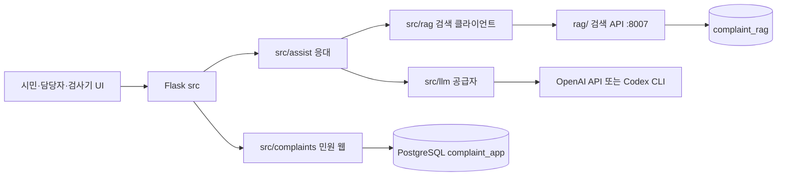

# 진행 보고 · 2026-11-05

[문서 목차](README.md) · [프로젝트 소개](../README.md) · [변경 이력](../CHANGELOG.md) · [사례 색인](cases/README.md)

기준일: **2026-11-06 UTC**. 대상: 청주 민원 1차 응대 AI 완충지대(검색 MVP + 시연 웹 + 응대 검사기).  
환경: Windows / Python 3.12.10 `.venv-web` · RAG `.venv`. Git 커밋·원격 반영은 CASE-023~045 업로드에 포함한다.

이 문서는 보고용 요약이다. 패치별 경위는 CASE-023~045, 날짜별 한 줄은 CHANGELOG를 본다. Git 업로드 범위는 CASE-023~045이다.

## 한 줄 요약

시민·담당자 시연 웹과 검색은 로컬에서 돌아가고, 응대 검사기는 RAG 검색 위에 LLM 판정을 올린 상태다. Flask 백엔드는 민원 웹 / 검색 클라이언트 / LLM / 연결 계층으로 나눴고, 루트 호환 모듈은 없애 민원 웹은 `src.complaints`에서 직접 import한다. 민원 CRUD는 PostgreSQL `complaint_app`, 검색 색인은 `complaint_rag`다. 검색 원본 JSON·검색 DDL은 `rag/origin/`이다. Windows에서는 `웹-시작.cmd`로 화면을 열고, `검색-시작.cmd`로 DB와 검색 API를 켜며, `민원-응대.cmd`로 민원 문장에 대한 RAG+LLM 응대를 본다. `문장-임베딩.cmd`는 검색 API 없이 벡터 숫자만 출력한다. 판정·FAQ 안내 시스템 접두는 `docs/harness/prompts/` PREFIX-00~02다. 기본 임베딩은 CPU용 e5-small이다. **민원 CRUD의 AI 연결, PREFIX-03/04 호출, 5,109건 재임베딩, Luna 실측, 공식 이관은 아직이다.**

## 지금 되는 것

| 영역 | 내용 | 상태 |
| --- | --- | --- |
| 시연 웹 | 시민·담당자 화면, Flask API·Swagger, PostgreSQL `complaint_app` jsonb 민원 CRUD | 로컬 구현. SQLite 파일은 쓰지 않음. Swagger 인쇄본 `docs/청주톡톡_민원_업무_API_Swagger.pdf` |
| 백엔드 패키지 | `src/complaints` · `src/rag` · `src/llm` · `src/assist` | 루트 Python은 `app.py` 조립·실행 진입점. 호환 재내보내기 없음 |
| 검색 | FAQ 94 · 사례 5,015 · 부서 127, `retrieval_only` / `requires_gate` | 구현. 기존 dump는 BGE-M3 1024차원 |
| 임베딩 캐시 | 재적재 벡터 체크포인트 | `complaint_rag.embedding_cache`. 예전 SQLite 캐시 대체 |
| 응대 검사기 | `/#/lab`, `python -m rag assist`, `민원-응대.cmd` | RAG+LLM 연결. 민원 저장 없음 |
| LLM 공급자 | `.env`의 `COMPLAINT_LLM_PROVIDER`: `openai_api`(gpt-6-luna) 또는 `codex_cli` | 선택 구현. 실측 평가 후속 |
| Windows 실행 | `웹-시작.cmd` → Flask·시민 화면, `검색-시작.cmd` → PG·검색 API, `민원-응대.cmd` → 응대. 꺼진 localhost 검색 API는 자동 시작 | 로컬 개발용. RAG `.venv`·PostgreSQL 필요 |
| 임베딩 기본값 | `intfloat/multilingual-e5-small` 384차원, `query:` / `passage:` 접두 | 코드 적용. 실데이터 재임베딩 후속 |

검색 응답은 자동 답변·이관 허가가 아니다. FAQ 안내는 FAQ 원문으로만 만들고, 공개 사례는 부서 후보 근거로만 쓴다.

## 아직인 것

- 민원 등록·조회·답변 CRUD에 LLM을 붙이는 일, 시민 챗봇 실연결, 담당자 SSE 모니터
- 운영 DB 5,109건을 e5-small로 다시 임베딩하고 검색 예제 10건을 재평가하는 일
- Luna 공급자 실측, 운영 모델 확정, 운영 인증, 청주시 공식 접수·이관
- `complaint_app` 7테이블 정규화 이관. 이전 시연 SQLite 잔여는 CASE-041에서 삭제했다.
- 부서 공식 업무분장·관할 검증, FAQ 정책·연락처 현행성 확인

## 이번 기간에 한 일 (2026-11-05)

앞선 기반은 검색 DB(CASE-001), 시연 웹(CASE-013~021), 응대 계층(CASE-022)이다. 아래는 그 위에 이어서 한 작업이다.

| 사례 | 한 일 | 결과 |
| --- | --- | --- |
| [CASE-023](cases/사례-023-GPT-6-Luna-공급자-선택-2026-11-05.md) | 응대 LLM을 `openai_api` / `codex_cli` / `legacy`로 선택 | 키·CLI가 있으면 Luna 호출, 없으면 검색 근거와 담당자 검토 |
| [CASE-024](cases/사례-024-Windows-서버-시작-스크립트-2026-11-05.md) | `웹-시작.cmd` | `.venv-web` Flask를 띄우고 시민 화면을 연다. 이미 떠 있으면 재시작하지 않음 |
| [CASE-025](cases/사례-025-패치-주석-문서-최적화-2026-11-05.md) | 주석 양식, `.env` 키 한 번 읽기, 공백 API 키는 미설정 | README 시작 표·배너 정리 |
| [CASE-026](cases/사례-026-백엔드-민원웹-RAG-LLM-분리-2026-11-05.md) | `src/`를 네 패키지로 분리 | `complaints` · `rag`(API 클라이언트) · `llm` · `assist`(둘을 이음). 당시 루트 호환 모듈은 CASE-032에서 삭제 |
| [CASE-027](cases/사례-027-분리-패치-주석-문서-점검-2026-11-05.md) | 분리 코드 Google 주석·문서 경로 | API 동작 변경 없음 |
| [CASE-028](cases/사례-028-README-디자인과-검색조각-최적화-2026-11-05.md) | README 히어로, HTTP·검색 조각·LLM 설정 재사용 | 응대 한 요청에서 중복 순회·중복 설정 읽기 제거 |
| [CASE-029](cases/사례-029-가벼운-임베딩과-응대-CMD-2026-11-05.md) | CPU용 e5-small 기본값, `민원-응대.cmd` | 기존 dump는 `RAG_EMBEDDING_PROFILE=bge-m3` |
| [CASE-030](cases/사례-030-임베딩-주석-문서-최적화-2026-11-05.md) | 주석·문서·README 디자인, 중복 토큰화 제거 | 긴 본문은 벡터만 자르고 원문·BM25는 유지한다고 문서화 |
| [CASE-031](cases/사례-031-업무저장-PostgreSQL-통일-2026-11-05.md) | 시연 웹·임베딩 캐시를 PostgreSQL로 통일 | 민원은 `complaint_app` jsonb, 검색은 `complaint_rag`. 단위 테스트는 메모리 저장소 |
| [CASE-032](cases/사례-032-호환모듈-제거-2026-11-05.md) | 루트 호환 모듈 9개 삭제 | 민원 웹은 `src.complaints`에서 직접 import. `app.py`는 조립 진입점 |
| [CASE-033](cases/사례-033-민원웹-Swagger-PDF-2026-11-05.md) | Flask `/docs` Swagger를 PDF로 `docs/`에 저장 | OpenAPI 0.2.0 스냅샷 25쪽. 검색 `:8007/docs`는 제외 |
| [CASE-034](cases/사례-034-패치-주석-문서-최적화-2026-11-05.md) | 주석 양식, 현재 문서 SQLite 표기, README 두 스키마, 캐시 일괄 조회 | 역사 사례의 SQLite 기록은 유지 |
| [CASE-035](cases/사례-035-응대-CMD-검색API-자동시작-2026-11-05.md) | `민원-응대.cmd`가 꺼진 localhost 검색 API를 자동 시작 | 단위 테스트 통과. 이 호스트 실검색 기동은 후속 |
| [CASE-036](cases/사례-036-Windows-RAG-PostgreSQL-로컬기동-2026-11-05.md) | Windows 사용자 디렉터리 PostgreSQL·RAG `.venv`·e5-small 적재 | health ready, `나무가 쓰러짐` 사례 검색 확인. LLM 키는 없음 |
| [CASE-038](cases/사례-038-Windows-Codex-명령줄-길이-2026-11-05.md) | Codex CLI 긴 프롬프트를 stdin으로 전달, Windows npm 래퍼는 node로 실행 | Windows `The command line is too long` 수정 |
| [CASE-039](cases/사례-039-검색코퍼스와-업무스키마-배치-2026-11-05.md) | 검색 원본을 `rag/origin`, 업무 DDL을 `src/complaints/schema` | 루트 `db/`는 이전 경로 안내 |
| [CASE-040](cases/사례-040-패치-주석-문서-최적화-2026-11-05.md) | 주석 양식, README origin·`검색-시작.cmd`, 콘솔 기동 공유 | `scripts/콘솔_기동.py` |
| [CASE-041](cases/사례-041-잔여-SQLite-삭제-2026-11-05.md) | 쓰지 않는 시연 SQLite 잔여 삭제 | `db/app` 안내 폴더 없음 |
| [CASE-042](cases/사례-042-AI-입출력-프리픽스-캐싱-하네스-2026-11-05.md) | AI 입출력·캐싱·가드레일 하네스 문서 | PREFIX 원문 파일은 CASE-044 |
| [CASE-043](cases/사례-043-문장-임베딩과-한국어-스크립트명-2026-11-05.md) | 한 문장 임베딩 숫자, 실행 스크립트 한국어 이름 | `문장-임베딩.cmd`. Flask libpq 기본값 |
| [CASE-044](cases/사례-044-LLM-완충지대-하네스와-프리픽스-원문-2026-11-06.md) | LLM 완충지대 하네스와 PREFIX-00~04 원문 | 판정·FAQ 안내가 파일을 읽음. 03/04는 미연결 |
| [CASE-045](cases/사례-045-패치-주석-문서-최적화-2026-11-06.md) | 주석 양식, README PREFIX 배지, numpy L2 | GitHub 업로드 |

## 백엔드 구성

루트 `rag/`는 PostgreSQL 색인·임베딩 엔진이다. `src/rag`는 그 검색 API를 호출하는 클라이언트다. 민원 `complaint_app`과 검색 `complaint_rag`는 섞지 않는다. Flask 루트의 `api.py`·`config.py` 등 호환 모듈은 없앴고, 민원 웹은 `src.complaints`에서 직접 import한다. `app.py`는 네 패키지를 조립하는 진입점이다.



응대 흐름: 민원 문장 → FAQ·사례 각각 검색 → LLM 판정 → 코드 정책 검사 → FAQ 안내 또는 부서 후보 또는 담당자 검토 사유. 정책 검사를 통과하기 전에는 FAQ 문장을 만들지 않는다.

## 실행 방법

Windows 저장소 루트.

```bat
웹-시작.cmd
```

Flask 시연 서버는 PostgreSQL이 필요하다. 연결은 `COMPLAINT_DATABASE_URL` 또는 `PGHOST`/`PGDATABASE` 등 libpq 환경변수다. 스키마 기본값은 `complaint_app`이다. 이전 시연 SQLite 잔여는 [CASE-041](cases/사례-041-잔여-SQLite-삭제-2026-11-05.md)에서 삭제했다. 데모 글은 `seed-demo`로 넣는다.

시민 화면 `http://127.0.0.1:5000/#/citizen`, 담당자 `/#/staff`, 검사기 `/#/lab`, API 문서 `/docs`.

`민원-응대.cmd`는 검색 API(`python -m rag serve`, 기본 `http://127.0.0.1:8007`)가 꺼져 있으면 localhost에서 별도 창으로 시작한다. `--no-start`면 시작하지 않는다.

```bat
민원-응대.cmd 대형폐기물 배출 방법이 궁금합니다
민원-응대.cmd --example faq
민원-응대.cmd --no-start --example faq
```

LLM이 설정되지 않으면 검색 근거와 담당자 검토 사유만 나온다. 기본은 재정렬을 끈다. `--rerank`로 켠다.

가벼운 임베딩으로 색인을 다시 만들 때는 네이티브 PostgreSQL에서 `python -m rag ingest --reembed`가 필요하다. 기존 1024차원 dump는 `RAG_EMBEDDING_PROFILE=bge-m3`로 복원한다.

## 검증

2026-11-06 `.venv-web`에서 `pytest src/tests rag/tests/test_assist.py` **71개 통과**, PostgreSQL 왕복 1개 skip. `.venv`에서 `pytest rag/tests/test_db_paths.py rag/tests/test_retrieval.py rag/tests/test_embedding_config.py` **16개 통과**.

실행하지 않은 검증: 운영 PostgreSQL 검색 회귀 10건, 5,109건 재임베딩, Luna 실호출 평가, 브라우저 E2E, GitHub README SVG 미리보기. 이 호스트의 Windows PostgreSQL·검색 API·Codex stdin 실호출은 CASE-036·038에서 확인했다.

## 유지한 경계

- FAQ와 공개 사례를 한 순위로 섞지 않는다. 과거 답변을 현재 정책 안내로 쓰지 않는다.
- 검색 점수와 LLM 자기 보고 confidence를 자동 답변·이관 확률로 쓰지 않는다.
- `department_current`가 없거나 `review_required`인 사례는 부서 확정 근거에서 뺀다.
- 시연 웹 등록은 청주시 공식 접수·외부 부서 이관과 구별한다.
- Docker를 새로 넣지 않았다.

## 다음에 할 일 (제안 순서)

1. 네이티브 DB에 `complaint_app` 스키마를 적용하고 `웹-시작.cmd`를 PostgreSQL에 연결
2. 네이티브 DB에서 e5-small `--reembed` 후 검색 예제 10건 재평가
3. Luna `openai_api` / `codex_cli` 실측 비교와 운영 모델 확정
4. 민원 CRUD에 같은 `src.assist` 연결, 미게시 초안이 시민에게 나가지 않게 유지
5. 시민 챗봇 `/#/citizen/assistant` 실연결, 담당자 SSE 모니터
6. 운영 인증·공식 이관, 필요 시 `complaint_app` 7테이블 정규화는 별도 범위

## 참고

| 문서 | 용도 |
| --- | --- |
| [루트 README](../README.md) | 현재 구현 상태와 빠른 시작 |
| [서버 안내](../src/README.md) | Flask 패키지·응대 API |
| [RAG 실행](../rag/README.md) | 검색·임베딩 프로필 |
| [데이터 계약](harness/data-contracts.md) | 원문 보존, 긴 본문은 벡터만 절단 |
| [CASE-031](cases/사례-031-업무저장-PostgreSQL-통일-2026-11-05.md) | 시연 웹·임베딩 캐시의 PostgreSQL 통일 |
| [CASE-032](cases/사례-032-호환모듈-제거-2026-11-05.md) | 루트 호환 모듈 제거, `src.complaints` 직접 import |
| [Swagger PDF](청주톡톡_민원_업무_API_Swagger.pdf) | Flask `/docs` OpenAPI 인쇄본 · [CASE-033](cases/사례-033-민원웹-Swagger-PDF-2026-11-05.md) |
| [CASE-034](cases/사례-034-패치-주석-문서-최적화-2026-11-05.md) | 주석·현재 문서·README 디자인·캐시 조회 |
| [CASE-039](cases/사례-039-검색코퍼스와-업무스키마-배치-2026-11-05.md) | 검색 원본 `rag/origin`, 업무 스키마 `src/complaints/schema` |
| [CASE-041](cases/사례-041-잔여-SQLite-삭제-2026-11-05.md) | 시연 sqlite 잔여와 `db/app` 삭제 |
| [CASE-042](cases/사례-042-AI-입출력-프리픽스-캐싱-하네스-2026-11-05.md) | AI 입출력·프리픽스 캐싱·안전 가드레일 하네스 문서 |
| [CASE-040](cases/사례-040-패치-주석-문서-최적화-2026-11-05.md) | CASE-035~039 주석·README·콘솔 기동 공유 |
| [CHANGELOG](../CHANGELOG.md) | 날짜별 패치 한 줄 |
