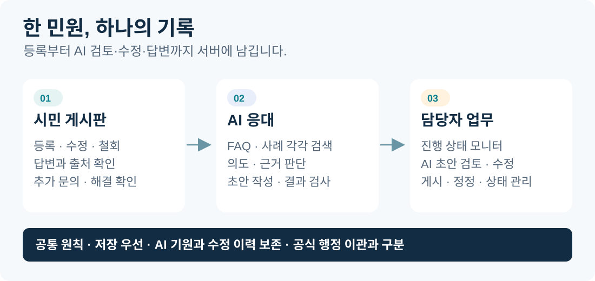
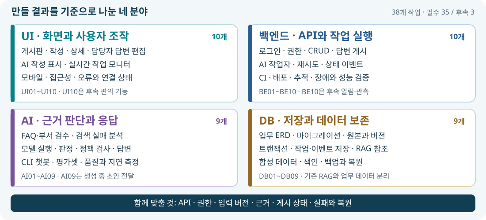
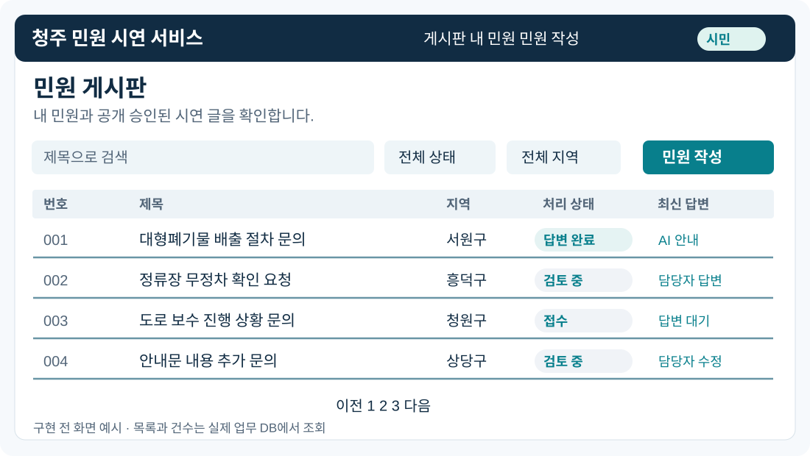
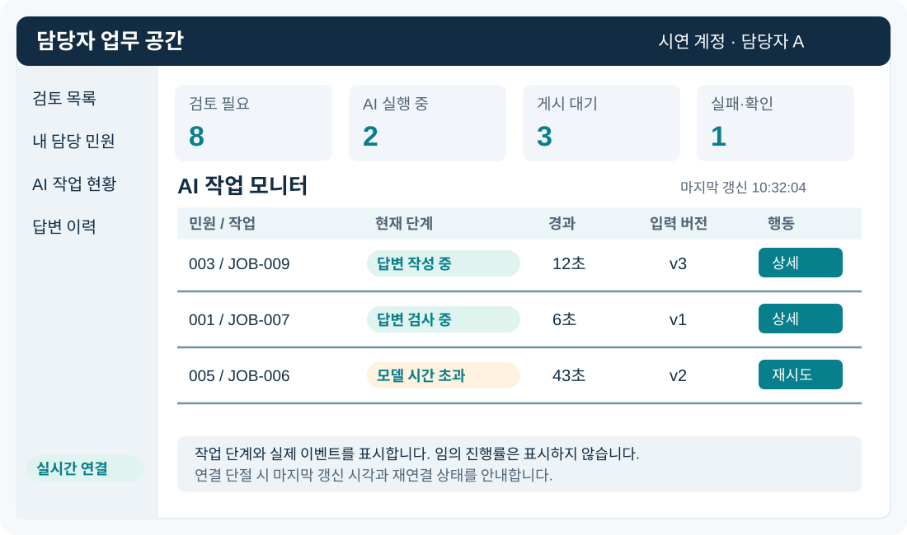
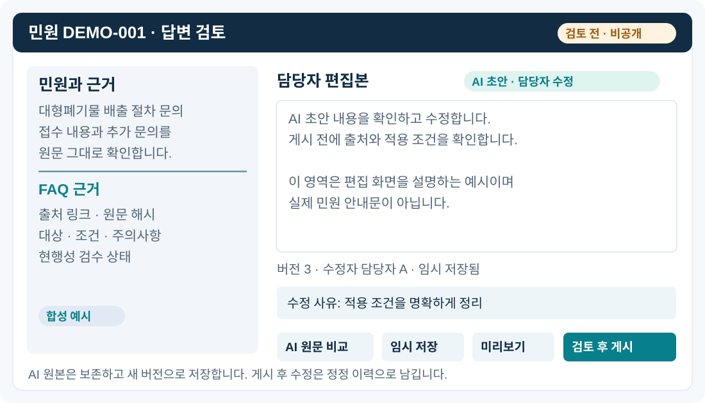
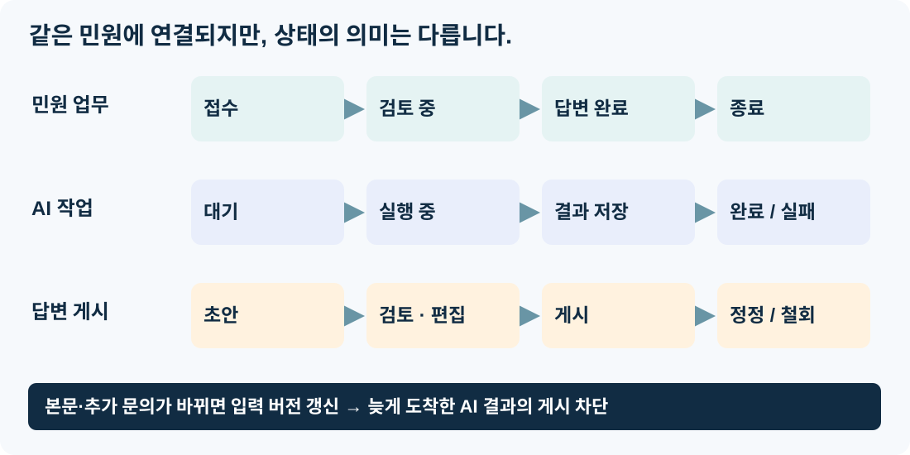
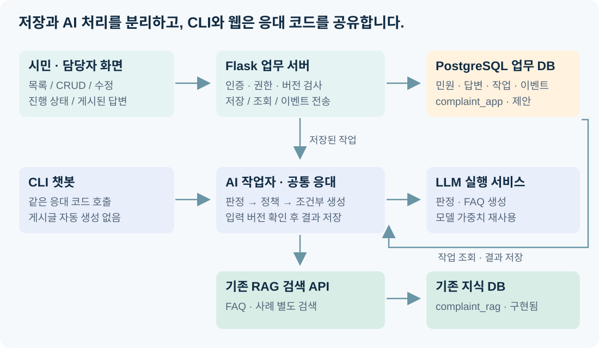

# 민원 웹 MVP 상세설계와 분야별 작업계획

**청주 민원 AI 완충지대 · 게시판에서 담당자 답변까지**

설계 기준 **2026-10-28 UTC** · 문서 버전 **1.3** · 상태 **구현 전 설계**



실제 DB에 저장되는 민원 게시판, 수정 가능한 AI 답변, 담당자의 실시간 작업 모니터링을 하나의 시연 서비스로 연결한다. **UI·백엔드·AI·DB** 네 분야별로 구현할 기능과 산출물·완료 기준을 정리한다. 작업을 선택하고 연결 순서를 확인하는 계획이며, 개인별 담당 배정은 포함하지 않는다.

| 이 문서에서 정리하는 것 | 완료로 주장하지 않는 것 |
| --- | --- |
| 화면·CRUD·권한·답변 수정·실시간 상태·DB/API·분야별 작업·인수 조건 | 웹·업무 서버·LLM 기능 구현, 운영 배포, 공식 행정 이관 |

현재 구현은 PostgreSQL/pgvector와 검색 CLI/API까지다. **초기 AI는 Jev 없는 LLM + RAG**이며 모델은 미선정이다. Jev·Papago·LoRA는 후속 비교 대상으로 유지한다.

[동일 내용 PDF](민원_웹_MVP_상세설계와_분야별_작업계획.pdf) · [프로젝트 소개](../README.md) · [웹 범위 요약](시연_웹_게시판과_민원_서버_구현계획.md) · [실행 과제](harness-roadmap.md)

<!-- page -->

## 01. 범위와 읽는 순서

### 네 분야에서 무엇을 만드는가?

**UI는 시민·담당자가 사용하는 화면, 백엔드는 API·업무 처리·작업 실행, AI는 검색·판정·응답·평가, DB는 저장 구조·무결성·복원을 만든다.** 분야별 목록은 구현할 일을 소개하며 담당 인원을 고정하지 않는다.



### 분야 사이에 맞출 계약

| 연결 | 함께 확인할 내용 |
| --- | --- |
| UI ↔ 백엔드 | 화면 입력·조회 범위·오류·상태·이벤트 형식. 권한은 서버에서 최종 검사 |
| 백엔드 ↔ AI | 입력 버전·세 결과 형식·근거·시간 초과·취소. 저장 성공과 AI 성공을 분리 |
| 백엔드 ↔ DB | 키·버전·원자 저장·실행권·게시본·커서. 동시 처리와 복원 후 일관성 |
| AI ↔ DB | FAQ/사례 문서 키·근거 스냅샷·검증 상태. 업무 민원을 RAG에 자동 혼입하지 않음 |

다음 표에서 전체 작업을 확인하고 **14~17절의 분야별 작업·완료 기준**을 읽는다. CI·배포는 백엔드, 의미적 데이터 검수는 AI, 저장·참조 검증은 DB에 둔다. 하네스와 테스트는 각 분야의 완료 조건에 포함한다.

<!-- page -->

## 01-1. 세부 작업 38개 한눈에 보기

**UI 10개 · 백엔드 10개 · AI 9개 · DB 9개 = 총 38개.** 여러 분야가 섞였던 기존 작업을 기능과 저장·처리 경계에 맞춰 나눴다. 기존 시연 범위를 유지하며 P0는 필수 35개, P1은 후속 보완 3개다.

| UI · 화면 | 백엔드 · API·실행 | AI · 검색·응답 | DB · 저장·무결성 |
| --- | --- | --- | --- |
| UI01<br>공통 화면·구성 요소 | BE01<br>API·상태·결과 계약 | AI01<br>FAQ·부서 근거 검수 | DB01<br>업무 ERD·스키마 |
| UI02<br>게시판 목록·검색·페이지 | BE02<br>로그인·세션·권한 | AI02<br>검색 기준선·실패 분석 | DB02<br>마이그레이션·복구 |
| UI03<br>민원 작성·수정·삭제 | BE03<br>민원 CRUD·목록 API | AI03<br>모델 실행·기준 선정 | DB03<br>답변 원본·버전·근거 |
| UI04<br>민원 상세·추가 문의 | BE04<br>대화·답변·게시 API | AI04<br>판정·생성 어댑터 | DB04<br>트랜잭션·중복·경쟁 |
| UI05<br>담당자 검토 목록 | BE05<br>담당자 지정·상태 전이 | AI05<br>응답 허용 정책 검사 | DB05<br>작업·이벤트 저장 구조 |
| UI06<br>답변 편집·비교·게시 | BE06<br>AI 작업 실행·복구 | AI06<br>공통 검색·판정·응답 | DB06<br>RAG 데이터 무결성 |
| UI07<br>AI 작성 표시·출처 | BE07<br>상태 이벤트·SSE | AI07<br>CLI 챗봇·결과 표시 | DB07<br>합성 시연 데이터 |
| UI08<br>실시간 작업 모니터 | BE08<br>추적·제한·장애 측정 | AI08<br>평가셋·평가 실행기 | DB08<br>조회·색인 성능 |
| UI09<br>화면 품질·동작 검증 | BE09<br>CI·배포·통합 검증 | AI09 · P1<br>생성 중 초안 전달 | DB09<br>백업·보존·복원 검증 |
| UI10 · P1<br>화면 편의·미리보기 | BE10 · P1<br>알림·필터·관측 확장 | — | — |

### 표를 읽는 방법

번호는 분야별 작업 식별자이며 GitHub 이슈 번호가 아니다. **P1 표시가 없는 항목은 모두 P0**다. UI는 14절, 백엔드는 15절, AI는 16절, DB는 17절에서 실제 기능·산출물·검증 기준을 확인한다.

작업 수는 공수나 인원 수를 뜻하지 않는다. 예를 들어 ‘AI 답변 수정’은 UI06의 편집 화면, BE04의 수정·게시 API, DB03의 원본·버전 보존을 연결해야 완성된다. 각 작업을 따로 개발하더라도 20절의 인수 시나리오로 전체 흐름을 확인한다.

<!-- page -->

## 01-2. 확정 범위와 분야별 읽는 순서

### 확정된 요구와 구현 제안

| 구분 | 내용 |
| --- | --- |
| 사용자 요구 | 실제 목록·등록·조회·수정·삭제, 담당자 답변 화면, AI 작성 표시와 수정, 담당자의 실시간 AI 작업 모니터링 |
| 기존 방향 유지 | 한국어 직접 입력, 무료 모델 우선, CLI 이후 웹 시연, FAQ 안내와 사례 기반 부서 추천 분리 |
| 이 문서의 제안 | Flask 업무 서버, 템플릿+TypeScript, PostgreSQL 업무 스키마, 작업자와 SSE, 수정 이력·게시 정책 |
| 별도 결정 필요 | 최종 모델·실행 엔진, 자동 게시 활성화 범위, 공개 범위, 실제 배포 자원·접근 대상 |

“게시판 날리는 것”은 **글 등록·전송과 삭제를 모두 포함하는 CRUD**로 구체화했다. 삭제의 기본안은 목록에서 숨기는 논리 삭제이며 복구와 이력을 보존한다. 실데이터의 영구 삭제·보존 기간은 운영 단계에서 별도로 정한다.

### 기능 우선순위

| 우선순위 | 이번 시연의 범위 |
| --- | --- |
| P0 · 필수 | 저장된 목록, 글 CRUD, 시민·담당자 권한, 답변 교환, AI 표시·수정 이력, 실제 작업 상태 모니터, 실패 시 민원 보존 |
| P1 · 안정화 | 입력 임시 저장, 고급 필터, 수정 전후 비교 개선, 읽음 표시·사이트 내부 알림, 모니터 지연 통계 |
| 후속 | 첨부파일, 외부 알림, 시민 간 실시간 채팅, 공식 본인인증·행정 이관, Jev·Papago·LoRA |

### 문서 지도

| 분야 | 먼저 읽을 설계 | 작업·검증 확인 |
| --- | --- | --- |
| UI | 02~06절 화면·CRUD·답변, 08절 실시간 상태 | 14절 UI 작업, 20절 화면 인수 |
| 백엔드 | 07~09절 상태·구조, 11·12절 API·작업 | 15절 백엔드 작업, 18~20절 운영·통합 |
| AI | 13절 LLM + RAG·자료 검수, 12절 결과 계약 | 16절 AI 작업, 18~20절 평가·연결 |
| DB | 07·10절 버전·저장 구조, 12절 게시 일관성 | 17절 DB 작업, 18~20절 복원·통합 |
| 공통 | 01~01-2절 범위·전체 목록, 09절 구조 | 19절 개발 순서, 20절 인수, 21절 결정 사항 |

02~06은 화면, 07~12는 상태·구조·DB/API, 13은 AI 품질, 14~17은 네 분야의 세부 작업이다. 18~21은 하네스·개발 순서·인수 조건·미정 항목을 다룬다. 그림은 설계 예시이며 실제 서비스 화면이나 구현 완료 증거가 아니다.

<!-- page -->

## 02. 시민 게시판: 실제 목록이 보이는 화면



| 영역 | 기능·표시 기준 |
| --- | --- |
| 상단 | 시연 서비스 표시, 게시판·내 민원·민원 작성, 현재 로그인 역할 |
| 검색·필터 | 제목 검색, 처리 상태·기간·지역, 내 글 보기. 조건과 페이지를 URL에 보존 |
| 목록 | 민원 번호·제목·지역·처리 상태·최신 공개 답변 주체·등록 시각 |
| 답변 주체 | AI 안내 / AI 초안·담당자 검토 / AI 초안·담당자 수정 / 담당자 답변을 텍스트 배지로 구분 |
| 목록 동작 | 페이지 이동·정렬·빈 결과·로딩·오류·재시도. 비공개 글은 권한 없는 목록·건수에서 제외 |
| 접근성 | 상태는 색과 문구를 함께 사용. 키보드로 목록·작성 버튼 접근, 모바일에서는 카드형 배치 |

**데이터가 실제로 움직이는 시연:** 개발용 합성 민원 20~30건을 업무 DB에 넣는 초기 데이터 생성 기능을 제안한다. 개인정보 없는 시연 데이터임을 표시하고, 화면의 하드코딩 배열이나 RAG 사례 전체를 게시판 글로 복사하지 않는다. 사용자가 새 글을 등록하면 DB 저장 결과로 목록에 즉시 반영된다. 개발용 초기화는 운영 데이터와 분리한다.

첫 공개 범위는 “내 민원 + 공개 승인된 합성 시연 글”을 권장한다. 실제 민원 공개는 별도 정책을 정한 뒤 적용한다. 로그인하지 않은 사용자의 열람 허용 여부도 서버 정책으로 확정한다.

<!-- page -->

## 03. 민원 작성·수정·삭제와 권한

### 작성과 입력 제한

제목·본문·관할 구(모름 허용)를 받고 공개 범위는 기본 비공개로 둔다. 개인정보를 제목에 쓰지 않도록 입력 안내를 둔다. 저장 중에는 제출 버튼을 잠그고, 서버도 중복 키를 검사한다. 저장에 성공한 뒤 **시연 서비스 내 등록 완료**와 민원 ID를 보여 준다.

초기 제안은 제목 120자, 본문 2,000자다. 현재 검색 API의 `query` 최대 길이가 2,000자이므로 더 긴 본문 지원은 별도 검색 질의 구성·평가 후 확장한다. 검색 질의는 본문을 기본으로 사용하고 제목을 결합하면 합계 길이도 검사한다. 본문을 저장하면서 AI에 전달할 때 조용히 잘라내지 않는다. 길이 초과는 입력 단계에서 알린다.

| 작업 | 시민 | 담당자 | 저장·검증 기준 |
| --- | --- | --- | --- |
| 등록 | 본인 민원 등록 | 검토용 합성 글 외 대리 작성은 후속 | 작성자 ID는 세션에서 결정 |
| 조회 | 본인 글·허용된 공개 글 | 부여된 검토 범위 | 목록·상세·이력·이벤트 모두 동일 권한 |
| 본문 수정 | 답변 게시 전 본인 글 | 시민 원문을 대신 수정하지 않음 | 버전 증가, 이전 본문 보존, 기존 AI 작업 무효화 |
| 답변 이후 정정 | 추가 문의로 정정 | 정정 내용을 참고해 새 답변 | 이미 답한 원문·맥락을 유지 |
| 삭제·철회 | 본인 글 논리 삭제·철회 | 관리상 숨김과 사유 기록 | 공개 목록에서 제외, AI 작업 취소 요청 |
| 복구 | 초기에는 담당자 요청 | 권한 있는 담당자 복구 | 복구 사유·행위자 저장, AI 재실행은 명시적 요청 |

### 충돌·중복 방지

수정·삭제에는 현재 `version`을 보낸다. 서버 버전과 다르면 `409`로 거부하고 최신 내용을 다시 불러오게 한다. 같은 등록 키와 같은 본문 재전송은 같은 민원 ID를 반환하며 다른 본문으로 키를 재사용하면 `409`다. 민원과 최초 AI 작업 기록은 같은 트랜잭션에서 저장한다.

논리 삭제는 권한·백업·보존 기간 설계를 대신하지 않는다. 시연에서는 삭제 안내·복구 이력을 확인하고 영구 삭제는 구현 범위를 별도 합의한다.

<!-- page -->

## 04. 시민 상세: AI와 담당자의 답변 구별

상세 화면은 **민원 본문 → 현재 처리 상태 → 게시된 답변 → 추가 문의 → 공개 가능한 변경 이력** 순서로 구성한다. 작성 중인 AI 원문과 담당자 초안은 시민 API·HTML·이벤트에 포함하지 않는다.

| 배지 | 판별 기준 | 시민이 확인할 내용 |
| --- | --- | --- |
| AI 안내 | AI 생성본이 정책 검사를 통과해 자동 게시 | AI 작성 표시, FAQ 출처·적용 조건, 확인 시각 |
| AI 초안·담당자 검토 | AI 생성본을 사람이 내용 변경 없이 게시 | 검토한 담당자 표시, 게시 시각 |
| AI 초안·담당자 수정 | AI 생성본에서 파생된 수정본을 사람이 게시 | 수정 주체·시각, 정정 안내, 출처 |
| 담당자 답변 | 담당자가 직접 작성 | 담당자 표시와 게시 시각 |

작성 기원과 최종 수정 주체를 별도로 저장한다. UI가 본문 단어를 보고 AI 여부를 추측하거나 클라이언트가 보낸 `origin=ai`를 신뢰하지 않는다. AI 답변을 사람이 고쳤다고 AI 기원을 지우지 않는다.

### 시민의 후속 행동

- **추가 문의:** 같은 민원에 새 메시지 저장. 답변 이후 문의면 검토 상태로 다시 전환한다.
- **해결 확인:** 안내가 도움이 됐는지 확인하고, 정보 문의에 한해 정해진 종료 절차로 연결한다.
- **담당자 확인 요청:** 기존 AI 답변을 유지하면서 검토 대상으로 연결한다. 실제 조치 요청은 자동 종결하지 않는다.
- **정정 이력 확인:** 현재 게시본과 정정 시각·사유를 표시한다. 개인정보로 철회한 과거 본문은 시민에게 노출하지 않는다.

업무 상태와 AI 상태는 다른 표시다. “AI 답변 작성 중”은 접수 완료·처리 완료를 뜻하지 않는다. 내부 부서 후보는 추천 정보이며 **공식 배정·외부 이관 완료로 표시하지 않는다**.

<!-- page -->

## 05. 담당자 대시보드와 작업 모니터



| 영역 | 필요한 정보·행동 |
| --- | --- |
| 업무 요약 | 접수 대기·검토 필요·게시 대기·답변 완료 건수. 건수는 담당자 권한 범위 내 DB 조회 |
| 민원 검토 목록 | 담당자 미지정·내 담당, 지역·상태·AI 실패·오래 대기한 글 필터 |
| 담당자 지정 | 한 명이 검토를 맡거나 권한 있는 다른 담당자에게 내부 변경. AI 추천 부서와 별도 필드 |
| 실시간 작업 목록 | 민원 ID, 작업 ID, 입력 버전, 시도 번호, 단계, 경과 시간, 마지막 이벤트 시각 |
| 작업 상세 | 검색·판정·작성·검증 단계 이력, 근거 ID, 실패 사유 코드, 게시 가능 여부 |
| 조작 | 상세 열기, AI 재시도, 취소 요청, 담당자 직접 답변. 역할·작업 상태에 따라 버튼 활성화 |

**진행률 숫자를 꾸며내지 않는다.** “답변 작성 중 · 12초 경과”처럼 서버 단계와 시간만 표시한다. 연결이 끊기면 “연결 재시도 중 / 마지막 갱신 시각”으로 바뀌며, 실제 작업이 계속 진행되는지는 재조회로 확인한다.

시민에게는 필요한 요약 상태만, 담당자에게는 업무 범위 내 작업 정보만 공개한다. 시스템 프롬프트·내부 추론 과정·비밀 키·전체 원문 로그는 모니터에 노출하지 않는다. 모델의 토큰 출력이 없는 엔진에서도 단계 모니터는 동작해야 한다.

<!-- page -->

## 06. 담당자 답변 편집·검토·게시



### 편집 흐름

1. 왼쪽에서 민원·추가 문의·FAQ 근거와 부서 검증 상태를 확인한다.
2. AI 초안을 불러오거나 담당자가 새 답변을 작성한다. AI 초안은 **검토 전·시민 비공개**로 표시한다.
3. 저장하면 새 답변 버전이 생긴다. AI 원본과 이전 버전은 그대로 보존한다.
4. 미리보기에서 시민에게 표시할 본문·배지·출처를 확인하고 게시한다. 현재 버전·권한·입력 버전을 서버가 다시 검사한다.
5. 게시 후 수정은 새 정정 버전으로 저장·게시한다. 이전 게시본을 조용히 덮어쓰지 않는다.

| 동작 | 규칙 |
| --- | --- |
| 임시 저장·재열기 | 담당자만 조회. 저장 성공 시각 표시, 저장 실패 시 편집 내용 유지 |
| AI 원문 비교 | 초안과 수정본의 차이·변경 사유·작성 주체 확인 |
| AI 다시 작성 | 기존 편집본을 유지한 채 별도 후보 초안 생성. 자동으로 편집창·게시본 교체 금지 |
| 게시·철회 | 게시 권한과 버전 확인. 철회 사유·시각 기록, 시민에게 철회 상태 표시 |
| 초안 삭제 | 미게시 초안을 논리 삭제. 게시된 답변은 철회 절차 사용 |

**게시 정책 제안:** 첫 개발 시연은 검토 우선 모드를 기본으로 검증한다. 이후 현행성 확인된 FAQ 허용 목록과 코드 검사를 통과한 `faq_answer`만 자동 게시하는 제한 모드를 비교한다. 검토 우선 모드는 개발 초기의 제안이며 AI 1차 응대라는 최종 목적을 대체하지 않는다. 두 모드에서 AI 표시·수정·검토 요청은 동일하게 지원한다.

사람이 편집한 답변은 자동 검사 통과 표시를 재사용하지 않는다. 근거 참조 검사를 다시 하고 담당자가 내용에 책임지는 게시로 기록한다. 수동 작성·수정 답변은 제한 자동 게시 대상에서 제외한다.

<!-- page -->

## 07. 세 가지 상태와 버전 관리



| 상태 축 | 제안 값과 전이 |
| --- | --- |
| 민원 업무 | `submitted → under_review → answered → closed`; 추가 문의·재검토 요청 시 `under_review`, 철회 시 `withdrawn` |
| AI 작업 | `queued → running → succeeded / failed / cancelled / superseded`; 실행 중 세부 단계는 별도 `stage` |
| 답변 게시 | `draft → published → retracted`; 수정 시 새 버전을 만들고 게시 포인터 변경 |

`succeeded`는 AI 결과 저장 완료다. `human_handoff` 결과도 정상 완료일 수 있고, 게시 완료나 민원 해결과 동의어가 아니다. 현재 입력 버전에 대한 답변이 게시돼야 `answered`로 전환한다. 이후 추가 문의는 다시 검토하며 시민의 해결 확인 또는 담당자의 사유 있는 종료만 `closed`로 연결한다.

### 늦은 결과와 동시 편집

본문 수정·시민 추가 문의·삭제·담당자 게시처럼 기존 AI 결과의 적용 가능성을 바꾸는 행동은 `context_version`을 갱신한다. AI 작업은 시작 시 버전을 고정한다. 결과 저장·자동 게시 직전에 현재 버전과 대조하고 다르면 `superseded`로 남기며 적용하지 않는다. 이전에 게시된 답변은 당시 맥락의 이력으로 유지한다.

답변 편집에는 별도의 답변 `version`을 사용한다. 두 담당자의 동시 저장·게시 충돌은 `409`로 알린다. 담당자 게시와 AI 자동 게시의 경쟁도 트랜잭션·버전 조건으로 한쪽만 성공시킨다. 취소는 요청 즉시 모델 중단을 보장하지 않으며 늦게 돌아온 결과의 게시를 차단한다.

<!-- page -->

## 08. 실시간 상태: SSE와 재연결

실시간 요구는 서버가 작업 변경을 화면에 전달하는 것이므로 **SSE 우선, 짧은 주기 조회를 대체 경로**로 제안한다. 답변 수정·취소 같은 사용자 행동은 일반 HTTP 요청으로 처리한다. SSE는 서버에서 브라우저로 전달하는 단방향 연결이다. [MDN 설명](https://developer.mozilla.org/en-US/docs/Web/API/Server-sent_events/Using_server-sent_events)

| 항목 | 설계 기준 |
| --- | --- |
| 실제 단계 | 대기 → 근거 검색 → LLM 판정 → 정책 검사 → FAQ 작성(해당 경로만) → 답변 검사 → 결과 저장 |
| 이벤트 저장 | DB 작업 상태와 이벤트를 같은 트랜잭션으로 기록한 뒤 구독자에게 전달 |
| 연결 시작 | 스냅샷과 마지막 커서를 일관된 시점에 조회한 뒤 커서 이후 이벤트 수신 |
| 재연결 | `Last-Event-ID` 이후 이벤트 재전달. 클라이언트는 ID로 중복 제거·순서 확인 |
| 누락·보관 만료 | `resync_required` 후 현재 스냅샷 재조회. 전송 순서만으로 최신 상태를 추측하지 않음 |
| 연결 장애 | 연결 상태·마지막 갱신 시각 표시. 예: 3초 간격 조회로 전환하고 복구 시 중복 연결 종료 |
| 하트비트 | 예: 15초 간격 연결 유지. 연결 하트비트와 AI 작업의 실행 생존 신호를 구분 |

이벤트 발행 커서는 커밋이 확인된 순서로 증가시킨다. 미커밋 이벤트가 나중에 나타날 수 있는 단순 DB 시퀀스의 최댓값만 커서로 삼지 않는다. 재연결·누락 복구는 이 발행 순서를 기준으로 검증한다.

3초·15초는 초기 실험값이며 부하 측정 후 조정한다. 화면 하나에 필요한 구독을 묶고 같은 사용자의 중복 연결을 줄인다. 장시간 SSE 연결이 Flask의 일반 요청 작업자를 점유하므로 동시 연결 예산·프록시 버퍼링·타임아웃을 검증한다. 부족하면 이벤트 전달 프로세스를 분리한다.

토큰 단위 초안 미리보기는 **P1 선택 기능**이다. 지원 엔진에서 담당자에게만 검토 전 미완성 문구로 표시하며, 시민에게는 게시된 본문만 전달한다. 단계·작업 완료 이벤트만으로도 P0 모니터는 완성된다. 인증은 같은 출처 세션을 권장하고 토큰을 이벤트 URL 쿼리에 넣지 않는다.

<!-- page -->

## 09. 추천 구성과 데이터 흐름



| 구성 | 제안·책임 |
| --- | --- |
| 웹·업무 서버 | Flask + 템플릿 + 필요한 TypeScript. UI 화면과 백엔드 CRUD·권한·이벤트 연결 |
| 업무 저장소 | PostgreSQL의 새 `complaint_app` 스키마. 민원·답변·작업·이력 관리 |
| AI 작업자 | 업무 DB의 대기 작업을 실행. 최초에는 동시 실행 1개부터 측정 |
| 공통 응대 코드 | 기존 검색 → LLM 판정 → 코드 정책 → 조건부 FAQ 생성. CLI에서도 같은 코드 호출 |
| 기존 검색 | FastAPI·pgvector·BM25·RRF·재정렬 유지. 모델을 업무 서버에 중복 로드하지 않음 |
| LLM 실행 | 검색 API 프로세스와 분리, 모델 가중치 재사용. 모델·엔진·양자화는 평가 후 결정 |

민원과 작업을 원자적으로 저장하고 작업자는 짧은 트랜잭션으로 실행권·만료 시각을 얻은 뒤 트랜잭션 밖에서 추론한다. 결과 반영은 실행권·입력 버전을 다시 검사한다. 재시작으로 실행권이 만료된 작업은 제한된 재시도 또는 담당자 검토로 복구한다. 실행은 중복될 수 있으므로 결과 저장·게시를 멱등하게 만든다.

DB 작업 테이블은 초기 규모에 맞춘 제안이다. Celery 등 큐 도구 채택은 부하·복구 복잡도를 보고 결정하며 Redis를 처음부터 필수로 추가하지 않는다. Flask 공식 문서 역시 오래 걸리는 작업을 요청과 분리해 다른 프로세스에서 실행하는 방식을 설명한다. [공식 안내](https://flask.palletsprojects.com/en/stable/patterns/celery/)

<!-- page -->

## 10. 업무 DB 설계 초안

아래 객체는 **현재 생성되지 않았다**. 검색용 7개 테이블은 `complaint_rag`에 유지하고 업무 데이터만 `complaint_app`에 둔다. 스키마 구분과 함께 DB 역할 권한을 설정한다. [PostgreSQL 스키마 문서](https://www.postgresql.org/docs/17/ddl-schemas.html)

| 제안 테이블 | 핵심 내용 |
| --- | --- |
| `users` | 시연 사용자·역할·활성 상태. 외부 본인인증은 별도 |
| `complaints` | ID·작성자·제목·본문·지역·공개 범위·상태·담당자·버전·삭제 시각 |
| `complaint_revisions` | 수정 전후 본문·버전·행위자·사유. 시민 공개 범위 제한 |
| `messages` | 민원 ID·시민 문의/답변 구분·작성 기원·현재 게시 버전·철회 상태 |
| `message_versions` | 본문·기원 AI 작업·이전 버전·편집자·시각·사유·게시 상태 |
| `ai_jobs` | 입력 스냅샷·context 버전·상태·단계·시도·실행권·취소·오류 코드 |
| `ai_results` | outcome·이유·모델/정책/프롬프트 버전·근거·후보 부서·검사 결과 |
| `job_events` | 단조 증가 이벤트 ID·작업 ID·시도·단계·발생 시각·허용된 payload |
| `status_history` | 민원 상태 전후·주체·사유·시각 |
| `idempotency_keys` | 사용자·작업 종류·키·요청 해시·최초 응답 참조·만료 |

### 제약과 보존

- 민원·메시지·버전·AI 작업은 외래 키로 연결한다. 하나의 메시지에서 현재 게시 버전은 최대 하나다.
- 같은 작업 시도에 대한 결과 저장·답변 생성은 유일 키로 중복을 차단한다. AI 재생성은 새로운 작업으로 이력을 남긴다.
- AI 원본은 수정하지 않는다. 사람이 고친 버전은 `origin=ai`와 기원 작업 참조를 유지하고 편집자·게시자를 별도 기록한다.
- 근거는 `(corpus, source_id)`·원문 해시·출처·검토 시점 스냅샷으로 남긴다. RAG 재적재·삭제가 게시된 답변 이력을 지우지 않게 한다.
- `(status, created_at)`, `(author_id, created_at)`, 작업 상태·이벤트 ID 등에 조회 목적의 색인을 설계하고 실제 조회로 검증한다.
- 업무 글·담당자 수정본을 RAG·학습 데이터로 자동 적재하지 않는다. 삭제·이벤트·로그 보관 기간은 운영 대상과 함께 결정한다.

<!-- page -->

## 11. 업무 API 계약 초안

아래는 **새 업무 서버의 설계 경로**이며 현재 검색 API의 지원 기능이 아니다. 기본 응답에 요청 ID·객체 버전을 포함하고 서버에서 역할·소유권·공개 범위를 확인한다.

| 경로 | 용도·주요 조건 |
| --- | --- |
| `POST /api/session`, `DELETE /api/session` | 시연 계정 로그인·로그아웃. 세션 쿠키·CSRF 검사 |
| `GET /api/me` | 현재 사용자·역할·허용 기능 |
| `GET /api/complaints` | 검색·정렬·페이지·권한 범위 적용 |
| `POST /api/complaints` | 등록과 AI 작업 기록. `Idempotency-Key`, 저장 성공 시 `201` |
| `GET /api/complaints/{id}` | 본문·공개 가능한 답변·요약 상태·버전 |
| `PATCH /api/complaints/{id}` | 본인 글 수정. 현재 버전 필요, 답변 이후 원문 수정 제한 |
| `DELETE /api/complaints/{id}` | 본인 철회·논리 삭제. 버전·사유 기록 |
| `POST /api/complaints/{id}/restore` | 담당자 복구. 재실행은 별도 요청 |
| `POST /api/complaints/{id}/messages` | 시민 추가 문의 또는 담당자 답변 초안 |
| `PATCH /api/messages/{id}` | 본인 문의의 허용된 정정 또는 담당자 답변 새 버전 |
| `DELETE /api/messages/{id}` | 미게시 담당자 초안 삭제. 시민 문의는 처리 전 본인 것만, 처리 후 정정 메시지로 보존 |
| `POST /api/messages/{id}/publish` | 지정 버전 게시. 역할·입력 버전·검사 결과 재확인 |
| `POST /api/messages/{id}/retract` | 게시 답변 철회와 사유·이력 기록 |
| `GET /api/messages/{id}/versions` | 역할에 맞는 수정 이력·전후 비교 |
| `PATCH /api/complaints/{id}/status` | 허용된 상태 변경·종료·재검토 |
| `PATCH /api/complaints/{id}/assignee` | 담당자 내부 지정. 공식 부서 배정과 별개 |

추가 문의 수정·삭제도 `context_version`을 바꾸고 진행 중 AI 결과를 무효화한다. 게시 권한은 브라우저가 지정한 역할이 아닌 서버 세션·정책으로 판단한다.

입력 오류 `400/422`, 미인증 `401`, 권한 오류 `403` 또는 존재를 숨기는 `404`, 충돌 `409`, 요청 제한 `429`, 일시 장애 `503`을 구분한다. 등록 실패에 성공 문구를 표시하지 않는다. **저장 성공 후 AI 실패는 등록 API의 저장 성공을 취소하지 않는다.**

<!-- page -->

## 12. AI 작업·이벤트 API와 게시 일관성

| 경로 | 용도 |
| --- | --- |
| `GET /api/staff/complaints` | 담당자 검토 목록·필터·요약 건수 |
| `GET /api/staff/ai-jobs` | 권한 범위의 작업 스냅샷과 이벤트 커서 |
| `GET /api/ai-jobs/{id}` | 작업 상태·단계·현재 시도·허용된 결과 |
| `POST /api/complaints/{id}/ai-jobs` | 재검토·재생성 작업. 작업 생성은 `202` |
| `POST /api/ai-jobs/{id}/cancel` | 협력적 취소 요청. 늦은 결과의 적용 차단 |
| `GET /api/staff/events` | 담당자 범위의 SSE 구독 |
| `GET /api/complaints/{id}/events` | 작성자에게 허용된 상태·게시 이벤트만 구독 |

### 이벤트 예시: 담당자에게 전달되는 단계 변경

```json
{
  "event_id": 1042,
  "type": "ai_job.stage_changed",
  "complaint_id": "DEMO-003",
  "job_id": "JOB-009",
  "context_version": 3,
  "attempt": 1,
  "state": "running",
  "stage": "generating",
  "occurred_at": "2026-10-27T06:00:00Z"
}
```

숫자·ID·시각은 합성 예시다. SSE의 `id`도 같은 이벤트 ID를 사용한다. 이벤트에는 민감한 본문·비밀 키·추론 과정을 담지 않는다. 시민 이벤트는 필요한 요약으로 변환하며, 직원 이벤트의 payload를 그대로 전달하지 않는다.

### 서버가 보장할 순서

민원 저장과 최초 작업 등록 → 응답 반환 → 작업 실행 → 버전·취소 확인 → 결과와 이벤트 저장 → 필요 시 게시 권한·정책 검사 → 게시본과 이벤트 저장. 이벤트는 저장 성공 이후에만 전송한다. 작업 재시도는 새 시도 번호로 추적하고 같은 단계 이벤트 재수신이 상태를 거꾸로 돌리지 않도록 한다.

로그아웃·역할 변경·민원 삭제 후 연결된 이벤트 스트림도 권한을 재확인해 종료하거나 데이터 전송을 중단한다. 재연결은 전송 복구이고 모델 재실행이 아니다.

<!-- page -->

## 13. LLM + RAG와 데이터 검수

현재 FAQ 94건·사례 5,015건·부서 127개는 검색 기반이다. 2026-10-25 기록상 부서 127개의 공식 업무분장이 미검증이고 27개 사례는 현행 부서 재검토 대상이다. FAQ 정책·연락처 현행성도 별도 확인해야 한다. 이 설계 작성으로 데이터를 갱신·검증한 것은 아니다.

| 처리 | 책임·기준 |
| --- | --- |
| 검색 | FAQ와 사례를 각각 검색. 기존 `/search`의 `retrieval_only=true`, `requires_gate` 유지 |
| 판정 | 같은 범용 LLM에 한국어 민원·검색 원문·검증 상태를 전달, 의도·근거·결과를 구조화 |
| 코드 검사 | 후보에 실제 존재하는 근거·부서 ID, 현행성 기록, 실제 조치·복합 요청 여부 대조 |
| 생성 | 허용된 FAQ 경로에서 같은 모델 재호출. 선택된 FAQ 전체 조건을 사용 |
| 결과 | `faq_answer / department_suggestion / human_handoff`; 초기 `automatic_transfer=false` |
| 실패 | 잘못된 JSON·가짜 근거·시간 초과·근거 부족은 검토 경로. 민원 저장 유지 |

AI 판정 결과와 게시 여부는 분리한다. 과거 사례의 답변을 현재 정책 안내로 쓰지 않고, 미검증 부서를 실제 이관 대상으로 확정하지 않는다. 검색 점수·모델 confidence를 정답 확률로 보지 않는다. 문자열·ID 검사만으로 의미적 정확성을 보장하지 않으므로 사람 검수와 평가를 병행한다.

### AI 분야에서 준비할 검수 자료

우선 시연에 사용할 FAQ 10~20건과 관련 부서부터 공식 근거·확인일·원문 해시를 기록하는 안을 제안한다. 처음 검수 질문 60~100개로 개발을 시작하고 기존 400문항 평가 제안으로 확장한다. 수량은 계획값이며 현재 준비된 수량이 아니다.

안내·실제 조치·복합·지역 불명·범위 밖·조건 누락을 포함하고 원문 그룹별로 개발/보류 평가를 나눈다. 검색 실패와 판정 실패를 구별한다. 자동 안내 오류율·조치 요청 오안내율·부서 후보 Hit@k·검토 회수율·안내 비중·전체 지연을 함께 기록한다. Jev·LoRA·번역은 이 기준 성능 확보 뒤 개별 실험으로 둔다.

<!-- page -->

## 14. UI: 시민·담당자가 사용하는 화면

저장된 데이터를 보여 주고 사용자의 입력·응답·검토를 연결한다. 화면의 버튼 노출과 서버 권한 검사를 구별한다.

| 번호·우선순위 | 작업·산출물 | 구체적 작업·완료 기준 |
| --- | --- | --- |
| UI01 · P0 | 공통 화면·구성 요소 | 메뉴·화면 틀·폼·버튼·배지·모달을 만든다. 시민/담당자 화면에서 같은 상태·오류 표현을 재사용한다. |
| UI02 · P0 | 게시판 목록·검색·페이지 | 실제 목록 API에 검색·상태 필터·페이지 이동을 연결한다. 조회 범위·건수·빈 결과가 서버 응답과 일치한다. |
| UI03 · P0 | 민원 작성·수정·삭제 | 입력 검증·제출 중 표시·철회/복구 조작을 만든다. 저장 실패 시 입력을 유지하고 버전 충돌을 안내한다. |
| UI04 · P0 | 민원 상세·추가 문의 | 본문·게시 답변·추가 문의·처리 이력을 표시한다. 새로고침 후에도 저장된 대화와 상태가 다시 보인다. |
| UI05 · P0 | 담당자 검토 목록 | 미답변·검토 대기·실패 민원 목록과 담당자 지정 조작을 만든다. 선택한 민원의 상세·작업으로 이동한다. |
| UI06 · P0 | 답변 편집·비교·게시 | AI 초안 수정·저장·버전 비교·게시·정정·철회를 연결한다. 동시 수정과 게시 충돌을 화면에서 안내한다. |
| UI07 · P0 | AI 작성 표시·출처 | AI 작성/담당자 수정/직접 작성 배지와 출처를 표시한다. 시민에게는 게시본만 보여 주고 결과를 갱신한다. |
| UI08 · P0 | 실시간 작업 모니터 | 실제 단계·경과 시간·실패·취소·재시도를 표시한다. SSE 단절·재연결·스냅샷 재조회 상태도 구별한다. |
| UI09 · P0 | 화면 품질·동작 검증 | 모바일·키보드 조작·라벨·대비와 로딩/빈 화면/오류를 확인한다. 등록부터 담당자 게시까지 화면 흐름을 검증한다. |
| UI10 · P1 | 화면 편의·미리보기 | 입력 임시 저장·고급 필터·읽음/내부 알림·비교 화면을 개선한다. 지원 시 담당자에게만 생성 중 초안을 표시한다. |

**연결 순서:** BE01의 API·대역 응답과 UI01의 공통 요소부터 준비한다. 실제 조회·저장은 BE03~07에 연결하고, AI 초안 미리보기는 AI09 지원 이후 추가한다.

<!-- page -->

## 15. 백엔드: 업무 API·작업 실행·운영

민원 접수부터 답변 게시까지의 규칙을 서버에서 보장한다. 긴 AI 처리는 별도 작업자로 실행하며 글 저장·담당자 응답을 막지 않는다.

| 번호·우선순위 | 작업·산출물 | 구체적 작업·완료 기준 |
| --- | --- | --- |
| BE01 · P0 | API·상태·결과 계약 | 요청/응답·오류·권한·버전·멱등 키를 정의한다. 세 AI 결과의 대역 응답으로 화면과 AI를 독립 개발한다. |
| BE02 · P0 | 로그인·세션·권한 | 시연 계정·세션·시민/담당자 권한·CSRF를 구현한다. 타인 글·미게시 초안·SSE 접근을 서버에서 거부한다. |
| BE03 · P0 | 민원 CRUD·목록 API | 등록·조회·필터·페이지·수정·철회·복구를 구현한다. 반복 제출과 버전 충돌을 처리하고 AI 실패에도 글을 보존한다. |
| BE04 · P0 | 대화·답변·게시 API | 추가 문의·AI 초안 수정·버전 조회·게시·정정·철회를 구현한다. 작성 기원과 편집자·게시자를 보존한다. |
| BE05 · P0 | 담당자 지정·상태 전이 | 배정·처리·종료·재검토 규칙과 context_version 갱신을 구현한다. 입력 변경·철회 후 오래된 결과를 반영하지 않는다. |
| BE06 · P0 | AI 작업 실행·복구 | 실행권·만료·재시도 한도·취소·멱등 결과 저장을 구현한다. 추론은 트랜잭션 밖에서 실행하고 종료 시 버전을 대조한다. |
| BE07 · P0 | 상태 이벤트·SSE | 저장 완료 후 이벤트를 전달한다. 재연결·중복·보관 만료·권한 회수와 커서 재동기화를 검증한다. |
| BE08 · P0 | 추적·제한·장애 측정 | 요청/민원/작업 ID·단계 시간·오류를 연결한다. 요청 제한과 시간 초과를 적용하고 대기·검색·생성 지연을 나눠 측정한다. |
| BE09 · P0 | CI·배포·통합 검증 | 코드·DB·계약 검사를 CI에 연결한다. 네이티브 서비스·HTTPS·내부 포트·비밀 설정·롤백과 AI 중단 시 업무 지속을 검증한다. |
| BE10 · P1 | 알림·필터·관측 확장 | 사이트 내부 알림·읽음 상태·고급 필터 API를 추가한다. 모니터 통계를 보완하고 계정 간 데이터 누출을 검사한다. |

**연결 순서:** BE01과 DB01~05를 맞춘 뒤 CRUD·답변을 대역 AI로 검증한다. AI06을 BE06 작업자에 연결하고 BE07 이벤트를 UI08 모니터와 대조한다.

<!-- page -->

## 16. AI: 근거 검색·판정·답변·평가

초기 구성은 Jev 없는 LLM + RAG다. 검색 기반은 구현되어 있으므로 이를 재사용하고 새 판정·답변 기능의 품질을 따로 평가한다.

| 번호·우선순위 | 작업·산출물 | 구체적 작업·완료 기준 |
| --- | --- | --- |
| AI01 · P0 | FAQ·부서 근거 검수 | 시연 FAQ의 조건·현행성과 부서 업무분장·관할을 확인한다. 공식 출처·확인일·원문 해시와 미검증 상태를 기록한다. |
| AI02 · P0 | 검색 기준선·실패 분석 | 기존 FAQ/사례 검색을 재사용한다. 정답 문서·부서 후보 누락과 순위 실패를 측정하고 수정이 필요한 원인을 구분한다. |
| AI03 · P0 | 모델 실행·기준 선정 | 무료 로컬 후보를 한국어로 비교한다. 모델·리비전·라이선스·엔진·양자화·메모리·지연을 기록하고 실행 환경을 분리한다. |
| AI04 · P0 | 판정·생성 어댑터 | 같은 LLM의 구조화 판정과 FAQ 생성을 연결한다. 프롬프트/스키마 버전·JSON 오류·시간 초과·대체 경로를 검증한다. |
| AI05 · P0 | 응답 허용 정책 검사 | 근거/부서 ID·현행성·조건 충족·관할을 코드에서 검사한다. 실제 조치·복합 요청·가짜 근거·자료 속 지시를 안전하게 처리한다. |
| AI06 · P0 | 공통 검색·판정·응답 | 검색→판정→정책→조건부 생성→검증을 묶는다. 안내/부서 추천/담당자 검토를 반환하고 공식 이관은 수행하지 않는다. |
| AI07 · P0 | CLI 챗봇·결과 표시 | 한국어 민원 입력에 공통 응대 코드를 호출한다. 세 결과·출처·부서 후보·검토 사유·오류를 터미널에서 확인한다. |
| AI08 · P0 | 평가셋·평가 실행기 | 안내·조치·복합·범위 밖 질문과 정답을 검수하고 그룹별 개발/보류로 나눈다. 오안내·후보 적중·검토 회수·지연을 보고한다. |
| AI09 · P1 | 생성 중 초안 전달 | 지원 엔진에서 답변 토큰 이벤트를 제공한다. 담당자 미리보기용 초안임을 표시하고 내부 추론·검토 전 시민 공개를 차단한다. |

**연결 순서:** AI01·02·03으로 자료·검색·모델 기준을 확보하고 AI04~06을 연결한다. AI07 CLI와 AI08 평가 결과를 먼저 확인한 뒤 웹 작업자에 적용한다.

<!-- page -->

## 17. DB: 저장 구조·무결성·복원

기존 PostgreSQL/pgvector 검색 데이터와 앞으로 만들 민원 업무 데이터를 구별한다. DB 작업에는 관계형 구조와 기존 벡터 색인의 무결성 확인을 모두 포함한다.

| 번호·우선순위 | 작업·산출물 | 구체적 작업·완료 기준 |
| --- | --- | --- |
| DB01 · P0 | 업무 ERD·스키마 | 민원·대화·답변·작업·이력의 관계와 키를 설계한다. complaint_app 업무 스키마와 기존 RAG 저장소의 경계를 명시한다. |
| DB02 · P0 | 마이그레이션·복구 | 스키마 생성·변경·되돌리기 절차를 버전 관리한다. 격리 DB에서 신규 생성과 데이터가 있는 상태의 변경·복구를 검증한다. |
| DB03 · P0 | 답변 원본·버전·근거 | 입력 버전·AI 원본·수정본·작성/편집/게시자·출처를 보존한다. 게시 포인터와 근거 스냅샷을 저장해 당시 답변을 재현한다. |
| DB04 · P0 | 트랜잭션·중복·경쟁 | 민원과 작업의 원자 저장, 외래 키·유일성·멱등 키·버전 제약을 적용한다. 동시 제출·수정·게시의 중복/유실을 검사한다. |
| DB05 · P0 | 작업·이벤트 저장 구조 | 실행권·만료·시도 횟수·입력 버전·이벤트를 저장한다. 커밋 순서가 바뀌어도 구독 커서가 미전달 이벤트를 건너뛰지 않게 한다. |
| DB06 · P0 | RAG 데이터 무결성 | 기존 문서 키 (corpus, source_id), 원문·임베딩·부서 참조를 대조한다. 미검증 표시를 보존하고 재적재 없이 현재 기반을 확인한다. |
| DB07 · P0 | 합성 시연 데이터 | 게시판·답변·실패 작업을 재현할 합성 초기 자료와 재설정 절차를 만든다. 반복 적재 중복을 막고 실제 민원·RAG 원본과 분리한다. |
| DB08 · P0 | 조회·색인 성능 | 목록·필터·이력·작업 획득·이벤트 조회의 SQL과 색인을 점검한다. 실행계획·조회 수·지연을 비교하고 무결성을 유지한다. |
| DB09 · P0 | 백업·보존·복원 검증 | 업무 DB·RAG의 백업 경계와 보존안을 문서화한다. 격리 복원 후 글·게시본·버전·작업을 대조하고 학습/색인 자동 혼입을 막는다. |

**연결 순서:** DB01과 BE01을 맞추고 DB02~05를 격리 DB에서 검증한다. DB06은 기존 검색 기반 점검이며 신규 구축을 뜻하지 않는다. DB07·09의 초기화·복원은 시연 환경에서 검증한다.

<!-- page -->

## 18. 하네스·운영·보안 작업

| 검증·운영 항목 | 분야·연결 작업 | 필요한 결과 |
| --- | --- | --- |
| 화면 동작 | UI · UI09 | 실제 API·게시본·모니터 연결, 오류·접근성·시민 초안 비노출 검사 |
| 계약·업무 하네스 | 백엔드 · BE01~07·09 | 대역 응답, CRUD·권한·상태·충돌·멱등·이벤트 회귀 |
| 근거·응답 평가 | AI · AI01·02·05·08 | 검수 질문·정답·정책 검사·실패 분류·버전별 품질 보고서 |
| 저장·복원 검사 | DB · DB02~09 | 변경·참조·원자 저장·버전·커서·격리 복원 대조 |
| CI·추적·운영 | 백엔드 · BE08·09 | 가벼운 CI, 별도 모델 평가, 요청/작업 추적·배포·복구 절차 |
| 개발 기록 | 네 분야 공통 | 한국어 주석·커밋, 관련 사례·README·계획에 실제 검증과 상태 반영 |

### 최소 운영 조건

DB·검색·모델 포트는 외부 공개 웹과 분리하고 필요한 서비스만 접근하게 한다. 쿠키는 배포 환경에 맞춰 Secure·HttpOnly·SameSite를 설정하고 변경 요청에 CSRF를 검사한다. 민원·답변은 기본 텍스트로 표시하며 HTML을 그대로 실행하지 않는다. 로그인·등록·AI 재실행에 요청 제한을 둔다.

한 명의 담당자 역할과 실제 공무원 권한은 다르다. 초기 계정은 시연 역할이며 공식 본인인증·행정 권한을 주장하지 않는다. 운영 로그·평가 보고서에 민원 원문·연락처·쿠키를 그대로 넣지 않는다. 비밀 설정·실행 DB·모델 캐시는 Git 제외를 유지한다.

현재 검색은 CPU 모델 작업을 직렬 처리한다. LLM 호출이 추가된 전체 지연은 검색 내부 `elapsed_ms`만으로 평가하지 않고 요청 대기·네트워크·각 단계를 포함해 측정한다. AI 자원 부족이 글 저장·담당자 직접 답변을 막지 않게 분리한다. 작업자 중단·DB 복원 후에도 현재 게시본·버전·작업 상태의 일관성을 확인한다.

<!-- page -->

## 19. 개발 순서와 분야별 연결

기간은 주당 투입 시간·모델 자원 확인 후 정한다. 아래는 시간 약속이 아니라 **완료 조건에 따른 순서**다. 웹 일반 기능은 AI와 병행하되 사용자에게 보여 주는 첫 AI 기준 시연은 기존 결정대로 CLI부터 확보한다.

| 단계 | 연결할 작업 | 완료 조건 |
| --- | --- | --- |
| 1 · 계약·준비 | UI01 · BE01 · DB01 · AI01~03 | 화면 틀·API 대역·ERD·검수 자료·모델 실행 기준 마련 |
| 2 · 독립 기능 | UI02~06 · BE02~05 · DB02~07 · AI04~06 | 대역 AI로 업무 흐름 검증, 실제 AI는 별도로 정상/실패 경로 확인 |
| 3 · CLI 기준 | AI07·08 · BE06 · DB04·05 | 안내·추천·검토 세 결과와 평가 기록, 작업 실행·복구 확인 |
| 4 · 웹 연결 | UI07·08 · BE06·07 · AI06 · DB03·05 | 실제 저장·AI 처리·모니터·담당자 수정·시민 게시를 연결 |
| 5 · 시연 점검 | UI09 · BE08·09 · AI08 · DB08·09 | 권한·충돌·재접속·AI 실패·복원과 지연 측정, T01~T16 확인 |
| 6 · 후속 보완 | UI10 · BE10 · AI09 | 기본 시연 이후 편의·알림·생성 중 초안 기능을 평가해 적용 |

### 작업을 구현으로 옮기는 방법

작업 항목별로 입출력·관련 API/테이블·선행 작업·완료 조건을 이슈에 옮긴다. API·스키마를 바꾸면 해당 화면·대역 응답·테스트도 함께 갱신한다. 한 분야에서 기능을 완성해도 연결 시나리오를 통과하기 전에는 전체 기능 완료로 표시하지 않는다.

통합 시연은 **등록 → AI 진행 → 답변 확인 → 담당자 수정·게시 → 시민 추가 문의 → 재접속**이다. 목록·상세·답변·모니터가 같은 민원과 입력 버전을 가리키는지 확인한다.

### 후속 범위

기본 시연과 평가 이후에 제한 자동 안내를 활성화하고 범위를 늘린다. Jev·LoRA는 각각 기준 구성과 비교하고 동시에 처음 도입하지 않는다. 첨부·문자/메일 알림·실시간 채팅·대규모 부서 조직 관리·공식 행정 연계는 별도 이슈로 남긴다.

<!-- page -->

## 20. 인수 시나리오와 통과 조건

아래는 **향후 구현의 검사 목록**이며 이번 문서 작성에서 통과한 기능 테스트가 아니다.

| 번호 | 시나리오 | 완료 조건 |
| --- | --- | --- |
| T01 | 합성 초기 데이터와 신규 등록 | 목록·필터·페이지가 실제 DB 결과와 일치 |
| T02 | 새로고침·서버 재시작 | 글·답변·게시본·상태·이력 보존 |
| T03 | 반복 제출·네트워크 재시도 | 같은 키에 같은 글·답변만 생성 |
| T04 | 타인 글·초안·이벤트 접근 | API·HTML·SSE 모두 내용과 건수 누출 없이 거부 |
| T05 | 본문 수정·철회·복구 | 버전·이력 일치, 오래된 AI 결과 게시 차단 |
| T06 | AI 작성 중 담당자 모니터 | 실제 단계·시간 표시, 임의 진행률·완료 오표시 없음 |
| T07 | 이벤트 단절·중복·순서 역전 | 재연결·커서·재조회로 현재 상태 복구 |
| T08 | 작업자 중단·실행권 만료 | 제한 재시도 또는 검토 경로, 중복 답변 없음 |
| T09 | AI 초안 수정·게시·정정 | AI 원본 보존, 사람 수정 배지·게시 버전·사유 일치 |
| T10 | 동시 편집·게시·AI 늦은 완료 | 충돌 `409`, 담당자 답변·최신 입력 덮어쓰기 없음 |
| T11 | 검색 실패·JSON 오류·시간 초과 | 민원 유지, 실패·검토 표시, 담당자 직접 답변 가능 |
| T12 | 조건 부족·조치·복합·범위 밖 | 정책에 맞게 추천/검토, 근거 없는 완결 답변 없음 |
| T13 | 제한 자동 안내 | 검수 FAQ·정책 통과만 게시, 수동 편집본 자동 게시 제외 |
| T14 | 답변 철회·시민 추가 문의 | 철회 안내와 재검토 상태, 시민에게 내부 초안 비노출 |
| T15 | 게시글 내용의 HTML·지시문 | 화면에서 실행하지 않음, AI 정책을 바꾸는 명령으로 취급하지 않음 |
| T16 | 백업 복원·자원 부족 | 글·게시본 복원 확인, AI 실패 중 등록·직접 답변 유지 |

AI 품질은 별도 보류 평가로 확인한다. 검색·권한·형식 검사 통과만으로 자동 안내 정확도를 주장하지 않는다. 잘못된 자동 안내 비율과 안내 가능한 비중을 함께 보고하고 민원 처리·공식 이관 완료는 실제 구현 범위대로 표시한다.

<!-- page -->

## 21. 결정할 항목·참고 근거·문서 유지

| 항목 | 초기 권장안 | 최종 결정 시점 |
| --- | --- | --- |
| 업무 서버·화면 | Flask + 템플릿 + TypeScript | BE01 계약·UI01 화면 기반 준비 |
| DB·큐 | 기존 PostgreSQL + 업무 스키마·작업자 | DB01·05·09 / BE06의 복구·부하 확인 |
| 공개·인증 | 비공개 기본·합성 공개 시연 글·시연 계정 | BE02와 UI09 인수 전 |
| AI 게시 | 검토 우선 검증 → 검수 FAQ 제한 자동 안내 | 평가 결과·사용자 시연 범위 합의 후 |
| 모델·실행 엔진 | 무료 로컬 후보 비교, 최종 미선정 | AI03·08의 비교·보류 평가 |
| 로그·삭제·백업 보관 | 시연 데이터와 운영 자료 구별 | 운영 대상·접근 범위 확정 전 |
| 동시 연결·시간 제한 | 실제 자원과 부하로 결정 | BE08·DB08 측정 후 |

### 프로젝트 기준 문서

- [LLM + RAG 우선 구현계획](언어모델과_검색증강생성_우선_구현계획.md), [모델·미세조정 제안](모델_선정과_미세조정_제안.md), [실행 과제](harness-roadmap.md).
- [판정 정책](../docs/harness/decision-policy.md), [데이터 계약](../docs/harness/data-contracts.md), [평가 하네스](../docs/harness/evaluation.md), [운영 절차](../docs/harness/runbook.md).
- [2026-10-25 종합 점검](../docs/cases/사례-008-프로젝트-종합점검과-저장소-반영-2026-10-25.md)은 기존 검색의 검증 기록이다. 이번 웹·LLM 기능의 검증 결과로 재사용하지 않는다.

### 외부 기술 근거 · 2026-10-27 확인

- [MDN: SSE](https://developer.mozilla.org/en-US/docs/Web/API/Server-sent_events/Using_server-sent_events): 단방향 이벤트·ID·재연결의 기본 동작. 본 문서의 권한·버전·재동기화 정책은 프로젝트 설계다.
- [Flask: 백그라운드 작업](https://flask.palletsprojects.com/en/stable/patterns/celery/): 긴 작업을 별도 프로세스로 분리하는 근거. Celery 도입을 확정한 것은 아니다.
- [PostgreSQL 17: 스키마](https://www.postgresql.org/docs/17/ddl-schemas.html): 논리 구분과 권한 관리의 근거.
- [FastAPI: 프로세스·메모리](https://fastapi.tiangolo.com/deployment/concepts/): 모델을 여러 프로세스에 중복 적재할 때의 자원 검토 근거.

Markdown을 편집 원본으로 유지하며 같은 내용을 PDF로 내보낸다. 그림은 `docs/assets/web-mvp/`의 편집 가능한 SVG이고 모두 합성 예시다. PDF는 한글 글꼴을 포함하며 저장소 문서 링크는 GitHub 주소로 연결한다. 생성·검증 방법과 실제 확인 결과는 [CASE-009](../docs/cases/사례-009-게시판-CRUD와-AI-모니터링-통합설계-2026-10-27.md)에 기록한다.
