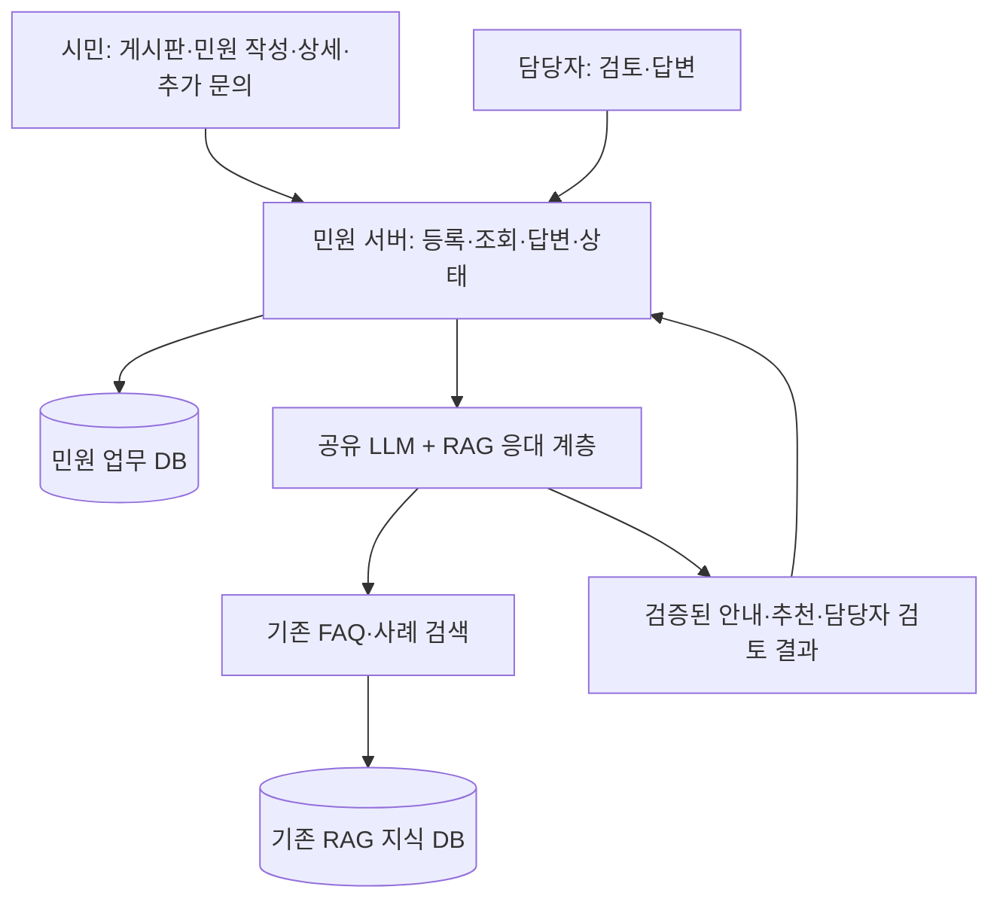

# 시연 웹 게시판과 민원 서버 구현 계획

[프로젝트 소개](../README.md) · [LLM + RAG 구현계획](언어모델과_검색증강생성_우선_구현계획.md) · [실행 계획](harness-roadmap.md) · [결정 기록](../docs/cases/사례-007-시연-웹-게시판과-민원-서버-범위-구체화-2026-10-25.md)

기준: **2026-10-25 UTC**. 사용자는 시연 웹에 실제 민원 게시판 기능·민원 작성 페이지와 **민원을 주고받는 서버까지 구현할 계획**이라고 구체화했다. 현재 구현은 검색 CLI/API까지이며 아래 웹·업무 서버·저장소 기능은 미구현이다.

## 확정 범위와 구현 제안

| 구분 | 내용 |
| --- | --- |
| 사용자 확정 | CLI 챗봇 이후 시연 웹 구현. 민원 게시판·작성 페이지·민원 교환 서버 포함 |
| 유지하는 AI 방향 | Jev 없는 LLM + RAG부터 구현하고 Jev는 추후 추가 |
| 기능 분해 제안 | 목록·상세·작성, 답변·추가 문의 교환, 담당자 검토 목록, 처리 상태 저장 |
| 기술 설계 제안 | 민원 업무 DB와 RAG 지식 DB의 역할 분리, CLI와 웹의 AI 응대 계층 재사용 |
| 추가 결정 필요 | 웹 기술 스택·인증 방식·공개 범위·첨부파일·수정/삭제 정책·배포 방식 |
| 별도 연계 범위 | 청주시 공식 민원 시스템의 접수번호 발급·행정 처리·외부 부서 이관 |

문서에서 사용하는 “웹 목업”은 위 기능을 시연 서버에서 실제로 동작시키는 웹 MVP를 뜻한다. 원래 상세 기획안의 모든 화면·본인인증·행정 연계를 포함한다는 의미는 아니다.

## 화면과 서버 기능

다음은 사용자 요구를 구현 단위로 나눈 최소안이다. 인증·권한의 구체적인 구현 방식은 별도로 정하되, 서버가 작성자와 담당자 역할을 확인하는 구조로 설계한다.

| 화면·역할 | 제안 기능 | 서버 책임 |
| --- | --- | --- |
| 민원 게시판 | 허용된 민원 목록·처리 상태·페이지 이동 | 조회 범위와 페이지네이션 적용 |
| 민원 작성 | 제목·내용·필요한 지역 정보 입력과 등록 결과 | 입력 검증·민원 ID 발급·DB 저장·중복 제출 제어 |
| 민원 상세 | 본문·AI 안내·출처·담당자 답변·처리 이력 조회 | 접근 가능한 민원과 공개 가능한 정보만 반환 |
| 시민 후속 문의 | 같은 민원의 답변에 추가 질문 | 작성 권한 확인·대화 이력 저장 |
| 담당자 검토 | AI가 보류하거나 추천한 민원 확인·답변 | 검토 목록·답변 저장·허용된 상태 변경 |
| AI 응대 표시 | FAQ 안내 또는 부서 후보·검토 사유 표시 | 공유 LLM + RAG 호출·검증 결과 저장·실패 시 검토 경로 |

답변은 AI·담당자·시민의 작성 주체를 구별한다. 글 수정·삭제, 파일 첨부, 알림, 실시간 채팅은 이 최소안을 구현하며 필요 범위를 별도로 정한다.

## 구성과 처리 흐름 제안

기존 RAG 검색과 지식 DB 외의 구성은 후속 구현 계획이다. 물리 DB·프로세스를 몇 개로 나눌지는 아직 정하지 않았다.

1. 서버가 입력과 작성 권한을 확인하고 민원을 저장한 뒤 민원 ID를 반환한다.
2. 등록된 민원에 대해 기존 FAQ·사례를 검색하고 공유 응대 계층이 LLM 판정·코드 검사·조건부 FAQ 생성을 수행한다.
3. 검사된 AI 결과와 출처를 해당 민원에 연결해 저장한다. 부서 추천은 후보로 표시하고 담당자 검토 대상으로 연결한다.
4. 근거 부족·모델 장애가 있으면 저장된 민원을 유지하고 담당자 검토 필요 상태와 실패 사유를 남긴다.
5. 담당자가 답변하면 시민이 상세 페이지에서 확인하고 추가 문의를 보낼 수 있게 한다.

CLI와 웹은 같은 AI 판단·답변 코드를 재사용한다. 게시판의 등록·답변·상태 저장과 권한 검사는 민원 서버가 담당한다. CLI에서 질문했다는 이유만으로 웹 게시글을 자동 생성하는 것으로 해석하지 않는다.

## 저장 구조 제안

현재 `complaint_rag` 스키마의 7개 테이블은 검색용이다. 민원 서버를 구현할 때 업무 데이터를 별도 스키마 또는 저장소에서 관리하는 안을 제안한다. 같은 PostgreSQL을 활용할 수 있으나 아래 명칭·열·테이블은 아직 생성되지 않았다.

| 논리 데이터 | 저장할 내용 |
| --- | --- |
| 민원 | 내부 `complaint_id`, 작성자 식별, 제목·본문·지역, 공개 범위, 처리 상태·시각 |
| 대화·답변 | 민원 ID, 작성 주체·역할, 본문·시각, AI 답변의 근거 연결 |
| AI 검토 | 민원 ID·검토 대상 입력 버전, outcome·사유·후보 부서, 근거 ID·출처·원문 버전, 모델·정책 버전, 성공·실패 상태 |
| 상태 이력 | 민원 ID, 변경 전후 상태, 처리 주체·시각·사유 |

새 민원 ID와 수집 사이트의 `(corpus, source_id)`는 다른 식별자다. 게시글·추가 문의·담당자 답변을 원본 JSON이나 RAG 검색 문서에 자동으로 넣지 않는다. 추후 지식화가 필요하면 검수·비식별·출처·평가 절차를 별도로 설계한다.

민원 저장과 AI 추론을 분리한다. 민원 저장에 실패하면 등록 완료로 표시하지 않고, 저장 후 AI가 실패하면 같은 민원을 중복 생성하지 않고 담당자 검토로 이어지게 한다. 응답이 늦어 재시도할 때 중복 게시글·답변이 생기지 않는 처리와 입력 버전별 AI 결과 연결도 구현 시 확인한다.

## API와 상태 제안

아래 경로는 설계 예시이며 현재 검색 API에서 지원하지 않는다. 실제 경로·인증·공개 필드는 구현 시 확정한다.

| API 예시 | 용도 |
| --- | --- |
| `POST /api/complaints` | 민원 등록과 저장된 민원 ID 반환 |
| `GET /api/complaints` | 조회 권한에 맞는 목록·처리 상태·페이지네이션 |
| `GET /api/complaints/{id}` | 민원 상세·허용된 대화·근거·처리 상태 조회 |
| `POST /api/complaints/{id}/messages` | 시민 후속 문의 또는 담당자 답변 저장 |
| `PATCH /api/complaints/{id}/status` | 서버가 허용한 역할·전이 규칙에 따른 상태 변경 |

AI 검토 재시도와 담당자 검토 목록 API도 업무 서버의 책임으로 설계한다. 기존 `POST /search`는 검색 근거 반환 계약을 유지하며 시민용 등록·답변 저장 API를 대신하지 않는다.

업무 상태는 `submitted → under_review → answered → closed`, AI 작업 상태는 `pending / completed / failed`처럼 별도로 두는 안을 제안한다. 정확한 이름과 전이는 구현 전 확정한다. AI가 답변을 만들었다고 민원을 자동 종결하지 않고 기존 응대 정책과 시민의 해결 확인을 반영한다.

## 상태 표시와 AI 정책

- DB 저장이 성공하면 **시연 서비스 내 등록 완료**를 표시할 수 있다. 서버가 저장한 민원 ID와 연결한다.
- 담당자 검토 목록에 실제 저장된 경우 검토 대상으로 전달됐다고 표시한다. 담당자 답변과 그 시각도 저장 결과를 바탕으로 보여 준다.
- `human_handoff`는 웹에서는 검토 대상 기록으로 연결하는 안이며, 현재 검색 CLI가 실제 검토 요청을 저장하는 기능은 없다.
- 부서 후보는 검토 정보다. `automatic_transfer=false`를 유지하고, 공식 업무·관할 미검증 후보로 자동 부서 이관을 확정하지 않는다.
- 청주시 공식 접수번호·기관 배정·외부 이관 완료는 해당 연계가 실제 구현·확인된 경우에만 표시한다.

## 구현 순서와 완료 조건

CLI 이후 **민원 저장·조회 서버와 DB → 게시판·작성·상세 → 담당자 답변·시민 후속 문의·상태 → AI 응대 연결 → 전체 시연** 순서로 구체화한다. 게시판과 서버의 일반 기능은 AI 연결 준비와 함께 개발할 수 있지만 AI 시연 완료에는 공통 응대 계층이 필요하다.

웹 단계는 다음을 확인해야 완료로 기록한다.

1. 시민이 등록한 글이 새로고침·서버 재시작 후에도 목록·상세에 남는다.
2. 담당자 답변과 시민 추가 문의가 같은 민원에 저장되고 양쪽 화면에서 확인된다.
3. 작성자·담당자 권한과 공개 범위에 맞춰 조회·답변·상태 변경이 처리된다.
4. AI 안내·추천·검토 사유와 출처가 해당 민원에 연결되며 AI 장애에도 글이 유실되지 않는다.
5. 중복 제출·답변 실패·늦은 AI 결과·허용되지 않은 상태 변경을 처리한다.
6. 시연 서버의 처리와 청주시 공식 접수·이관 표시가 구별되고, 게시글 데이터가 RAG 원본과 섞이지 않는다.

위 항목은 미구현 기능의 인수 조건이며 현재 테스트 결과가 아니다. 기존 RAG 재적재와 민원 업무 데이터 갱신·백업을 독립적으로 관리하는 운영 절차도 웹 구현과 함께 추가한다.
