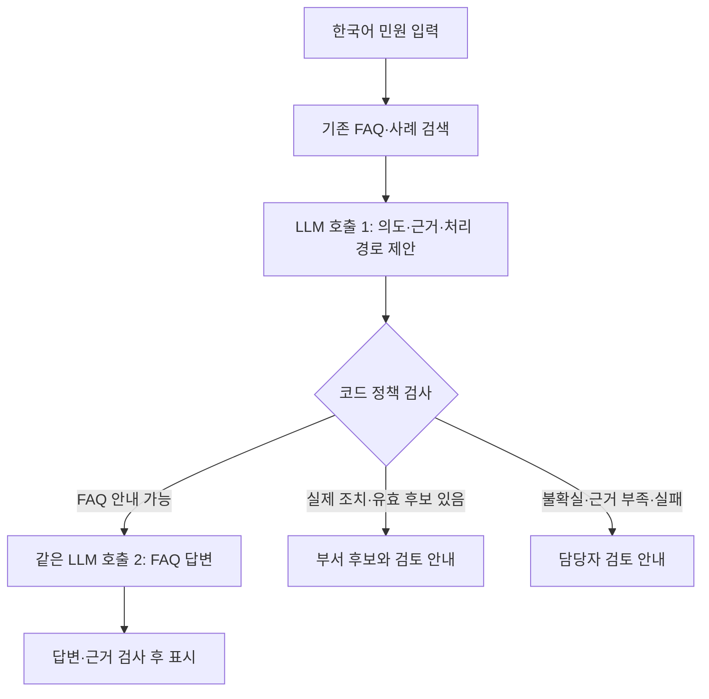

# LLM + RAG 우선 구현 계획

[프로젝트 소개](../README.md) · [문서 목차](../docs/README.md) · [모델 선정·미세조정 제안](모델_선정과_미세조정_제안.md) · [실행 과제](harness-roadmap.md)

작성 기준: **2026-10-25 UTC**. 사용자의 최신 요구인 **LLM + RAG를 먼저 구현하고 Jev는 추후 추가**하는 방향을 정리한다. 이 문서의 작성은 LLM 연결이나 모델 설치의 완료를 의미하지 않는다.

2026-10-27 웹 추가 요구인 실제 목록·CRUD·AI 답변 표시와 담당자 수정·실시간 작업 모니터는 [통합 상세설계·분야별 작업계획](민원_웹_MVP_상세설계와_분야별_작업계획.md)과 [PDF](민원_웹_MVP_상세설계와_분야별_작업계획.pdf)에 구체화했다. 초기 LLM + RAG 방향과 현재 미구현 상태는 유지한다.

## 확정 사항과 제안의 구분

| 구분 | 내용 |
| --- | --- |
| 사용자 확정 | 초기 구성은 Jev 없는 LLM + RAG, Jev는 후속 확장 |
| 시연 웹 범위 추가 확정 | 민원 게시판·작성 페이지와 민원을 주고받는 서버까지 구현할 계획 |
| 기존 결정 유지 | 한국어 직접 입력, 무료 모델 우선, FAQ와 사례의 목적 분리, CLI 챗봇 다음 웹 목업 |
| 이번 구현 제안 | 범용 LLM 하나를 판정과 FAQ 답변에 재사용하고 두 호출 사이에 코드 검사를 둠 |
| 이번 모델 제안 | Qwen3.5-4B부터 비교 시작, 자원·오류에 따라 9B 및 다른 계열 비교 |
| 이번 학습 제안 | 추가 학습 없는 기준 성능을 먼저 측정하고, 반복 오류에 한해 LoRA 검토 |
| 아직 미정 | 최종 모델·양자화·실행 엔진·프롬프트·시간 제한·운영 기준 |

이전의 OneJev 우선 연결 제안은 초기 MVP 기준에서 대체한다. Jev를 제거하는 대신 범위·의도·근거 충분성 판단을 범용 LLM과 코드 정책이 담당한다.

## 현재 구현에서 출발하는 지점

현재 구현은 PostgreSQL/pgvector, BGE-M3 임베딩, Kiwi BM25, RRF, 재정렬, 검색 CLI/API다. FAQ 94건·공개 사례 5,015건·부서 127개와 임베딩 5,109개가 적재되어 있다. LLM 판정·자연어 답변·CLI 챗봇·웹·민원 업무 서버·청주시 공식 이관 연계는 미구현이다.

FAQ는 안내 근거, 사례는 부서 추천 근거다. 현행 담당 부서 검토 대상 27건은 부서 후보 확정 근거에서 제외하며, 부서 127개 모두 공식 업무분장이 미검증이다. FAQ의 수집 시각도 정책 현행성 확인 시각과 구별한다. [현재 데이터 계약](../docs/harness/data-contracts.md)

## 기존 계획에서 달라지는 부분

| 항목 | 이전 제안 | 변경 후 |
| --- | --- | --- |
| 초기 판단 주체 | Jev 계열 판정 모델 | 검색 근거를 읽는 범용 LLM |
| 모델 구성 | 판정 모델 + 답변 모델 | 범용 LLM 하나로 판정·답변 수행부터 시작 |
| 개발 순서 | Jev 어댑터를 먼저 연결 | LLM 어댑터·정책 검사·FAQ 답변을 먼저 연결 |
| 판정 형식 | Jev의 선택지·확률 등 전용 출력 | 스키마를 제한한 JSON, 코드 검증, 실패 시 담당자 검토 |
| 신뢰도 사용 | 모델별 확률·confidence 평가 | LLM이 스스로 적은 confidence를 정답 확률로 사용하지 않음 |
| Jev 도입 | 초기 MVP 구성 요소 | LLM + RAG 기준 성능을 확보한 뒤 별도 비교 |
| 웹 목업 | CLI 다음 | 민원 게시판·작성·답변 교환 서버를 포함한 웹 MVP로 범위 구체화. Jev는 선행 조건 아님 |
| 저장·검색 | FAQ·사례 분리와 부서 사전 | 유지. 이 계획 변경만으로 JSON 수정·재임베딩·DB 재구축 불필요 |
| 업무 처리 | 근거·관할 확인 후 담당자 연결 | 시연 서버 내 민원 등록·답변·검토 기록을 구현. 청주시 공식 접수·외부 이관은 별도 연계 |

원래 VoteLab 상세 기획안의 TAXO 중심 자동 배정·직원 승인·전체 행정 화면은 장기 참고 범위다. 초기 MVP의 안내/추천/검토 분기는 LLM + 코드 정책으로 구현하며, TAXO 자동 배정 전체를 먼저 완성하는 것으로 해석하지 않는다. 원본 PDF와 원래 분석 본문은 해당 기획의 기록으로 보존한다.

## 제안하는 초기 처리 흐름

도표에서 검색 이후는 모두 미구현 설계다. FAQ 답변 검사에 실패한 경우도 담당자 검토로 전환한다.

1. 입력 형식·길이를 검사한다. 빈 입력은 정정 안내로 처리한다.
2. FAQ와 사례를 각각 검색한다. 검색되지 않은 자료의 내용을 모델 기억으로 보충하지 않는다.
3. 첫 LLM 호출은 의도, 근거 충분성, 허용된 처리 경로와 근거 ID를 구조화해 제안한다. 시민에게 바로 보여 줄 답변은 생성하지 않는다.
4. 코드가 실제 검색 후보와 ID를 대조하고 FAQ 현행성·조건, 사례와 부서 상태를 검사한다. 의미적 조건 판단까지 코드의 문자열 검사만으로 보장된다고 가정하지 않는다.
5. `faq_answer`가 허용된 경우에만 같은 모델을 다시 호출한다. 선택한 FAQ 전체와 대상·기간·주의사항으로 답변을 작성한다.
6. 출처 연결과 조건·수치 보존을 검사하고 결과를 표시한다. 불확실하거나 근거가 부족하면 `human_handoff`로 전환한다. 부서 추천·검토 안내 문구는 초기에는 템플릿으로 구성한다.

두 호출은 같은 모델 가중치를 재사용한다. 별도 Jev 모델이나 별도 답변 모델이 초기 필수 요건은 아니다. 단일 호출에서 판정과 답변을 함께 생성하는 방식은 이후 지연 비교 대상으로 남긴다.

## 유지할 판정 기준

| 민원과 근거의 상태 | 초기 결과 |
| --- | --- |
| 정보 문의이며 확인된 FAQ가 조건까지 충분히 설명 | FAQ 안내와 출처 |
| 단속·보수 등 실제 조치 요청이며 유효한 사례·부서 후보 있음 | 부서 후보 제시와 담당자 검토 안내 |
| FAQ에 없는 조건, 근거 충돌, 위치·관할 불명, 데이터 범위 밖 | 담당자 검토 안내 |
| 안내와 조치가 섞인 복합 요청 | 초기에는 담당자 검토; 일부 안내로 전체 해결 처리 금지 |
| 검색/LLM 장애, 잘못된 JSON, 존재하지 않는 출처·부서 | 코드에서 담당자 검토 결과 구성 |

실제 조치 요청을 안내만으로 종결하지 않는다. 근거가 없다는 것은 현재 데이터로 판단하기 어렵다는 뜻이며, 청주시 소관이 아니라는 결론이 아니다. 후보 부서는 사람이 검토할 추천이며 초기 `automatic_transfer`는 항상 `false`다.

FAQ의 현행성 검증 기록은 아직 구현되지 않았다. 첫 시연에서는 사람이 확인한 FAQ와 원문 해시·확인 일자·근거를 기록한 허용 목록부터 연결하는 방안을 제안한다. 기존 `retrieved_at`을 이 기록으로 대신하지 않는다. 상세 필드와 출력 계약은 [판정 정책](../docs/harness/decision-policy.md)을 따른다.

## 인터페이스와 구현 단위

현재 `/search`의 `retrieval_only=true`, `decision="requires_gate"`는 유지한다. 여기서 gate는 **검색 후 별도 판단 필요**라는 의미이며 Jev 설치를 요구하는 필드가 아니다. 검색 API를 시민용 최종 답변 API로 바꾸지 않고, 그 위에 민원 응대 계층을 추가한다.

| 추가할 단위 | 책임 | 현재 상태 |
| --- | --- | --- |
| 범용 LLM 어댑터 | 모델 서버 호출·시간 제한·구조화 응답 파싱 | 미구현 |
| 판정 프롬프트 | 의도·범위·근거 ID·처리 경로 제안 | 미구현 |
| 정책 검사 | 출처·부서·현행성 기록과 결과 계약 대조 | 미구현 |
| FAQ 생성 프롬프트 | 선택된 FAQ 전체에 근거한 한국어 답변 | 미구현 |
| 응대 조합 계층 | 검색 → 판정 → 검사 → 조건부 생성 → 결과 반환 | 미구현 |
| CLI 챗봇 | 입력·답변·추천·검토 사유·출처·오류 표시 | 미구현 |
| 민원 업무 서버·DB | 등록·목록·상세·답변·추가 문의·상태 저장, AI 결과 연결 | 미구현 |
| 시연 웹 | 게시판·작성·상세와 담당자 검토·답변을 서버와 연결 | 미구현 |
| 한국어 평가 | 개발/보류 질문, 자동 검사, 사람 검수, 지연 비교 | 미구현 |

LLM 실행은 기존 검색 컨테이너와 분리하는 방안을 제안한다. RAG 의존성을 그대로 유지하고 LLM 서버의 모델·리비전·양자화·실행 엔진 버전을 별도로 고정한다. 현재 GPU는 다른 작업이 사용하므로 모델의 메모리 요구량과 실행 시점의 가용 자원을 확인한다.

## 구현 순서와 완료 조건

1. **기준 자료·평가 준비:** 시연 FAQ 현행성, 부서 검증 상태, 한국어 질문과 정답 근거를 기록한다.
2. **LLM 연결:** 같은 입출력 계약으로 한국어 구조화 판정과 FAQ 생성을 호출하고 오류 경로를 검사한다. Jev 의존성을 넣지 않는다.
3. **응대 계층·CLI:** 세 결과와 출처를 표시하고, 검색 장애·LLM 실패에도 검증된 대체 결과를 반환한다.
4. **기준 성능 확보:** 오류율·안내 비중·부서 후보 정확도·전체 지연을 함께 비교해 모델과 프롬프트를 정한다.
5. **시연 웹·민원 서버:** 게시판·작성·상세, 민원 저장·조회와 답변 교환·검토 상태를 구현한다. CLI와 동일한 응대 계층을 재사용하며 AI 실패에도 등록된 민원을 보존한다. 시연 서버의 등록 완료와 청주시 공식 접수·외부 이관 상태는 구별한다. [웹·민원 서버 계획](시연_웹_게시판과_민원_서버_구현계획.md)
6. **후속 실험:** Jev 추가 또는 LoRA를 각각 독립적으로 비교한다. 둘 중 하나가 다른 하나의 필수 선행 조건은 아니다.

세부 작업 상태는 [실행 계획](harness-roadmap.md), 모델·학습 후보와 평가 규모는 [제안서](모델_선정과_미세조정_제안.md)에 정리한다.

## Jev를 추가할 때의 기준

먼저 LLM + RAG 결과를 고정한 기준으로 남긴다. 이후 검색한 근거를 동일하게 제공하면서 Jev가 LLM의 판정 호출을 대체하는 방식, 또는 특정 불확실 사례를 추가 검토하는 방식을 각각 비교한다. 범위 밖이라는 최종 판단을 검색 전 민원 문장만으로 맡기지 않는다.

출처·부서 검사, FAQ 생성, 출력 계약은 재사용한다. 오류율·자동 안내 비중·지연·메모리를 비교하고, Jev를 꺼도 기본 LLM + RAG 경로가 동작하도록 구성한다. 모델 이름이나 높은 confidence만으로 개선됐다고 판단하지 않는다.
