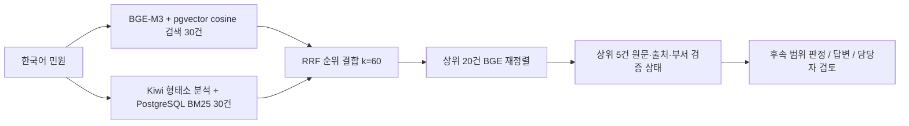

# 민원 RAG 검색 저장소

[프로젝트 소개](../README.md) · [문서 목차](../docs/README.md) · [운영 절차](../docs/harness/runbook.md) · [변경 이력](../CHANGELOG.md)

두 원본 JSON에서 **FAQ 답변 근거**와 **부서 추천 근거**를 분리해 검색합니다. PostgreSQL 17 + pgvector 0.8.1, BGE-M3 벡터, Kiwi 형태소 기반 BM25, RRF, BGE 재정렬을 사용합니다. 모델은 로컬에서 실행하므로 외부 추론 API 키나 호출 요금이 없습니다.

이 모듈은 검색 계층입니다. 다음 단계는 **Jev 없는 LLM + RAG 기반 판정·FAQ 답변**이며 Jev는 추후 확장입니다. 검색 결과만으로 자동 답변·이관을 확정하지 않습니다. 현재 `retrieval_only=true`, `decision="requires_gate"`는 후속 판단이 필요하다는 계약이며 Jev 설치를 요구하지 않습니다. [우선 구현계획](../plan/언어모델과_검색증강생성_우선_구현계획.md)

시연 웹에는 민원 게시판·작성 페이지와 민원을 주고받는 서버까지 구현할 계획입니다. 게시글·답변·처리 상태의 저장은 민원 업무 서버의 책임으로 설계하며, 이 검색 API나 RAG 원본에 자동 적재하는 기능과 구별합니다. 웹·업무 서버는 아직 미구현입니다. [시연 웹·민원 서버 계획](../plan/시연_웹_게시판과_민원_서버_구현계획.md)

## 실행

프로젝트 루트에서 실행합니다. Docker와 Docker Compose가 필요합니다. 기본 설정은 CPU 한도 4, 검색 컨테이너 메모리 상한 9GB입니다. 현재 서버는 `.env`의 `RAG_THREADS=12`, `RAG_CPUS=12`로 실행합니다. GPU는 사용하지 않습니다.

처음 설치할 때 `.env.example`을 `.env`로 복사하고 로컬 DB 비밀번호를 정합니다. 현재 작업 환경에는 `.env`가 생성되어 있습니다.

```bash
test -f .env || cp .env.example .env
docker compose up -d postgres
docker compose build rag
docker compose run --rm rag ingest
docker compose up -d --wait rag
```

첫 실행은 모델 다운로드와 벡터 생성으로 시간이 걸립니다. 모델 가중치와 벡터 체크포인트는 `.rag-cache/`, PostgreSQL 데이터는 `.rag-data/postgres/`에 저장합니다. `docker compose down` 후에도 이 디렉터리는 유지됩니다. CPU 여유가 있는 서버에서는 `RAG_THREADS=12 RAG_CPUS=12 docker compose run --rm rag ingest`처럼 적재 작업의 자원을 늘릴 수 있습니다.

API가 준비되면 호스트의 Python 표준 라이브러리만으로 검색할 수 있습니다.

```bash
python3 -m rag status
python3 -m rag search '여권을 처음 발급받으려면 어떤 서류가 필요한가요?' --collection faq
python3 -m rag search '711번 버스가 정류장에 서지 않고 지나갔습니다' --collection routing
python3 -m rag search '옥산면 도로에 포트홀이 생겼습니다' --collection routing --district 흥덕구
python3 -m rag search '소파를 버리는 방법이 궁금합니다' --collection both
```

- API: `http://127.0.0.1:8007`
- API 문서: `http://127.0.0.1:8007/docs`
- 상태: `GET /health`
- 검색: `POST /search`
- 부서/과거 명칭 조회: `GET /departments?query=대중교통과`
- PostgreSQL: `127.0.0.1:55432`, DB `complaints`, 사용자 `complaint`, 비밀번호는 `.env`

```json
{
  "query": "흥덕구 도로 포트홀을 보수해 주세요",
  "collection": "routing",
  "limit": 5,
  "district": "흥덕구",
  "rerank": true
}
```

민원은 1~2000자, 결과 수는 1~20건입니다. 재정렬 질문의 추가 제한은 모델 토큰 기준 1024개입니다. `district`는 명시적으로 전달할 때만 필터링하며, 본청/관할 미확인 후보는 유지하고 다른 구의 부서로 확인된 사례를 제외합니다. 질문에서 지역명을 자동 추측하지 않습니다.

## 저장 구조

PostgreSQL의 `complaints` DB, `complaint_rag` 스키마에서 관계형 데이터와 pgvector 벡터를 함께 관리합니다. 아래 7개 테이블이 생성되어 있으며 FAQ·사례에는 임베딩도 실제 적재되어 있습니다.

| 테이블 | 내용 |
| --- | --- |
| `faq_knowledge` | FAQ 94건. 분류·업무명·상세 안내·대상·접수 조건·기간·주의사항과 원본 JSON, 출처, 1024차원 벡터 |
| `routing_cases` | 사례 5,015건. 제목·요지의 검색 텍스트와 벡터, 원본 JSON, 현행 부서 FK, 검토 상태 |
| `department_directory` | 사례에서 현행 명칭이 확인된 부서 127개. 내부 ID, 명칭, 과거 표기, 구 정보, 검증 상태 |
| `term_postings` | Kiwi 토큰의 문서별 출현 빈도. PostgreSQL에 영속 저장 |
| `term_statistics` / `corpus_statistics` | FAQ/사례별 문서 빈도·문서 수·평균 길이. BM25 계산에 사용 |
| `index_metadata` | 모델 리비전, 색인 설정, 최근 적재 결과 |

FAQ와 사례 테이블은 일반 열·원본 JSON과 `embedding vector(1024)`를 함께 저장합니다. `routing_cases.department_id`는 부서 디렉터리의 ID를 참조하는 외래 키입니다. 부서 사전과 BM25 통계는 일반 관계형 테이블로 사용합니다.

원본 두 JSON은 변경하지 않고 `payload`에 그대로 보관합니다. 문서 식별자는 데이터 종류와 사이트의 `source_id`입니다. 사이트 표시 번호 `id`를 문서 키로 사용하지 않습니다.

**FAQ는 원문 한 건을 하나의 문서로 저장합니다.** 모든 안내 필드를 함께 임베딩합니다. 반환할 때도 원문 전체를 제공하여 조건·주의사항이 떨어져 나가지 않게 합니다.

**공개 사례는 제목과 `summary`만 임베딩합니다.** `summary`가 없는 58건은 제목으로 검색하며 `summary_missing=true`로 표시합니다. `resolution`이 없는 101건도 보존합니다. 과거 답변 `resolution`과 부서명은 검색 본문에 섞지 않고 원본 메타데이터로 전달합니다.

## 검색 순서



FAQ와 사례에서 이 과정을 **각각 실행**합니다. 두 종류의 문서를 하나의 순위로 섞지 않습니다.

- 벡터: 정규화된 `BAAI/bge-m3` 1024차원, cosine 거리, HNSW 색인.
- BM25: Kiwi의 명사·동사·형용사·숫자·외국어 형태소를 사용합니다. 조사·어미와 일부 상용 민원 표현을 제외합니다. SQL에서 양수 IDF를 사용하는 BM25(`k1=1.5`, `b=0.75`)를 계산합니다.
- RRF: 서로 다른 척도의 벡터/BM25 점수를 직접 더하지 않고 순위로 결합합니다.
- 재정렬: `BAAI/bge-reranker-v2-m3`가 질문과 후보 원문을 함께 평가합니다. 긴 문서는 겹치는 창으로 모두 평가하고 가장 높은 관련성 logit을 사용합니다. 원문을 조용히 잘라 저장하지 않습니다.
- 재정렬 비교: CLI `--no-rerank` 또는 API `rerank=false`로 RRF까지만 실행할 수 있습니다.
- 재정렬을 끄면 반환할 상위 `limit`건의 원문만 조회합니다. 기본 5건 반환에서는 컬렉션별 본문 조회가 기존 20건에서 5건으로 줄며, 벡터·BM25·RRF 후보 순위는 유지됩니다.

모델의 정확한 리비전은 [config.py](config.py)에 고정했습니다. 검색 결과의 `rerank_logit`, cosine 유사도, RRF 점수는 **자동 답변 가능 확률 또는 이관 정답 확률이 아닙니다.** 범위 밖 문의에도 최근접 문서는 나올 수 있습니다. 모든 검색 응답은 `retrieval_only=true`, `decision="requires_gate"`를 반환합니다.

## 부서 검증의 범위

현재 두 JSON만으로는 공식 업무분장을 채울 수 없습니다. 따라서 127개 부서의 `duty_description`은 `null`, `duty_status`는 `unverified`입니다. `observed_case_titles`는 과거 사례 예시이며 공식 업무분장이 아닙니다.

- `department_id`: 명칭 기반 UUID 내부 ID. 정부 행정기관 코드가 아닙니다. 재적재에는 유지되지만 조직개편/명칭 변경 시 별도 ID 이력 관리가 필요합니다.
- `district`: 구청/보건소 이름에서 추출한 구 정보. `jurisdiction_status="inferred_from_name"`이며 개별 업무의 실제 관할을 확정한 것이 아닙니다.
- `aliases`: 확인된 정규화 규칙과 원래 표기. 과거 미래산업과를 현행 한 부서에 임의 연결하지 않습니다.
- `routing_eligible`: 현행 이름이 확인된 사례인지 나타냅니다. **자동 이관 허가가 아닙니다.**
- `automatic_routing_ready`: 현재 모든 부서가 `false`. 실제 이관에는 공식 업무분장·관할 검증과 후속 판단이 필요합니다.

미래산업과 계열 10건과 과거 안전정책과 17건은 검색 자료에는 남지만 `department_id=null`, `routing_eligible=false`입니다. `department_candidates`에는 포함되지 않습니다. 서로 다른 구의 같은 이름 과는 별도 ID로 유지합니다.

부서 후보는 검색된 사례를 부서별로 묶되, 사례 수의 단순 다수결로 순위를 정하지 않습니다. 가장 높은 관련성 사례의 순위를 사용하며 사용한 사례 ID·출처를 함께 반환합니다. 모든 후보의 `automatic_transfer`는 `false`입니다.

공식 업무분장·관할을 확인해 directory의 검증 필드를 보완한 경우, 재적재는 동일 내부 ID로 남아 있는 부서의 해당 값을 보존합니다. 현재 이름·과거 표기·사례 예시는 원본 데이터에 맞춰 갱신합니다. 삭제되거나 이름 변경으로 ID가 달라진 부서는 검증 정보를 별도 보존·이관해야 합니다. [백업과 갱신 절차](../docs/harness/runbook.md)

## 데이터 갱신

원본을 수집기로 갱신한 뒤 실행합니다. 모델이 메모리에 올라간 API와 적재 프로세스가 동시에 실행되면 메모리 사용량이 늘어나므로 현재 서버에서는 API를 잠시 정지한 뒤 적재하는 방식을 권장합니다.

```bash
docker compose stop rag
docker compose run --rm rag ingest
docker compose up -d --wait rag
```

변경 없는 검색 본문은 기존 DB 벡터를 재사용합니다. 생성 도중 종료되어도 벡터 체크포인트를 재사용할 수 있습니다. 토큰/통계와 원본 메타데이터는 함께 갱신하고, 원본에서 사라진 문서는 이 스키마에서 제외합니다. 빈 원본·중복 ID·부서 상태 불일치는 쓰기 전에 거부합니다. 여러 적재 작업은 동시에 실행되지 않습니다.

원문 내용만 달라지면 일반 `ingest`가 본문 해시를 비교해 필요한 벡터만 생성합니다. 임베딩 모델·리비전·본문 구성 규칙의 버전을 바꿔 임베딩 서명이 달라지면 `ingest --reembed`로 재구축합니다. 토크나이저만 바뀌었다면 버전을 갱신하고 일반 `ingest`로 벡터를 재사용하면서 BM25를 다시 구성할 수 있습니다. 실행 코드와 색인 설정이 다르면 검색을 거부합니다. 새 문서·벡터·BM25 통계는 한 트랜잭션으로 반영하고 검색은 일관된 스냅샷을 읽습니다.

## 검증

```bash
docker compose run --rm --no-deps -e RUN_PG_TESTS=1 --entrypoint python rag -m pytest rag/tests -q -p no:cacheprovider
docker compose run --rm --no-deps --entrypoint python rag -m rag.verify
python3 -m rag.evaluate --output .rag-cache/reports/retrieval-current.json
```

현재 코드·격리 DB 검증은 25개입니다. 기존 13개는 구별 부서 ID, 검토 대상 제외, FAQ 조건 보존, 과거 답변과 검색 본문 분리, 한국어 형태소, RRF 결합, 원본 ID와 실제 SQL 검색을 확인합니다. 추가 12개는 모델·DB 대역으로 컬렉션·재정렬 사용 여부·반환 수에 따른 후보 조회량과 결과·검색 전용 계약을 확인합니다. PostgreSQL 검증은 임시 DB를 생성하고 종료 시 삭제하며, `RUN_PG_TESTS`를 생략하면 그 3개는 건너뜁니다. API 회귀 예제는 FAQ 5개·부서 추천 4개·범위 밖 입력 1개입니다. 통과 조건은 기대 문서·부서의 상위 5개 포함과 검색 전용 계약 유지입니다. 소규모 기능 확인용이며 **실제 민원 자동화 정확도나 운영 임계값을 검증한 평가셋은 아닙니다.** 새 실행 결과는 위 로컬 경로에 저장해 기존 기준 보고서를 덮어쓰지 않습니다.

2026-10-25 코드·주석 점검에서 코드·격리 DB 검증 **25개가 통과**했습니다. 변경 범위와 검색 결과 대조는 [CASE-006](../docs/cases/사례-006-한국어-주석과-커밋-규칙-정비와-검색-조회-최적화-2026-10-25.md)에 기록합니다.

2026-10-24 UTC 실행 결과:

| 검증 | 결과 |
| --- | --- |
| 코드·격리 PostgreSQL 검증 | 13개 통과 |
| 실제 DB와 원본 대조 | FAQ 94건·사례 5,015건 전체 payload/출처/벡터/토큰 통계 일치, 부서 127개 일치 |
| 재적재 | 기존 벡터 5,109개 재사용, 신규 생성 0개, 문서 행 중복·변경 없음 |
| 검색 API 예제 | 10/10 통과. FAQ 5개·부서 4개는 기대 대상이 1위 |
| 범위 밖 입력 | 최근접 문서가 나와도 자동 처리로 확정하지 않고 `requires_gate` 유지 |
| 원본 JSON | 두 파일 모두 작업 전후 SHA256 동일 |

실제 결과 파일: [무결성](reports/data-integrity.json), [재적재](reports/reingestion.json), [검색 예제](reports/retrieval-smoke.json), [API 입력 검증](reports/api-contract.json), [원본 보존](reports/source-preservation.json), [실행 패키지 버전](reports/runtime-packages.txt).

검색 예제 10개는 CPU 4개 설정에서 측정했으며 단일 컬렉션 검색은 약 7~42초, 두 컬렉션을 모두 검색한 예제는 약 49초였습니다. 이는 재정렬 20건을 포함한 개발 환경 측정입니다. 현재 CPU 12개 설정에서는 같은 대형폐기물 질의가 **33.9초 → 15.4초**로 줄었고 기대 문서 1위를 유지했습니다. [현재 설정 검색 예제](reports/search-example-cpu12.json)

재정렬을 끈 별도 버스 분실물 질의는 약 0.28초였으며, 관련 FAQ가 1위였습니다. [RRF까지 실행한 예제](reports/search-without-rerank.json) 운영 지연 목표와 한국어 판정 정확도는 별도 평가가 필요합니다.

공식 기술 자료: [pgvector](https://github.com/pgvector/pgvector), [BGE-M3](https://huggingface.co/BAAI/bge-m3), [BGE 재정렬 모델](https://huggingface.co/BAAI/bge-reranker-v2-m3), [Kiwi](https://github.com/bab2min/kiwipiepy).
