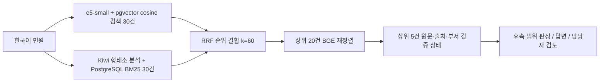

# 민원 RAG 검색 저장소

[프로젝트 소개](../README.md) · [문서 목차](../docs/README.md) · [운영 절차](../docs/harness/runbook.md) · [변경 이력](../CHANGELOG.md)

두 원본 JSON에서 **FAQ 답변 근거**와 **부서 추천 근거**를 분리해 검색합니다. PostgreSQL 18 + pgvector 0.8.1, 기본 `intfloat/multilingual-e5-small` 벡터, Kiwi 형태소 기반 BM25, RRF, 선택적 BGE 재정렬을 사용합니다. 모델은 로컬 CPU에서 실행합니다. 기존 BGE-M3 1024차원 색인은 `RAG_EMBEDDING_PROFILE=bge-m3`로 유지합니다.

이 모듈은 검색 계층입니다. 다음 단계는 **Jev 없는 LLM + RAG 기반 판정·FAQ 답변**이며 Jev는 추후 확장입니다. 검색 결과만으로 자동 답변·이관을 확정하지 않습니다. 현재 `retrieval_only=true`, `decision="requires_gate"`는 후속 판단이 필요하다는 계약이며 Jev 설치를 요구하지 않습니다. [우선 구현계획](../plan/언어모델과_검색증강생성_우선_구현계획.md)

`python -m rag assist`는 실행 중인 검색 API 위에 판정 JSON과 코드 정책 검사를 올립니다. 구현은 `src/assist`(연결), `src/rag`(검색 클라이언트), `src/llm`(공급자)에 있고 `rag/assist.py`는 CLI 호환 진입점입니다. 검색 응답의 `retrieval_only=true` / `decision=requires_gate`는 그대로 둡니다. LLM 공급자가 없으면 검색 근거만 남기고 담당자 검토로 연결합니다. 시연 웹의 민원 CRUD는 이 검색 색인에 적재하지 않습니다. 검사기 화면은 Flask `/#/lab`입니다. [CASE-022](../docs/cases/사례-022-RAG-LLM-응대검사기-2026-11-01.md) · [CASE-026](../docs/cases/사례-026-백엔드-민원웹-RAG-LLM-분리-2026-11-05.md)

`COMPLAINT_LLM_PROVIDER=openai_api`로 선택하면 `OPENAI_API_KEY` 환경변수를 이용해
OpenAI Responses API의 `gpt-6-luna`·`medium` 설정을 사용합니다. `codex_cli`를 선택하면
로그인된 Codex CLI를 읽기 전용 임시 작업공간에서 실행합니다. 선택과 키 예시는 루트
`.env.example` 및 [서버 안내](../src/README.md)를 따릅니다. 실제 API 키는 Git에 넣지 않습니다.

## 실행

> 현재 서버는 네이티브 환경입니다. 실행·적재·검증 명령은 [네이티브 운영 안내](../docs/harness/네이티브_운영.md)를 따릅니다.

### 현재 서버에서 실행

PostgreSQL과 사용자 서비스를 실행한 상태에서 검색합니다. 설치·운영은 [네이티브 운영 안내](../docs/harness/네이티브_운영.md)를 따릅니다.

```bash
systemctl --user status cheongju-rag.service
python3 -m rag status
python3 -m rag search '여권을 처음 발급받으려면 어떤 서류가 필요한가요?' --collection faq
python3 -m rag search '711번 버스가 정류장에 서지 않고 지나갔습니다' --collection routing
python3 -m rag assist --example faq
# Windows: ask-assist.cmd --example faq
# 검색 API가 꺼져 있으면 ask-assist.cmd가 localhost에서 python -m rag serve 를 자동 시작한다.
```

API는 `http://127.0.0.1:8007`, 문서는 `/docs`입니다. DB는 로컬 소켓으로 접속하는 `complaints_native`입니다. 지역 필터는 `--district 흥덕구`처럼 명시하며 재정렬 비교는 `--no-rerank`를 사용합니다.

## 검색 테스트 메뉴

저장소 루트 또는 다른 작업 디렉터리에서 [test_search.sh](test_search.sh)를 실행하면 한국어 메뉴가 열립니다. Bash와 Python이 필요하며 상태·검색은 실행 중인 API를 사용합니다. 가상환경이 없으면 `python3`를 API 클라이언트로 사용하지만 DB 무결성 검사에는 네이티브 의존성이 설치된 환경이 필요합니다.

```bash
bash rag/test_search.sh
# 다른 디렉터리에서는 스크립트의 절대 경로를 사용합니다.
```

스크립트는 LF 줄 끝만 사용합니다. Windows 작업 트리의 CRLF는 WSL bash에서 `set -o pipefail` 오류를 만듭니다. `*.sh`는 저장소 루트 `.gitattributes`로 LF를 유지합니다. Windows PowerShell의 `bash`는 WSL이므로 `C:\...` 경로를 그대로 넘기지 말고, WSL에서 저장소 루트로 이동한 뒤 위 명령을 실행합니다.

| 메뉴 | 동작 |
| --- | --- |
| `1` | API 준비 상태·FAQ·사례·부서 건수 확인 |
| `2` / `3` / `4` | 직접 입력한 민원으로 FAQ / 공개 사례 / 양쪽 각각 검색 |
| `5` / `6` | 대형폐기물 FAQ / 버스 무정차 사례 예제 실행 |
| `7` / `8` / `9` | 재정렬 전환 / 관할 구 / 컬렉션별 결과 수 설정 |
| `j` / `s` | 마지막 성공 응답의 원본 JSON 보기 / 파일로 저장 |
| `v` | 원본·벡터·BM25·HNSW 무결성 대조 (`rag.verify`) |
| `0` | 종료 |

메뉴 기본값은 **재정렬 끔·3건·관할 전체**이며 일반 검색 CLI의 기본값과 다릅니다. 재정렬을 켜면 처리 시간이 늘어날 수 있습니다. FAQ와 사례는 각각 순위를 표시하고 출처·점수·원본 근거를 함께 보여줍니다. FAQ의 대상·조건·주의사항은 생략하지 않습니다. 화면에 표시되는 부서는 후보이며 실제 이관을 실행하지 않습니다.

자동 점검이나 JSON 출력을 원하면 옵션으로 실행합니다.

```bash
bash rag/test_search.sh --status
bash rag/test_search.sh --search '대형폐기물 배출 방법' --collection faq --limit 3
bash rag/test_search.sh --search '흥덕구 도로 포트홀 보수 요청' --collection routing --district 흥덕구 --rerank
bash rag/test_search.sh --search '여권 발급 방법' --collection faq --json
bash rag/test_search.sh --help
```

`RAG_API_URL` 또는 `--api-url`로 API 주소를 지정할 수 있습니다. API 오류 시 비정상 종료 코드를 반환합니다. 메뉴에서는 오류를 표시한 뒤 다음 입력을 받습니다. 검색할 때마다 새 모델을 로드하지 않고 API의 공유 모델을 사용합니다. 색상은 일반 터미널에서만 적용하며 `NO_COLOR=1`로 끌 수 있습니다. 긴 결과는 터미널의 스크롤로 확인합니다.

응답은 임시 파일에 두고 종료 시 삭제합니다. `s`를 선택한 경우에만 `.rag-cache/reports/tui-*.json`에 권한 600으로 저장하며 Git에서 제외됩니다. 입력 민원과 원본 근거가 포함되므로 공유 전에 내용을 확인합니다. 서비스 시작·중지, 원본 수집·변경, DB 재적재 기능은 메뉴에 없습니다.

## 저장 구조

PostgreSQL의 `complaints_native` DB, `complaint_rag` 스키마에서 관계형 데이터와 pgvector 벡터를 함께 관리합니다. 아래 7개 테이블이 생성되어 있으며 FAQ·사례에는 임베딩도 실제 적재되어 있습니다.

| 테이블 | 내용 |
| --- | --- |
| `faq_knowledge` | FAQ 94건. 분류·업무명·상세 안내·대상·접수 조건·기간·주의사항과 원본 JSON, 출처, 현재 프로필 차원 벡터 |
| `routing_cases` | 사례 5,015건. 제목·요지의 검색 텍스트와 벡터, 원본 JSON, 현행 부서 FK, 검토 상태 |
| `department_directory` | 사례에서 현행 명칭이 확인된 부서 127개. 내부 ID, 명칭, 과거 표기, 구 정보, 검증 상태 |
| `term_postings` | Kiwi 토큰의 문서별 출현 빈도. PostgreSQL에 영속 저장 |
| `term_statistics` / `corpus_statistics` | FAQ/사례별 문서 빈도·문서 수·평균 길이. BM25 계산에 사용 |
| `index_metadata` | 모델 리비전, 색인 설정, 최근 적재 결과 |

FAQ와 사례 테이블은 일반 열·원본 JSON과 `embedding vector(__EMBEDDING_DIM__)`를 함께 저장합니다. 기본은 384차원입니다. `routing_cases.department_id`는 부서 디렉터리의 ID를 참조하는 외래 키입니다. 부서 사전과 BM25 통계는 일반 관계형 테이블로 사용합니다.

원본 두 JSON은 `rag/origin/`에 두고 변경하지 않은 채 `payload`에 그대로 보관합니다. 스키마 SQL은 `rag/origin/schema/complaint_rag.sql`이며 적재 코드가 이 파일을 읽습니다. 문서 식별자는 데이터 종류와 사이트의 `source_id`입니다. 사이트 표시 번호 `id`를 문서 키로 사용하지 않습니다.

**FAQ는 원문 한 건을 하나의 문서로 저장합니다.** 모든 안내 필드를 함께 임베딩합니다. 반환할 때도 원문 전체를 제공하여 조건·주의사항이 떨어져 나가지 않게 합니다.

**공개 사례는 제목과 `summary`만 임베딩합니다.** `summary`가 없는 58건은 제목으로 검색하며 `summary_missing=true`로 표시합니다. `resolution`이 없는 101건도 보존합니다. 과거 답변 `resolution`과 부서명은 검색 본문에 섞지 않고 원본 메타데이터로 전달합니다.

## 검색 순서



FAQ와 사례에서 이 과정을 **각각 실행**합니다. 두 종류의 문서를 하나의 순위로 섞지 않습니다.

- 벡터: 기본 `intfloat/multilingual-e5-small` 정규화 384차원, cosine 거리, HNSW 색인. 질문에는 `query: `, 문서에는 `passage: ` 접두를 붙입니다. 기존 BGE-M3 색인은 `RAG_EMBEDDING_PROFILE=bge-m3`입니다.
- BM25: Kiwi의 명사·동사·형용사·숫자·외국어 형태소를 사용합니다. 조사·어미와 일부 상용 민원 표현을 제외합니다. SQL에서 양수 IDF를 사용하는 BM25(`k1=1.5`, `b=0.75`)를 계산합니다.
- RRF: 서로 다른 척도의 벡터/BM25 점수를 직접 더하지 않고 순위로 결합합니다.
- 재정렬: `BAAI/bge-reranker-v2-m3`가 질문과 후보 원문을 함께 평가합니다. 긴 문서는 겹치는 창으로 모두 평가하고 가장 높은 관련성 logit을 사용합니다. 원문을 조용히 잘라 저장하지 않습니다.
- 재정렬 비교: CLI `--no-rerank` 또는 API `rerank=false`로 RRF까지만 실행할 수 있습니다.
- 재정렬을 끄면 반환할 상위 `limit`건의 원문만 조회합니다. 기본 5건 반환에서는 컬렉션별 본문 조회가 기존 20건에서 5건으로 줄며, 벡터·BM25·RRF 후보 순위는 유지됩니다.

모델의 정확한 리비전은 [config.py](config.py)에 고정했습니다. 검색 결과의 `rerank_logit`, cosine 유사도, RRF 점수는 **자동 답변 가능 확률 또는 이관 정답 확률이 아닙니다.** 범위 밖 문의에도 최근접 문서는 나올 수 있습니다. 모든 검색 응답은 `retrieval_only=true`, `decision="requires_gate"`를 반환합니다.

## 부서 검증의 범위

현재 두 JSON만으로는 공식 업무분장을 채울 수 없습니다. 따라서 127개 부서의 `duty_description`은 `null`, `duty_status`는 `unverified`입니다. `observed_case_titles`는 과거 사례 예시이며 공식 업무분장이 아닙니다.

- `department_id`: 명칭 기반 UUID 내부 ID. 정부 행정기관 코드가 아닙니다. 재적재에는 유지되지만 조직개편/명칭 변경 시 별도 ID 이력 관리가 필요합니다.
- `district`: 구청/보건소 이름에서 추출한 구 정보. `jurisdiction_status="inferred_from_name"`이며 개별 업무의 실제 관할을 확정한 것이 아닙니다.
- `aliases`: 확인된 정규화 규칙과 원래 표기. 과거 미래산업과를 현행 한 부서에 임의 연결하지 않습니다.
- `routing_eligible`: 현행 이름이 확인된 사례인지 나타냅니다. **자동 이관 허가가 아닙니다.**
- `automatic_routing_ready`: 현재 모든 부서가 `false`. 실제 이관에는 공식 업무분장·관할 검증과 후속 판단이 필요합니다.

미래산업과 계열 10건과 과거 안전정책과 17건은 검색 자료에는 남지만 `department_id=null`, `routing_eligible=false`입니다. `department_candidates`에는 포함되지 않습니다. 서로 다른 구의 같은 이름 과는 별도 ID로 유지합니다.

부서 후보는 검색된 사례를 부서별로 묶되, 사례 수의 단순 다수결로 순위를 정하지 않습니다. 가장 높은 관련성 사례의 순위를 사용하며 사용한 사례 ID·출처를 함께 반환합니다. 모든 후보의 `automatic_transfer`는 `false`입니다.

공식 업무분장·관할을 확인해 directory의 검증 필드를 보완한 경우, 재적재는 동일 내부 ID로 남아 있는 부서의 해당 값을 보존합니다. 현재 이름·과거 표기·사례 예시는 원본 데이터에 맞춰 갱신합니다. 삭제되거나 이름 변경으로 ID가 달라진 부서는 검증 정보를 별도 보존·이관해야 합니다. [백업과 갱신 절차](../docs/harness/runbook.md)

## 데이터 갱신과 검증

백업과 데이터 변경 검토 후 [네이티브 운영 안내](../docs/harness/네이티브_운영.md)에 따라 실행합니다.

```bash
source scripts/native-env.sh
.venv/bin/python -m rag.verify
RUN_PG_TESTS=1 .venv/bin/python -m pytest rag/tests -q -p no:cacheprovider
```

`RUN_PG_TESTS=1`로 전체 테스트를 실행합니다. `scripts/setup-native-db.sh`가 확장을 설치한 `complaint_rag_test_template`을 준비하므로 테스트 계정에는 DB 생성 권한만 필요하며 superuser는 필요하지 않습니다.

2026-10-25 코드·주석 점검에서 코드·격리 DB 검증 **25개가 통과**했습니다. 변경 범위와 검색 결과 대조는 [CASE-006](../docs/cases/사례-006-한국어-주석과-커밋-규칙-정비와-검색-조회-최적화-2026-10-25.md)에 기록합니다.

2026-10-24 UTC 실행 결과:

| 검증 | 결과 |
| --- | --- |
| 코드·격리 PostgreSQL 검증 | 13개 통과 |
| 실제 DB와 원본 대조 | FAQ 94건·사례 5,015건 전체 payload/출처/벡터/토큰 통계 일치, 부서 127개 일치 |
| 재적재 | 기존 벡터 5,109개 재사용, 신규 생성 0개, 문서 행 중복·변경 없음 |
| 검색 API 예제 | 10/10 통과. FAQ 5개·부서 4개는 기대 대상이 1위 |
| 범위 밖 입력 | 최근접 문서가 나와도 자동 처리로 확정하지 않고 `requires_gate` 유지 |
| 원본 JSON | 두 파일 모두 작업 전후 SHA256 동일 |

실제 결과 파일: [무결성](reports/data-integrity.json), [재적재](reports/reingestion.json), [검색 예제](reports/retrieval-smoke.json), [API 입력 검증](reports/api-contract.json), [원본 보존](reports/source-preservation.json), [실행 패키지 버전](reports/runtime-packages.txt).

검색 예제 10개는 CPU 4개 설정에서 측정했으며 단일 컬렉션 검색은 약 7~42초, 두 컬렉션을 모두 검색한 예제는 약 49초였습니다. 이는 재정렬 20건을 포함한 개발 환경 측정입니다. 현재 CPU 12개 설정에서는 같은 대형폐기물 질의가 **33.9초 → 15.4초**로 줄었고 기대 문서 1위를 유지했습니다. [현재 설정 검색 예제](reports/search-example-cpu12.json)

재정렬을 끈 별도 버스 분실물 질의는 약 0.28초였으며, 관련 FAQ가 1위였습니다. [RRF까지 실행한 예제](reports/search-without-rerank.json) 운영 지연 목표와 한국어 판정 정확도는 별도 평가가 필요합니다.

공식 기술 자료: [pgvector](https://github.com/pgvector/pgvector), [BGE-M3](https://huggingface.co/BAAI/bge-m3), [BGE 재정렬 모델](https://huggingface.co/BAAI/bge-reranker-v2-m3), [Kiwi](https://github.com/bab2min/kiwipiepy).
