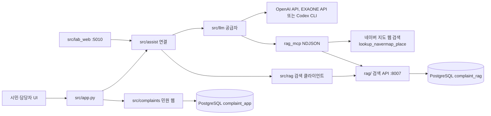

# 민원 웹·RAG·LLM 백엔드

프로젝트 루트의 `src/`는 Flask 시연 서버와 응대 계층이다. 민원 웹(`complaints`), 검색 클라이언트(`rag`), LLM 공급자(`llm`), 둘을 잇는 응대(`assist`)로 나눈다. 시민·담당자 UI와 API, Swagger는 같은 출처에서 제공한다. 민원·추가 문의·초안·게시 답변·시연 작업 이벤트는 PostgreSQL `complaint_app`에 저장한다. 검색 색인·임베딩 엔진은 루트 `rag/`와 `complaint_rag`에 있고 `src/rag`는 그 API만 호출한다.

## 설치와 실행

저장소 루트에서 Python 3.12로 실행한다. 기존 RAG 추론 가상환경·DB·모델을 변경하지 않는다. Docker가 필요 없다.

```powershell
py -3.12 -m venv .venv-web
.\.venv-web\Scripts\python.exe -m pip install -r src/requirements-dev.txt

# 선택 사항: 비어 있는 업무 DB에 개인정보 없는 합성 민원 24건 생성
.\.venv-web\Scripts\python.exe -m flask --app src:create_app seed-demo

# 선택 사항: db/ 공개 민원 사례·FAQ 기반 마스킹 시연 민원 56건 생성
.\.venv-web\Scripts\python.exe -m flask --app src:create_app seed-public-demo

.\.venv-web\Scripts\python.exe -m src
```

처음 환경은 저장소 루트의 [`setup.cmd`](../setup.cmd) 또는 Linux [`setup.sh`](../setup.sh)로 가상환경·DB·모델을 준비한다. `--check`는 설치 없이 확인만 한다. `llm` 브랜치의 검사기 웹은 [`src/lab_web`](lab_web/README.md)이다. `python -m src.lab_web` 또는 [`bin/start-lab.cmd`](../bin/start-lab.cmd)로 `http://127.0.0.1:5010/`을 연다. 민원 JSON은 `POST /api/v1/lab/complaints`로 받는다. 기존 민원 CRUD는 `python -m src`(:5000)이다. 업무 서버 포트는 `COMPLAINT_PORT`, 검사기 웹 포트는 `LAB_WEB_PORT`다.

한 문장의 임베딩과 pgvector 이웃은 [`bin/embed-sentence.cmd`](../bin/embed-sentence.cmd)다. RAG `.venv`의 현재 프로필로 벡터를 만든 뒤 FAQ·공개 사례를 따로 조회하고, `--raw`는 숫자만 출력한다. 검색 API·LLM은 쓰지 않는다. [`bin/ask-assist.cmd`](../bin/ask-assist.cmd)로 민원 문장을 넣어 RAG+LLM 응대를 볼 수 있다. 구현은 [`scripts/run/assist_cli.py`](../scripts/run/assist_cli.py)다. Windows에서 PostgreSQL과 검색 API를 다시 켜려면 [`bin/start-search.cmd`](../bin/start-search.cmd)다. 새 콘솔 기동·포트 확인은 [`scripts/run/start_console.py`](../scripts/run/start_console.py)를 공유한다. localhost 검색 API가 꺼져 있으면 별도 창에서 `python -m rag serve`를 시작하고 health ready를 기다린다. 원격 주소는 자동 시작하지 않으며 `--no-start`로 끌 수 있다. 검색 실행 파일은 `RAG_PYTHON` 또는 `.venv`이고, Flask용 `.venv-web`은 FastAPI·uvicorn이 있을 때만 쓴다. 기본 임베딩은 CPU용 `dragonkue/multilingual-e5-small-ko`이며 이전 intfloat 색인은 `RAG_EMBEDDING_PROFILE=e5-small`, BGE-M3 dump는 `bge-m3`다. [CASE-035](../docs/cases/사례-035-응대-CMD-검색API-자동시작-2026-11-05.md) · [CASE-036](../docs/cases/사례-036-Windows-RAG-PostgreSQL-로컬기동-2026-11-05.md)

실행 의존성만 설치하려면 `src/requirements.txt`를 사용한다. Linux에서는 `python3.12 -m venv .venv-web`로 준비하고 `.venv-web/bin/python`을 사용한다. 환경 준비 후 `npm --prefix ui run dev`도 같은 Flask 서버를 실행하는 편의 명령이다.

| 주소 | 제공 내용 |
| --- | --- |
| http://127.0.0.1:5010/ | 추출한 응대 검사기 웹. 민원 JSON 수신. 청주 전 지역 선택 및 본문 지명 자동 감지, 진행 단계 버퍼링, Codex 전문 표시, 오른쪽 테스트 기록 |
| http://127.0.0.1:5010/api/v1/lab/complaints | `POST` 제목·상세로 검색 후 판정. 기록은 `.rag-cache/lab-runs` |
| http://127.0.0.1:5010/api/v1/lab/complaints/stream | `POST` 같은 처리의 진행 안내 NDJSON 뒤 `done` 결과 스트리밍 |
| http://127.0.0.1:5010/api/v1/lab/runs | `GET` 기록 목록 · `DELETE` 모두 삭제 |
| http://127.0.0.1:5000/#/citizen | 시민·담당자 민원 웹 기본 화면 (`#/staff`, `#/staff/api`, `#/lab` 전환 지원) |
| http://127.0.0.1:5000/design/ui04 | `ui/minwon-toktok-ui04.html` 목업 + `ui04-adapter.js` 연동 |
| http://127.0.0.1:5000/#/staff/api | 담당자 콘솔 내 백엔드 API · Swagger UI 콘솔(헬스 요약·태그/키워드 색인·임베드 Swagger UI) |
| http://127.0.0.1:5000/#/lab | 기존 시연 Flask의 검사기 화면 |
| http://127.0.0.1:5000/docs | 한국어 대화형 Swagger UI 포털 · `/swagger`도 동일(`?embed=1`·다크 테마·세션 원클릭 전환 지원). 인쇄본 [Swagger PDF](../docs/청주톡톡_민원_업무_API_Swagger.pdf) |
| http://127.0.0.1:5000/openapi/openapi.json | 자동 생성 OpenAPI 3.1 · `/openapi.json`은 이 주소로 이동 |
| http://127.0.0.1:5000/api/v1/health | 상태·저장 방식·실제 AI 연결 여부 |

`/docs`·`/swagger` 상단의 원클릭 버튼 또는 Swagger의 `POST /api/v1/session`에서 `{"role":"citizen"}` 또는 `{"role":"staff"}`를 실행한 뒤 필요한 API를 호출한다(`#/staff/api` 임베드 화면에서는 현재 담당자 쿠키 세션을 바로 재사용). 보고용 인쇄본은 [Swagger PDF](../docs/청주톡톡_민원_업무_API_Swagger.pdf)이며, OpenAPI가 바뀌면 저장소 루트에서 `PYTHONPATH=. python docs/tools/export_swagger_pdf.py`로 다시 만든다. 검색 API `:8007/docs`는 이 파일에 넣지 않는다. 같은 출처의 서명 세션 쿠키가 요청에 전달된다. UI 상단 역할 선택도 같은 API를 사용한다. 시민·담당자 탭이 같은 쿠키를 공유하므로 역할을 바꾼 뒤 이전 탭을 사용할 때는 해당 화면을 다시 불러온다.

## 정적 타입과 구성

백엔드는 민원 웹, RAG 검색 클라이언트, LLM 공급자, 둘을 잇는 응대 계층으로 나눈다. 루트 `rag/`는 PostgreSQL 색인·임베딩 엔진이고, `src/rag`는 그 검색 API를 호출하는 클라이언트다. 민원 `complaint_app`과 검색 `complaint_rag`는 섞지 않는다. [CASE-026](../docs/cases/사례-026-백엔드-민원웹-RAG-LLM-분리-2026-11-05.md) · [CASE-031](../docs/cases/사례-031-업무저장-PostgreSQL-통일-2026-11-05.md)



읽을 때는 `app.py → complaints/api.py → complaints/service.py → complaints/repository.py` 순서로 따라가면 된다. `llm` 브랜치 검사기는 `src/lab_web` → `assist/pipeline.py`가 `rag` 다음에 `llm`을 호출한다. 발생 지역은 청주시 4개 구 및 읍·면·동 전 지역을 지원하며 미지정 시 `src/assist/district.py`가 본문 지명을 자동 추론한다. 응답의 `codex`는 모델에 넣은 사용자 JSON과 실제 프롬프트(내부 호환 키 `prompt`) 전문이며, `llmProvider`·`llmModel`은 실제 실행한 LLM 엔진과 모델명을 담는다. 검색 히트는 `search_parts`로 한 번 꺼내고, 환경 LLM은 `llm_settings()`를 요청당 한 번 읽는다. JSON HTTP는 `src.rag.http.http_json`을 검색과 LLM이 같이 쓴다. 민원 웹 모듈은 `src.complaints`에서 직접 import한다.

| 위치 | 책임·타입 경계 |
| --- | --- |
| `complaints/` | 민원 CRUD, **민원인·담당자 아이디/비밀번호 로그인(`auth.py`: `scrypt`·5회 잠금·부서 RBAC)**, 시연 세션, **PostgreSQL 7테이블 정규화(`schema/complaint_app.sql`·`repository.py`)**, 정적 UI, 한국어 Swagger 포털(`swagger_page.py`), 실시간 SSE 브로커(`events.py`), 시민 챗봇 투영(`chat.py`), `demo_data.py`(공개 시연 생성), `is_synthetic` 표시. `pages.py`는 UI·`/design/ui04`·`/docs`·`/swagger` 제공 |
| `rag/` | 검색 API 클라이언트, `retrieval_only`/`requires_gate` 계약, FAQ·사례 근거 |
| `llm/` | `openai_api`·`exaone_api`·`codex_cli`·`legacy` 공급자, 설정·완성 호출, MCP stdio 서버 및 도구(`search_complaint_rag`, `lookup_navermap_place`) |
| `assist/` | RAG와 LLM을 잇는 판정·정책 검사·조건부 FAQ·PREFIX-03 초안·PREFIX-04 순화. 민원을 저장하지 않음. `codex`에 사용자 JSON·프롬프트 전문, `llmProvider`·`llmModel`에 실제 사용 엔진 기록. 시스템 접두는 [prompts](../docs/harness/prompts/README.md), 계약은 [완충지대 하네스](../docs/harness/LLM_완충지대_하네스.md) |
| `lab_web/` | 추출 검사기 웹 `:5010`. 제목·상세 검색 후 판정. 테스트 기록은 `.rag-cache/lab-runs`. MCP 핸드셰이크는 NDJSON |
| `app.py` | 설정 → 저장소 → 서비스 → 공통 처리·API·화면·CLI(`seed-demo`, `seed-public-demo`) 등록 |
| `tests/test_api.py` | 격리 DB의 API·권한·게시·경쟁·영속화·OpenAPI 회귀 |
| `tests/test_demo_data.py` | 공개 데이터 마스킹과 56건 시연 생성 중복 방지 회귀 |
| `tests/test_postgres_schema.py` | PostgreSQL 생성 칼럼 5개·CHECK 3종·`DEMO-PUB-` 백필 검증 |
| `tests/test_assist_api.py` | 검사기 세션 생략·응답 계약·health 플래그 |
| `tests/test_backend_split.py` | 패키지 분리와 연결 계층 단위 시험 |

모든 서버 함수에는 타입 힌트를 적용했다. `Any`나 `type: ignore`로 업무 코드 검사를 우회하지 않고 `mypy --strict`를 통과시켰다. 동적 입력은 Pydantic에서 검증한 뒤 구체 타입으로 서비스에 전달하며, DB 재조회 결과도 모델로 재검증한다. Python 타입 힌트의 정적 검사와 실행 시 검증은 별개다.

코드 형식은 개발 의존성에 포함한 Black으로 정리한다. 저장소 루트에서 `python -m black --check src`로 형식을 확인하고, 수정 시에는 같은 가상환경에서 `python -m black src`를 실행한다. 한국어 Google 형식 docstring과 타입 힌트는 유지한다. [구조 정리 기록](../docs/cases/사례-021-Flask-서버-코드-구조-간소화-2026-10-31.md) · [패키지 분리](../docs/cases/사례-026-백엔드-민원웹-RAG-LLM-분리-2026-11-05.md) · [README·검색 조각](../docs/cases/사례-028-README-디자인과-검색조각-최적화-2026-11-05.md)

앱 팩토리는 [Flask 공식 안내](https://flask.palletsprojects.com/en/stable/patterns/appfactories/)를 따랐다. 요청·응답 모델과 자동 문서는 [flask-openapi3 요청 선언](https://luolingchun.github.io/flask-openapi/v4.x/Usage/Request/) 및 [응답 검증](https://luolingchun.github.io/flask-openapi/v4.x/Usage/Response/) 기능을 사용한다. Swagger JS·CSS는 설치 패키지의 로컬 자산으로 제공한다.

## API 계약

JSON 필드는 기본적으로 camelCase다. 경로 이름 `complaint_id`와 쿼리 이름은 문서 그대로 사용한다. 불필요한 필드·허용 목록 밖 상태를 거부하며, 작성자·AI 기원·업무 상태를 클라이언트가 임의 지정하지 못한다.

| 메서드·경로 (`/api/v1` 기준) | 권한·기능 |
| --- | --- |
| `GET /health` | 공개 서버 상태. `assistSearch`·`assistLlm`은 검색 API·LLM 토큰 여부, `aiConnected`는 민원 CRUD 비동기 AI 연결 여부, `sseEnabled`·`citizenChatEnabled`는 실시간 SSE·시민 챗봇 활성화 여부, `authEnabled`·`normalizedSchema`는 운영 인증·7테이블 정규화 활성화 여부 |
| `GET /staff/db-summary` | 담당자 전용 정규화 7테이블(`users`·`complaints`·`messages`·`message_versions`·`ai_jobs`·`ai_results`·`job_events`) 실시간 SQL 행 수·역할·AI 판정 분포 집계 |
| `GET /staff/stats` | 담당자 부서 RBAC 소관 범위 기준 운영 KPI 11종·5종 드릴다운 분포(`byStatus`/`byDistrict`/`byCategory`/`byAiOutcome`/`byDepartment`)·정규화 7테이블 요약(`includeSynthetic=1|0`) |
| `GET /staff/complaints/export.csv` | 담당자 부서 RBAC 소관·필터·정렬 기준 업무 메타데이터 15열 UTF-8 BOM CSV 내보내기(엑셀 수식 주입 중화·미게시 초안/순화 본문 제외) |
| `POST /auth/login`, `POST /auth/register`, `POST /auth/logout`, `GET /auth/me` | 민원인·담당자 아이디·비밀번호(`scrypt`) 로그인(5회 연속 실패 시 60초 `429` 잠금·세션 회전)·민원인 간단 가입(`loginId`·`password`·`displayName`)·로그아웃(`204`)·세션 조회 |
| 검사기 웹 `GET /api/v1/health` | `src.lab_web` 전용. `service=lab_web` |
| 검사기 웹 `GET /api/v1/lab/fields` | 민원 분야·발생 지역·공급자별 사용 가능 여부(`providers`: `available`, `reason`, `resolvedProvider`) 목록 |
| 검사기 웹 `POST /api/v1/lab/complaints` | 제목·상세 검색 및 장소 추적 후 선택 공급자(`provider`)로 판정. `assist.inferredPlace`·`assist.llmProvider`·`assist.llmModel`·`assist.codex` 포함. 분야는 검색 질의에서 제외. 업무 DB 미저장. `.rag-cache/lab-runs`에 기록 |
| 검사기 웹 `POST /api/v1/lab/complaints/stream` | 같은 판정의 진행 안내 NDJSON 뒤 결과. 기록도 남김 |
| 검사기 웹 `GET /api/v1/lab/runs` | 테스트 기록 목록. 최신순 |
| 검사기 웹 `GET /api/v1/lab/runs/<id>` | 기록 한 건. 모델을 다시 부르지 않음 |
| 검사기 웹 `DELETE /api/v1/lab/runs` | 기록 JSON 모두 삭제 |
| `GET /assist/fields` | 기존 Flask(`:5000`) 익명 필드 API. 허용 분야·4구/98 읍·면·동·공급자 가용 상태 반환 |
| `GET /assist/examples` | 기존 Flask 검사기 고정 예시. 세션 불필요 |
| `POST /assist` | 검색+판정+정책 검사(`rerank` 기본 False·`provider` 선택·읍·면·동 허용). 세션 불필요. 민원 저장 없음 |
| `POST /assist/stream` | 같은 파이프라인의 진행 안내 NDJSON 뒤 `done` 스트리밍. 세션 불필요 |
| `POST /citizen/chat`, `POST /citizen/chat/stream` | 시민 민원 도우미 전용 다중 턴 RAG+LLM 응답 및 NDJSON 스트림(세션 필수·0ms 후속 문맥 보강·`include_staff_outputs=False`·`staffDraft`/`sanitize`/`codex`/`cases` 구조 제거·`automaticTransfer=False`, 로그인 민원인 PostgreSQL 자동 저장 / 비로그인 시연 `history` 임시 대화) |
| `GET /citizen/chat/sessions`, `GET/DELETE /citizen/chat/sessions/{session_id}` | 로그인 민원인 본인의 챗봇 대화 세션 목록·상세 복원·영구 삭제(타 민원인 `404`·담당자 `403` 격리, 비로그인 시연 목록 조회는 빈 배열+`persisted=false`) |
| `POST /session`, `GET /session`, `DELETE /session` | 시연 계정 선택·조회·종료 |
| `GET /workspace` | 역할별 로컬 UI 전체 스냅샷(담당자는 `eventCursor` 포함) |
| `GET /complaints` | 공개 범위 적용 후 검색·페이지 목록 |
| `POST /complaints` | 시민 등록, `Idempotency-Key` 지원 |
| `GET /complaints/{complaint_id}` | 허용된 상세만 조회 |
| `PUT /complaints/{complaint_id}` | 게시 전 본인 원문 수정 |
| `DELETE /complaints/{complaint_id}` | 본인 글 논리 철회와 사유 저장 |
| `POST /complaints/{complaint_id}/delete` | 작성자 본인 민원 영구 삭제(버전·작성자 검증, `idempotency` FK·첨부 디스크 파일 연쇄 정리 후 204 반환) |
| `POST /complaints/{complaint_id}/attachments`, `GET/DELETE /complaints/{complaint_id}/attachments/{attachment_id}` | 작성자 본인 현장 사진(JPG·PNG·WebP)·PDF 업로드(매직바이트 검증·EXIF 위치 자동 제거·최대 5개×5MB), 권한 격리 열람/다운로드(비공개 타 시민 `404`·CSP 샌드박스·`nosniff`), 게시 전 삭제(`204`) |
| `POST /complaints/{complaint_id}/messages` | 본인 추가 문의·검토 재개 |
| `POST /complaints/{complaint_id}/review` | 본인 재검토 요청 |
| `PUT /complaints/{complaint_id}/assignment` | 담당자 본인 지정·해제 또는 청주시 127개 현행 부서 시연 배정(`department`·`reason`) |
| `GET /departments` | 담당자 전용 청주시 현행 부서 디렉터리 목록(`automaticTransfer: false`) |
| `GET /templates`, `POST /templates`, `DELETE /templates/{template_id}`, `POST /templates/reset` | 담당자 전용 답변 템플릿 조회·커스텀 추가·삭제·기본 5종 복원(`complaint_app.answer_templates`) |
| `PUT /complaints/{complaint_id}/draft` | 담당자 초안·편집 이력 저장 |
| `POST /complaints/{complaint_id}/publish` | 담당자 답변 게시·기원 판별 |
| `POST /complaints/{complaint_id}/retract` | 담당자 게시본 철회·이력 보존 |
| `POST /complaints/{complaint_id}/jobs` | 담당자 비동기 AI 분석 시작(`JobStartInput.provider` 선택) 또는 테스트 미연결 시 단계 시연 |
| `POST /complaints/{complaint_id}/jobs/cancel` | 담당자 실행 중 작업 취소 |
| `GET /staff/events` | 담당자 전용 실시간 SSE(`text/event-stream`) 이벤트 푸시(익명 401·시민 403, `Last-Event-ID`/`lastEventId` 재전송, 만료 시 `resync_required`, 15초 하트비트) |

등록 본문 예시:

```json
{
  "title": "보행로 시설 점검 요청",
  "body": "화면 검증을 위해 만든 합성 민원입니다. 보행로 시설 점검과 검토 결과 안내를 요청합니다.",
  "category": "도로·교통",
  "district": "흥덕구",
  "visibility": "private"
}
```

제목 1~120자, 원문 10~2,000자, 답변 1~4,000자, 사유 1~200자다. 공백만 있는 입력을 거부한다. 기존 민원을 바꾸는 요청에는 조회한 `version` 정수가 필수다. 답변 저장·게시는 `version`, `text`, `reason`을 보낸다. 서버는 `409 version_conflict`로 오래된 저장을 거부하며 UI는 편집 입력을 유지한다. 같은 등록 키와 같은 원문을 재전송하면 같은 민원을 반환하고, 같은 키에 다른 원문은 409로 거부한다.

목록은 `q`, `status`, `district`, `category`, `mine`, `assign`, `page`, `limit`를 지원한다. 기본 8건, 최대 100건이며 시민 건수에서도 다른 사람의 비공개 글과 철회 글을 제외한다. UI는 소규모 로컬 시연을 위해 `/workspace`를 읽어 화면 필터·집계를 구성한다. 대규모 운영에서는 전체 스냅샷 대신 페이지 API·서버 집계로 전환해야 한다.

오류 응답은 `{"code":"version_conflict","message":"…"}` 형식이다. 미인증 401, 역할 위반 403, 없는 글·열람 불가 404, 버전·상태·등록 키 충돌 409, 입력 검증 422를 구분한다. 손상 JSON은 400, 64 KiB 본문 한도 초과는 413이다. 입력 오류 응답에 민원 원문을 반사하지 않는다.

## 데이터·게시·작업 경계

- 기본 업무 DB: 같은 PostgreSQL의 `complaint_app` 스키마. **7개 핵심 정규화 테이블**(`users`·`complaints`·`messages`·`message_versions`·`ai_jobs`·`ai_results`·`job_events`)과 운영 보조 3테이블(`idempotency`·`answer_templates`·`app_meta`)로 구성한다. `complaints`는 기존 jsonb `payload`와 목록·필터용 `STORED` 생성 칼럼 5개(`status`·`owner`·`visibility`·`district`·`is_synthetic`)·복합 인덱스·`CHECK` 제약을 유지하면서 정규화 외래 키(`owner_user_id`·`assignee_user_id`)와 하위 5개 테이블을 동일 트랜잭션에서 원자적으로 동기화한다. `ai_results`는 `CHECK (automatic_transfer = false)`와 `complaint_rag.department_directory` 조건부 교차 스키마 FK(`fk_ai_results_department`)를 강제한다. 검색 색인 `complaint_rag`에 업무 행을 섞지 않는다. [스키마](complaints/schema/complaint_app.sql) · [업무 DB 실행 설계](../docs/harness/업무DB_실행설계.md) · [CASE-111](../docs/cases/사례-111-운영-본인담당자-인증과-PostgreSQL-7테이블-정규화-구현-2026-11-20.md)
- 초기 설계 초안은 [PostgreSQL 1차 업무 스키마](../plan/db%20설계%201차/2026-10-30/README.md)에 보존하며, `CASE-111`로 기존 jsonb 계약 호환성을 깨지 않고 7테이블 정규화·자동 백필·`GET /api/v1/staff/db-summary` 집계를 완료했다. [CASE-031](../docs/cases/사례-031-업무저장-PostgreSQL-통일-2026-11-05.md) · [CASE-111](../docs/cases/사례-111-운영-본인담당자-인증과-PostgreSQL-7테이블-정규화-구현-2026-11-20.md)
- 초안·AI 원본·후보·담당자 편집 이력·내부 작업은 담당자 응답에만 들어간다. 시민 목록·상세·스냅샷에서는 응답 전용 모델로 제거한다. 초안 저장 자체의 내부 이력도 시민에게 반환하지 않는다.
- 본문 수정·추가 문의·철회·게시·재검토는 맥락 버전을 증가시킨다. 실행 중인 기존 작업은 무효화한다. 시연 작업은 후보만 별도로 저장하고 사람의 편집본·게시본을 자동 교체하지 않는다.
- AI 완료·답변 게시·민원 상태는 구분합니다. 운영 앱(`testing=False`)에서는 민원 등록·수정 및 담당자 작업 실행 시 백그라운드 스레드(`ComplaintService`)가 `iter_web_assist`를 비동기로 실행하며 진행 단계를 `_live_jobs` 메모리와 `StaffEventBroker`(`GET /api/v1/staff/events`)에 발행하고 완료/실패 시에만 DB `version`을 갱신합니다(단절 시 UI 3초 폴링 자동 전환). 이미 담당자가 작성·수정한 초안(`draft`)과 최초 AI 원본(`aiOriginal`)은 후속 AI 실행으로 덮어쓰지 않고 `aiCandidate`·`aiAssist`만 갱신합니다. AI 실패 시에도 저장된 민원과 기존 초안은 보존됩니다(`testing=True` 또는 미연결 시에는 기존 `advance_jobs()` 단계 시연 동작 유지). [CASE-093](../docs/cases/사례-093-민원웹-CRUD-검사기-LLM-RAG-실시간통합-2026-11-15.md) · [CASE-110](../docs/cases/사례-110-담당자-실시간-SSE-푸시와-시민-AI-챗봇-실연결-구현-2026-11-20.md)
- 기존 브라우저 `cheongju-ui-v1` 자료는 보존하며 서버로 자동 업로드하지 않는다. 신규 업무 저장은 API만 사용한다. `sessionStorage`에는 작성 전 임시 입력만 남긴다.

## 설정·검증·남은 범위

| 환경 변수 | 기본 동작 |
| --- | --- |
| `COMPLAINT_PORT` | `5000`, localhost에만 바인딩 |
| `LAB_WEB_PORT` | 검사기 웹, 기본 `5010` |
| `RAG_API_URL` | 검색 API, 기본 `http://127.0.0.1:8007` |
| `RAG_PYTHON` | `bin/ask-assist.cmd`가 검색 서버를 띄울 Python. 없으면 `.venv` |
| `RAG_SERVE_WAIT_SECONDS` | 검색 API 준비 대기, 기본 180 |
| `COMPLAINT_LLM_PROVIDER` | `exaone_api`, `openai_api`, `codex_cli`, 또는 기존 호환용 `legacy`(기본값) |
| `EXAONE_API_KEY` | `exaone_api` 선택 시 LG AI연구원 EXAONE 무료 API 키. `.env`에만 보관 |
| `EXAONE_URL` · `EXAONE_MODEL` | 기본 `https://api.exaone.ai/v1/chat/completions` · `k-exaone_v2.5` |
| `EXAONE_REASONING_EFFORT` · `EXAONE_MAX_TOKENS` | 전역 추론 강도(기본 `max`)·최대 토큰(`16384`). 미지정 시 `EXAONE_DECISION_REASONING_EFFORT`(`high`·`EXAONE_DECISION_MAX_TOKENS=8192`, 타임아웃 시 `low`/`4096` 1회 재시도)·`EXAONE_FAST_REASONING_EFFORT`(`low`, `faq_answer`/`staff_draft`/`sanitize` 상한 `4096`)로 단계별 차등 적용 |
| `EXAONE_TEMPERATURE` · `EXAONE_TOP_P` | 생성 다양성 기본 `0.7` · `0.95` |
| `COMPLAINT_LLM_AUTO_FALLBACK` | 기본 `1`, 미고정 호출(`provider=None`) 한도·타임아웃 시 준비된 다른 공급자로 1회 자동 전환 (`0`이면 비활성, 명시 고정 호출은 전환 안 함) |
| `OPENAI_API_KEY` | `openai_api` 선택 시 OpenAI API 키. `.env`에만 보관 |
| `COMPLAINT_LLM_MODEL` · `COMPLAINT_LLM_REASONING_EFFORT` | 기본 `gpt-6-luna` · `medium` |
| `COMPLAINT_CODEX_COMMAND` | `codex_cli` 선택 시 Codex CLI 실행 파일, 기본 `codex` |
| `COMPLAINT_LLM_TOKEN` / `PUBLIC_LLM_TOKEN` / `XAI_API_KEY` | `legacy` 선택 시 기존 호환 LLM. 없으면 검색 후 담당자 검토 |
| `COMPLAINT_LLM_URL` · `COMPLAINT_LLM_MODEL` | OpenAI 호환 주소와 모델 이름 |
| `COMPLAINT_DATABASE_URL` | 비면 libpq `PG*` 환경변수. 같은 서버의 `complaint_app` |
| `COMPLAINT_APP_SCHEMA` | `complaint_app` |
| `COMPLAINT_SECRET_KEY` | 미지정 시 `.web-data/session.key`에 생성·보존, 로그·Git에서 제외 |
| `COMPLAINT_CITIZEN_INIT_PASSWORD` | 기본 민원인 계정(`citizen_01`) 초기 비밀번호(로컬 기본 `cheongju-citizen-2026!`) |
| `COMPLAINT_STAFF_INIT_PASSWORD` | 기본 담당자 계정(`staff_admin`·`staff_seowon`·`staff_heungdeok`) 초기 비밀번호(로컬 기본 `cheongju-staff-2026!`) |
| `COMPLAINT_DEMO_LOGIN` | `1`, `0`이면 시연 계정 선택 거부(아이디/비밀번호 `/api/v1/auth/*`만 허용) |
| `COMPLAINT_UPLOAD_DIR` | 첨부파일 디스크 저장 경로(기본 `.web-data/uploads`, Git 제외) |
| `COMPLAINT_PYTHON` | npm 실행기에 사용할 Python 실행 파일 선택 |

저장소 루트 `.env`에서 공급자와 키를 읽습니다. 예시는 [`.env.example`](../.env.example)입니다.
`COMPLAINT_LLM_PROVIDER=exaone_api`(또는 검사기 화면에서 K-EXAONE 선택)이면 `EXAONE_API_KEY`로 `https://api.exaone.ai/v1/chat/completions`(또는 `EXAONE_URL`) Chat Completions API의 `k-exaone_v2.5`(또는 `EXAONE_MODEL`)를 호출하며, `EXAONE_REASONING_EFFORT`·`EXAONE_MAX_TOKENS`·`EXAONE_TEMPERATURE`·`EXAONE_TOP_P`를 함께 전달해 추론 토큰(`reasoning_tokens`)을 포함한 충분한 토큰 한도와 코드 울타리 정리(`strip_code_fence`)를 적용합니다. 일시적인 HTTP 429(`rate_limit_exceeded`·동시 요청 한도)에는 `src/rag/http.py`가 `retry-after-ms`/`retry-after`와 지수 백오프로 최대 2회 재시도(일일 한도 `x-day-rate-limit-remaining: 0` 시 즉시 종료)하고, 판정 API 실패 시 후속 초안·순화 호출을 연달아 보내지 않습니다. `openai_api`이면 `OPENAI_API_KEY`로 Responses API의 `gpt-6-luna`·`medium`을 요청합니다. `codex_cli`이면 로그인된 Codex CLI를 읽기 전용 임시 작업공간에서 `codex exec -`로 실행하고
긴 프롬프트는 표준 입력으로 보냅니다. Windows npm `codex.cmd`는 `cmd.exe` 제한을 피하려고 `node`와 `codex.js`로
풀어 실행합니다. `OPENAI_API_KEY`를 하위 프로세스에 전달하지 않습니다. Codex에는 `search_complaint_rag` 및 `lookup_navermap_place` MCP 도구를 제공하며, 사용자 설정의 다른 MCP는 `--ignore-user-config`로 읽지 않습니다. API 직접 호출(`exaone_api`·`openai_api`)에도 `src/assist/district.py`가 `resolve_district_and_place`·네이버 `address`/`ac`(HTTP 400/429 60초 서킷브레이커)·공개 사례 235쌍 도로+번지 색인으로 사전 추적한 지역·`inferred_place`를 사용자 JSON에 실어 보냅니다(`validate_decision`의 `'담당자 연결'` 예외 보류 가드 포함). MCP Python은 `-u`이고 stdio는 줄 단위 JSON-RPC입니다. 업무 저장소는 시작 때 `complaint_app.complaints.version`이 없으면 채웁니다. 키를 바꾼 뒤에는 `bin/ask-assist.cmd`와 Flask를
다시 실행합니다. 모든 공급자는 검색 `retrieval_only=true`·`decision="requires_gate"` 및 코드 정책 검증 계약을 그대로 유지합니다. 민원 CRUD 백그라운드 분석에서도 `aiAssist`·`aiCandidate`·`draft`는 담당자 전용 응답에만 포함하고 시민 응답(`PublicComplaint`·`PublicWorkspace`)에서는 제거하며, `automaticTransfer=False`·자동 게시 금지 원칙을 지킵니다.
시스템 지시와 민원·검색 후보 JSON은 분리합니다. PREFIX 조립 적격은
[`src/assist/prefix_cache.py`](assist/prefix_cache.py)가 검사하고, openai_api
`cached_tokens`는 키가 있을 때 [`scripts/eval/compare_assist.py`](../scripts/eval/compare_assist.py)가
기록합니다. `.env` 파일은 비교 스크립트가 쓰지 않습니다.
[지침](../docs/harness/시스템_프롬프트와_프리픽스_캐싱_지침.md) · [CASE-062](../docs/cases/사례-062-PREFIX캐시조립-공급자비교-초안평가-2026-11-06.md).

```powershell
.\.venv-web\Scripts\python.exe -m mypy --config-file src/mypy.ini
.\.venv-web\Scripts\python.exe -m pytest src/tests -q -p no:cacheprovider
npm --prefix ui run check
npm --prefix ui test
```

2026-11-17(후속 보완, `CASE-100`) `CASE-097`·112건 상세 분석 보고서에서 도출된 3대 한계와 타 지자체 동명이인 방어를 반영해 `PREFIX-01` 문맥 `sanitize_needed`·`PREFIX-04` `sarcasm_mockery`·`followup.py` `should_run_sanitize()`, `district.py` 동+숫자 경계·단일구 시설 8종·타 지자체 접두(`_EXTERNAL_PREFIX_RE`) 동명이인 배제 및 `extract_external_jurisdiction()`, `policy.py` `out_of_scope`·`uncertain`·타 지자체 부서 추천 코드 차단, `place_tool.py` 서술어 어미 배제·불용어 보강·고유 접미어 우선 정렬·짧은 상호 오매칭 차단을 적용하고 `pytest src/tests` **163 passed**, `rag/tests` **49 passed(3 skipped)**, `mypy` **7개 수정 모듈 0오류**, `ui check` **17개**·`ui test` **19/19**, `:5010` 라이브 프로브(`B06`·`B12`·`B17`·`F12`·`대전 유성구 봉명동`·`서울특별시 종로구 사직동`)를 확인했다. [CASE-100](../docs/cases/사례-100-문맥기반-순화판단과-지명장소추론-결함보완-2026-11-17.md)

2026-11-17(실증 평가, `CASE-097`) 단독 검사기(`:5010`) 청주 한정 110건 포함 총 112건 5대 축(`codex_cli` 102건 0오류 평균 23.27s + `exaone_api` 10건 교차) 실측으로 FAQ(20/20)·환각 방어(23/23)·탈옥 차단(20/20) 및 3대 개선 과제(`SANITIZE_HINTS`·숫자 경계·장소 일반명사)를 식별하고, `departments.py` `_fallback_department_names` 캐시·docstring `Returns:` 보완 후 전수 회귀(`pytest 156`, `mypy 31`, `ui 18/18`)를 재확인했다. [CASE-097](../docs/cases/사례-097-단독검사기-5010-청주한정-112건-실증테스트와-한계식별-2026-11-17.md)

2026-11-16(최종 점검, `CASE-096`) `departments.py` 원격 부서 디렉터리 60초 TTL 캐시·`repository.py` 기본 템플릿 불필요 검증/지연 import 제거·`service.py` `change()` `_require_staff()` 재사용·Google Python docstring/JSDoc 보완·[`업무DB_실행설계.md`](../docs/harness/업무DB_실행설계.md) 4테이블 정합 후 `RUN_PG_TESTS=1 pytest src/tests -q -p no:cacheprovider` **156개 통과**, **31개 모듈** `mypy` 오류 없음, `npm --prefix ui run check` **17개**·`test` **18개 통과**, Edge E2E·다크 24/24(0건)를 확인했다. [CASE-096](../docs/cases/사례-096-패치-주석-최적화-문서디자인-최종점검-2026-11-16.md)

2026-11-16(후속, `CASE-095`) 담당자 다른 부서 배정(`127`개 현행 부서 검증·검색) 및 답변 템플릿 추가·삭제·복원(`answer_templates`) 반영 후 `RUN_PG_TESTS=1 pytest src/tests -q -p no:cacheprovider` **156개 통과**, 핵심 **31개 모듈** `mypy --config-file src/mypy.ini` 오류 없음, `npm --prefix ui run check` **17개 통과**·`npm --prefix ui test` **18개 통과**, 헤드리스 Edge 다크 감사 24/24(0건) 및 실브라우저 부서 배정·템플릿 E2E를 확인했다. [CASE-095](../docs/cases/사례-095-담당자-부서배정-및-답변템플릿-추가삭제-2026-11-16.md)

2026-11-16 Windows / Python 3.12 `.venv-web`에서 다크 테마 청주시 로고·호버·검사기 UI 다듬기·담당자 폰트 확대·시민 영구 삭제(`POST /complaints/{complaint_id}/delete`, `CASE-094`) 후 `RUN_PG_TESTS=1 pytest src/tests -q -p no:cacheprovider` **153개 통과**, 핵심 **30개 모듈** `mypy --config-file src/mypy.ini` 오류 없음, `npm --prefix ui run check` **17개 통과**·`npm --prefix ui test` **17개 통과**, 헤드리스 Edge 다크 전수 대비(`:5000` 24/24·`:5010` 0오류)·호버 19종·시민 상세/목록 삭제 E2E를 확인했다. [CASE-094](../docs/cases/사례-094-다크테마-청주시로고-호버-검사기UI-담당자폰트-시민민원삭제-2026-11-16.md)

2026-11-15 Windows / Python 3.12 `.venv-web`에서 민원 웹 CRUD·`#/staff`·`#/lab`에 `src.assist` 비동기 통합(`CASE-093`) 후 `RUN_PG_TESTS=1 pytest src/tests -q -p no:cacheprovider` **151개 통과**, `src/app.py`·`src/complaints`·`src/assist/pipeline.py`·`src/llm`·`src/lab_web`·`src/rag` **30개 모듈** `mypy --config-file src/mypy.ini` 오류 없음, `npm --prefix ui run check` **17개 통과**·`npm --prefix ui test` **16개 통과**, 격리 DB(`complaint_app_e2e`) `:5000`+`:8007` 실서버 모델별(`exaone_api`, `codex_cli`, `openai_api` 가드) E2E 검증을 확인했다. [CASE-093](../docs/cases/사례-093-민원웹-CRUD-검사기-LLM-RAG-실시간통합-2026-11-15.md)

2026-11-13 Windows / Python 3.12 `.venv-web`에서 `main` 비응대 기능(`UI02~04`, `db/`, 생성 칼럼·CHECK, `demo_data`) 병합 후 `RUN_PG_TESTS=1 pytest src/tests -q -p no:cacheprovider` **147개 통과**, 핵심 패키지 30개 파일 `mypy --config-file src/mypy.ini` 오류 없음, `npm --prefix ui run check` **16개 통과**·`npm --prefix ui test` **12개 통과**를 확인했다. [CASE-092](../docs/cases/사례-092-main브랜치-UI04-업무DB-비응대기능-병합-2026-11-13.md)

2026-11-05 Windows / Python 3.12.10 `.venv-web`에서 `pytest rag/tests/test_assist.py src/tests` 41개, `mypy --config-file src/mypy.ini`, `black --check src rag/assist.py`를 통과했다. 백엔드 패키지 분리와 검색 조각 재사용 시험을 포함한다. [CASE-026](../docs/cases/사례-026-백엔드-민원웹-RAG-LLM-분리-2026-11-05.md) · [CASE-028](../docs/cases/사례-028-README-디자인과-검색조각-최적화-2026-11-05.md)

2026-10-31 Windows / Python 3.12에서 당시 서버 파일 10개 엄격한 타입 검사, API 회귀 18개, JS 문법 검사와 API 클라이언트 회귀 3개를 통과했다. OpenAPI 문서는 규격 검증도 수행했다. 실제 브라우저 검증과 한계는 [CASE-014](../docs/cases/사례-014-Flask-업무서버와-Swagger-구현-2026-10-31.md)에 기록한다.

**미구현:** 외부 이동통신사 PASS/행정 SSO 연동, 다중 워커 이벤트 브로커(Redis/PG · 현 단계 제외), 멀티모달 이미지 AI 분석, 공식 행정 접수·외부 이관, 운영 배포. 민원 CRUD 백그라운드 AI 연결, 현장 사진·PDF 파일 첨부(EXIF 제거·권한 격리), 담당자 실시간 SSE 푸시, 시민 다중 턴 AI 챗봇(로그인 DB 영속 저장), 민원인·담당자 아이디/비밀번호 로그인(`scrypt`·부서 RBAC), PostgreSQL 7테이블 정규화, 담당자 통계 대시보드·안전 CSV 내보내기 및 검사기의 K-EXAONE 2.5 API·GPT-6 Luna API·Codex CLI 어댑터는 구현됐다. 초안 응대 평가셋 29건(개발 26/26, 보류 3/3) 및 200건(`95.0%`)·혼합 100건(`98.0%`)·Codex 100건(`99.0%`) 실증을 기록했고, 400문항·openai_api `cached_tokens`와 운영 모델 선정은 후속이다. [CASE-114](../docs/cases/사례-114-시민-다중턴챗봇-PG영속저장과-담당자-통계대시보드-CSV내보내기-구현-2026-11-21.md) · [CASE-115](../docs/cases/사례-115-민원-파일첨부-업로드-EXIF제거-권한격리-구현-2026-11-21.md)
