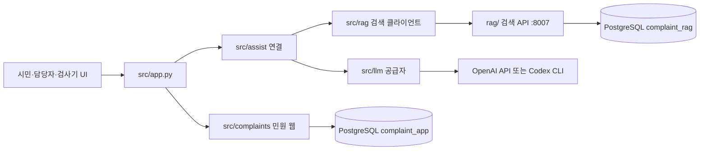

# 민원 웹·RAG·LLM 백엔드

프로젝트 루트의 `src/`는 Flask 시연 서버와 응대 계층이다. 민원 웹(`complaints`), 검색 클라이언트(`rag`), LLM 공급자(`llm`), 둘을 잇는 응대(`assist`)로 나눈다. 시민·담당자 UI와 API, Swagger는 같은 출처에서 제공한다. 민원·추가 문의·초안·게시 답변·시연 작업 이벤트는 PostgreSQL `complaint_app`에 저장한다. 검색 색인·임베딩 엔진은 루트 `rag/`와 `complaint_rag`에 있고 `src/rag`는 그 API만 호출한다.

## 설치와 실행

저장소 루트에서 Python 3.12로 실행한다. 기존 RAG 추론 가상환경·DB·모델을 변경하지 않는다. Docker가 필요 없다.

```powershell
py -3.12 -m venv .venv-web
.\.venv-web\Scripts\python.exe -m pip install -r src/requirements-dev.txt

# 선택 사항: 비어 있는 업무 DB에 개인정보 없는 합성 민원 24건 생성
.\.venv-web\Scripts\python.exe -m flask --app src:create_app seed-demo

# 선택 사항: db/공개_민원_사례.json·db/자주_묻는_민원.json에서 마스킹한 시연 민원 56건 생성(여러 번 실행해도 중복 없음)
.\.venv-web\Scripts\python.exe -m flask --app src:create_app seed-public-demo

.\.venv-web\Scripts\python.exe -m src
```

Windows에서는 저장소 루트의 [`웹-시작.cmd`](../웹-시작.cmd)를 더블클릭하거나 명령 프롬프트에서 실행할 수 있다. 이 스크립트는 [`scripts/웹_시작.py`](../scripts/웹_시작.py)로 `.venv-web`을 확인하고 Flask 서버를 별도 창에서 시작한 뒤, `/api/v1/health`가 준비되면 기본 브라우저에서 시민 화면을 연다. 서버가 이미 실행 중이면 새 서버를 만들지 않고 기존 주소를 연다. `COMPLAINT_PORT`를 설정했다면 그 포트로 확인·실행한다. Flask 자식 환경에는 Windows libpq 기본값(`PGHOST`·`PGDATABASE=complaints_native`)을 채운다.

한 문장의 임베딩과 pgvector 이웃은 [`문장-임베딩.cmd`](../문장-임베딩.cmd)다. RAG `.venv`의 현재 프로필로 벡터를 만든 뒤 FAQ·공개 사례를 따로 조회하고, `--raw`는 숫자만 출력한다. 검색 API·LLM은 쓰지 않는다. [`민원-응대.cmd`](../민원-응대.cmd)로 민원 문장을 넣어 RAG+LLM 응대를 볼 수 있다. 구현은 [`scripts/민원_응대.py`](../scripts/민원_응대.py)다. Windows에서 PostgreSQL과 검색 API를 다시 켜려면 [`검색-시작.cmd`](../검색-시작.cmd)다. 새 콘솔 기동·포트 확인은 [`scripts/콘솔_기동.py`](../scripts/콘솔_기동.py)를 공유한다. localhost 검색 API가 꺼져 있으면 별도 창에서 `python -m rag serve`를 시작하고 health ready를 기다린다. 원격 주소는 자동 시작하지 않으며 `--no-start`로 끌 수 있다. 검색 실행 파일은 `RAG_PYTHON` 또는 `.venv`이고, Flask용 `.venv-web`은 FastAPI·uvicorn이 있을 때만 쓴다. 기본 임베딩은 CPU용 `dragonkue/multilingual-e5-small-ko`이며 이전 intfloat 색인은 `RAG_EMBEDDING_PROFILE=e5-small`, BGE-M3 dump는 `bge-m3`다. [CASE-035](../docs/cases/사례-035-응대-CMD-검색API-자동시작-2026-11-05.md) · [CASE-036](../docs/cases/사례-036-Windows-RAG-PostgreSQL-로컬기동-2026-11-05.md)

실행 의존성만 설치하려면 `src/requirements.txt`를 사용한다. Linux에서는 `python3.12 -m venv .venv-web`로 준비하고 `.venv-web/bin/python`을 사용한다. 환경 준비 후 `npm --prefix ui run dev`도 같은 Flask 서버를 실행하는 편의 명령이다.

| 주소 | 제공 내용 |
| --- | --- |
| http://127.0.0.1:5000/#/citizen | 시민 사이트 |
| http://127.0.0.1:5000/#/staff | 담당자 사이트 |
| http://127.0.0.1:5000/#/lab | RAG·LLM 응대 검사기 · 민원 CRUD와 분리 |
| http://127.0.0.1:5000/docs | Swagger UI · `/swagger`도 동일. 인쇄본 [Swagger PDF](../docs/청주톡톡_민원_업무_API_Swagger.pdf) |
| http://127.0.0.1:5000/openapi/openapi.json | 자동 생성 OpenAPI 3.1 · `/openapi.json`은 이 주소로 이동 |
| http://127.0.0.1:5000/api/v1/health | 상태·저장 방식·실제 AI 연결 여부 |

Swagger의 `POST /api/v1/session`에서 `{"role":"citizen"}` 또는 `{"role":"staff"}`를 실행한 뒤 필요한 API를 호출한다. 보고용 인쇄본은 [Swagger PDF](../docs/청주톡톡_민원_업무_API_Swagger.pdf)이며, OpenAPI가 바뀌면 저장소 루트에서 `python docs/tools/export_swagger_pdf.py`로 다시 만든다. 검색 API `:8007/docs`는 이 파일에 넣지 않는다. 같은 출처의 서명 세션 쿠키가 요청에 전달된다. UI 상단 역할 선택도 같은 API를 사용한다. 시민·담당자 탭이 같은 쿠키를 공유하므로 역할을 바꾼 뒤 이전 탭을 사용할 때는 해당 화면을 다시 불러온다.

## 정적 타입과 구성

백엔드는 민원 웹, RAG 검색 클라이언트, LLM 공급자, 둘을 잇는 응대 계층으로 나눈다. 루트 `rag/`는 PostgreSQL 색인·임베딩 엔진이고, `src/rag`는 그 검색 API를 호출하는 클라이언트다. 민원 `complaint_app`과 검색 `complaint_rag`는 섞지 않는다. [CASE-026](../docs/cases/사례-026-백엔드-민원웹-RAG-LLM-분리-2026-11-05.md) · [CASE-031](../docs/cases/사례-031-업무저장-PostgreSQL-통일-2026-11-05.md)



읽을 때는 `app.py → complaints/api.py → complaints/service.py → complaints/repository.py` 순서로 따라가면 된다. 검사기 경로는 `assist/pipeline.py`가 `rag` 다음에 `llm`을 호출한다. 검색 히트는 `search_parts`로 한 번 꺼내고, 환경 LLM은 `llm_settings()`를 요청당 한 번 읽는다. JSON HTTP는 `src.rag.http.http_json`을 검색과 LLM이 같이 쓴다. 민원 웹 모듈은 `src.complaints`에서 직접 import한다.

| 위치 | 책임·타입 경계 |
| --- | --- |
| `complaints/` | 민원 CRUD, 시연 세션, 정적 UI, Swagger. `pages.py`는 시민·담당자 화면 |
| `rag/` | 검색 API 클라이언트, `retrieval_only`/`requires_gate` 계약, FAQ·사례 근거 |
| `llm/` | `openai_api`·`codex_cli`·`legacy` 공급자, 설정·완성 호출 |
| `assist/` | RAG와 LLM을 잇는 판정·정책 검사·조건부 FAQ 생성. 민원을 저장하지 않음. 시스템 접두는 [prompts](../docs/harness/prompts/README.md), 계약은 [완충지대 하네스](../docs/harness/LLM_완충지대_하네스.md) |
| `app.py` | 설정 → 저장소 → 서비스 → 공통 처리·API·화면 등록 |
| `tests/test_api.py` | 격리 DB의 API·권한·게시·경쟁·영속화·OpenAPI 회귀 |
| `tests/test_assist_api.py` | 검사기 세션 생략·응답 계약·health 플래그 |
| `tests/test_backend_split.py` | 패키지 분리와 연결 계층 단위 시험 |

모든 서버 함수에는 타입 힌트를 적용했다. `Any`나 `type: ignore`로 업무 코드 검사를 우회하지 않고 `mypy --strict`를 통과시켰다. 동적 입력은 Pydantic에서 검증한 뒤 구체 타입으로 서비스에 전달하며, DB 재조회 결과도 모델로 재검증한다. Python 타입 힌트의 정적 검사와 실행 시 검증은 별개다.

코드 형식은 개발 의존성에 포함한 Black으로 정리한다. 저장소 루트에서 `python -m black --check src`로 형식을 확인하고, 수정 시에는 같은 가상환경에서 `python -m black src`를 실행한다. 한국어 Google 형식 docstring과 타입 힌트는 유지한다. [구조 정리 기록](../docs/cases/사례-021-Flask-서버-코드-구조-간소화-2026-10-31.md) · [패키지 분리](../docs/cases/사례-026-백엔드-민원웹-RAG-LLM-분리-2026-11-05.md) · [README·검색 조각](../docs/cases/사례-028-README-디자인과-검색조각-최적화-2026-11-05.md)

앱 팩토리는 [Flask 공식 안내](https://flask.palletsprojects.com/en/stable/patterns/appfactories/)를 따랐다. 요청·응답 모델과 자동 문서는 [flask-openapi3 요청 선언](https://luolingchun.github.io/flask-openapi/v4.x/Usage/Request/) 및 [응답 검증](https://luolingchun.github.io/flask-openapi/v4.x/Usage/Response/) 기능을 사용한다. Swagger JS·CSS는 설치 패키지의 로컬 자산으로 제공한다.

## API 계약

JSON 필드는 기본적으로 camelCase다. 경로 이름 `complaint_id`와 쿼리 이름은 문서 그대로 사용한다. 불필요한 필드·허용 목록 밖 상태를 거부하며, 작성자·AI 기원·업무 상태를 클라이언트가 임의 지정하지 못한다.

| 메서드·경로 (`/api/v1` 기준) | 권한·기능 |
| --- | --- |
| `GET /health` | 공개 서버 상태. `assistSearch`·`assistLlm`은 검색 API·LLM 토큰 여부. `aiConnected`는 민원 CRUD AI 미연결 |
| `GET /assist/examples` | 검사기 고정 예시. 세션 불필요 |
| `POST /assist` | 검색+판정+정책 검사. 세션 불필요. 민원 저장 없음 |
| `POST /assist/stream` | 같은 파이프라인의 짧은 진행 안내 NDJSON. 세션 불필요 |
| `POST /session`, `GET /session`, `DELETE /session` | 시연 계정 선택·조회·종료 |
| `GET /workspace` | 역할별 로컬 UI 전체 스냅샷 |
| `GET /complaints` | 공개 범위 적용 후 검색·페이지 목록 |
| `POST /complaints` | 시민 등록, `Idempotency-Key` 지원 |
| `GET /complaints/{complaint_id}` | 허용된 상세만 조회 |
| `PUT /complaints/{complaint_id}` | 게시 전 본인 원문 수정 |
| `DELETE /complaints/{complaint_id}` | 본인 글 논리 철회와 사유 저장 |
| `POST /complaints/{complaint_id}/messages` | 본인 추가 문의·검토 재개 |
| `POST /complaints/{complaint_id}/review` | 본인 재검토 요청 |
| `PUT /complaints/{complaint_id}/assignment` | 담당자 지정·해제 |
| `PUT /complaints/{complaint_id}/draft` | 담당자 초안·편집 이력 저장 |
| `POST /complaints/{complaint_id}/publish` | 담당자 답변 게시·기원 판별 |
| `POST /complaints/{complaint_id}/retract` | 담당자 게시본 철회·이력 보존 |
| `POST /complaints/{complaint_id}/jobs` | 담당자 서버 단계 시연 시작 |
| `POST /complaints/{complaint_id}/jobs/cancel` | 담당자 단계 시연 취소 |

등록 본문 예시:

```json
{
  "title": "보행로 시설 점검 요청",
  "body": "화면 검증을 위해 만든 합성 민원입니다. 보행로 시설 점검과 검토 결과 안내를 요청합니다.",
  "category": "도로·교통",
  "district": "흥덕구",
  "visibility": "private"
}
```

제목 1~120자, 원문 10~2,000자, 답변 1~4,000자, 사유 1~200자다. 공백만 있는 입력을 거부한다. 기존 민원을 바꾸는 요청에는 조회한 `version` 정수가 필수다. 답변 저장·게시는 `version`, `text`, `reason`을 보낸다. 서버는 `409 version_conflict`로 오래된 저장을 거부하며 UI는 편집 입력을 유지한다. 같은 등록 키와 같은 원문을 재전송하면 같은 민원을 반환하고, 같은 키에 다른 원문은 409로 거부한다.

목록은 `q`, `status`, `district`, `category`, `mine`, `assign`, `page`, `limit`를 지원한다. 기본 8건, 최대 100건이며 시민 건수에서도 다른 사람의 비공개 글과 철회 글을 제외한다. UI는 소규모 로컬 시연을 위해 `/workspace`를 읽어 화면 필터·집계를 구성한다. 대규모 운영에서는 전체 스냅샷 대신 페이지 API·서버 집계로 전환해야 한다.

오류 응답은 `{"code":"version_conflict","message":"…"}` 형식이다. 미인증 401, 역할 위반 403, 없는 글·열람 불가 404, 버전·상태·등록 키 충돌 409, 입력 검증 422를 구분한다. 손상 JSON은 400, 64 KiB 본문 한도 초과는 413이다. 입력 오류 응답에 민원 원문을 반사하지 않는다.

## 데이터·게시·작업 경계

- 기본 업무 DB: 같은 PostgreSQL의 `complaint_app` 스키마. 민원 상태·답변 버전·작업을 jsonb `payload`로 저장하는 `complaints`와 등록 키 `idempotency`다. 상태·담당자·공개 범위·지역·시연 표시는 payload에서 계산하는 생성 칼럼이며, 상태·공개 범위·지역은 CHECK로 검사한다. 구조 전체는 [업무 DB 실행 설계](../docs/harness/업무DB_실행설계.md)를 따른다. 변경·버전 검사와 등록 중복 방지는 트랜잭션 안에서 수행한다. 검색 색인 `complaint_rag`와 테이블을 섞지 않는다. [스키마](complaints/schema/complaint_app.sql)
- 2026-10-30 설계의 7개 정규화 테이블은 미채택 초안이다([기준일 표기](../plan/db%20설계%201차/2026-10-30/README.md)). 현재 Flask 계약은 문서 jsonb다. [CASE-031](../docs/cases/사례-031-업무저장-PostgreSQL-통일-2026-11-05.md)
- 초안·AI 원본·후보·담당자 편집 이력·내부 작업은 담당자 응답에만 들어간다. 시민 목록·상세·스냅샷에서는 응답 전용 모델로 제거한다. 초안 저장 자체의 내부 이력도 시민에게 반환하지 않는다.
- 본문 수정·추가 문의·철회·게시·재검토는 맥락 버전을 증가시킨다. 실행 중인 기존 작업은 무효화한다. 시연 작업은 후보만 별도로 저장하고 사람의 편집본·게시본을 자동 교체하지 않는다.
- AI 완료·답변 게시·민원 상태는 구분한다. 새 민원은 실제 AI 미연동 대기 상태이며 저장 성공을 AI 성공으로 표시하지 않는다. 서버 단계 시연은 조회 시 경과 시간에 맞춰 이벤트를 저장하고 UI가 1.5초 간격으로 조회한다. 실제 추론·백그라운드 작업자·SSE가 아니다.
- 기존 브라우저 `cheongju-ui-v1` 자료는 보존하며 서버로 자동 업로드하지 않는다. 신규 업무 저장은 API만 사용한다. `sessionStorage`에는 작성 전 임시 입력만 남긴다.

## 설정·검증·남은 범위

| 환경 변수 | 기본 동작 |
| --- | --- |
| `COMPLAINT_PORT` | `5000`, localhost에만 바인딩 |
| `RAG_API_URL` | 검색 API, 기본 `http://127.0.0.1:8007` |
| `RAG_PYTHON` | `민원-응대.cmd`가 검색 서버를 띄울 Python. 없으면 `.venv` |
| `RAG_SERVE_WAIT_SECONDS` | 검색 API 준비 대기, 기본 180 |
| `COMPLAINT_LLM_PROVIDER` | `openai_api`, `codex_cli`, 또는 기존 호환용 `legacy`(기본값) |
| `OPENAI_API_KEY` | `openai_api` 선택 시 OpenAI API 키. `.env`에만 보관 |
| `COMPLAINT_LLM_MODEL` · `COMPLAINT_LLM_REASONING_EFFORT` | 기본 `gpt-6-luna` · `medium` |
| `COMPLAINT_CODEX_COMMAND` | `codex_cli` 선택 시 Codex CLI 실행 파일, 기본 `codex` |
| `COMPLAINT_LLM_TOKEN` / `PUBLIC_LLM_TOKEN` / `XAI_API_KEY` | `legacy` 선택 시 기존 호환 LLM. 없으면 검색 후 담당자 검토 |
| `COMPLAINT_LLM_URL` · `COMPLAINT_LLM_MODEL` | OpenAI 호환 주소와 모델 이름 |
| `COMPLAINT_DATABASE_URL` | 비면 libpq `PG*` 환경변수. 같은 서버의 `complaint_app` |
| `COMPLAINT_APP_SCHEMA` | `complaint_app` |
| `COMPLAINT_SECRET_KEY` | 미지정 시 `.web-data/session.key`에 생성·보존, 로그·Git에서 제외 |
| `COMPLAINT_DEMO_LOGIN` | `1`, `0`이면 시연 계정 선택 거부 |
| `COMPLAINT_PYTHON` | npm 실행기에 사용할 Python 실행 파일 선택 |

저장소 루트 `.env`에서 공급자와 키를 읽습니다. 예시는 [`.env.example`](../.env.example)입니다.
`COMPLAINT_LLM_PROVIDER=openai_api`이면 `OPENAI_API_KEY`로 Responses API의 `gpt-6-luna`·`medium`을
요청합니다. `codex_cli`이면 로그인된 Codex CLI를 읽기 전용 임시 작업공간에서 `codex exec -`로 실행하고
긴 프롬프트는 표준 입력으로 보냅니다. Windows npm `codex.cmd`는 `cmd.exe` 제한을 피하려고 `node`와 `codex.js`로
풀어 실행합니다. `OPENAI_API_KEY`를 하위 프로세스에 전달하지 않습니다. Codex에는 `search_complaint_rag` MCP만 붙이며, 사용자 설정의 다른 MCP는 `--ignore-user-config`로 읽지 않습니다. 업무 저장소는 시작 때 `complaint_app.complaints.version`이 없으면 채웁니다. 키를 바꾼 뒤에는 `민원-응대.cmd`와 Flask를
다시 실행합니다. 두 방식 모두 민원 CRUD와 분리된 응대 검사기에만 적용되고, 검색
`retrieval_only=true`·`decision="requires_gate"` 및 코드 정책 검증 계약은 그대로 유지합니다.
시스템 지시와 민원·검색 후보 JSON은 분리합니다. 계층형 프리픽스 캐싱 적용은
[지침](../docs/harness/시스템_프롬프트와_프리픽스_캐싱_지침.md)의 후속입니다.

```powershell
.\.venv-web\Scripts\python.exe -m mypy --config-file src/mypy.ini
.\.venv-web\Scripts\python.exe -m pytest src/tests -q -p no:cacheprovider
npm --prefix ui run check
npm --prefix ui test
```

2026-11-05 Windows / Python 3.12.10 `.venv-web`에서 `pytest rag/tests/test_assist.py src/tests` 41개, `mypy --config-file src/mypy.ini`, `black --check src rag/assist.py`를 통과했다. 백엔드 패키지 분리와 검색 조각 재사용 시험을 포함한다. [CASE-026](../docs/cases/사례-026-백엔드-민원웹-RAG-LLM-분리-2026-11-05.md) · [CASE-028](../docs/cases/사례-028-README-디자인과-검색조각-최적화-2026-11-05.md)

2026-10-31 Windows / Python 3.12에서 당시 서버 파일 10개 엄격한 타입 검사, API 회귀 18개, JS 문법 검사와 API 클라이언트 회귀 3개를 통과했다. OpenAPI 문서는 규격 검증도 수행했다. 실제 브라우저 검증과 한계는 [CASE-014](../docs/cases/사례-014-Flask-업무서버와-Swagger-구현-2026-10-31.md)에 기록한다.

**미구현:** 운영용 본인인증·담당자 인증, 7테이블 정규화 이관, 민원 CRUD의 실제 LLM 연결·작업자·SSE, 파일 첨부, 공식 행정 접수·외부 이관, 운영 배포. 응대 검사기의 GPT-6 Luna API·Codex CLI 어댑터는 구현됐지만 운영 자격 증명·사용량 관리·실측 평가는 후속이다. 역할 선택은 로컬 시연이며 운영용 권한 부여 수단이 아니다. 권한 있는 담당자 복구와 실제 보존 기간 정책은 후속 구현이다.
